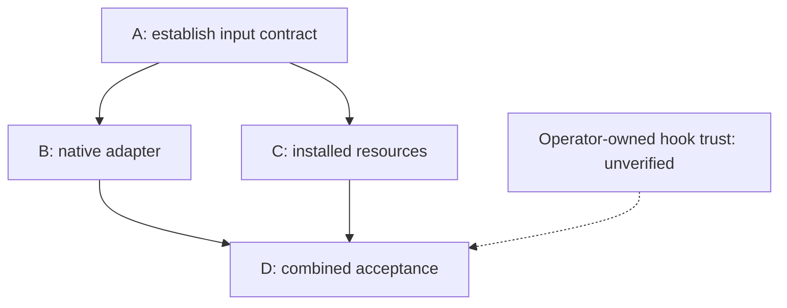
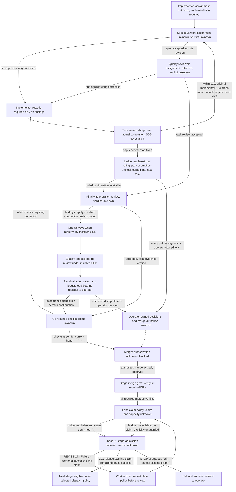

# Output format — `/pipeline <umbrella>` inline session report

> **Authoritative for:** the 3-layer structure shape emitted by `/pipeline <umbrella>` invocations — §1 grammar, §2 dependency-graph template, §3 action-queue template, §4 1-liner block grammar, §5 four worked examples (Mode A / SDD / Mode B × N / Queue mode), §6 anti-patterns for 1-liner format, §9 dispatch-chip contract (incl. the channel order: aif auto-dispatch before any chip), §9A launch card (plain-words-recap-v2 D7). Principle 18 (`packages/core/principles/18-meta-orchestrator-output-format.test.ts`) checks source-template substrings; it does not validate an actual emitted report. Empty/0 final-artifact grammar is checked by `../helpers/check-final-report.mjs`.
> **NOT authoritative for:** project goal — see [`../../../../README.md#why-this-exists`](../../../../README.md#why-this-exists). The `/pipeline` skill body authority — see [`../SKILL.md`](../SKILL.md).

> **Origin:** F.3 (2026-05-24). The 3-layer structure synthesises F.1 prior-art (PR #203) — Argo Workflows' `├── / └──` ASCII tree (ADAPT vocabulary, SSOT row TBA) + maintainer's binding 1-liner format refinement (parent kickoff §1 Sub-wave F.3 lines 237-254). The slash-tag draft (`/Mode-A /Roles-… /Skills-…`) was rated «not convenient» by the maintainer and has zero upstream precedent across 10 surveyed tools (GHA, Concourse, Argo, Dagger, just, LangGraph, Cline, Superpowers, gh workflow run, orchestrator-guide).

---

## §1 Top-level shape

Every `/pipeline <umbrella>` invocation that proceeds to dispatch (i.e. plan-currency check returned «Plan is current», priority chose a winner, kickoff loaded) emits one **inline session report** in this exact shape:

```text
═══════════════════════════════════════════════════════════════
EXECUTION PLAN — <umbrella> (<YYYY-MM-DD>)
═══════════════════════════════════════════════════════════════

## Dependency graph

<Stage tree — §2>

## Action queue — what you do next

<5-column table — §3>

## 1-liner blocks (copy ONE block = ONE new CC session)

### Stage 1 — <name> (<Mode>, ~<cost>)

**What it does:** <1-2 sentences plain language — what this fresh CC-session will do; what it will NOT do if scope is narrow>
**Deliverable:** <concrete artefact — file path / PR shape / verdict tag>
**Why now:** <why this stage at this moment — what gate it opens / what trap it counters / what dependency admitted it>

<1-liner — §4>

### Stage 2 — <name> (<Mode>, ~<cost>)

**What it does:** <…>
**Deliverable:** <…>
**Why now:** <…>

<1-liner — §4>

[...]
═══════════════════════════════════════════════════════════════
```

### Native diagram presentation

Under `## Dependency graph`, render a fenced `mermaid` flowchart when the surface
supports inline diagrams (including Codex desktop). Keep the compact text edges with
`↓` immediately below it so Claude Code/CLI/plain-text readers have the same plan.
The surface decides rendering capability; a provider or model name does not.
Draw only dependencies verified in the selected plan or kickoff. Label unknown
status as unknown and identify the source of a blocker; never infer a running worker,
completed review or merge permission from a diagram. Show independent stages as
parallel branches only when the plan explicitly establishes parallel safety and
isolation; absent dependency edges alone do not prove that safety. Label unknown
parallel safety as unknown. Keep the action queue authoritative for what is launchable now.
Keep two views separate: the selected plan's dependency graph and the applicable
role/gate lifecycle. The latter describes policy, not an observed execution.
For each role, identify its assignment or `unassigned/unknown`; for each gate,
give `required`, `passed`, `failed`, or `unknown`, with the artifact/head, source
and observation time supporting a claimed result. `Required` is a policy obligation,
not evidence of a completed gate. An unavailable probe remains `unknown`.
The existing dispatch, review, rework and merge policies are unchanged.

Example only — these names and relationships are supplied fixture inputs, not live status:



Text fallback: A ↓ B and C (parallel); B + C ↓ D. D also requires verified
operator-owned hook trust. This example does not grant that trust.

**Role/gate lifecycle — policy-derived example, not a live run:** use the selected
mode's protocol. SDD implementation and its spec/code-quality review loops belong
to the invoked `superpowers:subagent-driven-development` procedure, selected by
[dispatch §5](dispatch.md). Separate spec/quality nodes below are the framework's
role and acceptance vocabulary, not a certification of the companion's seat topology.
Read the actual installed companion: its task decomposition, combined task-review
seats, correction/re-review sequencing and required final whole-branch review govern
execution. Do not turn two acceptance labels into extra reviewer sessions or omit
the final branch review. Reviewer findings and operator strategy forks retain
[reviewer discipline](../../../rules/reviewer-discipline.md). Verification evidence
belongs to [orchestrator acceptance Phase 4/4.5](../../orchestrator/references/acceptance.md);
the authorized chip recipe's CI/merge mechanics belong to
[its scoped template](../../orchestrator/references/chip-worker-template.md), when
that factory mode actually applies. These references grant no new dispatch,
push, merge or factory authorization.



Text fallback: implementer ↓ spec review (correction ↓ implementer ↓ repeat review)
↓ quality review (correction ↓ implementer ↓ repeat affected reviews) ↓ required
final whole-branch review. Final findings follow the applicable installed companion's
bounded fix/re-review and residual adjudication, before verified local evidence,
current-head CI and separately authorized observed merge. For installed SDD 6.4.2,
that means ONE fix subagent with all final findings, exactly one scoped re-review,
then residual rulings/ledger and operator escalation for remaining load-bearing
findings; there is no second final fix wave or infinite return to broad review.
The separate task-review loop is also finite: the selected SDD 6.4.2 companion
allows five fix rounds per task, each one fix dispatch plus one scoped re-review.
Resume the original implementer in rounds 1–3; if the harness cannot resume, carry
the brief, report and findings into a fresh implementer. In rounds 4–5 use a fresh
implementer on a more capable model within actual authorization. At the cap stop
fix dispatch, ledger every adjudication and park contestable/nondependent residuals
with a ruling. For a real load-bearing residual, rule on the smallest unblock and
carry it into the next task's dispatch; stop when every path forward is a guess,
and surface operator-owned strategy decisions. Read the actually
selected companion before applying this policy to another version. A final branch
review cap does not substitute for the task-review cap.
When those steps are required, show both findings and accepted branches in Mermaid
and this text fallback. No finding, ruling or operator authorization is invented. These are acceptance labels; the installed companion
owns the actual reviewer seats and loops.
Then all required PR merges ↓ claim policy ↓ Phase -1 stage-admission review;
REVISE/RED ↓ cancel existing claim ↓ worker fixes ↓ fresh claim policy ↓ repeat
Phase -1, GO ↓ release existing claim ↓ remaining dispatch gates, STOP or strategy
fork ↓ cancel existing claim ↓ operator decision. An unavailable bridge claims
nothing: record the review as unguarded, not as a successful claim. A paused claim
does not prove free capacity. Apply [dispatch §6–§7](dispatch.md) and
[claim machinery](claim-machinery.md); neither this diagram nor an unguarded review
creates authorization. Dispatch §6–§7 places Phase -1
**after** the confirmed stage merges; it is not the pre-merge spec/quality review.
CI can run earlier, concurrently or again; the diagram presents logical acceptance
conditions and corrective loops, not a replacement execution order. Unknown
ownership, verdict, CI, trust, permission or merge state cannot become an active
worker, passed gate, `NOW` queue row or authorized transition. Include a source-backed
observed-status table beside the policy diagram; leave unsupported cells unknown.
For an informational no-arg overview, these remain explanatory requirements;
no worker is launched and no per-stage dispatch block is added.

The three layers (`## Dependency graph` / `## Action queue` / `### Stage N` blocks) are **mandatory** — principle 18 fails if any of the literal headings or the column substrings (§3) is missing from this file.

**Description block (3 lines `What it does / Deliverable / Why now`) is mandatory above every `<1-liner>`** — see §4.1 below for rationale + falsifiers. The block is not principle-18-checked (per maintainer scope decision 2026-05-25, Option A); enforcement is prose-discipline at session time. The block exists because `### Stage X — name (Mode, cost)` heading answers «how» but not «what / why now»; without it the receiving fresh CC-session can be pasted without the maintainer-reader understanding what they just dispatched.

---

## §1A No-arg overview format

For no-arg, `0`, and top-N overview output, read the complete binding
[overview grammar](output-overview.md) before rendering. All source reconciliation,
acceptance verification and fidelity requirements remain mandatory.

---

## §1B Named-dispatch compact format (pipeline-ux Stage 2)

> **Origin:** pipeline-ux Stage 2 (2026-06-04). Operator feedback: "why so much text". The live run produced walls of per-step narration on every `/pipeline <umbrella>` invocation.

Emitted by `/pipeline <umbrella>` (string arg). Same 3-layer structure as §1 but **bounded to ≤~15 visible lines**: dep-graph + action-queue + 1-liner blocks WITHOUT the verbose 3-line `What it does / Deliverable / Why now` description block per stage. Description blocks are optional in named-dispatch mode — the operator already selected the umbrella.

**Rule:** drop per-step §2.5 narration (plan-currency annotation, priority scoring trace, classify-work output) from the session report. Emit result only. Keep `## Dependency graph` / `↓` / `## Action queue` / `### Stage` structure — principle 18 anchors must remain.

```text
═══════════════════════════════════════════════════════════════
EXECUTION PLAN — <umbrella> (<YYYY-MM-DD>)
═══════════════════════════════════════════════════════════════

## Dependency graph

├── Stage 1 — <name>   (<Mode>, ~<cost>)
│
↓
└── Stage 2 — <name>   (<Mode>, ~<cost>)

## Action queue — what you do next

| Paste into a new CC tab | When | Waiting on | Can parallel with |
|---|---|---|---|
| `<1-liner Stage 1>` | now | — | nothing |

### Stage 1 — <name> (<Mode>, ~<cost>)

`<1-liner>` ← paste this into a new CC tab

═══════════════════════════════════════════════════════════════
```

**Coexistence:** §1B does not replace §1. Full §1 format (with description blocks) is used when emitting for the first time or when the operator explicitly requested detail. §1B is the default for re-invocations and follow-up dispatches where context is already established.

**Falsifiers:** wrong if §1B output exceeds ~15 lines for a 2-stage umbrella; wrong if any of the 6 principle-18 substrings (`## Dependency graph` / `↓` / `## Action queue` / `Paste into a new CC tab` / `Can parallel with` / `### Stage`) is absent from the §1B skeleton above.

## §1C Status format (beta-delivery-ux S2, A5)

> **Origin:** beta-delivery-ux S2 (2026-08-08). Spec: [2026-07-23-beta-program-design.md §4 A5](../../../../docs/superpowers/specs/2026-07-23-beta-program-design.md). Read-only, three-section, no persistent state, NOT a dashboard.

Emitted by `/pipeline status`. The status verb does NOT enter the §1 dispatch tree — it short-circuits to a read-only render against live bricks.

```text
## Pipeline status

### In-factory
  <running aif tasks + their state — from bridge REST /health + /tasks>
  (or: "(bridge unreachable at <url>)" — designed degradation)

### Parked questions
  <each parked task + its fork — from questions.ts --json>
  (or: "(no parked questions)" — designed degradation)

### Ready-to-harvest + PR state
  <open PRs + mergeable state — from gh pr list>
  (or: "(no open PRs)" / "(gh unavailable)" — designed degradation)

### Suggested next
→ next: <suggested command 1>
→ next: <suggested command 2 — optional>
```

**Rules:**

- Each section degrades **independently** — an unreachable bridge does NOT block parked-questions or PR sections.
- Exit code is 0 unless the renderer itself crashes; degraded sections are a **designed success path** (§3 spec).
- 1-3 suggested-next lines tail the output (clig.dev «suggest what to run next»).
- No persistent state, no refresh loop, no TUI. One-shot read + print.

**Falsifiers:** wrong if any section is silently elided (each MUST appear, even in degraded form); wrong if the renderer exits non-zero on a missing brick; wrong if the output omits the `### Suggested next` tail.

**See also:** [`helpers/render-status.sh`](../helpers/render-status.sh) — the renderer. [`SKILL.md §2.6`](../SKILL.md) — invocation point.

---

## §2 Dependency graph

ADAPTed from Argo Workflows' CLI tree (F.1 §A.1 Candidate 3). Prospective (shows WILL run), not retrospective (which is what Argo shows during execution).

**Symbols:**

- `├──` — sibling node (parallel-safe with other `├──` / `└──` at same indent)
- `└──` — last sibling at this indent
- `↓` — inter-stage dependency edge (Stage N → Stage N+1)
- `PARALLEL-OK ↔` (optional inline annotation) — explicit parallel marker between sibling sub-waves at the same stage

**Template:**

```text
Stage 1 — NOW:
├── Sub-wave A   (Mode A, ~30k, read-only)
└── Sub-wave B   (Mode A, ~30k, read-only)
                                  ↓
Stage 2 — after Stage 1 merges:
├── Sub-wave C   (Mode A, ~40k)   PARALLEL-OK ↔
└── Sub-wave D   (Mode B × 3, ~120k)
                                  ↓
Stage 3 — after Stage 2 merges:
└── Sub-wave E   (Mode A, ~30k)
```

**Conventions:**

- One stage header per stage with descriptive label («NOW» / «after Stage N merges» / «after maintainer GO»).
- Each sub-wave bullet carries the Mode + cost estimate + role hint in parentheses.
- `↓` arrow alone on a line communicates the inter-stage edge.
- Single-sub-wave stages use `└──` only (no `├──`).
- Stages where execution depends on a maintainer DECISION rather than just a merge get the label «after maintainer DECISION on <fork>».

---

## §3 Action queue

5-column markdown table mapping each Stage's 1-liner block to a row. The `Can parallel with` column is a genuine BUILD contribution — no upstream renders static parallel-safety; F.1 §A.4 Q3 documents the gap (all CI tools show parallelism dynamically during execution, not statically in a plan).

**Required columns** (principle 18 grep-checks these column-header substrings):

| #   | Paste into a new CC tab | When                 | Waiting on    | Can parallel with        |
| --- | ----------------------- | -------------------- | ------------- | ------------------------ |
| 1   | Stage 1 block below     | Now                  | —             | Stage 1 sibling (if any) |
| 2   | Stage 2 block below     | After Stage 1 merges | <PR# / event> | Stage 2 sibling (if any) |
| 3   | …                       | …                    | …             | …                        |

Tail line below the table:

```text
Total pastes: <N> (depends on <conditions>; max=<M> if all GO).
```

---

## §4 1-liner block grammar

Exactly one block per stage. Maintainer pastes the entire block into a fresh CC session.

**Grammar:**

```text
/orchestrator <umbrella-name> §<section-anchor> — <natural-language payload>, rest in kickoff
```

**Tokens:**

- `/orchestrator` — deterministic CC slash-command routing token. Activates `.claude/skills/orchestrator/SKILL.md`.
- `<umbrella-name>` — kebab-case identifier matching the kickoff directory `.claude/orchestrator-prompts/<umbrella-name>/kickoff.md`.
- `§<section-anchor>` — exact section header from the kickoff (e.g. `§1`, `§4 Stage 1`, `§1 Sub-wave F.3`).
- `— <natural-language payload>` — free-form description naming Mode/role/autonomous?/iterative-review-status. The global `orchestrator` skill parses this as natural language, NOT as `--flag=value` args.
- `, rest in kickoff` — closing token instructing the receiving session to read the kickoff at the anchor for acceptance criteria, T-traps, skills, stop conditions, etc.

**Why this shape (F.1 evidence):**

- 10 mature tools surveyed (GHA, Concourse, Argo, Dagger, just, LangGraph, Cline, Superpowers, `gh workflow run`, chat-orchestrator pattern article) — all converge on `/<command> <natural-language-payload>` for chat-medium dispatch. None use `/Flag-Value /Flag-Value …` shape.
- Maintainer (2026-05-24) explicitly rated the earlier `/Mode-A /Roles-worker /Skills-foo /Autonomous-yes /Iterative-review-no` draft «not a convenient format, I don't like it».
- The orchestrator skill at `.claude/skills/orchestrator/SKILL.md` parses natural-language payload (no structured-args parser).

## §4.1 Description block above each 1-liner (mandatory, prose-discipline)

> **Origin:** 2026-05-25 maintainer feedback («Why is there no description of what each one does? … shouldn't the meta-orchestrator prompts include descriptions»). Spec gap identified post-F.3-ship: §1 template + §5 examples produced heading + 1-liner with no plain-language context, which is paste-able but not _reader-comprehensible_ without opening the kickoff. Maintainer chose **Option A** (template + examples patch, no principle 18 extension) over Option B (mechanical gate via `**What it does:**` substring grep).

Every `### Stage X — <name> (<Mode>, <cost>)` heading MUST be followed by a 3-line description block BEFORE the `/orchestrator …` 1-liner:

```text
### Stage X — <name> (<Mode>, <cost>)

**What it does:** <1-2 sentences plain language — what the fresh CC-session will do; what it explicitly will NOT do if scope is narrow>
**Deliverable:** <concrete artefact — file path / PR shape / verdict tag / data point captured>
**Why now:** <why this stage at this moment — what gate it opens / what trap it counters / what dependency admitted it>

/orchestrator <umbrella> §<anchor> — <NL payload>, rest in kickoff
```

**Why this block is load-bearing:**

- `/pipeline`'s entire purpose is to dispatch _fresh CC-sessions without the maintainer's current session context_. Each paste = one autonomous world. The 1-liner starts with `/orchestrator` and is optimised for the **receiving** session (it re-reads kickoff). The description block is optimised for the **maintainer-reader who must decide whether to paste**.
- Without the block, the reader must open `kickoff.md §<anchor>` to learn what the dispatched session will produce — which defeats the one-message-one-session pattern.
- `### Stage X — <name> (<Mode>, <cost>)` heading answers «**how** big / **what** mode» — not «**what** the work is / **why** now». The three triplet fields close that gap.

**Falsifiers / when the block is allowed to be terser:**

- One-line stages where the heading already names the deliverable verbatim (e.g. `### Stage 1 — Append SSOT row #79 (Mode A, ~5k)`) — `**What it does:**` may be a single noun phrase, but **must still appear** to keep the format machine-readable for future grep promotion.
- Description block is **NOT principle-18-checked** (per maintainer scope decision 2026-05-25). Promotion to mechanical gate (Option B) is a separate trigger — if 3+ sessions ship dispatches without the block within 6 months, promote to principle 18 substring check on `**What it does:**` presence between `### Stage` and `/orchestrator`.

**Anti-patterns:**

- `#description-as-restated-heading` — content of `**What it does:**` paraphrases the `### Stage X — <name>` heading. Adds zero context. Counter: name what the SESSION will execute (verbs: «queries», «writes», «extends», «runs»), not what the stage is called.
- `#deliverable-without-path` — `**Deliverable:**` says «a research-patch» without naming the file path. Reader can't grep for it post-merge. Counter: give the actual path or PR-title shape.
- `#why-now-as-tautology` — `**Why now:**` says «it's the next step». Adds zero reasoning. Counter: name the gate / trap / dependency edge.

---

## §5 Four worked examples

Read the complete [worked examples](output-examples.md) before producing the
selected Mode A, SDD, Mode B or Queue report. The examples remain part of this contract.

---

## §6 Anti-patterns for the 1-liner format

- **`#slash-tag-flag-format`** — formatting payload as `/Mode-A /Roles-… /Skills-… /Autonomous-yes /Iterative-review-no /Kickoff:<path>`. F.1 §A.5(i) — ZERO upstream precedent across 10 surveyed tools. Maintainer 2026-05-24 explicit «not a convenient format». Counter: natural-language payload after `— ` (em-dash + space). **Falsifier:** if a future revision of `.claude/skills/orchestrator/SKILL.md` adds a structured-args parser, the slash-tag format may regain viability — verify by reading that skill body before falsifying.
- **`#paste-block-with-kickoff-content-inlined`** — copying acceptance criteria / T-traps / skills list / stop conditions INTO the 1-liner. Defeats `rest in kickoff` deferral; the new session re-reads the kickoff at the anchor anyway. Counter: keep the 1-liner under ~150 chars; anything more belongs in the kickoff.
- **`#missing-section-anchor`** — emitting `/orchestrator <umbrella> — Mode A …` without `§<section>`. The receiving session has no anchor to read; defaults to the kickoff top, which may be `§0 Status` or `§-1 RE-VERIFY` rather than the action body. Counter: every 1-liner carries an explicit `§<section>` anchor.
- **`#pattern-matching-on-name-T16`** — assuming the format works because it visually resembles `/aif-handoff` slash-tag examples (which DO have structured args). Our `/orchestrator` is a different problem class — it parses NL payload, not args. Verify by reading that skill body, not by analogy.

---

## §7 Falsifiers

- **Wrong if** `.claude/skills/orchestrator/SKILL.md` is replaced by a structured-args parser — re-read that skill body before relying on the natural-language form documented here. (F.3 reads the orchestrator skill but does NOT edit it.)
- **Wrong if** Argo Workflows discontinues the `├── / └──` ASCII tree convention or the upstream pattern is superseded by a better chat-medium-renderable graph notation. Re-check F.1 SSOT entry on a 12-month cadence.
- **Wrong if** the `Can parallel with` column proves redundant in practice (e.g. maintainer never consults it; or all umbrellas turn out to be strictly sequential). Promotion-to-drop trigger: 3 consecutive umbrellas where the column is empty for every row.

---

## §8 Step 3b — the TTY-only preset row

Spec A4 ([`2026-07-23-beta-program-design.md`](../../../../docs/superpowers/specs/2026-07-23-beta-program-design.md) §4 A4, lines 269-271) proposes presets via a TTY menu row in the §3 launch-table. The row is **additive**: `--preset <name>` / `AIF_PIPELINE_PRESET=<name>` stays the primary path per the S2 kickoff §2 binding constraint 1 and clig.dev flag-first. **Menu-only UX is REJECTED** — it breaks agents and CI, which have no TTY.

Render only when `[ -t 0 ] && [ -t 1 ]`. The four presets are data-driven from the `presets/` directory ([`presets/aif.json`](presets/aif.json), [`presets/night.json`](presets/night.json), [`presets/economy.json`](presets/economy.json), [`presets/sdd.json`](presets/sdd.json)); each line's text is the preset's own `description` field, read via [`../helpers/list-presets.sh`](../helpers/list-presets.sh) — never hard-coded here, so adding a preset JSON is the only edit a new preset needs.

```text
Presets (optional — use --preset <name> or AIF_PIPELINE_PRESET=<name> to activate):
  aif      — <description from presets/aif.json>
  night    — <description from presets/night.json>
  economy  — <description from presets/economy.json>
  sdd      — <description from presets/sdd.json>
```

**Falsifier:** if this row ever appears in a non-TTY transcript, the TTY guard regressed; if it lists a preset absent from `presets/*.json` (or omits one present there), the row stopped being data-driven.

## §9 Dispatch chips (ADR D1/D2)

> **Origin:** [`2026-08-09-pipeline-chips-session-bus-design.md`](../../../../docs/superpowers/specs/2026-08-09-pipeline-chips-session-bus-design.md) D1 + D2, stage S1. Chips are an **addition** to the report above, never a replacement: the report + the kickoff files stay the durable record, and chips die on app restart.

**Capability gate.** Emit chips only when `spawn_task` is invocable in this session — a runtime roster probe, never a version-sniff and never an `allowed-tools` declaration (skill-frontmatter `allowed-tools` is not CC-enforced, [SSOT #121](../../../../docs/meta-factory/prior-art-evaluations.md), and an `mcp__ccd_session__*` entry would additionally turn [principle 21](../../../../packages/core/principles/21-shipped-agent-tools-valid.test.ts) red on its `MCP_TOOL_RE`). A tool named in the roster but deferred needs its schema fetched before the first call. When the probe fails, render the paste tabs alone, verbatim — no apology line.

**Channel order — try aif auto-dispatch before any chip** ([recommendation-laziness-discipline.md §3](../../../rules/recommendation-laziness-discipline.md) «Zero-click dispatch first»). A chip waits for a human click; aif auto-dispatch does not. So when the runtime bridge is up (`RUNTIME_BRIDGE_MODE` set and not `manual`, and `$RUNTIME_BRIDGE_AIF_URL/health` answers) and a routed action has no unmet gate, dispatch it through aif — a kickoff whose exact first line is `<!-- bridge: auto -->` (the write-time hook `.claude/hooks/runtime-bridge-dispatch.sh` dispatches it; factory depth only), or `npx tsx packages/runtime-bridge/src/cli/dispatch.ts <kickoff>` — and report it as running, with no chip. A chip remains right only when (a) the bridge is down or forced `manual`, (b) the action is a stage gated on an unmerged predecessor, or (c) the operator must choose when it starts; the report names which, in a `chip-over-bridge: <why, 20+ chars>` line. That line is also the escape of the Stop-hook arm `#CHIP` in `.claude/hooks/end-of-turn-reminder.sh`, which blocks the turn end when a chip names a `*/kickoff.md` without the auto marker while the bridge is up (a stage kickoff such as `kickoff-s2.md` is not dispatched by the marker, so its zero-click route is `dispatch.ts`).

**Emission points.** `/pipeline` §10 — one chip per Stage 1-liner. `/arch` §3 — one chip per routed next action, **except** the single-task `bridge: auto` route, where the write-time hook `.claude/hooks/runtime-bridge-dispatch.sh` (factory depth only) already dispatches the kickoff and a chip would be a second dispatch path for the same task (the `dispatcher/SKILL.md §2.0` (factory depth only) probe's three signals are all empty while that task sits in `backlog`, so it cannot catch the collision). `/dispatcher` emits no dispatch chips at all (REST + self-advance); its park-chips are D3, outside this section.

**Chip contract.**

| Field    | Content                                                                                                                                                                                                                                      |
| -------- | -------------------------------------------------------------------------------------------------------------------------------------------------------------------------------------------------------------------------------------------- |
| `title`  | ≤60-char imperative with the DISTINGUISHING tokens first — `S2 auth: dispatch [<umbrella>]`, never the raw 1-liner (real 1-liners run 85–146 chars and carry their `§section` / Mode tokens in the tail, which the title cap truncates away) |
| `tldr`   | the Action-queue context the chip drops — `When` + `Waiting on`                                                                                                                                                                              |
| `prompt` | self-contained, carrying its own gates (below), **and rendered in full in the report next to the chip** — the payload is invisible in the chip UI, so the report is the only place the operator can inspect what a click authorizes          |

**Chip prompt — four mandatory steps, in this order:**

1. **Isolation first** (STOP-on-fail): enter or verify an isolated worktree before any write ([parallel-subwave-isolation.md §1](../../../rules/parallel-subwave-isolation.md)). The app's worktree default is NOT assumed — the prompt step is the mechanism, the default is a convenience.
2. **In-flight probe**, widened: the `dispatcher/SKILL.md §2.0` (factory depth only) three-signal dedup PLUS an aif queue scan (`curl "$RUNTIME_BRIDGE_AIF_URL/tasks"` filtered by the kickoff slug) — the queue is exactly where those three signals are blind.
3. **Stage-gate at click time**, never frozen at plan time: a stage-N chip opens with the gate predicate AND its resolution instruction — «derive Stage N-1's head branch from the umbrella's PR list / kickoff / state.md NOW, then `gh pr list --search "is:merged head:<derived> base:staging"`; empty → HALT and report». A plan-time literal branch name is wrong on the factory path (aif names branches per task at dispatch time; harvest may rename), so the HALT would fire forever on a branch that never existed. Without this step the chips strip `When` / `Waiting on` off the Action queue and become premature-dispatch buttons (`#flat-queue-no-gates`).
4. **cwd = repo root**, plus the kickoff/residue path and «read and execute».

**Lifecycle.** Superseded chips get a best-effort `dismiss_task`. The operator's click IS the «maintainer opens a fresh session» channel, so `#umbrella-execution-launch-without-operator` (formerly `#worker-dispatch-via-subagent`) is untouched — the session is born from the click, not from an Agent-tool call.

**Language.** `title` and `tldr` are operator-facing prose: write them in `AIF_OUTPUT_LANG`, like the rest of the report. The chip prompt itself is machinery — English always ([language-discipline.md §1](../../../rules/language-discipline.md)). **The rendered payload therefore needs a gloss:** when `AIF_OUTPUT_LANG` is not `en`, the in-report rendering of the prompt (required above) is accompanied by a short step-by-step gloss in `AIF_OUTPUT_LANG` — what each of the four steps authorizes, plus any hard stop the payload carries. Rendering the English payload alone in a non-English report satisfies the letter of «inspectable» while leaving nothing the operator can actually read, which is `#hope-as-gate` wearing the shape of compliance. The gloss is prose about machinery, never a translated payload: the prompt that ships to the session stays English verbatim.

**What principle 18 asserts, and what it does not.** The chip check asserts that THIS section and both emitter clauses literally name the three gates — it reads the files from disk and never sees a rendered report or a runtime chip payload. So a chip whose `prompt` silently drops step 1, 2, or 3 is **not** caught by any gate today: the payload rests on emitter diligence (`#hope-as-gate`, [attention-is-not-a-mechanism.md §1](../../../rules/attention-is-not-a-mechanism.md)). Emit accordingly — render the prompt in full next to the chip (above) so the omission is at least visible to the operator before the click.

**Falsifier:** wrong if a chip payload is inspected anywhere before dispatch — no `spawn_task` PreToolUse matcher exists in `.claude/settings.json` as of 2026-08-17. The reachable gate + its build trigger are recorded in [ADR D1](../../../../docs/superpowers/specs/2026-08-09-pipeline-chips-session-bus-design.md).

## §9A Launch card (plain-words-recap-v2 D7)

> **Origin:** [`2026-09-13-plain-words-recap-v2-design.md`](../../../../docs/superpowers/specs/2026-09-13-plain-words-recap-v2-design.md) D7; rule tenets 5-6 ([parallel-subwave-isolation.md §6](../../../rules/parallel-subwave-isolation.md)). Additive to §9 — chips stay; the card is the recommendation layer above them, never a dispatch path.

**At the exit, emit a launch card for each routed next action** — `/pipeline` §10 item 3's report and `/arch` §3's exit routing (both already defer here) — carrying: the **recommended channel + its arguments**, a **plain-words explanation** of what that channel does (prose in `AIF_OUTPUT_LANG`), and **ready artefacts per channel** (below). The recommendation comes from two questions, asked in the card verbatim:

| «хотите видеть и вмешиваться?» | «длинная самостоятельная работа?» | Recommended channel                                                                                                                        |
| ------------------------------ | --------------------------------- | ------------------------------------------------------------------------------------------------------------------------------------------ |
| да                             | да                                | paste the kickoff into a visible tab (`§4` 1-liner) — chips die on app restart, so long work wants the durable route you can check back on |
| да                             | нет                               | chip (§9) — one click, watch and interrupt live                                                                                            |
| нет                            | да                                | zero-click aif auto-dispatch (`dispatch.ts` / `<!-- bridge: auto -->`, §9 Channel order) — runs unattended in the factory                  |
| нет                            | нет                               | chip — short task, click when convenient                                                                                                   |

**Ready artefacts per channel** (each copy/paste-ready, in the report next to the card): chip → the §9 payload; kickoff → the §4 paste 1-liner verbatim; subagent → a self-contained Agent-tool prompt. The artefacts are the OPERATOR's instruments: the emitting session's job ends at a correct card (tenet 6) and never executes one itself (tenet 3) — the operator's pick of the channel IS the explicit choice tenet 3 names, and write-subagent spawning stays conditional on R-12 (tenet 2).

**Memory-note correction.** `dispatch-channel-must-not-need-a-click` is corrected by this section: zero-click auto-dispatch is one CHANNEL among several — recommended only in the «нет / да» row, never a default that removes the choice.

**Recheck record.** No `start_session` tool exists in-session (roster rechecked 2026-10-04, plain-words-recap-v2 S5) — the card's artefacts are copy/paste payloads, not invocations the emitting session can perform.

**Falsifier:** wrong if the card recommends a channel whose ready artefact is absent from the report — a recommendation the operator cannot act on is `#hope-as-gate`; wrong if the emitting session dispatches the recommended channel itself ([parallel-subwave-isolation.md §6](../../../rules/parallel-subwave-isolation.md) tenet 3, `#umbrella-execution-launch-without-operator`).

## §A — See also

- [`../SKILL.md` §10](../SKILL.md) — the meta-orchestrator skill that emits this output structure.
- [F.1 prior-art research-patch](../../../../docs/meta-factory/research-patches/2026-05-24-meta-orchestrator-ux-research.md) — Argo `├── / └──` ADAPT verdict, slash-tag REJECT verdict, 10 surveyed tools.
- [G refactor design](../../../../docs/meta-factory/research-patches/2026-05-24-meta-orchestrator-refactor-design.md) + [G §1.5 F.3 binding scope](../../../../docs/meta-factory/research-patches/2026-05-24-meta-orchestrator-refactor-f3-scope.md) — Items 7-9 (F3-S1/S2/S3).
- [`packages/core/principles/18-meta-orchestrator-output-format.test.ts`](../../../../packages/core/principles/18-meta-orchestrator-output-format.test.ts) — principle 18 enforcement.
- [`../../../rules/dual-implementation-discipline.md`](../../../rules/dual-implementation-discipline.md) §5 — channel-split discipline for SKILL ↔ references file pairing.
