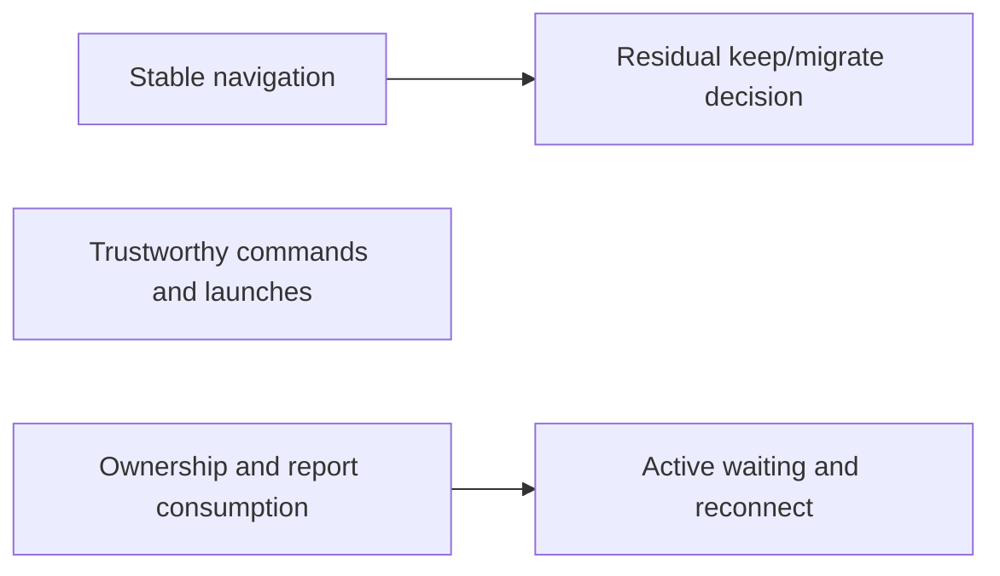

# Development efficiency — umbrella kickoff

> **Type:** execution-build with a final bounded research/decision stage; sequential by default.
> **Rigor label (L0):** `build-and-verify` — repair demonstrated mechanisms and retain effective controls.
> **Status:** Handoff preparation; no stage launched by this document.
> **Feature:** `development-efficiency`. **Base:** `staging`.
> **Authoritative for:** S1–S5 task boundaries, dependencies, acceptance and continuation of this umbrella.
> **NOT authoritative for:** project goal, additional execution authority or the internals of existing workflow procedures.

## §0 Binding authority and cold start

Read README goal → `.agents/session-bootstrap.md` → `CLAUDE.md` →
`docs/superpowers/specs/2026-10-22-development-efficiency-design.md` → this kickoff →
the selected stage kickoff. The design's outcomes, control floor and deferrals are binding.
Design SHA-256: `22efd36f9a3d08e8f087d4bf7678444f58dbfbf80fcc15212642148c6940487a`.
Approved brief SHA-256: `e1d88b90d4996999c058aab6a52df6d28ed707c56d2bdc5c835dbe6d56c8100e`.
The existing intent selector must still validate the current authority at plan preparation.
The operator's request to prepare the complete umbrella handoff is recorded in
`docs/superpowers/specs/2026-10-22-development-efficiency-handoff-decision.json`.
It supersedes the initial S1-only packaging; it is not a worker launch or publication receipt.

This is `/arch`'s complete multi-stage handoff to `/pipeline development-efficiency`.
`pipeline` owns current-state reconciliation, launch routing and merge gates; `orchestrator`,
`dispatcher` and their adopted companion procedures own execution/review. Use them as-is.
There is no `bridge: auto` or `bridge-profile` marker. S2–S4 need higher-tier bounded
planning on actual installed owners before executor admission; this is not an executor-only plan.
Do not substitute this umbrella document for the selected stage's task input.

Before dispatch, publish the binding spec, handoff decision, this kickoff, all five stage
kickoffs and their final cold review to `staging` through the normal documentation PR path.
Recheck exact contents on the dispatch base. A feature-branch-only file is not available
to a staging-based factory worker. Preparation does not itself satisfy publication.

## §1 Outcome, delivery and shared constraints

Deliver useful changes sooner by removing avoidable source churn, repairing check/launch
interfaces and making completed results actionable. Use existing mechanisms and retire
the replaced path in each migrated workflow. Preserve independent membership, identity,
bytes, behavior, approvals and consumer-data protections. No new general scheduler,
evidence platform, standing observer, recurring model audit or coordinator hierarchy.

One execution owner carries each admitted slice through known generated outputs,
ordinary repairs and specified review fixes to its authorized destination. Independent
review and publication ownership remain distinct. A source PR is not installed activation.
Every stage records its actual checkout, candidate, installed target where applicable,
existing execution/delivery owners, changed paths, generated closure, checks and rollback.
Bind these in the existing stage/task record before mutation; do not create a second packet.

Respect existing capacity and serial GLM custody. No added worker concurrency is authorized.
Read `/Users/art/.config/getff/glm-launch-policy.md` before any later admitted local GLM
launch/resume; use the supported launcher, verify actual mode/identity and retain cumulative
attempt accounting. Preserve deny rules, hook trust, writer locks and task-specific gates.
No settings/security change, speculative charged retry, main merge or npm publication.

Host-only owners and historical incident artifacts may be inaccessible in a factory
container. Bind a host-capable existing owner before admitting that work; never treat a
container stub or an unreadable source as proof of repair. Keep unavailable work pending
with a prerequisite/return condition; independent ready work need not wait for it.

## §2 Sub-wave decomposition and dependencies

| Sub-wave | Type             | Stage | Branch                            | Depends on | Parallel-with | Kickoff             | Useful accepted result                                                                                   |
| -------- | ---------------- | ----- | --------------------------------- | ---------- | ------------- | ------------------- | -------------------------------------------------------------------------------------------------------- |
| S1       | execution-build  | 1     | `codex/development-efficiency-s1` | none       | none          | [S1](kickoff-s1.md) | Stable precompact navigation delivered through current package/install checks                            |
| S2       | execution-build  | 2     | `codex/development-efficiency-s2` | none       | none          | [S2](kickoff-s2.md) | Trustworthy selection, scenarios, semantic outcomes and launch accounting in the bound affected families |
| S3       | execution-build  | 3     | `codex/development-efficiency-s3` | none       | none          | [S3](kickoff-s3.md) | Actual producer/consumer and owners carry complete bounded outcomes into authorized next actions         |
| S4       | execution-build  | 4     | `codex/development-efficiency-s4` | S3         | none          | [S4](kickoff-s4.md) | Active/reconnected/explicitly resumed owners consume the correct generation safely                       |
| S5       | R-phase decision | 5     | `codex/development-efficiency-s5` | S1         | none          | [S5](kickoff-s5.md) | Evidence-backed keep/migrate decision for residual fingerprint maintenance                               |

Stage numbers express the selected priority sequence, not invented source dependencies.
Default execution order is S1 → S2 → S3 → S4 → S5, one executing owner at a time.
The `Depends on` cells are the hard same-umbrella code/interface edges. No dependency
on unrelated host delivery is inferred from the numeric order. S4 consumes S3's identities
and action contract. S5 measures the applicable repaired workflow after S1; unfinished
S2/S3/S4 work is an evidence-applicability limit, not an unconditional gate on a KEEP decision.
Keep is valid under incomplete payoff evidence; missing evidence cannot justify migration.



Text equivalent: S3 → S4 and S1 → S5; S2 is independently useful. Default priority
is still S1, S2, S3, S4, S5. `Parallel-with: none` preserves current serial custody.

## §3 Stage admission and actual merge gates

For every selected stage, first read its kickoff, reconcile current owners/inputs and run
the existing in-flight probe. A collision returns to that owner; incomplete probing is
unknown, never a clean lane. Repeat after Phase -1 and before outward effects.

```bash
SLUG=development-efficiency bash .agents/procedures/dispatcher/helpers/probe-inflight.sh
```

**Stage-input binding for pipeline's existing dispatch procedure:** replace its generic
`<slug>/kickoff.md` claim/dispatch argument with the selected row's exact stage file.
For S1, the concrete claim is:

```bash
npx --no-install tsx packages/runtime-bridge/src/cli/claim.ts create "$(bash .agents/procedures/pipeline/helpers/print-orch-home.sh)/development-efficiency/kickoff-s1.md"
```

S2–S5 use their corresponding `kickoff-s2.md` through `kickoff-s5.md` paths in that
same argument. The persisted task description must be those selected stage bytes,
not this umbrella or a meta-launch kickoff. The row's stage branch mapping stays with
the resulting task ID. This changes the input argument only: use pipeline's existing
claim-before-review, GO/release, RED/cancel and post-review in-flight reprobe unchanged.
Never release or dispatch the umbrella document as one worker task. Preparation here
creates no claim and grants no stage launch.

Admit S1/S2/S3 only within current authority. S2/S3/S4 each produce a bounded stage plan
before edits: exact live files/callers and installed owner; permitted changes and generated
closure; required real boundary tests with commands; intended existing path to retire;
destination and rollback. This refinement is part of the stage, not a new product interview.
A real unresolved architectural/authority fork parks only its dependent scope through
the existing advisor/owner route. No blanket new operator vote for ordinary in-scope repair.

At every hard transition, `pipeline` verifies the actual predecessor PR and source against
the existing stage result, not just a branch-name search or an unverified table marker:

```bash
gh pr list --repo artyhoo/getff --state merged --base staging --head codex/development-efficiency-s3 --json number,url,headRefName,mergeCommit,mergedAt
gh pr list --repo artyhoo/getff --state merged --base staging --head codex/development-efficiency-s1 --json number,url,headRefName,mergeCommit,mergedAt
```

S4 needs the first gate. S5 needs the second gate. Empty, failed, ambiguous or
wrong-result evidence holds that dependent transition. If the actual authorized owner
uses another branch, record its exact mapping in the existing result and query that
branch; never quietly waive the merge gate. An adopted installed contract may require
destination acceptance in addition to source merge; do not infer it from GitHub.

## §4 Cause coverage and separately bounded work

The design's C01–C19 table remains the cause population. Do not shrink the umbrella to S1.

| Cause group  | Required disposition                                                                                    |
| ------------ | ------------------------------------------------------------------------------------------------------- |
| C01          | S1 removes the numerical-reference trigger                                                              |
| C02–C03      | S5 decides from residual cost; no unconditional oracle/ledger migration                                 |
| C04, C13     | S3 includes generated closure, generators and one canonical actionable result                           |
| C05–C08      | S2 repairs selection, environment, meaningful tests, aggregate propagation and integrated API migration |
| C09–C10      | S3 action ownership, S4 live/resumed reconciliation; D1 owns automatic terminated-owner recovery        |
| C11          | S2 stable identity, pre-spawn intent, early diagnostics and conservative attempt accounting             |
| C12, C18–C19 | S3 supported review routing, latest applicable authority and acknowledged serial custody                |
| C14–C15      | D2 proportionality/destination analysis; S3 retains resumable pending delivery                          |
| C16          | S2 diagnostics and D3 unknown-cause disposition; no invented outage/quota diagnosis                     |
| C17          | S2 phase effects and S3 final-input review/check ordering                                               |

D1, D2 and D3 are explicitly bounded follow-ons, not extra execution rows secretly
authorized by this table. Keep their existing owners, next condition and evidence in the
same program result. D1 follows established S4 boundaries and needs a separate durable
runtime capability design; D2 follows applicable command/ownership repairs and tests
necessity against the actual external-red-to-triage purpose; D3 retains unknown incident
causes and recovery caps. Do not start automatic observers, remote retries or business-task
replays to close them. Closing S1–S5 never means those unresolved outcomes were delivered.

## §4c Park-don't-guess

On a genuine unresolved architecture, scope or authority fork, do not guess. Park it as
a question through the existing runtime task's supported park/answer path, name the
existing accountable recipient, and state both options with their consequences and the
missing decision/evidence. Stop dependent effects until a valid answer returns through
that route; continue independent already-admitted work when possible. A clear ordinary
in-scope correction is not a new operator vote. Preserve task identity, current authority,
review/launch caps and any owned pending result. This contract grants no launch itself.

## §5 AI-traps active

See `.agents/rules/ai-laziness-traps.md` §2. Active traps: **T3**, **T7**, **T15**,
**T19**, **T20**, **T21**, **T22**.

- **T3 / T20:** inspect actual bytes, outcomes and delivery; historical acceptance is historical.
- **T7:** a new template or saved READY file is not proof of consumption/continuation.
- **T15:** run this umbrella through the actual launch-table/frontier readers; exercise
  changed controls against this framework's own changed family before claiming improvement.
- **T19:** cold review the exact stage input and final candidate through existing procedures.
- **T21:** a rule/contract change sweeps parallel producers, consumers and delivery twins;
  cite the sweep or applicable scope exemption before retiring an old path.
- **T22:** each bad/good case names the production change it distinguishes and pins other
  controls; prove the intended fault, not accidental environmental failure.
- **T-DE-A:** all stages appear in a table but only S1 has an actionable task. Counter:
  the five stage kickoffs are binding inputs, with outcomes, admission, cases and rollback.
- **T-DE-B:** simplify by deleting an oracle or a unique handoff function. Counter: preserve
  its independently demonstrated control at the surviving boundary before retirement.
- **T-DE-C:** a source-only or decision-only result is labeled installed improvement.
  Counter: retain distinct source, acceptance, decision, installed and unresolved states.

## §6 Acceptance, measurements and closeout

There is no new universal acceptance platform. Each stage runs its host contract and
the exact additional commands selected by its bounded plan for the changed family.
Final evidence binds relevant final code, tests, dependencies, toolchain, configuration
and environment. Unknown applicability means relevant verification or an unresolved result.
Keep existing independent review, pre-egress, CI and publication requirements. Targeted
checks during editing precede expensive final acceptance; no duplicate blanket audit ladder.

Use existing task/check records for comparable destination time, mandatory manual/model
handoffs, unchanged reruns, capture/update work and produced-to-consumed wait. Separate
migration effort; leave missing per-task usage unknown. S1 proves the line-movement
counterfactual; S2–S4 use incident-shaped controls and the next real authorized workflow.
No numerical saving or completion date is promised. Narrow/stop replacements that cost
more recurring work than they remove; rollback if a formerly detected fault becomes silent.

The common final source/package floor is executable on the host:

```bash host-verify
bash scripts/build-getff-dist.sh --check
make self-audit
```

This floor does not replace stage-specific behavioral or installed-owner acceptance.
Do not run it once per narrative update; reuse known-applicable final evidence.

One stage result records actual candidate, completed action/outcome, authoritative
evidence, next action, accountable owner and prerequisite/return condition. Distinguish
sent, received, accepted and performed. Final program reporting lists S1–S5 separately,
the S5 decision, each deferred D disposition and the actual usable destinations reached.
Write `done.md` only after the existing pipeline closure convention and all admitted
stage outcomes are satisfied; a pending required host repair keeps the umbrella open.

Rollback follows each stage contract, retains results/counters/consumer data and restores
the affected interface with its early consumer. No destructive Git recovery or removal
of another owner's work. This kickoff adds no second implementation of pipeline or SDD.
