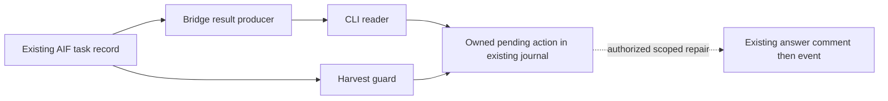

# Development efficiency S3 — bounded result consumption plan

> **Authoritative for:** this S3 owner's admitted source slice, evidence and pending destinations.
> **NOT authoritative for:** whole-S3 acceptance, foreign custody, launch allowance or S4 admission.
> **For agentic workers:** execute the selected stage inline with independent final CODE and FIDELITY reviews; no duplicate AIF executor.

## Goal and immutable input

Repair the existing AIF result producer and its real CLI/harvest consumers so a terminal
status cannot silently erase a structured park, pause or unresolved decision. Retain the
existing task as the canonical result record and its authorized repair/review/delivery
owners. This is an independently useful S3 slice; external workflow adoption stays pending.

- Owner: native Codex `01a16fd3-50e8-7bf3-a6bd-37fe6493a4b9`.
- Checkout: `/Users/art/.codex/worktrees/development-efficiency-s3/rules-as-tests-aif`.
- Branch: `codex/development-efficiency-s3`; base `819582ad868dcfd21c7fad481e3e33bc2bb7cccd`.
- Selected input: `kickoff-s3.md`, SHA256 `7a86290415909853ee2218e4fea3c275d01717e81144509fc8ecf571a523399f`.
- Spec: `docs/superpowers/specs/2026-10-22-development-efficiency-design.md` §8,
  SHA256 `22efd36f9a3d08e8f087d4bf7678444f58dbfbf80fcc15212642148c6940487a`.
- Existing selector plan-prep passed against the original owner roots and original
  attempt `ab51569fc129f2bcc37f8c05af8f8d58e125cb7430692101d7ab4f42a652f67b`.
  No new brief/selector approval is required or created.
- Admission evidence: `/Users/art/.codex/visualizations/2026/10/24/01a16fd3-50e8-7bf3-a6bd-37fe6493a4b9/s3-admission/`.
- Full probe: four unfiltered projects, 408 tasks, container-only/unharvested/claims zero,
  all surfaces asked through Docker context `pc`; raw IN-FLIGHT contains ten historical/
  owned refs including this new branch and three merged umbrella PRs. No second S3 observed.
  The first incorrectly unexported-context probe was incomplete and grants nothing.

## Census and boundaries

| Boundary | Observed producer and consumer | Selected change / limitation |
| --- | --- | --- |
| Runtime record | Live PC API `/app/packages/shared/src/types.ts:322` Task; `/app/packages/shared/src/stateMachine.ts:103` manual review transition; GET `/tasks/:id` | Read existing identity/status/paused/manualReviewRequired/blockedReason/plan/branch/session/review fields. Never change this foreign API or infer content approval from prose. |
| Framework result producer | `packages/runtime-bridge/src/AifHandoffBackend.ts:648` getStatus, `:664` awaitDone; `aifWsStatus.ts` REST/terminal helpers | Produce reconciled result metadata from full authoritative task detail; retain current status independently of acceptance. |
| CLI reader | `packages/runtime-bridge/src/cli/await.ts:62` stderr-only reconciliation, `:116` JSON/exit consumer | Consume result before JSON/exit; replace success-plus-warning with an explicit held result. Preserve the legacy negative advisory signal. Detail failure is uncertainty, never success. |
| Publication consumer | `packages/runtime-bridge/src/harvest.ts:516` harvestTask; `src/cli/harvest.ts` fetch/core/result reader | Hold before commit/push/PR when current task is parked/paused; expose task/result identity, owner and exact prerequisite. Confirmation flags for other guards cannot clear this hold. |
| Ordinary repair | `packages/runtime-bridge/src/cli/answer.ts:392` pushAnswer, comment before request_changes | Preserve and exercise this actual receiving action in controlled integration tests; no new repair scheduler or automatic historical task replay. |
| Existing park parser | `packages/runtime-bridge/src/cli/questions.ts` isParked/parkedReason | Reuse this parser; do not invent a competing natural-language verdict classifier. |
| Worker REPORT | `.agents/roles/orchestrator-worker-discipline.md:47`; shipped skill-context REPORT; chip-worker REPORT | Distinct existing protocols, not evidence that all tasks loaded one. No grammar retirement in this slice; no template-only completion claim. |
| Installed host receiver | `/Users/art/.local/share/getff-economy/build/cli/await.js` | Has additional until-actionable behavior absent from staging and no installed answer/harvest. Preserve it. Source adoption requires its actual owner and additive integration; source merge cannot certify installed adoption. |
| Consumer delivery | `setup.d/55-runtime-bridge-vendor.sh`; `vendor/README.md` manual re-vendor; package manifest generator | Update the exact delivered subset by the existing manual copy route, check parity, then exercise delivered harvest/core. `cli/await.ts` remains excluded; no sync generator exists. |
| Canonical owner record | Existing `state.md`, task API record and PR body | Reference the same task/result generation and this stage journal, not another universal packet or registry. |

Text equivalent: authoritative task detail feeds the result producer and harvest guard;
their readers retain an owned pending action when approval or custody is missing. The
existing answer route remains the effect boundary for admitted repairs. No automatic
continuation, host launch, external approval or publication is depicted as performed.

## Permitted source and generated closure

Permitted production files: `packages/runtime-bridge/src/aifWsStatus.ts`,
`AifHandoffBackend.ts`, `types.ts`, `harvest.ts`, `cli/aifHttp.ts`, `cli/await.ts`, `cli/harvest.ts`.
Reuse `cli/questions.ts` unchanged unless a demonstrated parser contract defect requires
its directly affected correction. Put narrow result mapping in an existing runtime file;
no new universal schema module/service or dependency.

Permitted tests: affected `packages/runtime-bridge/test/*` suites and one bounded new
integration suite for the actual CLI/backend/harvest/answer boundaries. Permitted docs:
this plan, existing stage `state.md`, and the affected dispatcher execution reference to
describe the changed result contract at its existing consumption boundary.

Delivered closure is the exact same seven production paths above under
`packages/runtime-bridge/vendor/src/`, excluding `cli/await.ts`. Update these six existing
copies with individual `cp` operations from their corresponding source paths, followed
by `bash scripts/format-shipped.sh --write <six-vendor-paths>` and
`bash scripts/format-shipped.sh --check <six-vendor-paths>`. This is the existing manual
route (`vendor/README.md:222`), not a generator. Preserve `vendor/src/idempotency.ts`
byte-for-byte and leave P4 parked. No recursive whole-tree copy or new sync mechanism.
Generated closure is tracked `packages/getff/MANIFEST.sha256` from the existing
`bash scripts/build-getff-dist.sh` command.
No installer baseline population/fingerprint representation change is intended. Unexpected
generated paths stop for scope reconciliation before staging. Preserve index versus
working-tree identity and independent archive comparison; keep the manifest tracked.

### Final-floor citation closure (scope review required before application)

The final self-audit at `d2abe905be12016c1ed9c81c298ce2db5434fb7f` found two
recoverable locators moved by this slice. Admit only the generator's numeric corrections:
`.agents/rules/reviewer-discipline.md` locator `execution.md:200` to `:209`, and
`packages/core/skills/dispatcher/monitor.test.ts` locator `aifWsStatus.ts:83` to `:169`.
No rule, review budget, executable assertion or authority changes. These are causal source
reference repairs under kickoff-s3 item2, not a new enforcement capability or foreign edit.

After independent narrow scope/patch GO, use the existing writer:
`node scripts/check-line-citations.mjs --write .agents/rules/reviewer-discipline.md packages/core/skills/dispatcher/monitor.test.ts`.
Require exact equality to the reviewed two-locator patch, check those files with the same
helper's `--check`, and run `npx --no-install vitest run packages/core/skills/dispatcher/monitor.test.ts`.
Regenerate the same tracked package manifest and re-enter self-audit at its failed citation
gate, followed by the remaining required gates. Reuse unchanged runtime/vendor and actual
installed-backend acceptance; the citation patch changes neither their code nor assertions.
The original plan and both CODE verdicts remain inspectable; this amendment requires its
own immutable scope review and a final content-bound FIDELITY verdict before egress.

## Result and authority rules

Reuse TaskResult, TaskStatus and HarvestResult rather than a new result store. Add narrow
AIF metadata containing the actual task/branch/candidate (null when unavailable), session/
review attempt (null when unavailable), content-bound result generation, source reference,
observed outcome and pending next action/owner/prerequisite. A digest identifies the
observed result; it never authorizes effects or proves candidate acceptance.

Structured park/pause fields win over optimistic done. Current REST detail wins over an
earlier terminal event. A different task, malformed detail or failed fetch holds as unknown.
No reviewComments regex grants approval. Preserve the existing negative advisory matcher
as an explicit needs-reconciliation signal, including historical task `a4bdff98` whose
structured park fields are clear while the advisory says zero code / blocked. That signal
cannot authorize re-dispatch; it retains a pending action for narrow source reconciliation.
Missing commit identity remains unknown; task
completion never implies independent review, CI, merge or installed acceptance. This slice
does not query CI; final same-candidate CI reconciliation remains with the delivery owner.
Do not bind foreign candidate evidence by recency or manufacture an owner from history.

An explicit per-invocation `RUNTIME_BRIDGE_RESULT_OWNER` reference may bind the current
reader's pending obligation; it is data, never an authority grant. Without it, the output
must say owner is unbound and require binding rather than promote `executionOwner: ai|human`
to an accountable person/chat. This native S3 owner records consumed pending results in
the existing `state.md`; stdout alone is not durable consumption or an executing receiver.

Ordinary specified repairs remain with their execution owner through existing answer
comment+event routing and existing intent/PlanReview checks. A pending result is a retained
obligation, not a running consumer. Known generated outputs are already in this assignment;
no separate re-kickoff for their ordinary regeneration or specified review fixes.

## Implementation and meaningful verification

- [ ] Independently review this exact plan/scope before source mutation; reprobe afterward.
- [ ] Write failing actual-boundary cases before the production repair. Pin sibling inputs
  and replay all changed production preimages for RED evidence (T22).
- [ ] Implement result production and actual consumers together. Verify done+structured
  block, pause, stale terminal versus current rework, wrong task, malformed/unavailable
  detail, same/different candidate identity and unchanged/changed result generations.
- [ ] Run a real subprocess CLI against a controlled HTTP boundary and assert both JSON
  and exit. Exercise harvest with real scratch Git input plus recording publication
  effects; no effect may occur when held. Exercise actual answer comment+event consumer
  with a harmless local API, preserving supplied task/decision/findings and existing scope
  gate; no live foreign POST or model task is authorized.
- [ ] Exact new boundary command:
  `npm --prefix packages/runtime-bridge test -- test/aif-result-consumption.test.ts`.
  This suite executes source CLI, manually copied vendor backend/core and the existing
  answer effect consumer. Its scratch consumer runs the actual
  `bash <source-checkout>/install.sh ts-server --profile factory </dev/null` from a scratch
  Git project, with explicit isolated HOME/control environment and no --full/--all/global
  mode. This reaches real layer55 file copy; it is not --dry-run (which copies nothing).
  Assert installer exit, delivered identity, stub preservation and actual installed
  backend/harvest behavior; scratch installation does not establish global/native trust.
- [ ] Existing affected consumers:
  `npm --prefix packages/runtime-bridge test -- test/aif-status-readback.test.ts test/aif-answer.test.ts test/result-review-effects.test.ts test/harvest.test.ts test/harvest-cli.test.ts test/harvest-merge-report.test.ts`.
  Do not count a routing stub as native Windows, Yarn/Astro or installed economy adoption.
- [ ] Live read command (after the suite establishes its CLI contract):
  `RUNTIME_BRIDGE_RESULT_OWNER=codex:01a16fd3-50e8-7bf3-a6bd-37fe6493a4b9 RUNTIME_BRIDGE_MODE=aif-handoff RUNTIME_BRIDGE_AIF_URL=<read-only-loopback-Docker-route> npx --no-install tsx packages/runtime-bridge/src/cli/await.ts <exact-live-task-id> --once`.
  The local transport adapter forwards GET only through `docker --context pc exec
  aif-api-1 node` to actual loopback3009. It performs no POST, launch or global route change.
  Persist stdout/exit and the owner consumption in this existing journal; this is live
  readback and pending custody, not historical business replay or installed economy acceptance.
- [ ] On a read-only live PC task, run the actual changed reader through the supported
  Docker API route; consume its result in this owner's existing journal. Do not replay
  historical business work or label this as installed-host adoption.
- [ ] Regenerate only admitted closure using existing generators; verify independent
  archive/package identity. Record actual delivered consumer subset and exclusions.
- [ ] Run `node --test tests/roles/orchestrator-worker-discipline.test.mjs`,
  `npm --prefix packages/runtime-bridge run typecheck`,
  `npm --prefix packages/runtime-bridge test`,
  `bash scripts/build-getff-dist.sh --check`, `make self-audit`, and the applicable local
  pre-egress sweep once after source stabilization. Relevant final edits invalidate only
  affected evidence. Reuse unchanged evidence; no repeated blanket acceptance ladder.
- [ ] Independent cold CODE and scoped FIDELITY on the final candidate; retain the
  unchanged-substance delta-review watch-list. CODE rework and FIDELITY rounds stay
  distinct; second unchanged-scope REVISE stops dependent effects.
- [ ] Normal source PR against staging under current authority. No CI queries/watchers;
  required unavailable current-head gate remains pending. No merge bypass or main/npm action.

## Retired work, surviving controls and falsifiers

Replace only the CLI's contradictory success-plus-warning handling; preserve the exact
legacy adverse-advisory signal and its useful UI link at the surviving boundary. Structured
park/paused and advisory-only cases must turn JSON/exit red with an owned/unbound pending
action; harvest must hold before effects for the same adverse facts. No independent review, writer lock, generated-membership
check, evidence identity or publication decision is removed. No manual relay hop is
claimed removed without a real corresponding owner/effect; unknown hop value stays open.

Falsifier: a structured park/pause produces successful terminal JSON/exit or publication;
a failed/mismatched detail read clears completion; a different candidate's generation
clears a held action; source merge is reported as installed acceptance; or an affected
generated output lies outside the admitted closure without renewed review.

## Pending foreign ownership and rollback

- Installed economy integration: actual source/delivery owner is not established by the
  compiled path. Return condition: bind its real source/custody and preserve additive
  until-actionable behavior before adoption. This native owner retains the pending
  reconciliation in this journal; it cannot message or overwrite that owner without
  actual human authorization. S4 cannot assume this installation is accepted.
- Integration25 retains Clarify source/capture migration, five installed witnesses and
  UNKNOWN 1/1 reservation. Windows24/Root25 retain original independent delta/publication;
  Onebutton27/Dot24 retain controller and acknowledged serial c9 custody; consumer41
  retains installed acceptance. No S3 exemption or new launch is inferred.
- Authority/custody reconciliation in those foreign queues remains pending with those
  owners. Their actual latest authority/ACK is the prerequisite; this plan does not
  supersede restrictions or claim a custody return from historical evidence.
- Rollback: revert the source adapter/reader/guard and causally regenerated outputs
  together through normal staging delivery; retain task results, decisions, generation
  evidence and pending ownership. Never delete foreign WIP or reset attempts.
- Caps: zero new GLM/AIF/native business launches, zero foreign messages, zero CI queries;
  existing foreign generation/CLI/walltime/native/review caps remain unchanged. Native
  subscription usage is available account-wide, per-task attribution unknown.

Active traps: T3 (observed source status), T7 (pending is not execution), T21 (cold sibling
sweep before retirement), T22 (all changed preimages). Independent plan review is the
next permitted action. This plan does not close all S3 §8 outcomes or launch S4.
