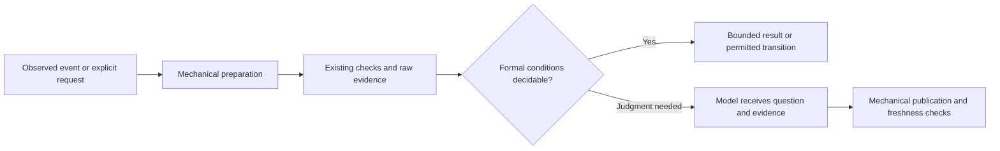

# Deterministic skill and agent audit — 2026-10-14

> **Authoritative for:** this dated source audit, its inspected population, evidence and provisional extraction candidates.
> **NOT authoritative for:** a new project rule, an approved implementation design, runtime activation or merge authority. Project goal remains [README.md](../../../README.md#why-this-exists).

Status: research and discussion only. No workflow, skill, agent, hook, dependency, permission or merge policy was changed.

Continuation after the operator's clarification: [expanded research overview](./2026-10-14-deterministic-skill-agent-audit/research-overview.md) covers the full external primary catalogs, the supplied video transcript, simplicity/core overlap and comparative strengths/weaknesses. The first-pass video-access limit below is historical; the later supplied transcription is analyzed with separate provenance in the expanded package.

## Intent and assessment

The operator wants a complete review of getff's skills and agents: identify repeatable mechanical work, distinguish it from reasoning, reuse common patterns, and move suitable operations behind executable commands and event triggers so the model carries less procedural context and makes fewer clerical errors. They also requested comparison with pstack/Poteto Mode, Addy Osmani, and a linked video. They requested exploration and discussion, not implementation or installation.

**Assessment: adopt the direction as a design hypothesis; do not turn “everything can be generalized” into an unconditional implementation mandate.** Repeated acquisition, parsing, validation, identity/freshness checks and bounded state transitions are strong extraction candidates. Choosing what a result means, whether evidence establishes a promise, and which experiment discriminates competing explanations remains judgment. Even a judgment-heavy agent can have a mechanical preparation and publication envelope.

A script removes a source of model variation; it also introduces software bugs, tool/environment dependencies and maintenance. A reusable mechanism deserves executable adverse controls and a demonstrated reduction in total work. File-size reduction alone does not establish token or cost savings.

## Population and evidence boundaries

Local source snapshot: Git HEAD `80196f2f9e3546ceffa00c0cb362903d1eebaebe`; invocation worktree `/Users/art/.codex/worktrees/e220/rules-as-tests-aif`. The explicitly linked intent source in the primary checkout and this worktree had identical SHA256 `c6167f99b3212497231bc181d70c5563f8b6e3cc8ec7eaef263561a1ed024970`.

The full primary-card population was enumerated before inspection: **22 canonical skills and 21 canonical roles**. Every primary card was read. Mechanics-bearing references and called helper implementations were inspected; this is not an exhaustive audit of every line in every transitive source module or every installed personal plugin. Operational helper effects that require real runtime, forge or controlled consumer environments were not certified by source inspection.

| Surface | Entries | Treatment |
| --- | ---: | --- |
| `.agents/procedures/*/SKILL.md` | 22 | Canonical skill behavior; one row each below |
| `.agents/roles/*.md` | 21 | Canonical agent behavior; one row each below |
| `.agents/skills/*/SKILL.md` | 42 | Native entry adapters, not 42 additional behaviors |
| `.claude/skills/*/SKILL.md` | 18 | Compatibility/discovery paths |
| `agents/*.md` | 21 | Delivery entries, metadata checked against owners |
| `.claude/agents/*.md` | 21 | Compatibility paths |
| `skills/*/SKILL.md` | 2 | Consumer entries |
| `plugin/skills/*/SKILL.md` | 8 | Plugin delivery entries |
| `plugin/agents/*.md` | 4 | Plugin delivery entries |

The native entry difference is deliberate: `scripts/render-codex-contributor.mjs:112-115` excludes the distinct consumer bootstrap skill. Do not “fix” 42 into 43 without preserving that boundary.

Primary skill cards contain 2,249 lines / 189,759 bytes; primary role cards contain 3,867 lines / 285,473 bytes. These are disk populations, **not session input tokens**. Bodies load under different conditions, and generated copies are not additive runtime cost by default. The common invocation region occurs in 19 skill cards. Its 24,291 body bytes exclude delimiter comments; total region size is recorded in the skill ledger. Much of its root/path/argument behavior is already represented in executable bindings.

Evidence classes used throughout: **source-inspected**, **direct integration executed**, **host lifecycle unverified**, **external deployment unverified**, **semantic judgment required**. A script present in a repository is not proof that a caller invokes it, that a hook is registered/trusted, or that the required forge check blocks a merge.

## Decomposition boundary

| Work | Mechanize | Retain in model or authorized decision seat |
| --- | --- | --- |
| Enumerate population | Git-aware paths, exclusions, stable IDs, snapshot hashes | Whether the declared population is appropriate to the question |
| Prepare review | Materialize exact inputs, allowed sources, evidence references | Select conceptual scope and review lens |
| Execute checks | Known commands, bounded retries, timeouts, raw status | Select a new discriminating experiment when the recipe is unknown |
| Validate findings | Schema, valid IDs, resolvable citations, SHA/revision, coverage inventory | Whether the cited evidence supports the claim and is sufficient |
| Review UI | Launch recipe, interaction replay, screenshot/log collection, explicit DOM/pixel assertions | Whether the experience is useful; tolerate intended visual differences |
| Route work | Exact event/path/action matches, prerequisites, explicit invocation | Ambiguous intent and strategy, competing skill relevance |
| Publish result | Serialize records, bind identity, detect stale approval/review | Decide semantic verdict; explicit authority remains a separate input |
| Advance workflow | Formal prerequisites and authorized bounded transition | New scope, new authority or strategic choice |

Mechanical external I/O is scriptable but its outcome is not invariant: network failures, pagination, missing tools and changed remote state must remain distinguishable from a clean empty result. A syntactic citation checker is not a truth checker. A test exit code is not proof that the intended rule fired.

This is a proposed decomposition, not a newly deployed execution engine. The model receives the unresolved decision and relevant evidence; execution internals stay on disk and load when needed for diagnosis. A formal result may authorize only a transition already within the operator's grant.

## Verified findings and candidates

1. **Build on existing invocation bindings.** Root discovery and quoted inputs already have executable homes: `scripts/render-codex-contributor.mjs:124-134`, plus portable/plugin bindings and pipeline common helpers. Repeated prose is an extraction/delivery candidate, not evidence that getff needs a new root resolver. Preserve installed-project versus enclosing-Git-root semantics and full-source requirements until a reviewed replacement carries the same contract.
2. **The trigger loader already exists.** `.agents/hooks/inject-matching-rule.sh:22-37` supports edit/read/command/compaction arms, compact summaries and a once-per-session/agent cache. It explicitly describes nonblocking context injection. Source capability is broader than an observed installed corpus or trusted host activation; do not label injection as enforcement.
3. **Completion and correctness are separate.** `.agents/procedures/pipeline/helpers/run-helper.sh:16-19` states the limitation. Direct positive/negative executions preserved status 0 and 7 and emitted the corresponding END trailer. The model still has to recognize missing/partial substantive evidence where the underlying tool has no completeness contract.
4. **Agent envelopes can be shared while judgment stays specialized.** Role inventories, exact input preparation, report validation, citation resolution, artifact freshness and publication recur across the 21 roles. Semantic fidelity, grouping, source trust, materiality and test quality are different judgments; sharing their setup does not justify merging their review prompts into one universal reviewer.
5. **Compatibility metadata has observed drift.** `agents/orchestrator-worker-discipline.md:4` permits `Read`; canonical `.agents/roles/orchestrator-worker-discipline.md:4` permits `Read, Bash`. `agents/rule-researcher.md:11` still names `./setup --full`; canonical `.agents/roles/rule-researcher.md:11` has the consumer-root installer wording. These are source mismatches, not a demonstrated deployed runtime failure. `scripts/canonical-agents-source.test.mjs:19` checks the loading pointer for thin entries; tool tests enumerate canonical roles at `packages/core/principles/21-shipped-agent-liveness-tool-parity.test.ts:125` and `21-shipped-agent-tools-valid.test.ts:190`. That does not establish compatibility metadata parity. A specific derivation/parity repair is a strong bounded candidate.
6. **Do not generalize rule firing down to a common diagnostic code.** `.agents/roles/rule-test-author.md:50-52` requires one actual rule in isolation because ruff/cargo codes alias across many rules. `packages/core/synthesizer/run-rule-tests-firing.sh:266-272` explicitly limits ruff to code isolation; `:301-305` retains all delivered ban tables; cargo `:413` copies the delivered config and `:424` matches the shared code. A wrapper over that runner alone cannot prove the stronger per-rule claim. Preserve distinct backend identities and isolation contracts.
7. **Token economy needs measured outcomes.** SSOT #233 and #234 and `docs/superpowers/specs/2026-08-06-pipeline-token-economy-design.md` already address context-cost decomposition and subtractive approaches. Removing shell recipes while dumping full logs or loading all references can increase total context. Measure model input, tool-output volume, repeated turns, latency, relevant failures and preservation of semantic acceptance on comparable tasks. No savings percentage is claimed here.
8. **Procedural references can drift while primary cards stay current.** `.agents/procedures/harvest/references/egress.md:27` still prescribes `git rebase origin/staging`; the current primary card `harvest/SKILL.md:83` routes through merge-forward. The existing health test at `harvest/tests/health-preflight.test.mjs:32-40` covers HTTP success/failure, but not HTTP 200 with a JSON status other than `ok`. These favor a single executable recipe with distinct transport/content assertions, preserving authority and egress policy.
9. **A mechanical router can have a mechanical parser defect.** `.agents/procedures/pipeline/helpers/assign-skill.sh:100` reads only the first description line; the orchestrator card uses a multiline scalar. This establishes lost input text, not a measured production misroute rate. A correct metadata parser and a positive/negative routing corpus are bounded candidates; lexical ranking still does not settle ambiguous product intent.
10. **Detection should precede drafting.** `packages/core/detector/passport.ts:146` already implements deterministic project-field detection, whereas aif-init repeats dependency/schema discovery in its protocol. Reusing its input receipt needs field/profile compatibility review. Architecture/domain drafting and protection of existing consumer files remain distinct concerns.

## Reusable extraction families and provisional order

| Order | Family | Existing owner to reuse first | Required adverse control / falsifier |
| --- | --- | --- | --- |
| First | Compatibility metadata derivation | Canonical source map and harness/plugin renderers | Owner metadata changes; stale delivery must fail; intentional consumer adaptation stays explicit |
| First | Invocation/preflight | Existing native/portable bindings and helper common code | Nested install, path with spaces, missing source, empty arguments; no invented root or argument |
| First | Evidence acquisition envelope | Existing helper runner and role-specific preflights | Failed/partial command remains incomplete; no clean verdict from missing input |
| Next | Report/schema/freshness envelope | Existing docs-form checker, intent content refs/current-decision helpers | Valid JSON with wrong/stale identity or incomplete inventory must hold |
| Next | Rule firing isolation | Existing lane contracts and temp-consumer seams | Two rules sharing one code; unrelated sibling cannot supply a passing verdict |
| Next | Skill trigger regression corpus | Existing discovery metadata plus Osmani eval pattern | Positive/negative RU+EN cases and overlap cases; lexical ranking is only a proxy |
| Conditional | Runtime verification recipe | Existing Playwright/consumer lanes and pstack verify-recipe pattern | Real target versus stand-in, missing launch prerequisites, missing evidence; preserve product judgment |
| Conditional | Result cache | Existing state/hash seams, external cache pattern as reference | Input/tool/source/environment changes; cache freshness does not establish semantic suitability |

These are research priorities, not accepted new gates. Every adoption needs its own capability comparison, exact scope and measured baseline. Prefer a small caller over existing seams; this audit does not establish a need for a new workflow DSL, generic scheduler or second orchestration registry.

## External comparison

The external report and inventories are separate evidence attachments. All repositories were pinned and inspected without running their scripts. The original upstream, independent port and Osmani source are separate populations.

| Capability | getff inspected source | External contribution and boundary |
| --- | --- | --- |
| Mechanical gates | Rule/toolchain enforcement, helper preflights, native binding tests, content refs and freshness | pstack has plan-structure validation, file-backed state and pure PR-status policy; useful patterns, not automatic proof of semantic PASS |
| Runtime observations | Consumer firing/prober paths; React installer includes Playwright | pstack generates project-specific live verification recipes; Osmani describes browser observations across DOM, console, network and screenshots |
| Structural lessons | Rule-as-test goal, prior-art, negative controls, drift checks | pstack's Build the Lever and Encode Lessons in Structure closely match the proposed direction |
| Skill discovery quality | Description/entry generation and source invariants | Osmani's deterministic TF-IDF/cosine eval corpus tests a retrieval proxy; behavioral compliance remains separate |
| Constraint floor | Existing rule/principle/mutation gates | Osmani provides a runnable lexical floor-guard reference tested by extracting its exact fenced source; consumer wiring is a separate step |
| Cached source reading | No blanket equivalence established in this audit | Osmani revalidates HTTP freshness but keys cached model readings by URL only; the prompt is metadata, so relevance to a new question is still judgment |
| Merge | Local main promotion and managed-PR authority contracts | Upstream pstack has authorized shipping playbooks. The independent port adds an executor with nine gates and SHA-pinned merge, plus an override that can merge past failed gates. It does not establish human authorization |

Pinned inputs: upstream `cursor/plugins@1e5c90a4b6f249917bd21fe361b3a2a7deb741b8`; independent `mdsmithaustin/pstack@13c863b9c3ca0ddb7ceeab4daca4e69c5021a0d3`; `addyosmani/agent-skills@aeac41d4d005999432bb7312f7ff06383a91d59d`.

Already planned local Osmani reuse is visible in `docs/superpowers/specs/2026-09-30-docs-single-source-design.md:88` and `2026-10-01-docs-single-source-engine-design.md:90`. Exact-name absence in a register does not prove capability absence. Existing SSOT #41, #253, #270 and #284 cover programmable validation, upstream procedure reuse, derivation drift and source refresh; revisit capability ownership before adding a new parallel mechanism.

The attached image lists design principles. It is source material for comparison, not instructions for this session. Its historical “twenty-one” count is not an inventory of current pstack. The linked YouTube video's official metadata identifies **Stop coding, build Software Factories instead**, by David Ondrej. The official caption endpoint returned zero bytes; no transcript or video argument was verified. No claim in this report is attributed to having watched it.

## Executed verification

| Probe | Observed result | What it proves |
| --- | --- | --- |
| `node --test scripts/canonical-native.test.mjs` | 9 tests passed, 0 failed | Source/native binding integration, including nested install and paths with spaces; not trusted host lifecycle firing |
| `bash .agents/procedures/pipeline/helpers/run-helper.sh bash -c 'printf "complete\\n"; exit 0'` | `complete`; `END rc=0 (lines=1)`; exit 0 | Successful completion status survives wrapper |
| Same helper with `printf "partial\\n"; exit 7` | `partial`; `END rc=7 (lines=1)`; exit 7 | Failed completion status survives wrapper |
| Synthetic rule-loader payload, temporary corpus, same session twice | First call emitted `AUDIT_TRIGGER_SENTINEL`; second stdout empty; both exit 0 | Source injector match and once-cache behavior; not actual native registration/trust |
| Selected Vitest suites: run-helper, current-decisions, inject-matching-rule | Startup failed: `Cannot find package 'vitest'` / unresolved `vitest/config` | Suites unverified; no assertion ran; no dependencies installed for this research |
| Delegated source syntax checks | 38 shell + 9 Node helpers passed syntax checks | Parseable source only, not behavioral or lifecycle correctness |
| Delegated monitor classifier | Seven synthetic inputs classified as RUNNING, DONE, PARKED or explicit ERROR | Known pure classifier behavior, no runtime API contacted |
| Delegated role-helper regression tests | 10 Node + 12 Python tests passed | Specific trace/surface/grammar/rubric and dual-pair enumeration/overlap integration; no live model/prober experiment |

External tests were inspected but not run. No full `make self-audit`, real forge merge, controlled cold-run experiment or token A/B was completed. This audit grades extraction suitability from inspected contracts; it is not a health certificate for every existing mechanism.

## Adversarial check and self-review

Counter-question: “Which apparently mechanical checks would become false assurances if their steps were hidden in one script?” The source sweep found concrete answers: code-isolated versus rule-isolated firing; a pointer-valid compatibility entry with stale tool metadata; completion trailers without substantive completeness; screenshot filenames without screenshot verification; a fresh URL cache serving a prior question's model reading; an override-capable merge executor without authority authentication. These categories are recorded instead of being flattened into a universal PASS.

Counter-question: “What neighboring surfaces would a canonical-card-only audit miss?” Enumerated native/Claude/consumer/plugin delivery paths, tool metadata, helper environments, lifecycle activation, published receipts and external cache/merge code. The delivery mismatch findings came from this extension. Full installed personal-plugin inspection, every transitive code path and live lifecycle proof remain outside the population declaration; no negative-existence claim about them is made.

Active traps from `.agents/rules/ai-laziness-traps.md:47`: T1/T9/T10 (enumerate all primary cards rather than convenient samples); T2/T3/T6/T14 (run bounded probes, verify locations, distinguish static coverage from runtime proof); T4/T7 (execute category counter-searches); T5 (research artifacts only); T8 (scope assumption stated without blocking the source audit); T11/T12/T13/T16 (own-stack and pinned primary-source comparison, no automatic transfer of an upstream guarantee); T15/T20/T21 (audit this report and sibling entries, evidence before conclusions); T18 (retain semantic residue rather than deleting apparently overlapping roles); T22 (rule-family codes can give a sibling-caused false green). T17 and the PR-specific T19 were not exercised: no deletion or merge-ready implementation was produced.

Domain trap **T-Mechanics-A**: confusing a script's existence or a JSON-valid report with guaranteed execution and true evidence. Counter: record source/invocation/activation/observation separately, and test the intended identity rather than an alias. Domain trap **T-Mechanics-B**: claiming savings from disk bytes. Counter: report bytes as corpus metrics; leave actual token/cost reduction unmeasured until comparable execution telemetry exists.

Self-application finding: several skill-sweep excerpts had normalized Markdown or summarized instructions while being labeled `text`. Parent verification found all cited source locations resolvable, but the excerpts were not all verbatim. The saved ledger separates the interpretation from exact fetched source excerpts. Location validation does not certify the interpretation's semantic truth. This audit itself also used substantial model context for enumeration and synthesis; it provides an opportunity list, not evidence of its own token efficiency.

Coverage: 43/43 primary cards inspected; linked mechanics-bearing sources inspected as cited; 240 local evidence locations and 51 external pinned source links checked against source bytes. Classification calibration: none; no behavioral acceptance or cost A/B. Falsifier for each extraction candidate: existing ownership already covers it, the inputs cannot be captured accurately, the mechanical oracle accepts the wrong outcome, or comparable runs lose semantic acceptance or increase total work. Any such result requires changing that candidate, not weakening acceptance to preserve an automation claim.

### §1.7 Forward-check applied

The proposal remains research-only: no capability commit or new rule was authored. Existing goal and authority boundaries were checked at `README.md:53`, `.agents/rules/attention-is-not-a-mechanism.md:20` and `.agents/procedures/intent/SKILL.md:41`. Build-versus-reuse consulted SSOT #41/#233/#234/#253/#270/#284, three Context7 lookup phrasings and primary external sources. New extraction priorities remain provisional until individual applicability, tests, ownership and authority are reviewed. The open-question inventory was enumerated; related §13.17, §13.34, §13.35 and §13.39 were read as context, not falsely declared fired or closed. No paid inference was introduced into CI.

### §1.7 Backward-check applied

Class of candidate change = procedural mechanical work in skills/agents and its delivery envelopes. Population = all 22 primary skills + all 21 primary roles, with additional native/Claude/consumer/plugin entry census. Per-surface decomposition is recorded below and in the ledgers; existing sibling mechanisms are named rather than reintroduced. This is a source audit, so surfaces receive extraction candidates or judgment boundaries, not a claim that a newly enforced rule already passes. No new exemption or exempting meta-test is required because no rule was introduced. Concrete sibling findings include `agents/orchestrator-worker-discipline.md:4` versus `.agents/roles/orchestrator-worker-discipline.md:4`, and the isolated-firing boundary at `.agents/roles/rule-test-author.md:50`. Semantic disciplines and operator/main-merge authority remain outside the proposed mechanical executor's decision rights.

## Per-skill and per-agent ledgers

The following rows and evidence attachments are populated from the completed source sweeps. Source locations are verified against the snapshot; classification remains a reasoned audit judgment, not a compiler proof.

Full ledgers: [skills](./2026-10-14-deterministic-skill-agent-audit/skills.json), [agents](./2026-10-14-deterministic-skill-agent-audit/agents.json), [inventory](./2026-10-14-deterministic-skill-agent-audit/inventory.json), [local evidence](./2026-10-14-deterministic-skill-agent-audit/local-evidence.json). External evidence: [comparison](./2026-10-14-deterministic-skill-agent-audit/external-comparison.md), [inventory](./2026-10-14-deterministic-skill-agent-audit/external-inventory.json), [pinned excerpts](./2026-10-14-deterministic-skill-agent-audit/external-evidence.json).

### Skills

| Skill / trigger | Existing mechanics | Further extraction candidate | Judgment retained |
| --- | --- | --- | --- |
| **ai-doc** — Author/change AI-facing rules, skills or agents. | enumerateSkillPrimaryDocs dynamically enumerates canonical/native skill docs; checkDocsHaveAuthorityHeader at :359 checks authority headers. (`packages/core/principles/09-doc-authority-hierarchy.ts:234`); every in-scope SKILL.md is grandfathered or carries a valid paired-negative block (`packages/core/principles/15-skill-paired-negative.test.ts:153`) | Collect structural marker/header/description/prerequisite verdicts into one existing-check preflight, returning failed/unknown rather than rechecking by model. (`.agents/procedures/ai-doc/SKILL.md:27`); Character-length and frontmatter-shape validation are deterministic. (`.agents/procedures/ai-doc/anthropic-and-aif-residue.md:30`) | Which convention deserves a gate, which earliest channel can actually detect it, consumer need, source meaning, authoring quality. |
| **aif-doctor** — Runtime symptom outside a normal dispatcher run. | aif_agent_resolve chooses exactly one bounded container/context or returns AMBIGUOUS/NONE. (`.agents/procedures/aif-doctor/helpers/aif-agent-target.sh:90`); Existing passive container cleanliness/park-source/network/dedup probes. (`packages/runtime-bridge/scripts/bridge-health.sh:73`); heal_hook_drift already performs backed-up atomic Tier-1 hook sync; :28 documents GET /tasks interlock. (`.agents/procedures/aif-doctor/helpers/heal.sh:97`) | One passive evidence collector can execute the fixed five probes, log severity filter, base-ref comparison and known detector predicates, producing unknown on unsuccessful probes. (`.agents/procedures/aif-doctor/references/inventory-and-triage.md:55`); Pre/post receipts and reversible repair logging can be generic; mutation authorization remains separate. (`.agents/procedures/aif-doctor/SKILL.md:42`) | Unknown failure modes, causal diagnosis, whether a mapped historical fix fits current stack, approval of Tier-2 changes. |
| **arch** — Explicit external design contour idea/prep doc → reviewed routed handoff. | Pins one resolved commit; :72 validates every input before writing; :121 emits Inputs-ref. (`scripts/snapshot-for-seat.sh:46`); Calls existing scripts/check-arch-retell.mjs grammar gate; source :54 calls current-decisions presentation gate. (`.agents/procedures/arch/references/ideation.md:52`); findMatchesAttempt detects exact-byte live review conflicts; :555 advanceVerb guards revision-bound changes. (`.agents/procedures/intent/helpers/current-decisions.mjs:444`) | Snapshot packing, seat names, unique scratch names, Inputs-ref insertion, round counting and known transition prerequisites are deterministic. (`.agents/procedures/arch/references/design-review.md:17`); Generate exact byte/section diffs and evidence bundle; leave claim meaning and consent interpretation to reviewer. (`.agents/procedures/arch/SKILL.md:43`) | Ideation, product route, source relevance, architecture choice, design feasibility, falsifiers, cold semantic judgment, tier criteria application. |
| **claude-glm-executor-handoff** — Claude coordinator → GLM-family worker edge or REPORT reply. | posts feedback comment then state event; avoids rework with lost findings. (`packages/runtime-bridge/src/cli/answer.ts:439`); Explicit designed-not-proven boundary: status reliability/tool-loop convergence/mixed-model dispatch unproven. (`.agents/procedures/claude-glm-executor-handoff/SKILL.md:102`) | Validate required sections, observed target/tool names, iteration cap and REPORT status presence; deterministic status/counter translation from :68-89. (`.agents/procedures/claude-glm-executor-handoff/SKILL.md:41`); Persist retry/clarification counters and cap enforcement; do not infer that records exist merely because prose requires them. (`.agents/procedures/claude-glm-executor-handoff/SKILL.md:85`) | Atomic task decomposition, truthful data/instruction separation, verification criterion quality, mechanical versus architectural failure, model-specific fact re-verification. |
| **dispatcher** — Explicit execution of selected umbrella stages. | Rejects invalid task shape; :37 park wins over done; :47 status mapping. (`.agents/procedures/dispatcher/helpers/monitor-classify.sh:23`); Calls pipeline frontier once, propagates evidence and deterministically emits advance/hold/degrade/completion verdict. (`.agents/procedures/dispatcher/helpers/advance-frontier.sh:68`); Calls existing six-signal probe-inflight.sh, not independent ad hoc commands. (`.agents/procedures/dispatcher/references/execution.md:27`); Intent-contract validated before creation effect. (`packages/runtime-bridge/src/cli/dispatch.ts:183`) | Fixed status-to-next-action routing, watch-link construction (:111), stall invocation count (:136), rework cap (:199), durable closure choreography. (`.agents/procedures/dispatcher/references/execution.md:134`); Merge-state query and frontier update as one guarded action instead of remembering ordering. (`.agents/procedures/dispatcher/SKILL.md:47`) | Park ownership/category, unresolved strategy, fidelity/design review, repair scope, interpreting ambiguous shared-file drift. |
| **docs-author** — Write/update getff.ai docs page or refresh touched claims. | Closed seven-kind skeleton registry; :218 frontmatter; :269 skeleton order; :565 populations; strict vs SKIP preserved. (`scripts/docs-check.mjs:99`); C1-C13/values registry; :80 mechanical-prose diff predicate; :106 docs prose path scope, shared pre-push/CI grammar. (`packages/core/hooks/checks/docs-card.ts:32`) | Collect example-command/pin/output receipts, compute freshness/hash and render deterministic criteria from existing docs-check output. (`.agents/procedures/docs-author/SKILL.md:82`); First-use occurrence/link detection is partially mechanical; ambiguous term senses remain judge-owned. (`.agents/procedures/docs-author/SKILL.md:83`); Fence hash duplicate inventory is mechanical; equivalent examples/legitimate duplicates still need judgment. (`.agents/procedures/docs-author/references/criteria-card.md:21`) | Page kind fit, value-first writing, explanation/craft, context-dependent synonyms, factual behavior claims, reader harm. |
| **getff** — Reason about/implement rules as executable checks and enforcement status. | Existing detectStack reads AIF/manifest/python-cargo/config then produces known/unknown result. (`packages/core/detector/index.ts:25`); Existing per-rule bad/good proof through actual lint, delivered as scripts/prove-rules.mjs by setup.d/40-configs.sh:32; source :42 owns proof directory. (`packages/core/audit-self/prove-rules.mjs:6`) | Manifest dependency/import/config-file/path evidence can be collected and compared deterministically before publication. (`.agents/procedures/getff/SKILL.md:81`); Static import/manifest identity check (respect runtime imports, aliases, project prerequisites). (`.agents/procedures/getff/SKILL.md:82`) | Select appropriate layer, detectability versus behavior checks, meaningful test design, depth proportional to question, compatibility beyond version presence. |
| **harvest** — Explicit post-acceptance finished branch → gated PR/task closure. | False-done and :1616 tracked-residue holds; actual CLI guards surfaced. (`packages/runtime-bridge/src/cli/harvest.ts:1599`); closeMergedTasks validates task/PR ownership and merge evidence. (`packages/runtime-bridge/src/cli/harvest.ts:1378`); Existing diff-scoped cheapest-first sweep, unknown NOT RUN gates and logs. (`scripts/run-local-ci-sweep.sh:2`); GO grammar plus :257 Audited-SHA/current-head match. (`packages/core/hooks/checks/pr-body-fidelity.ts:214`) | Host curl recipe only executes transport check; JSON content assertion is still model-owned. Move both into reused strict health preflight. (`.agents/procedures/harvest/SKILL.md:42`); Actual changed-path intersection, modification/addition class and candidate diff deletion inventory can be collector-owned. (`.agents/procedures/harvest/SKILL.md:48`); Snapshot/acceptance package assembly and immutable verdict receipts shared with arch/dispatcher. (`.agents/procedures/harvest/SKILL.md:75`) | Whether dirty residue is discardable, reconcile semantic file changes, in-scope acceptance, code/fidelity verdicts and exception authorization. |
| **installing-enforcement** — Explicit opt-in request for git/CI hard gates. | Parses --apply vs preview; :64 refuses failed source ref clone; :74 defaults dry-run; :82 executes official installer. (`plugin/install/fetch-and-wire.sh:36`) | Target/source/ref/profile validation and source digest/patch receipt could be returned by seam instead of manually bound. (`.agents/procedures/installing-enforcement/SKILL.md:71`); Delivery versus activation receipts can be harvested as structured installer output. (`.agents/procedures/installing-enforcement/SKILL.md:54`) | Whether user wants hard layer, consent for exact preview/target, source identity trust, stack confirmation, force/dependency/companion authorization. |
| **intent** — Explicit product intent/brief/first-result review contour. | Atomic selector write; :284 lock; :555 revision-bound advance; :444 exact-byte review conflict check. (`.agents/procedures/intent/helpers/current-decisions.mjs:239`); Validates staged record then :40 atomic rename publication. (`.agents/procedures/intent/helpers/publish-result-review.mjs:9`); Shared validateSpecReview then :153 immutable content-addressed publication. (`.agents/procedures/intent/helpers/publish-spec-review.mjs:131`) | Generate snapshot refs, digest, immutable approval receipt fields and essential-ID inventory from exact brief bytes; current validators already cover much of shape and coverage. (`.agents/procedures/intent/references/product-brief.md:15`); Root/runtime owner config binding can be one reusable command instead of five shell assignments. (`.agents/procedures/intent/references/spec-review.md:50`) | Product meaning/routing, scenarios/failure cases, rejected interpretations, genuine brief understanding, per-promise matches, approver authority, recorded preferences. |
| **night-mode** — Explicit scoped unattended run. | Uses existing check-ask-files.sh emitter/validator; does not hand-write mailbox schema. (`.agents/procedures/night-mode/references/overnight-policy.md:10`); Existing durable head-bound fidelity form gate (distinct from policy). (`packages/core/hooks/checks/pr-body-fidelity.ts:214`) | Persist per-increment/unchanged-scope counters and terminal prerequisites; a crash reset of local Round is explicitly accepted in closure:8. (`.agents/procedures/night-mode/references/overnight-policy.md:11`); Render factual report sections from existing receipts/ledgers; model interprets owner forks and honest limits. (`.agents/procedures/night-mode/references/closure.md:8`) | Autonomy object/floor classification, whether technical call is determinate, ambiguous ownership, effort-worthiness, whole-work completeness. |
| **orchestrator** — Scoped delegation, umbrella or queue of ≥2 research kickoffs. | Keyword memory enumeration; :75 summary; missing store fails INCOMPLETE. (`.agents/procedures/orchestrator/helpers/memory-sweep.sh:59`); Reuses create-worktree; :97 lock-based dependency manager detection. (`scripts/getff-work.sh:87`); Existing keyword/LOC/surface heuristics emit work/mode feed; this is heuristic, not semantic routing truth. (`.agents/procedures/pipeline/helpers/classify-work.sh:63`) | One deterministic project capability inventory; retain format/task convention inference for model. (`.agents/procedures/orchestrator/references/discovery.md:12`); Changed-path obligation report can use live principle registries, not head-20 grep; model decides semantic compliance. (`.agents/procedures/orchestrator/references/intake-and-planning.md:28`); Collect tool/skill invocation receipts, validate citation ranges and cross-reference boxes; meaning remains reviewer-owned. (`.agents/procedures/orchestrator/references/acceptance.md:38`) | Decomposition, file coupling/risk, scope/strategy forks, quality of report evidence, judgment by senior, all-lines complete sweep interpretation. |
| **pipeline** — Explicit noarg/0/top-N/list/status/named umbrella planning. | Named mode only kickoff existence; :48 exit 0 explicitly is not current-plan proof. (`.agents/procedures/pipeline/helpers/plan-currency-check.sh:33`); Deterministic state + kickoff feed (head 120, not complete semantic source). (`.agents/procedures/pipeline/helpers/dispatch-from-state.sh:58`); validateSourceReconciliation binds actual source reads, output rows, witness and citation ranges; explicitly not semantic truth at :86. (`.agents/procedures/pipeline/helpers/check-final-report.mjs:88`); Existing local skill/agent keyword heuristic scans metadata; not authoritative intent classifier. (`.agents/procedures/pipeline/helpers/assign-skill.sh:94`) | Given structured wave/PR identities, status comparison, file existence, cache HEAD/path drift and saturated query detection are machine work; legacy prose-to-identity interpretation remains model-owned. (`.agents/procedures/pipeline/references/planning.md:40`); Make existing claim/frontier/merged-PR prerequisites actual guarded transition, currently declared Class C in references/stage-gates.md:12. (`.agents/procedures/pipeline/SKILL.md:57`) | Priority B/V/S/P, semantic completion versus branch closure, interpreting dependency prose, strategy tie, usefulness and scope of proposed launch. |
| **reviewer** — Interactive verified answer or GO/REVISE/STOP on supplied artifact. | Existing immutable seat input packer. (`scripts/snapshot-for-seat.sh:46`); Existing runtime-audit scope assertion file, not a production review runner. (`tests/reviewer-runtime-audit/assert-scope.mjs:1`) | Validate invocation artifact identity and declared acceptance-command envelope before inspection. (`.agents/procedures/reviewer/SKILL.md:27`); Generic execution/citation receipt collection; verdict stays model-owned. (`.agents/procedures/reviewer/SKILL.md:40`); Grammar/scenario presence and exactly-one-next-step validation are mechanical. (`.agents/procedures/reviewer/SKILL.md:55`) | Evidence supports conclusion, grades/materiality, concrete failure scenario, unrecorded value premises, full cold-review synthesis. |
| **rule-research** — Create stack-aware rules from live canonical documentation. | resolveAllowedSources; :399 validateProvenance implements source tiers. (`packages/core/research/allowlist-resolver.ts:188`); 8 downstream generation gates; :33 degrade != pass. (`packages/core/validator/validate.ts:22`) | Native procedure/role prerequisite resolution shared with rule-tests. (`.agents/procedures/rule-research/SKILL.md:22`); Capability/delivery preflight and JSON schema validation can be single command; do not invent consumer ./setup. (`.agents/procedures/rule-research/SKILL.md:28`) | Practice source selection/current meaning, L4 expressibility semantics, selector minimality, useful message, bad/good/safe form intent. |
| **rule-tests** — Repair test material for an existing generated rule, not rule creation. | Single-rule scratch isolation; :26 structured diagnostic identity instead of exit-code inference; :80 sidecar shape validation. (`packages/core/synthesizer/run-rule-tests-firing.sh:16`); Existing npm eight-gate and mutation-runner path, no second validator. (`.agents/roles/rule-test-author.md:60`) | Resolve backend/artifact/material/read obligations and actual isolation runner into one dossier. (`.agents/procedures/rule-tests/SKILL.md:24`); Age/deps-drift factual collector with explicit signal limitations; consent and semantic freshness remain separate. (`.agents/roles/rule-test-author.md:78`) | Meaningful bypass variants and good cases, what rule really forbids, whether to regenerate, staleness interpretation. |
| **self-reflection** — Introduce or extend rule/principle/process methodology. | Discipline introducing commit classifier; :79 trailer body grammar; :42 shared citation regex. (`packages/core/hooks/checks/s17.ts:66`); Existing structural doc authority validator. (`packages/core/principles/09-doc-authority-hierarchy.ts:359`) | Enumerate exact trigger population + executable predicates only; composite/domain triggers still judgment. (`.agents/procedures/self-reflection/SKILL.md:63`); Given declared scope and dispositions, compute unaccounted/duplicate rows and existence/citation/exemption evidence; semantic scope discovery remains cold agent work. (`.agents/procedures/self-reflection/references/backward-checklist.md:47`) | Rule-class scope, detectability, build-vs-reuse, premise falsifiers, which sibling surfaces matter, exemption quality, intent of collateral failures. |
| **story** — Recap session or completed work. | Canonical language/root lookup; :23 requires nonempty whole instruction, propagates failure. (`.agents/procedures/story/helpers/emit-story-prompt.sh:12`) | Render test/CI/push/merge/publication fields from actual receipts and explicit unknowns; record counts/delivery independently. (`.agents/procedures/story/SKILL.md:36`); Check declared provenance links/field presence; semantic entailment remains model-owned. (`.agents/procedures/story/SKILL.md:67`) | Plain-language why/before-after/benefit, meaning of decisions, intended next action, facts entail benefit rather than invented consumer compatibility. |
| **template-audit** — Advisory rendered document/template audit. | Real installer run into temp consumer; :98 P1 probes, :109 negative; P4 and P6 follow. P2/P3/P5 explicitly advisory at :10. (`packages/core/audit-self/template-render.audit.ts:70`); Calls actual test:template-render runner; not execution merely by reading. (`.agents/procedures/template-audit/SKILL.md:56`) | Replace inline root/argument loop with existing binding seam; runner presence and exit/target receipt collection can share wrapper. (`.agents/procedures/template-audit/SKILL.md:30`); P3 cue line position is deterministic once exact cue identity is defined; currently advisory. (`.agents/procedures/template-audit/SKILL.md:82`); Mechanical list occurrence feed only; synonym meaning remains advisory judgment. (`.agents/procedures/template-audit/SKILL.md:84`) | P2 semantic paraphrase fidelity, guideline versus gate implication, appropriate cue wording, synonym adequacy, actual consumer rendering versus source. |
| **tool-bootstrapping** — Project stack/MCP/skill proposal, dependency change, onboarding. | Canonical per-stack print-baseline; :506 per-stack baseline read; :543 drift warning; workspace-aware memoization. (`packages/core/hooks/deps-hash-check.sh:497`); checkStackTools obtains registry candidates and ownership signals; :401 isDecided suppression; :420 writes/proposes existing decision record. (`packages/core/install/mcp-source-check.ts:311`); GETFF_STACK_TOOLS opt-in; :31 invokes existing bundled source checker. (`setup.d/35-stack-tools.sh:16`) | Deduplicate observed cores, search once, collect provenance/ownership evidence, prefilter already-decided candidates and render confirmation block. Reuse MCP checker ownership logic only where same source class; skill registry has weaker publisher proof. (`.agents/procedures/tool-bootstrapping/SKILL.md:25`); Structured edit/update for decision rows, hashes and installer-owned block preservation; abstract trigger firing remains human/model judgment. (`.agents/procedures/tool-bootstrapping/SKILL.md:41`) | Stack intent beyond explicit deps, value/frequency/token tradeoff, skill versus MCP, relevance rationale, first-party skill confidence, approval. |
| **tool-bootstrapping-consumer** — Project stack/MCP/skill proposal, dependency change, onboarding. | Canonical per-stack print-baseline; :506 per-stack baseline read; :543 drift warning; workspace-aware memoization. (`packages/core/hooks/deps-hash-check.sh:497`); checkStackTools obtains registry candidates and ownership signals; :401 isDecided suppression; :420 writes/proposes existing decision record. (`packages/core/install/mcp-source-check.ts:311`); GETFF_STACK_TOOLS opt-in; :31 invokes existing bundled source checker. (`setup.d/35-stack-tools.sh:16`) | Deduplicate observed cores, search once, collect provenance/ownership evidence, prefilter already-decided candidates and render confirmation block. Reuse MCP checker ownership logic only where same source class; skill registry has weaker publisher proof. (`.agents/procedures/tool-bootstrapping-consumer/SKILL.md:31`); Structured edit/update for decision rows, hashes and installer-owned block preservation; abstract trigger firing remains human/model judgment. (`.agents/procedures/tool-bootstrapping-consumer/SKILL.md:47`) | Stack intent beyond explicit deps, value/frequency/token tradeoff, skill versus MCP, relevance rationale, first-party skill confidence, approval. |
| **using-getff** — Session-start activation and relevant enforcement question. | Metadata explicit-invocation flag controls :137 allow_implicit_invocation; native full-source binding generated at :134. (`scripts/render-codex-contributor.mjs:121`); Existing plugin ENTRY table derives eight native entries from canonical sources. (`scripts/generate-plugin-skills.sh:88`) | Resource discovery/availability/version identity and activation receipts can be harness-owned; cannot universally enforce semantic ~1% applicability by script. (`.agents/procedures/using-getff/SKILL.md:35`); Known explicit route can be loader dependency metadata; decision whether user question belongs there stays semantic. (`.agents/procedures/using-getff/SKILL.md:44`) | Applicability/routing when natural-language intent ambiguous; preserve instruction priority and soft/hard opt-in boundary. |

### Agents

| Agent / trigger | Existing mechanics and invocation | Further extraction candidate | Judgment retained |
| --- | --- | --- | --- |
| **adapter-jig-reviewer** — Ecosystem adapter wiring diff; operator-only cold review | 22-arm inventory and structural gates: packages/core/principles/33-adapter-jig-arm-registry.ts:63 (CANONICAL_ARMS), :642 (pairing), :694 (refs), :832 (population parity), :919 (marker registration). Reporting grammar source test: tests/roles/adapter-jig-reviewer.test.mjs:6. Role :58-59 resolves diff; :74-95 walks real lanes. It does not prescribe a single wrapper collecting registry/gate receipts. | .agents/roles/adapter-jig-reviewer.md:123-127 computes arm→group→overall precedence; :115 counts 8 group verdicts; :58 resolves changed-file list. Extract inventory, input identity, evidence receipt slots, arithmetic and aggregation, retaining specific real-lane checks. | :68-72 requires real lane evidence, not fixture-only theater; :76-95 judges arm relevance and whether RED proof exercises the required production class. |
| **aif-init** — Consumer passport missing/placeholders/pristine starter; draft generation | packages/core/detector/passport.ts:49 aggregates root/workspace deps; :72-138 detects fields/schema; :146 returns PassportFields. packages/core/principles/23-aif-init-passport-gen.test.ts:35 proves two concrete consumer fixtures. packages/core/detector/index.ts:25 detects stack; CLI :69. .agents/roles/aif-init.md:27-100 labels Step 1 deterministic but manually reads/globs/applies the table; no invocation of detectPassportFields is required. Frontmatter :4 grants Read,Glob,Write, not shell. | :44 dependency aggregation; :66 first-match table; :91 schema priority; :149 zero-placeholders; :191-198 missing/template/pristine/protected target classification with exact normalized byte comparison. Package as read-only detection/protection receipt and deterministic draft skeleton; do not overwrite protected files. | :121 domain paragraph, :173 observed layer interpretation, :177 architecture choice, :204 human confirmation/content corrections remain judgment/authority. |
| **backward-sweep-auditor** — Before author §1.7 Backward-check; class-only cold sweep | Shared declaration/form checks live in packages/core/hooks/checks/s17.ts and discipline-self-check.yml:154-175; these do not discover functional siblings. Canonical full-source loading protected by scripts/canonical-agents-source.test.mjs:19. Role .agents/roles/backward-sweep-auditor.md:59-66 binds root/predicate and refuses contamination; :75-91 requires actual searches. No helper invoked for output reconciliation. | :59-70 bind root and cold allowed-input fields, constant touched-by-change UNKNOWN; :83 author-side diff comparison; :95-107 population/coverage counts and GAP→REVISE/incomplete→STOP rollup. Candidate enumeration commands can be executed/recorded, not guessed. | :74-81 turn change logic into functional search and assess reachability/guard sufficiency. Functional completeness is not recoverable from filename inventories alone. |
| **capability-reuse-auditor** — Proposed/just-authored capability plus optional prior-art verdict | packages/core/hooks/checks/prior-art.ts:28 extracts SSOT IDs; :43 parses registered IDs; capability/trailer checks run via pre-push. Inventory paths and descriptions are enumerable. .agents/roles/capability-reuse-auditor.md:54-62 manually Grep/Glob/read overlap candidates. No direct invocation of prior-art helpers. | :54-62 inventory, candidate counts, description/authority extraction, SSOT referent resolution and :87-95 output completeness can be precomputed. Preserve 3 functional query phrasings and search receipts; do not turn token similarity into overlap verdict. | :52 problem-class naming; :63-70 functional equivalence, genuine residue, owner subordination, trailer/body honesty. |
| **claims-conformance-auditor** — Before merge/publish docs asserting repository/shipped/runtime facts | Generated getff regions already renderer-gated per .agents/roles/claims-conformance-auditor.md:26-27,:56-58. scripts/check-line-citations.mjs:14-35 detects historical line drift and blank landings; :85-136 explicitly reports unresolved/out-of-repo limits. audit-ai-docs.ts:244,:300 implements structured D1/D2 facts. Role :62-83 requires full factual-claim read and live probes, but does not invoke a common claim/receipt report helper. | :57 exclude generated fences mechanically; :64-66 census/sampling threshold; :71 command status/outputs; :89-95 GAP/incomplete/zero-population precedence and coverage arithmetic. Counts/existence/path claims of recurring known forms can route to existing live source checks. | :47-58 extract factual claims from arbitrary prose, choose source of truth, judge behavior evidence entailment and distinguish normative judgment. |
| **compliance-verifier** — Pre-merge §1.7 substance review | .github/workflows/discipline-self-check.yml:154-175 checks file:line form; packages/core/hooks/pre-push.ts:600 invokes s17. scripts/check-line-citations.mjs:14-35 checks citation drift/blank landings. tests/compliance-verifier-runtime/check-finding-counts.py:17-31 reconciles fixture counts; check-input-binding.py:17-34 detects swapped fixture verdicts/invented absence. .agents/roles/compliance-verifier.md:41-47 binding remains prose; :64-69 spot-checks 2-3 citations; :156-166 tells model to reconcile arithmetic. Fixture validators are not called by agent protocol. | :41-47 immutable body/diff/evidence-root binding and source re-read; :66 citation extraction and range/existence; :110-124 presence of head/tail/unpaginated commands as candidates; :156-166 one-block counts/section totals/overall precedence. Generalize fixture counter, not hardcoded 6 REVISE/1 ATTN expectations. | :54-60 applicable layers and substantive N/A; :67 semantic citation entailment; :73 complete functional scope; :91 exemption quality; :98 parity of substance; :105 absence evidence sufficiency. |
| **dispatch-input-checker** — Every aif-dispatch boundary; dialogue-blind seat | Role .agents/roles/dispatch-input-checker.md:70-90 contains validated bounded curl/jq runtime profile probe. scripts/host-verify-coverage.sh:44-48 reuses host-verify --list extraction; :53-55 distinguishes successful candidate emission from failed extraction. Profile probe explicitly run for nonempty requirements :64-68; host-verify-coverage invoked :175-179. Other K1/K2 and K6 lexicon/allowlist shell snippets remain inline. | :59-97 root/required-profile routing/probe status; :107 path/line/section resolution, :108 reproduced command receipts; :127-151 lexicon/mutating-path emitters; :200-224 exact fields/counts/K1/K2/K5→STOP vs K3/K4→REVISE; ledger-row serialization. Package mechanical emitter/probe set while retaining candidates as candidates. | :109 sibling-pattern consistency; :110 silent mechanics; :118-123 non-goal consistency delegated to adjudicator; :154-161 prose allowlist subtraction must remain read/judgment. |
| **docplan-auditor** — Composed DocPlan before shipping; plan+nodes only cold review | packages/core/composition/gates/composition-gate.ts:64 shape; :86 FF8001 dangling refs; :109 FF8002 missing/short reasons; :100, :122 FF8003 contradictions; :151 FF8004 incoherence. scripts/docplan-auditor-runtime-audit.test.mjs:14-45 replays thin/missing/positive/adverse receipts. Role .agents/roles/docplan-auditor.md:29-32 explicitly delegates structural facts; :65-66 reads each JSON; :119-121 author later reruns gate. | :55-58 materialize resolved section/node/exclusion inventory, :91 counts, :94-98 evidence slots, :102-116 every-section/every-exclusion output coverage and STOP/REVISE/GO aggregation. Feed gate result with resolved node text into semantic seat. | :70-87 theme coherence, better grouping, exclusion substance, granularity; :97 thin-claim inability is semantic. |
| **docs-form-auditor** — Gold-page/family/final-site/≥5-page refresh review | scripts/docs-check.mjs:28-60 implements deterministic profiles, required sections/frontmatter, strict missing-tool errors and JSON output. .agents/roles/resources/docs-form-auditor/check-report.mjs:12-29 validates C12 compound coverage; :32-73 grammar/scenarios/C11 receipt shape/verdict; :77-87 renders exact report. Tests: tests/roles/docs-form-auditor/report.test.mjs:22-105. .agents/roles/docs-form-auditor.md:80-87 explicitly invokes strict gate and separate metrics; :128-138 mandates exact helper stdout. This is already stronger offload, not absent implementation. | :55-67 root binding; :75-79 page census/kind-stratified sampling; :101-107 commit-trailer extraction and repeated-shape counts. Automate receipt capture, metrics, deterministic inventory/trailer diff; do not infer truth from schema acceptance. | :88-100 JUDGE card halves and reader harm; :105-107 same failure-shape classification; :43-51 fact ban. |
| **dual-channel-drift-auditor** — One @dual-pair anchor or all, operator-only cold audit | .agents/roles/dual-channel-drift-auditor/enumerate.py:22-52 validates input, tracked population, canonical symlink dedup and root containment. overlap.py:29-49 measures original consecutive raw/nonboilerplate runs with exclusions. Tests test_enumerate.py and test_overlap.py. Role .agents/roles/dual-channel-drift-auditor.md:67-70 and :93-95 explicitly invoke helpers; :90 says every pair. | :90-110 pair loop and receipt aggregation; :132-140 active entrypoint inventory/search and parity-gate population membership; :151-164 verdict counts/coverage rendering. Enumerate all combinations deterministically and preserve failed measurement as unknown. | :112-144 intentional vs accidental duplication, substantive divergence, actual enforcing mechanism relevance vs mere provenance; group-specific extra boilerplate. |
| **fidelity-auditor** — Every stage PR; kickoff/spec+3-dot diff+SHA+round only | scripts/cited-spec-addenda.sh:12-28 checks addenda/freshness with CLEAN/AMENDED/INCONCLUSIVE. packages/core/hooks/checks/pr-body-fidelity.ts:214-260 validates single section/token, real GO, SHA freshness, evidence and stage no-skip. tests/runtime/fidelity-auditor-receipt.mjs:6-29 validates role output/watch-list. Role .agents/roles/fidelity-auditor.md:58-66 explicitly calls addenda helper. PR gate consumes persisted block; role does not explicitly call tests/runtime output validator. | :51-52 bind full diff/SHA/round; :85-96 required fields/scenario/triage; :135-144 section replacement; :163-169 watch-list schema IDs/current-round tokens; :99-101 severity rollup. Generalize existing output validator and exact-byte insertion/freshness receipt. | :56-75 intent deliverables/descopes vs implementation missing/extra/diverged/ambiguous; :103-110 materiality and authority; watch-list preventive content. |
| **getff-cold-run-prober** — Dormant single-pass shipped-docs journey experiment; operator-only | .agents/roles/resources/getff-cold-run-prober/preflight.py:17-20 delivered surface, :22-41 baseline hashes, :44-48 real remote HEAD, :50-66 actual dependencies/metadata. tests/roles/getff-cold-run-prober.test.py covers prerequisite controls. W6 scripted journey: tests/consumer-matrix/python-unfamiliar-stack-cell.sh (scripted fixture, not cold agent). Role .agents/roles/getff-cold-run-prober.md:68-73 explicitly invokes preflight; :99-115 native launcher/traces remain prescribed prose. | :73 baseline snapshot; :108-113 trace capture/normalized file accesses; :125 changed artifact hash; :126 tool result identity; :127 source-root path containment; :142-166 report arithmetic/verdict. Experiment controller can automate these once actual launch controls exist. | Cold consumer journey is empirical agent behavior; :79-91 realistic minimal task asks may require stack adaptation. Rule stack relevance and source-read intent remain judgment beyond raw paths. |
| **living-docs-auditor** — Consumer code-vs-docs audit; reports only | packages/core/audit-self/audit-ai-docs.sh:49-51 counts statuses; audit-ai-docs.ts:244 implements AST-aware D1, :300 JSON-aware D2. Canonical distributed presets include audit-ai-docs.react-next.sh. Tests packages/core/audit-self/audit-ai-docs.test.ts. Role .agents/roles/living-docs-auditor.md:34-78 manually detects script/existence/runs with retained exit/log. Main script invocation explicit; auxiliary :172-199 remains inline shell. | :23-30 root/state binding; :34-78 runner selection + captures; :83-110 parse statuses/counts and rule mapping; :172-199 auxiliary checks. Reuse AST/JSON D1/D2 rather than weaker prose-contained grep/awk. Return structured receipt before model explains failures. | :105-110 explain actual probe failure in declared project rule; :210 false-positive/probe flaw diagnosis. Many no-failure runs need no semantic model step beyond explanation. |
| **manual-rule-liveness-prober** — Single manual rule ID or all; session-bound operator experiment | packages/core/principles/02-paired-negative-test.test.ts:597-653 validates scenario distinctness/pressure and required manual scenario; :724-750 current manifest population. roles/manual-rule-liveness-prober.md:38-43 binds manifest membership. Manifest/schema own structure. Role :60-75 two-source lookup/policy extraction is manual; :88,:96 fresh baseline/with-policy dispatch is prose, not deterministic launcher. | .agents/roles/manual-rule-liveness-prober.md:38-43 exact membership, :60 priority/validated source, :63-75 record extraction, :82-84 code/runtime routing, :101-108 Boolean delta classification, :130-133 dynamic output population. Extract scenario loader/shape validator/experiment report while preserving protocol exception semantics. | :77-80 code proxy vs actual runtime consequence; :106 how to strengthen pressure; :107 whether policy/scenario mismatched; observe real behavior, not text schema. |
| **memory-codification-auditor** — Local user-memory semantic sweep; feedback/project convention-shaped entries | .agents/hooks/inject-memory-codification.sh:36-55 write-time path reminder, not pointer enforcement. .agents/rules/memory-codification.md:53-65 local candidate grep; .agents/procedures/orchestrator/helpers/memory-sweep.sh:37-52 resolves store and :59-77 keyword enumeration. scripts/check-line-citations.mjs:130-136 local memory blank-only mode, no history proof. Role .agents/roles/memory-codification-auditor.md:54-57 manually inventories and repo cross-checks; it does not invoke memory-sweep or citation checker. | :40 typed file inventory; :50 marker extraction; :54 population; :56 pointer target/SHA existence and codified-note backpointer checks; :61-73 all headings/no-empty-group omission and coverage arithmetic. Candidate grep may be reusable prefilter, never complete semantic population. | :44 different-machine durable-behavior counterfactual; :55 convention/state classification; :56 equivalent convention under another name. |
| **orchestrator-worker-discipline** — aif worker kickoff; planning/review subset when named | packages/runtime-bridge/src/cli/park.ts implements authorized task-state transition; .agents/hooks/lib/report-sections.sh:5-25 validates VERIFY/Confidence/ATTN, which is a DIFFERENT report grammar. Role regression: tests/roles/orchestrator-worker-discipline.test.mjs. §1.7 form gate s17 already exists. .agents/roles/orchestrator-worker-discipline.md:67-75 explicitly invokes park after capability check; :132/:166 merged-stage query inline. Advisor-prefix routing reliability explicitly unproven at :123-125. | :46-60 REPORT exact schema, DONE/BLOCKED consistency and evidence; :69-75 task/helper/tsx checks; :116 consultation counter cap; :132-139 query JSON/non-null mergedAt; :146-159 launch-table schema/stage ordering/file overlap; :203-204 §1.7 gating. Reuse helpers with their actual grammar, no false 'already validated REPORT'. | :64 genuine owner fork vs :79 tradeoff; :83-85 consultation appropriateness; :143-159 stage decomposition and task scope; :175-196 review vs strategy decision. |
| **review-sidecar** — Cold diff review; real diff required; read-only Bash | Existing ESLint/React hooks/a11y/Next/testing gates are earlier channels (README.md: What you get today). scripts/review-sidecar-contract.test.mjs:11-22 guards embedded rubric and scenario/triage template. Tool/frontmatter form gate principle21. Role .agents/roles/review-sidecar.md:233 explicitly permits diff/stat/per-file retrieval; :234 NO-DIFF stop. Mechanical anti-pattern gates are not explicitly collected by a role wrapper. | :78 public function and assertion candidates; :117-139 stable lintable pattern candidates can reuse actual configured linters; :154-162 structured finding fields; :200-224 counts/final verdict. Prepare immutable complete diff/public-symbol/test inventory and report validation; avoid model repeating known deterministic lint outcomes. | :61 assertion counterfactual, :65 missing behavioral outcome, :78-85 meaningful edge coverage, :145 causal single-change RED proof/sibling movable inputs; :168-192 materiality. |
| **reviewer-discipline** — Review/verdict/second-opinion session; role-separation protocol | scripts/reviewer-discipline-runtime.test.mjs:11-28 verifies exact measured rubric parity; shared role source loading. This is explicitly NOT future reviewer-discipline-verifier at role :17-19. .agents/roles/reviewer-discipline.md:101-107 self-scan is model prose, not an output checker. | :69-73 required layer/whose/provenance fields; :94-97 DECISION-NEEDED A/B format; :123-128 input identity/rubric/evidence/verdict/unverified cells. Deterministic schema and serialization can validate present fields; strategy lexicon only candidate emitter. | :77-88 strategic fork vs unambiguous technical finding; :49-65 materiality/authority; :101-107 imperative over actual fork. |
| **rule-researcher** — Consumer stack practices→structured research/selection; model writes testable inputs | packages/core/detector/index.ts:25 stack detection; .agents/roles/resources/rule-researcher/preflight.mjs:22-64 parses structures, invokes real check-plan, validates dropped/kept/researchOnly and Gate7. packages/core/validator/validate.ts:23-31 executes eight gates; synthesizer/rule-bootstrap deterministic factory/trust backends exist. Role .agents/roles/rule-researcher.md:171 detector reuse optional; :250-269 mandates installed/source read-only preflight; :273-297 separates input validation from synthesis and reports consumer-root installer command. | :175-183 base-core pending row extraction; :86-90 closed provenance shape; :208 mechanically prepend taint banner; :234 consistent filenames/entry IDs; :254-269 root/tool fallback; :279-291 installer prerequisite/handoff. Reuse existing checks; could collect metadata/candidate schemas and command receipt deterministically before semantic source research. | :185-210 authoritative research/source support and accepted-safe forms, :199 L4 expressibility, :143 safe variant selection, selector/examples authorship. Trust acknowledgement remains human authorization :224. |
| **rule-test-author** — Repair existing generated rule test material; never edit hashed rule identity | packages/core/synthesizer/rule-tests-sidecar.ts:96 validates shape, :59 seeds samples. packages/core/hooks/pre-push.ts:1498-1549 invokes delivered firing runner with shape checks. packages/core/synthesizer/run-rule-tests-firing.sh:207 astgrep rule isolation, :273 ruff, :385 cargo. npm eight gates validator/validate.ts:23-31 and mutation runner exist. Role .agents/roles/rule-test-author.md:44-52 requires tool verification, but describes constructing isolation using test mechanic; :72 references standing runner. Existing runner covers automation, with exact caveats below. | :37 resolve delivered rule/diagnostic; :28-31 enforce allowed test-material patch vs unchanged identity hash; :48-52 isolate temp consumer/plant source/parse results/cleanup; :78-88 read age/deps facts; :99 deterministic report command/exit/tool-code fields. Existing runner can be the base with correct per-rule mapping, not reimplement orchestration in prompt. | :22 appropriate bypass variants; :39-42 sample coverage; :81-91 staleness explanation/consent remains authority. |
| **shipped-agent-liveness-prober** — Dormant operator-only shipped profile behavioral tool grant experiment | principle21 tools validity collects canonical roles at 21-shipped-agent-tools-valid.test.ts:189-190; fixture↔role↔roster parity at 21-shipped-agent-liveness-tool-parity.test.ts:117-141. setup.d/20-agents.sh:24-55 owns actual copy population/profile. summarize-native-trace.mjs:11-34 validates completed native session, grants, IDs, replay, nested rejection, raw hash/counts. Role .agents/roles/shipped-agent-liveness-prober.md:54-61 runs population discovery commands; :140 asks authorized launcher to run trace summarizer and hand result to read-only role. Must not assert launcher capability from this helper. | :91 input validation, :99-106 frontmatter/fixture parse, :112-118 dispatchability routing, :124-143 experiment controls/capture, :149-154 Boolean delta, :189-199 dynamic rows/counts. Factor same verified experiment lifecycle as manual-rule/cold-run with distinct controls. | :141-143 actual evidence compliance/real citation, :152 pressure fixture adequacy and :153 prompt-vs-fixture revision judgment. Observed behavior still requires real controlled passes. |

Bare `:line` references in the agent table resolve to that row's canonical `.agents/roles/<agent>.md`. Full literal receipts and resolved paths are in the agent ledger.
