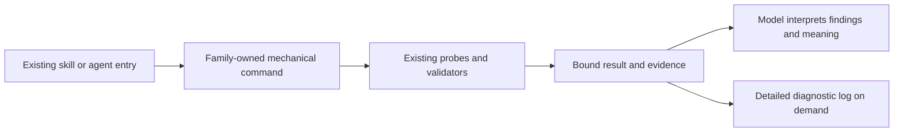

# Deterministic core — technical design

> **Status:** technical design candidate for exact-content review and subsequent operator agreement, 2026-10-15. The operator accepted sequencing and the implementation platform; this document grants no implementation authority. Actual review verdicts and their content bindings live in the separate review record.
> **Authoritative for:** the evolving technical proposal and decision register for feature `deterministic-core`.
> **NOT authoritative for:** the project goal, runtime activation, delivery certification, or permission to implement. The approved product brief owns the product promise.

## Context and product authority

The ready-made framework should execute its specified mechanical responsibilities through reusable mechanisms. Models retain meaning, judgment, unfamiliar diagnosis and decisions. Begin with this repository, invest strongly in reusable core assurance, and deliver useful bounded increments while keeping residual mechanical work visible.

Product authority: [approved PRD](../../meta-factory/research-patches/2026-10-14-deterministic-skill-agent-audit/product-brief-4869eaee6c97d6ea055a94e11f462d4c4c3870a79a5fe5bf6eecd17574d3d326.md), SHA256 `4869eaee6c97d6ea055a94e11f462d4c4c3870a79a5fe5bf6eecd17574d3d326`. The current-decision selector was read at revision 1 with this currentPrd and no currentSpec. Source baseline: `80196f2f9e3546ceffa00c0cb362903d1eebaebe` in the operator-designated `e220` checkout.

The original artifacts were authored in worktree `e220`, which was subsequently archived. On 2026-10-15, all 28 research/design files were recovered byte-for-byte from Git snapshot `cd9c57bbb0a2a0523a71d3fc86704f5381b8c228` into the current `6612` checkout before these design updates. The approved PRD bytes and original approval records remain unchanged. See the research recovery receipt for relocated paths; old absolute receipt paths are historical and must be reconciled through the existing authority helpers before formal publication. The current source checkout is not claimed to include newer TAK work merely because it is a different worktree.

### Operator-premise register

The authoritative entries P1–P13 are incorporated by pointer to [product-intent-source.md](../../meta-factory/research-patches/2026-10-14-deterministic-skill-agent-audit/product-intent-source.md), SHA256 `d8208866c44ae7af5cf071735253151d12fa0eec9ae55fa6fa1557cc15be7762`. They are not rewritten into new premises here.

Design-stage operator instructions (2026-10-14, preserved separately from the approved PRD bytes):

| ID | Instruction | Provenance |
| --- | --- | --- |
| P14 | Plan the whole core, at least at the coverage/dependency level, and determine the order; identify what should come first to support the rest. A first increment must not become the entire initiative. | Operator response to Q1 |
| P15 | Accept a separate named core simplicity principle through existing design/review owners. | Operator response to Q2: agreement |
| P16 | Reconcile the recently implemented anti-tautology protection before proposing more; meta-tests are central infrastructure and require strong assurance. | Operator test-quality question |
| P17 | Delegate technical ordering to Codex; prioritize high useful benefit, easy implementation and immediate reuse. Avoid attempting to mechanize complex open-ended judgment. | Operator sequencing delegation, 2026-10-15 |
| P18 | Accept the proposed sequence and Node.js/TypeScript-to-JavaScript platform; seek portability across environments. | Operator response “Yes, let us do that”, 2026-10-15 |
| P19 | Recover original documents, write this specification and a handoff only; Sol will prepare the kickoff after context compaction. | Operator scope instruction, 2026-10-15 |

| Premise | Source entry |
| --- | --- |
| P1 | Linked register P1: division between formal work and judgment |
| P2 | Linked register P2: simplicity across callers, maintainers and agents |
| P3 | Linked register P3: named simplicity criterion through existing owners |
| P4 | Linked register P4: mechanize the ready-made core and use relevant triggers |
| P5 | Linked register P5: strong common assurance and anti-tautology |
| P6 | Linked register P6: historical investment distinction, corrected by P12 |
| P7 | Linked register P7: expected context and mechanical-reliability benefits |
| P8 | Linked register P8: historical small-task example, corrected by P12 |
| P9 | Linked register P9: start with this framework project |
| P10 | Linked register P10: research reuse, evidence boundaries and scoped handoff |
| P11 | Linked register P11: written product definition |
| P12 | Linked register P12: useful priorities and bounded completion; no separate lightweight-project promise |
| P13 | Linked register P13: effort versus useful result; no numeric interpretation of the analogy |

### Vocabulary and population

Use the existing glossary meanings of [base core](../../../CONTEXT.md#base-core) and [internal core](../../../CONTEXT.md#internal-core). The PRD's ready-made core includes maintained install-delivered capabilities, with profile-specific boundaries; it is not synonymous with every file under `packages/core/` or every operator procedure. Internal-only examples can inform reuse without becoming default consumer payload.

The dated base-core inventory contains 100 principles (A–J); it is not a census of 100 active checks. Skills, roles, hooks and their constituent operations form additional, overlapping populations. The unit of mechanization is an operation with a defined contract, not a principle number, Markdown file or individual sentence.

## Verified starting points

| Existing owner | Source evidence | Consequence for the proposal |
| --- | --- | --- |
| Mechanism versus judgment | `2026-09-28-one-button-chain-base-core.md:95`, A7; consumer status `.agents/procedures/getff/references/base-core.md:46` | Extend an existing division of responsibility; do not invent a competing automation principle. Broad activation is not established. |
| Core population | `2026-09-28-one-button-chain-base-core.md:247` | Preserve the 100-ID baseline; a new simplicity entry is a separately reviewed catalog change. |
| Role source and delivery | `.agents/roles/living-docs-auditor.md:23`; `setup.d/20-agents.sh`; `setup.d/ships.manifest:126` | The first candidate can improve an existing consumer-shipped role. |
| Audit mechanism | `setup.d/40-configs.sh:14`; `setup.d/ships.manifest:147` | Reuse the delivered audit script; do not replace domain probes with a new universal checker. |
| Residual command interpretation | `.agents/roles/living-docs-auditor.md:31–91,174–198` | Script selection, run bookkeeping, output classification and auxiliary checks remain model-executed recipes. |
| Existing report mechanism example | `.agents/roles/resources/docs-form-auditor/check-report.mjs`; `.agents/roles/docs-form-auditor.md:128` | Reuse its separation of structural validation from semantic judgment; its role-specific schema is not a universal report format. |
| Existing invocation wrapper | `.agents/procedures/pipeline/helpers/run-helper.sh` | Completion and exit propagation already have an owner; they do not prove semantic success. This is operator machinery, not automatically consumer payload. |
| Existing context/delivery ownership | Prior-art SSOT #233, #234, #253, #270, #273 | Preserve adopted workflow and generated-entry owners. Extracting scripts must not add a parallel router or second hand-maintained native entry. |

Sources and original-versus-port distinctions are recorded in the completed [research overview](../../meta-factory/research-patches/2026-10-14-deterministic-skill-agent-audit/research-overview.md) and [simplicity research](../../meta-factory/research-patches/2026-10-14-deterministic-skill-agent-audit/simplicity-research.md). This design does not adopt pstack's whole router, the independent port's shipping policy, or a second Osmani workflow pack. The useful residue is lower reader burden, fewer repeated decisions, behavior-preserving simplification and evidence of actual use.

## Approaches and proposed decision

| Approach | Useful result | Cost / failure case |
| --- | --- | --- |
| **Recommended: convert one complete existing operation family, then expand from observed results** | A real caller gets a tested mechanical path and compact result; existing owners remain recognizable | First increment has deliberately limited coverage; shared abstractions must wait for demonstrated compatibility |
| Mechanize common wrappers across all skills first | Broadly consistent invocation mechanics | May standardize ceremony while the meaningful failure remains inside each operation; delivery and authority differences complicate a common wrapper |
| Build a general workflow engine first | Uniform scheduling, state and transitions | Large new ownership surface before useful evidence; recreates capabilities already owned by procedures and runtime bridge |

The recommended approach is falsified if the existing family already provides the advertised mechanical behavior through its real caller, or if integration/maintenance outweighs the removed clerical work. The alternative is to select a better evidenced family, not to declare the remaining work judgment-only.

## Proposed architecture

This is a proposed responsibility split. The existing entry invokes one family-owned command. The command performs specified acquisition and checks, preserves their actual result and returns enough evidence for interpretation. The model supplies semantic conclusions and advice. No new scheduler, runtime registry or workflow DSL is proposed.

### Mechanical boundary

Mechanize operations whose accepted inputs, effects and outcomes can be specified without a new semantic choice: resolve an explicit target, select a documented command, validate prerequisites, enumerate declared inputs, preserve exits/output, apply exact result rules, count findings, render reports and bind evidence to its target.

Keep the following with judgment: whether a declared rule expresses the right intent, whether a reported violation is an actual problem or a probe defect, how to repair it, whether two operations share the same meaning, and whether an abstraction reduces total complexity. A semantic verdict supplied by a model can be structurally validated without becoming mechanically proven.

A contract is not sufficient merely because its parser is deterministic. Wrong-target execution, partial reads and a false oracle remain failures.

### Invocation, result and context contract

Each converted family must define the following in its existing owner; this is design content, not a new mandatory global runtime schema:

| Concern | Required behavior |
| --- | --- |
| Input | Explicit target and operation arguments; no fallback to the framework checkout when the intended target is missing or ambiguous |
| Trigger | Existing explicit entry or a verified relevant event; no unrelated broad hook and no inference that context injection executes the check |
| Effects | Declare reads, temporary files and allowed subprocesses; preserve the existing reporting-only or writing boundary |
| Success | State what ran and what passed; an exit-zero/no-op result cannot establish check completion |
| Failure | Preserve failures independently of incomplete acquisition; never convert unavailable inputs into clean output |
| Evidence | Target, selected operation, execution result and diagnostic location sufficient to trace the observation; no new hash/state framework without a concrete need |
| Repeat execution | Read-only checks can be rerun; retries must not hide the original failure or change the target |
| Routine context | Purpose, when to invoke, inputs, effects, result interpretation, judgment residue and diagnostic pointer |
| Cold detail | Implementation recipes, complete logs and repair detail loaded only when needed |

Existing contracts may already cover parts of this table. Extend them at their current owner rather than wrapping them in another protocol merely for consistency.

## Whole-core plan and the first foundation

The complete initial [coverage and sequencing map](./2026-10-14-deterministic-core-coverage.md) assigns all 100 existing base-core IDs, 22 canonical procedures, 21 roles and 36 hook/adapter/library files to workstreams. It separately names template, rule, helper, installer and test-entrypoint populations whose transitive operation closure is an F0 task. It is a full-core planning map, not a claim of full implementation or exhaustive transitive source audit.

Selected sequence (P17/P18):

1. **F0 — establish trustworthy acceptance using the existing Test Assurance Kernel (TAK).** Reconcile its actual implementation/evidence with the execution base, bind the selected mechanism to an independently specified oracle, and retain the remaining population in TAK's existing S2 program. Add the accepted simplicity principle at its existing catalog/design/review owners. Do not start a second anti-tautology subsystem or wait for a new universal test platform.
2. **F1 — establish the execution contract through real consumers.** First convert living-docs-auditor execution and result preservation, then the existing rule-tests verification entry. The latter tests a materially different contract: diagnostic identity and single-rule isolation. Share only target/execution/evidence mechanics that genuinely survive both uses; role-specific checking remains with its owner.
3. **F2 — inventories, evidence and reports.** Move formal census, coverage arithmetic, receipt validation and report preparation out of the model across the mapped roles/procedures.
4. **F3 — compact context, triggers and delivery.** Reconcile existing entrypoints, narrow events, installed dependencies and real invocation across supported profiles/harnesses. Each earlier increment already needs its own delivery proof; this stage closes cross-family gaps.
5. **F4/F5 — remaining core checks and research/reuse bookkeeping.** Reuse existing rule/template/back-end owners. Mechanize known source identity, prerequisite, freshness and provenance operations without claiming to mechanize relevance or judgment.
6. **F6 — workflow transitions in their actual scope.** Reuse intent/runtime/pipeline owners for counters, state preconditions and receipts; keep optional operator machinery separate from consumer default.
7. **F7 — full-coverage reconciliation and measured benefit.** Account for all deterministic responsibilities, preserve genuine judgment boundaries and explicit remaining work. Run reconciliation at each checkpoint, not only at the end.

This order makes assurance and an actual invocation/result boundary reusable foundations. It does not turn the first audit into a miniature universal workflow engine. Later ready families may advance independently; a missing unrelated platform or a full TAK campaign closure does not block a locally evidenced increment. A missing assurance obligation on the selected mechanism does block claiming that mechanism accepted.

Falsifier: if TAK's current entrypoints already cover the selected assurance obligations, reuse them without additional mechanism work. If the first two callers require incompatible state/authority contracts, retain family-owned commands instead of forcing a shared runtime. If comparable work shows no useful reduction in clerical failures/context/maintenance burden, reconsider the family order.

## First execution slice candidate: living documentation audit

**Selected first execution family (P17/P18).** The scope is the mechanical execution/reporting boundary of `living-docs-auditor`, not new semantic audit coverage and not a rewrite of all audit scripts.

Today the model selects a script, manages shell variables across tool calls, captures logs/exit status, classifies PASS/FAIL/WARN and executes auxiliary recipes. The role already specifies that missing scripts, empty output and helper failure are incomplete. Those instructions deserve execution rather than repeated interpretation. The JSON TODO recipe at `.agents/roles/living-docs-auditor.md:197–198` uses a failing grep as evidence of no debt even when files cannot be read; the new path must distinguish those cases.

The proposed command is co-located with the existing audit owner under `packages/core/audit-self/`; its exact filename and result format are an open design detail. It selects and invokes the existing project audit, performs bounded auxiliary checks, returns mechanical status/counts/evidence and renders the mechanical report portion. The role keeps reading the relevant declarations and explaining findings. It cannot manufacture missing locations, rule meanings or repair advice.

Reuse the existing structured D1/D2 implementations in `packages/core/audit-self/audit-ai-docs.ts:244,300` and their existing tests where their delivered lane supports them. Do not promote the role's weaker grep/awk recipes into a second normative checker. Resolve the runner matrix before freezing this increment: the role currently selects base/React Next, while `setup.d/40-configs.sh:148–153` also delivers SPA/native variants. Payload availability and supported output contracts must be checked per lane; this draft does not claim universal parsing or profile closure.

Source reconciliation also found limits in that reuse candidate: `probeD2` silently ignores unreadable directories and malformed/unreadable JSON (`audit-ai-docs.ts:306–327`). Reuse is not proof of completeness. The selected design must preserve these states explicitly at the owning boundary before claiming a complete result. Existing `tests/living-docs-auditor/runtime.test.mjs:7–55` executes extracted Markdown snippets and checks exit/output preservation, missing-helper continuation and one drift extractor; extend that real seam to the converted command and its delivery instead of merely asserting the replacement prose mentions it.

The overall result must preserve two independent facts: known violations and completeness. A run can contain known FAIL findings while another check is unavailable. Only a completed eligible population with no failures may be described as clean. Optional absence must be reported as not applicable where the contract permits it; unreadable or required-but-missing inputs are not an empty population. Unknown/custom output must remain available with an explicit unsupported/incomplete interpretation, not silently counted as PASS.

Framework-first acceptance must exercise the same command on this repository and through a controlled installed-layout fixture. The framework normally lacks the consumer `scripts/audit-ai-docs.sh`; that run must honestly demonstrate the missing-script branch. Positive and violation cases need actual installed-layout execution, not a false green from the framework's missing script. No live consumer installation is authorized by writing this design.

Completion boundary: the selected role has one usable mechanical entry, its documented adverse states are exercised, routine recipes are replaced by a usable contract, and delivery evidence names the profiles that carry the dependencies. Other roles and core principles remain explicitly residual.

Formal report validation/publication and common wrappers were considered as first increments. Execution/result handling in living-docs-auditor is selected because it has an existing shipped caller, bounded mechanical residue and a concrete false-clean risk. Move report/inventory work next after the second caller; do not build all-skill wrappers first. Reorder only on recorded evidence that the selected work is already covered or another bounded operation provides materially greater benefit for lower total cost.

## Implementation platform and portability

Use the existing Node.js ecosystem. Write substantive typed core modules in TypeScript and deliver runnable JavaScript through the existing build/distribution owners. Small dependency-light helpers may remain direct `.mjs` files. Consumer execution must not require a TypeScript compiler, tsx, a source checkout or npm installation into the consumer application merely to run the helper. Reuse an existing mechanism in another language when it already satisfies the obligation; no language-homogenization rewrite is required.

Evidence in the available checkout: `packages/core/package.json` declares Node >=22, TypeScript and the existing test runners; root `package.json` already contains esbuild-based distribution owners. Match the core's supported Node baseline rather than independently inventing a version policy. `README.md:155` names Bash/Git/Python/curl setup prerequisites, and `install.sh:100,802` describes node-free paths. Node is therefore an existing core runtime, not a proven prerequisite of every delivered consumer profile. New commands must declare their runtime dependency, detect it through the existing installation/preflight owner and report unavailable capability explicitly. Do not silently install runtimes or mark a missing runtime as a successful check.

| Portability axis | Contract | Acceptance evidence |
| --- | --- | --- |
| Project language | Framework mechanics are independent of application language; existing stack checks retain their own prerequisites | Installed fixtures for each admitted profile; no injected application dependency solely for the helper |
| Model/harness | A normal CLI can be invoked by any supported harness with process access; native trigger adapters stay with existing owners | Actual adapter invocation where supported; direct CLI evidence does not establish native hook firing |
| Operating system | Target macOS, Linux and native Windows for the new common mechanics | Real command tests on each claimed OS; record unverified cells rather than infer support from Node availability |
| Runtime/tool dependencies | Node version and existing backend executables are explicit | Missing/unsupported runtime and backend paths produce actionable unavailable/incomplete outcomes |
| Packaging | Consumer gets the entry plus all runtime resources | Run from an isolated installed layout without imports from the contributor checkout |

Use standard filesystem/path APIs and subprocess argument arrays. Do not build new mechanics from GNU-only grep/sed recipes, implicit cwd, shell interpolation or POSIX path assumptions. Node's [subprocess API](https://nodejs.org/download/release/latest-jod/docs/api/child_process.html) supports direct execution; Windows command scripts and existing Bash backends still require their applicable launcher. A Node wrapper does not remove those dependencies. Define and test Windows Git Bash requirements where such backends remain; do not silently substitute WSL for native Windows evidence.

No service, database, workflow DSL, generic plugin registry, persistent scheduler or FSM package is introduced for this feature. Straight-line operations use functions; explicit branches represent known states. Extract a shared helper only after the living-docs and rule-tests callers demonstrate compatible obligations. Runtime/protocol reuse is a possible result, not a required deliverable. Keep family-specific result meaning and authorization separate.

Reconsider the platform at the existing owner if a required consumer profile cannot accept Node or a materially simpler existing mechanism covers the same obligations. Do not preemptively maintain Python/Node twins or per-OS executables to avoid that evidence-based decision.

## First-family command and result contract

The audit owner under `packages/core/audit-self/` owns the implementation. Expose a family-local CLI through the existing role delivery mechanism; determine the physical emitted filename from the existing distribution layout during kickoff preparation. The externally observable contract is fixed here; a new global router is not needed.

- Input: explicit project root and a supported audit profile (or the existing deterministic profile selector). Resolve the root once and use it for every check. A missing/ambiguous target fails before subprocess execution; no fallback to the framework cwd.
- Operation: validate prerequisites, resolve the supported existing runner, execute it once, collect bounded output, run admitted auxiliary probes, aggregate mechanical findings and render a concise result. Do not analyze arbitrary prose meaning or synthesize new checks.
- Effects: read-only against the target. Diagnostic files, when requested, go to an explicit output location; failure to preserve required evidence is an error. No repairs, package installation, Git changes or retry that alters the target.
- Result: one machine-readable JSON result on stdout; launcher diagnostics on stderr. Include target, profile, per-check identity/status, known findings, completeness and reasons, and diagnostic references when created. Counts are derived from findings, never supplied by the model. Full logs stay outside routine context. No new global receipt/hash format is required.
- Per-check states: passed, violations, not-applicable, incomplete or error. Not-applicable requires a documented profile condition. Unknown output, absent required inputs, invalid JSON, timeout and output truncation cannot become passed.
- Overall classification: clean only when all applicable checks completed without violations. Preserve known violations even if another check is incomplete. A completed negative audit and a failed execution are different facts.
- CLI exit mapping for the new entry: 0 = complete and no violations; 1 = complete with violations; 2 = invalid invocation, incomplete or execution error. For exit 2 with known violations, JSON retains those violations. Translate existing backend exits at the family boundary without changing their original meanings or discarding raw diagnostic information. A contradictory backend result remains an explicit error, retaining any known findings.
- Boundedness: external processes have a finite timeout and output limit, documented for the family and overridable only through validated options. No unbounded retries. On timeout/overflow preserve partial findings and mark incomplete; do not parse truncated output as a complete result. Concrete limits are selected against the existing runners during kickoff preparation.

The profile matrix must reconcile the role's base/React Next selection with the installer's SPA/native variants before the first slice is admitted. An existing custom project script is not assumed to emit the shipped runner's format. Preserve its output as unsupported/incomplete unless an explicit existing contract supports it. Do not solve this with heuristic parsing of arbitrary shell output.

The model-facing role retains only purpose, applicability, invocation, effects, result interpretation and judgment responsibilities. It does not reconstruct the mechanical report or rerun the displaced recipes. Detailed implementation stays at the owning module; diagnostic detail is loaded when relevant.

The second family, rule-tests, invokes its existing verification path with explicit rule identity and isolation. It preserves diagnostic identity and the existing verifier's normative verdict. It must not copy the audit's profile rules, broaden into test generation or claim semantic test adequacy from a successful process exit. Compare real shared concerns only after both family paths are exercised.

## Increment acceptance and sequencing boundaries

The first execution slice completes only when the actual role entry reaches the delivered command; good input, a real violation and required-input/runner failures produce the correct distinct results; no-op and bypass controls fail the unchanged outer oracle; supported payloads contain all dependencies; and routine role recipes have been replaced with the compact invocation contract. Exercise the framework's genuine missing-consumer-script case and controlled positive/negative installed layouts. This is a useful completed result even while other core families remain unconverted.

F0 assurance is scoped to the selected mechanism and runs alongside F1 preparation. Full TAK campaign closure and a shared library are not prerequisites. The simplicity principle is recorded through existing catalog/design/review owners; it does not create a new mandatory review station. After the second family, prefer inventory/report operations with an existing parser, repeated callers and explicit expected output. Defer only their implementation order, never erase remaining deterministic obligations from the whole-core map.

Each later family closes with actual execution, supported delivery, meaningful adverse tests and removed routine interpretation. Context/trigger work occurs in every slice; F3 reconciles cross-family gaps. F4/F5 may proceed independently when ready; F6 remains a separately scoped operator lane. Measure useful outcomes at every checkpoint, without claiming token savings from source-line reduction alone.

## Named principle: simplest sufficient structure

**Proposed wording:** Prefer the simplest structure that satisfies accepted behavior and required invariants. Before adding a layer or mechanism, examine removal, reuse and a better data/interface shape. Keep each genuine decision with one owner. Evaluate complexity for callers, maintainers, verification, operation and agent context.

The operator accepted a distinct named core principle in the second design round (P15). It has one canonical criterion referenced by existing design/review owners, with examples and counterexamples. The exact catalog identifier and final wording remain technical design work. The planned population is the 100 existing principles plus this accepted addition; the live inventory has not yet been modified. Do not add a new mandatory reviewer or universal complexity gate merely to host the principle.

A7 continues to own the mechanical/judgment division. B7/H2/H6/H12 retain their narrower complexity, dependency, public-surface and unused-code responsibilities. Mechanically checkable slices reuse their tools. The broad architectural judgment must not become a regex verdict, a line-count threshold or a new mandatory reviewer for every change.

Counterexample: fewer lines in a role do not constitute simplification if callers must coordinate a new registry and several pass-through commands. Conversely, a larger helper can simplify the system if it eliminates repeated callers' state and preserves diagnosis. Removal still requires a consumer map and preservation of unique obligations.

## Testing seams and assurance

### Reuse the existing Test Assurance Kernel

The prior owner is [Test Assurance Kernel design](./2026-10-08-test-assurance-kernel-design.md), especially sections 4–6 and 9. That campaign already specifies K1–K7, Q1–Q6, a fixed outer conformance driver for principle-tests that are themselves production gates, complete-population S2 repair, S3 cost reduction and S4 independent acceptance. This feature consumes those contracts and evidence; it does not fork their policy, mutation engine or repair campaign.

Source reconciliation on this turn found two distinct states:

| State | Verified scope | Limit |
| --- | --- | --- |
| This checkout, `80196f2f9e3546ceffa00c0cb362903d1eebaebe` | TAK design/S0 baseline; P04 manifest no-op/identical-example checks; P02 selected assertion-shape checks; existing liveness and mutation machinery | P04 is not a general meta-test quality checker. P02's content scan does not cover `principles/`; existing Stryker scope targets ESLint/hooks, not principle gates implemented as test files. |
| Local branch `codex/tak-s1-d011`, inspected at `133fd3ae99e` | Actual Q1/Q2 test-quality lint, P51 corpus/population conformance, P52 subprocess/self-source corpus, P53 delivery/discovery conformance, fixed outer counterfactual driver and subsequent repairs | These bytes are not part of this checkout. Source inspection does not certify final campaign acceptance, merge or current runtime activation. |

Pinned newer-source references (paths are relative to that branch, not claims about this checkout): `packages/core/eslint-rules/no-vacuous-assertion.ts:7–18`, `require-effective-assertion.ts:7–19`, `packages/core/hooks/checks/guard-liveness.ts:239–271`, `packages/core/principles/51-test-quality-corpus-conformance.test.ts:4–43`, `52-subprocess-status-conformance.test.ts:6–21`, `53-delivery-discovery-conformance.test.ts:6–23`, `scripts/test-assurance/driver.mjs:4–21`. Recent repair commits include `1cb4a51d3e7`, `03b8cf7032d`, `bcf1c7dc4be` and `09da4aa2b5d`.

Q1 rejects literal-only assertions; Q2 looks for recognized assertion/helper calls. Neither is a universal semantic oracle. An identifier/call-based copied predicate, `expect(actual).toBe(actual)`, recomputing the expected value with the same defective helper, or checking the wrong import can look syntactically valid. P52/P53 and fixed-driver campaigns provide stronger evidence for their exercised cases; corpus coverage must not be represented as all-test semantic classification.

For each load-bearing mechanical obligation in this initiative, require the existing TAK contract: unchanged good/bad oracle → baseline through the real entrypoint → reached permissive/over-rejecting/check-disconnection fault → intended failure of the unchanged outer driver → restored baseline. If the checker itself lives in a `.test.ts` principle, mutate that checker in isolation while retaining the outer oracle and its expected outcomes. Mutating only the governed input demonstrates detection, not sensitivity to a defective checker.

The explicit trusted boundary is the independently reviewed fixed driver and intended outcomes. No infinite hierarchy of tests-about-tests is proposed. Static test-quality checks stay cheap and early; expensive counterfactual evidence follows the existing targeted/deep TAK lanes, not an unconditional full mutation run on every push. TAK's own previously approved performance targets do not convert the operator's unrelated 20/80 analogy into a target for this feature.

Sufficiency is per obligation, not a global assertion that tautology is solved. Full-core assurance requires a complete obligation register and relevant evidence for each admitted row; a green suite and Q1/Q2 presence alone are insufficient. Source inspection in this design turn ran no TAK battery and does not reuse historical execution results as a fresh green claim.

Primary seam: the selected family's public command as invoked by its actual entry, using controlled input trees and existing probe implementations. A direct parser unit test is useful for diagnosis but cannot substitute for the invocation path.

| Case | Required observable |
| --- | --- |
| Valid input and completed checks | Correct target and covered population, stable result meaning, evidence retrievable |
| Relevant violation | The intended check detects it; an unrelated diagnostic cannot satisfy the assertion |
| Checker replaced by success-only/no-op behavior | Acceptance fails because required work/result evidence is absent |
| Required invocation removed or bypassed | Caller-path assurance fails even if direct helper tests remain green |
| Exit zero plus explicit failure | Failure preserved |
| Nonzero exit without valid findings | Incomplete/error preserved; no clean claim |
| Missing/unreadable input, empty output or truncated result | Absence/partial work reported accurately, known failures retained |
| Nested cwd or wrong target | Uses the bound target or refuses; does not audit a convenient different checkout |
| Mixed warning, violation and incomplete checks | Counts and overall interpretation preserve all three facts |
| Dependency omitted from delivered payload | Installed-layout test detects the broken entry |

Expected results must be independently specified from contract examples and actual adverse behavior. Do not generate the oracle using the same production function under test. Use targeted mutations/disabled-check controls at this seam; choose an existing test runner rather than adding a universal mutation service. Review tests for meaningful assertions and plausible false positives/false negatives.

Mechanical CI tests remain deterministic and make no paid LLM calls. Real model invocation, host trigger firing, receipt structure and semantic judgment are distinct evidence layers. A synthetic event does not certify trusted native activation.

## Benefit and simplicity evaluation

Compare the original and converted entry on the same task inputs and accepted outputs. Capture actual prompt/reference loads, tool-output volume, repeated calls, clerical errors and repair work, elapsed time and maintenance obligations. Record model/harness/version when available; unavailable token telemetry stays unavailable. Source bytes can be a proxy for reading burden, not observed token savings.

An initial model comparison is optional for a bounded technical increment, but any claim that weaker models perform better requires comparable observed runs under the same contract. Semantic competence is outside the guarantee. All-model benchmarking and paid infrastructure are not prerequisites.

Choose subsequent work using actual frequency, repeated interpretation, failure history, reuse and integration/maintenance cost. No 20/80 quota, weighted score or universal savings threshold follows from the operator's analogy. A neutral or harmful result is recorded in the existing decision/evidence record and changes the next recommendation.

## Delivery, residual coverage and stopping boundaries

Maintain one scoped operation inventory alongside the design, initially derived from the completed audit rather than another full research pass. Each selected operation records its owner, mechanical/judgment boundary, current implementation, actual callers, delivery profile, evidence level and remaining gap. Inventory data must not become a second runtime registry.

Each increment closes on its declared family and observable outcome. Overall coverage remains open until every in-scope deterministic responsibility is accounted for. Deferred mechanics remain mechanics; they are not reclassified as judgment to make the inventory green. The 100 principle rows and the skill/role population must not be merged into an invented denominator.

Distinguish source correctness, installed payload closure, entry discoverability and actual host invocation. Preserve existing installation profiles and generated native entries. A source-only local result can be delivered as such, with remaining delivery work explicit; it cannot substantiate a consumer activation claim.

## Live decision register

| Decision | Status | Resolution | Falsifier |
| --- | --- | --- | --- |
| D1 Product boundary | answered | Approved PRD P1/P4/P9: mechanize ready-made formal work, judgment retained, framework first | Design makes semantic decisions mechanically or silently substitutes an internal-only population for the shipped core |
| D2 Assurance | answered | P5/DC-P3: strong common assurance and anti-tautology | Wrong/no-op/bypassed checks pass acceptance |
| D3 Simplicity intent | answered | P2/P3: named criterion through existing owners | A second owner or new ceremony merely relocates complexity |
| D4 Prioritization meaning | answered | P12/P13: useful bounded increments, no numeric rule or small-project policy | Numeric analogy becomes a target, or useful results wait on universal construction |
| D5 Foundation and sequence | answered | P17/P18: selected TAK assurance alongside living-docs-auditor, then rule-tests, then inventory/report mechanics; continue the full-core workstreams without a universal engine prerequisite | Existing current-base evidence already discharges a proposed prerequisite, or real caller/cost evidence favors a different sequence |
| D6 Simplicity catalog treatment | answered | P15: operator accepts a distinct named core inventory entry carried by existing design/review owners; ID and final wording remain technical work | New entry duplicates a complete existing owner or introduces a needless separate process |
| D7 Whole-core planning | answered | P14: plan all core populations now; order incremental delivery without shrinking scope to the first pilot | An unassigned core family is silently omitted or an early slice is reported as full-core completion |
| D8 Existing assurance reuse | answered | P16 requires reconciliation; existing TAK owns the assurance contract and campaign; no competing anti-tautology subsystem | TAK cannot express the selected obligation's real entrypoint and fixed-oracle sensitivity, requiring an evidence-backed extension at its owner |
| D9 Implementation platform | answered | P18: existing Node.js ecosystem; TypeScript modules where useful, runnable JavaScript delivery, small direct JavaScript helpers; no new FSM engine | Required profiles cannot accept Node or existing simpler mechanisms meet the contract at materially lower cost |
| D10 Current delivery boundary | answered | P19: documents and recovery only; Sol prepares kickoff after compaction | This turn writes a kickoff, starts implementation, installs software or claims pending reviews passed |

D1–D10 record settled intent and delegated technical decisions. Acceptance of the direction is not exact-content agreement on this subsequently edited specification. Formal review and publication gates remain pending.

## Consensus retell

Baseline: none — first retell

Rows 1–7 retain prior meaning; rows 8–10 add the latest operator decisions. The recovered draft is archived at `cd9c57bbb0a2a0523a71d3fc86704f5381b8c228`; it is not an operator-confirmed specification baseline. No exact written-spec agreement has yet been recorded.

| # | Claim | Source |
| --- | --- | --- |
| 1 | Mechanize deterministic work in the ready-made core and retain model judgment. | P1 + P4 |
| 2 | Begin in this framework project and invest thoroughly in core test quality, including anti-tautology. | P5 + P9 |
| 3 | Simplicity is a named criterion carried by existing owners. | P2 + P3 |
| 4 | Prioritize useful outcomes relative to effort without a numerical interpretation of the analogy. | P12 + P13 |
| 5 | Plan the whole core and sequence delivery; the first increment does not replace the full scope. | P14 |
| 6 | Add a distinct named core simplicity principle through existing owners. | P15 |
| 7 | Reconcile and reuse the recent anti-tautology work, with strong assurance for meta-tests. | P16 |
| 8 | Codex selects the sequence by useful benefit, simplicity and immediate reuse; the proposed living-docs-auditor then rule-tests order is accepted. | P17 + P18 |
| 9 | Use the existing Node.js ecosystem with TypeScript development where useful and executable JavaScript delivery; verify portability per supported environment. | P18 |
| 10 | Recover and write documents now; Sol prepares kickoff after compaction, without implementation in this turn. | P19 |

### Unconfirmed — author derivations

- The proposed simplicity wording, identifier and technical carrier.
- The proposed command placement, acceptance matrix and evaluation method.

## Review and agreement boundary

Sequence, runtime direction, whole-core scope and the distinct simplicity principle are settled. This specification defines the family contract and completion criteria for later kickoff preparation. The operator subsequently requested completion of the arch reviews and correction of findings, while preserving the no-implementation/no-kickoff boundary for this turn. Actual verdicts, publication results and candidate digests are recorded separately under the research directory's `arch-review/`; no outcome is inferred from this paragraph. This avoids editing a candidate merely to record a review over its own bytes. Exact written-spec agreement is a separate operator decision, recorded through the existing intent helper only after the presentation gate passes. Sol must check the bound review record, operator agreement and current TAK readiness before preparing an executable kickoff. Do not reopen settled product intent, repeat completed external research, or advance currentSpec on the strength of a review GO alone.

### §1.7 Forward-check applied

The proposal reuses A7 (`2026-09-28-one-button-chain-base-core.md:95`), existing role/audit ownership (`.agents/roles/living-docs-auditor.md:14`), and the research's prior-art map (#233/#234/#253/#270/#273). It preserves no paid inference in CI, product approval boundaries and source-versus-delivery honesty. No code, hook or active rule has been changed.

### §1.7 Backward-check applied

The completed audit covers 22 canonical procedures, 21 roles and the joined 100-principle inventory (`2026-09-28-one-button-chain-base-core.md:247`); it is reused as a dated population map, not a certification that these surfaces comply with this proposed design. The selected role's command and auxiliary surfaces were reread (`.agents/roles/living-docs-auditor.md:23–198`). Broader conversion, exemptions and their adverse controls remain future scoped work; this first draft grants no blanket compliance or exemption.
