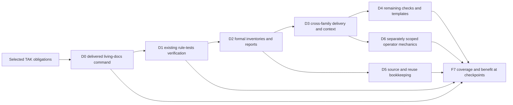

# Deterministic core — execution umbrella

> **Status:** prepared on 2026-10-15; implementation and launch are not authorized.
> **Authoritative for:** decomposition, stage boundaries and acceptance of feature `deterministic-core` under the agreed specification.
> **NOT authoritative for:** product intent, architecture requirements, execution choreography, runtime activation or permission to implement. Those remain with the PRD, agreed design, existing procedures and operator.

## §0 Authority and cold start

Read these inputs before planning a stage:

1. [Agreed technical specification](../../../docs/superpowers/specs/2026-10-14-deterministic-core-design.md), SHA256 `b30836da511c96d1de996b373262140fbf6c8b65d023b7c0d902fcb9861d099e`.
2. [Whole-core coverage map](../../../docs/superpowers/specs/2026-10-14-deterministic-core-coverage.md), SHA256 `03770d8453fc1f3a64df940969fa2bea506416f9b5003044898d80cdb9a093db`.
3. [Exact agreement](../../../docs/meta-factory/research-patches/2026-10-14-deterministic-skill-agent-audit/spec-agreement.md) and [completed reviews](../../../docs/meta-factory/research-patches/2026-10-14-deterministic-skill-agent-audit/arch-review/REVIEW-SUMMARY.md). The frozen spec's historical pending-status paragraphs do not undo the subsequent agreement.
4. The current stage input, initially [D0: living-docs audit](./kickoff-d0.md).

The approved PRD digest is `4869eaee6c97d6ea055a94e11f462d4c4c3870a79a5fe5bf6eecd17574d3d326`. The current selector is revision 2 with currentSpec set; published matches attempt is `565cd291f736f333c3421654c87bbcebb1fc315855ac3d4d037c9e8afba9324a`. Do not replay approval or modify the agreed design to record progress.

Read the execution checkout's AGENTS.md, README goal, session bootstrap and CLAUDE.md. Commands and ordinary artifact paths below are repository-relative. Absolute archival paths are authority-resolution inputs only, never execution cwd defaults.

Authoring checkout: `/Users/art/.codex/worktrees/6612/rules-as-tests-aif`; source HEAD `80196f2f9e3546ceffa00c0cb362903d1eebaebe`. Old e220 is an archival authority mirror, not a checkout. Both owner roots are currently needed by intent helpers. Before launch, ensure authority refs resolve in the actual destination; use the existing continuity transport, not an invented selector or manual approval rewrite. Recheck:

```bash
node .agents/procedures/intent/helpers/current-decisions.mjs --check-plan-prep --feature deterministic-core --spec docs/superpowers/specs/2026-10-14-deterministic-core-design.md --orch-home "$(bash .agents/procedures/pipeline/helpers/print-orch-home.sh)" --roots "/Users/art/.codex/worktrees/6612/rules-as-tests-aif,/Users/art/.codex/worktrees/e220/rules-as-tests-aif"
```

The command passed during preparation. These host paths are not presumed mounted in another environment. Unresolved authority holds that destination's handoff.

## §1 Required result and limits

Mechanize the maintained core's deterministic work through its existing owners. Retain judgment, meaning, unfamiliar diagnosis and decisions with the model. Routine entries retain purpose, invocation, constraints, result interpretation and diagnostic pointers; implementation recipes move behind the command.

The complete planning population is the existing 100 base-core IDs, 22 procedures, 21 roles, 36 hook/adapter/library sources and the coverage map's transitive owner populations. These denominators overlap and must never be added together. Numeric principle-test IDs are a different population. The accepted simplicity addition does not mean the live inventory already contains 101 principles.

Scope includes source, payload closure, discoverability and relevant invocation evidence. Keep each evidence level distinct. Operator-only pipeline/intent/runtime operations remain a separate lane from default consumer delivery. Original pstack/Poteto Mode, its independent port and Osmani remain separately attributed research; no wholesale router/workflow import is selected.

Use Node >=22 following the existing core baseline; substantive typed modules in TypeScript, delivered runnable JavaScript. Small helpers may be `.mjs`. Reuse working mechanisms in other languages. Consumer execution must not need tsx, a contributor checkout, a TypeScript build or application dependencies solely for the new command. Preserve Bash/backend prerequisites explicitly.

No workflow DSL, scheduler, service, database, FSM package, compulsory common library or generic semantic evaluator. Do not mechanize adoption judgment, review strategy, diagnosis or test-material authorship by relabeling them formal operations. The operator's 20/80 analogy supplies no ratio, quota or score. No separate lightweight-installation product policy is part of this feature.

## §2 Ordered frontier — whole-core scope

The F-names below refer to the agreed coverage map, not new runtime phases. D0 is a concrete first vertical slice. Later rows are bounded planning frontiers, not permission to dispatch an unspecified bulk task.

| Order | Workstream and output | Dependency / admission | Completion boundary |
| --- | --- | --- | --- |
| D0 | F0 selected assurance + F1 living-docs execution/result + its delivery/context | Agreed intent, actual execution-base TAK reconciliation | Actual role reaches delivered command; target, findings and completeness preserved; adverse/fault controls discriminate. See `kickoff-d0.md`. |
| D1 | F1 rule-tests verification as a different second caller | D0 outcome reviewed; family contract and lane prerequisites pinned | Explicit root/backend/rule, real isolation, expected diagnostic identity, honest skipped/error state and delivered caller path. Test-material authorship remains judgment. |
| D2 | F2 formal inventories, evidence and report preparation | A selected existing caller/parser and independently specified expected output | That caller no longer asks the model to count, bind or serialize mechanically; semantic verdict remains unchanged. Start with existing report-validation seams, not a universal report schema. |
| D3 | F3 cross-family context/triggers/delivery reconciliation | Selected converted commands; actual supported profile/harness population | Gaps between source, payload, discovery and firing closed or explicitly open. Narrow triggers; no context injection counted as execution. |
| D4 | F4 remaining rules/checks/templates and reusable generated-artifact mechanics | Per-obligation TAK assurance and relevant delivery owner | Each admitted deterministic obligation has an executable carrier and adverse proof; genuine judgment remains named. Preserve existing generators and correctness requirements. |
| D5 | F5 research/reuse bookkeeping | Existing source/provenance/acquisition owners; may proceed independently of D4 | Source identity, freshness, prerequisites and receipts mechanical; relevance, same-class transfer and adoption remain judgment. No repeated completed research without a specific gap. |
| D6 | F6 workflow transitions/counters/receipts | Existing intent/runtime/pipeline authority and a separately scoped operator stage | Preserve consent, exact-content binding and transition preconditions; no consumer-default payload expansion. |
| Every checkpoint / final | F7 coverage and observed benefit | Stage evidence, including explicit failures and residuals | No omitted operation or incomplete population reported green. Full initiative closes only after all in-scope deterministic obligations are accounted for. |

F0 readiness accompanies each selected mechanism. Full unrelated TAK campaign closure does not block D0. Delivery and compact entries belong to every row; D3 does not postpone shipping. Do not extract shared mechanics until D0 and D1 demonstrate compatible behavior; retaining separate commands is an acceptable result.



This is planned sequencing. Selected assurance supports the first real caller; the second tests reuse. Independent ready families can advance with their own prerequisites. Reconciliation runs throughout, not only at the end.

### F0 catalog and population companion

Before claiming whole-core completion, resolve the coverage map's transitive owners to concrete operation rows using existing inventories/manifests and TAK discovery. Do this incrementally around selected entrypoints, keeping unresolved owner populations visible; a complete deep census of unrelated implementation lines is not a D0 launch prerequisite.

Maintain a human-readable operation ledger under `docs/deterministic-core/` during future execution. Each row names operation, source owner, mechanical/judgment boundary, current mechanism, real caller, consumer/operator scope, payload/runtime, earliest channel, independent obligation, evidence/ref, disposition and remaining gap. This is planning/evidence data, never a runtime registry. Reuse TAK records by reference rather than copying its campaign ledger.

Add the accepted named simplicity principle through existing inventory/design/review owners in an atomic catalog batch alongside the foundation work. Allocate its ID from the actual current catalog; do not guess a 101st ID. Use the agreed design's proposed wording as input, reconcile A7/B7/H2/H6/H12, and preserve one owner per decision. Broad architectural simplicity remains a judgment criterion. Mechanically checkable slices reuse existing tools. No new mandatory reviewer or universal complexity threshold. This catalog batch need not delay the usable D0 command.

### D1 preparation contract

Before authoring `kickoff-d1.md`, read `.agents/roles/rule-test-author.md`, `.agents/procedures/rule-tests/SKILL.md`, `packages/core/synthesizer/run-rule-tests-firing.sh`, the existing npm mutation/validator path and current backend capability contracts. Use `scripts/rule-tests-runtime-audit.test.mjs` as a real seam, not a proof of native-agent behavior.

The current firing script accepts root/backend, not a public single-rule selector. It may exit zero on absent/degraded lanes. Extend the existing owner only where needed for exact rule selection; never filter prose after running unrelated rules. Keep per-sample temp isolation and normative diagnostic identity: npm `expectedRuleId`, astgrep/cargo `expectedCode`, ruff `expectedCodes[]` are distinct contracts. Preserve optional standing cargo policy and regeneration consent. Return incomplete when requested verification did not run; do not change existing standing-hook skip policy merely to fit the on-demand entry.

Freeze D1 lane matrix and fixed good/bad/wrong-code/no-op/disconnection cases before implementation. No new rule generation or rule-artifact edits. Share a helper with D0 only if a concrete compatible obligation and reduced total complexity are demonstrated.

### Later stage preparation rule

For D2–D6, enumerate the selected family's operation rows from the agreed map and existing audit ledgers before selecting a batch. Each stage input supplies exact owner/write scope, callers, inputs/effects/result, admitted environment matrix, evidence seam, adverse cases and explicit completion. These later inputs are not written by guessing every future helper now. Preserve the whole-core map and order while allowing evidence-backed reprioritization under design D5's falsifier.

## §3 Execution and publication boundary

This preparation turn writes documents only. It does not launch a worker, a runtime task, install dependencies, create a PR, commit, push or merge. There is no automatic-dispatch or executor-profile marker. Drafts are regular Git-staged files for preservation, not published dispatch inputs.

After separate implementation authorization, the coordinator selects the existing execution route per tier-home and arch exit. Overall classification is Tier 2: cross-owner result/delivery and test-oracle integration still require implementation planning. Do not infer an executor-profile exception without its live required-check precondition. No provider/model choice is imposed by this kickoff.

Before any future factory dispatch: isolate the write checkout; reconcile current staging and same-work in-flight signals using the existing dispatcher; verify exact regular-file inputs and all referenced authority/evidence are available in that destination; merge the actual input/dependencies to staging before launch. Missing probe evidence is unknown, not empty. Read the current dispatcher/orchestrator/harvest protocols instead of copying their loops here. GLM selection, if later made, requires the global launch policy and canonical GLM handoff.

The umbrella is not one executable multi-goal worker assignment. Dispatch only the admitted stage input. Later inputs depend on reviewed preceding results, not on this document's predicted success. Preserve unrelated work and existing source owners. Do not edit sealed settings or bypass checks to make a route available.

## §4 Acceptance, evidence and stopping

Each admitted operation needs: real entry execution; independent good/bad expected results; permissive/no-op, over-rejection and disconnected-caller controls; relevant installed closure; finite process/output behavior; accurate known findings plus completeness; compact caller contract; and evidence bound to actual code/test/environment refs.

Reuse [TAK](../../../docs/superpowers/specs/2026-10-08-test-assurance-kernel-design.md). For a checker implemented as a principle test, an unchanged outer driver must fail for a reached defective checker and recover after restoration. Static Q1/Q2 or a green suite alone does not establish semantic anti-tautology. Do not rerun the entire TAK campaign or build a second mutation system. Missing selected evidence holds that operation's acceptance.

Maintain a small source/payload/discovery/invocation matrix per admitted OS/harness/profile. A direct CLI test is not native trigger firing. macOS/Linux/native Windows are the portability targets; Bash backends require their tested launcher. An unverified Windows cell remains open, never silently substituted by WSL or inferred from Node availability. A bounded verified subset may close as a subset, with the remaining portability obligation retained in D3.

Compare converted and original caller on the same accepted inputs: routine loads, tool-output volume, repeated calls, clerical failures, elapsed work and maintenance cost. Source-size difference is only a reading-burden proxy. Model/harness comparison is optional; unavailable token telemetry stays unavailable. Claims about weaker-model improvement require actual comparable runs. No numerical savings threshold or all-model benchmark is required.

Stop/park only the affected work when: the authoritative bytes fail continuity checks; a required command/input is missing; the selected independent oracle cannot detect the reached defect; profile semantics are ambiguous; delivering a dependency violates an accepted profile; a proposed change alters product promises/authority; or claimed behavior cannot be verified in its destination. Record concrete alternatives and continue independent admitted work where possible. Do not transform a blocker into a new universal prerequisite.

Each stage report gives changed behavior, actual source/test refs, commands/exits, complete/partial coverage, false-positive/negative limits, benefit observations and the next frontier. Whole-core acceptance is distinct from the first-family result. No `done.md` until full declared scope closes.

## §5 Reuse and retained decisions

Reuse the completed research and SSOT #233/#234/#253/#270/#273 as mapped by the agreed design. The functional match is existing workflow/entry ownership and derived-channel delivery; they do not prove a new audit parser. The actual audit owner and probes provide the first family's domain mechanics. The small command adds target/execution/completeness residue at that owner. The existing runtime-bundle builder supplies executable packaging; existing role/native generators supply entries. TAK retains assurance ownership.

Reconsider only on concrete evidence: an existing delivered caller already meets the obligation; the selected contract cannot be represented at its owner; two callers require incompatible authority/state; or measured total burden grows. Do not rerun external research solely because context was compacted.

## §6 AI traps and self-application

See [ai-laziness-traps.md §2–§3](../../../.agents/rules/ai-laziness-traps.md). Active traps: **T2** (design is not execution evidence), **T3** (quote actual outputs), **T4/T7** (run the missing-category challenge), **T8** (settled choices are not new questions), **T10** (population before coverage), **T14** (partial is not clean), **T15** (test the checking boundary), **T16** (same-class reuse), **T19** (cold review of actual artifacts), **T20** (evidence before verdict), **T22** (pin sibling effects and reach the defect).

**T-DC-A — ported ceremony:** replacing Markdown recipes with a registry plus wrappers increases caller decisions. Counter: one family command at its owner, compatible reuse only after D1, record removed and added obligations.

**T-DC-B — false clean from partial work:** WARN/skip, missing files, unsupported runner or absent output get counted as success. Counter: independent completeness plus findings and exact adverse cases in D0.

**T-DC-C — pilot replaces core:** D0 success is reported as 100-principle completion. Counter: checkpoint ledger and unchanged whole-core denominators; every deferred deterministic operation stays visible.

**T-DC-D — authority mirror as execution base:** historical e220/source availability is treated as runnable destination payload. Counter: bind actual execution root and verify transported authority/dependencies before launch.

### §1.7 Forward-check applied

This document follows the agreed design's whole-core and sequencing sections, uses existing audit/TAK/delivery owners, preserves English machinery and paid-inference-free deterministic CI. `setup.d/40-configs.sh:14,136–153` establishes the runner population; `scripts/build-runtime-bundles.mjs:65–133` owns ready JavaScript packaging. The first-stage contract supplies failure controls and does not certify an unexecuted implementation. Publication obeys `.agents/rules/kickoff-staging-placement.md`.

### §1.7 Backward-check applied

Class = deterministic recipes and completion claims at maintained core entries. Enumerated parallel surfaces are the entire coverage map: 100 principles, 22 procedures, 21 roles, 36 hook/adapter/library sources plus its six transitive owner rows. **GAP-FOUND/planned:** D0 living-docs target/run/result and auxiliary acquisition; D1 rule-tests exact verification selection; D2 formal evidence/report preparation; D3 profile/context/firing gaps; D4–D6 remaining owner-specific mechanics. **REUSE:** already executable helpers/hooks, generators and TAK are verified per selected obligation rather than rewritten. This is planning disposition, not a completed behavioral sweep. No existing normative source is modified by preparing this kickoff.

## §7 Host verification and preparation status

The umbrella is a plan; actual executable acceptance belongs to each stage's fenced contract. The D0 host contract is binding for its future implementation. This umbrella's opt-out does not substitute for it.

<!-- host-verify: none — routing document only; executable acceptance is declared in kickoff-d0.md and each later admitted stage -->

Prepared inputs must survive as regular tracked files together with their referenced spec/research authority before publication. The current spec and coverage hashes remain unchanged. Preparation evidence and any cold-review findings live in the scoped research handoff; no runtime acceptance is implied.
