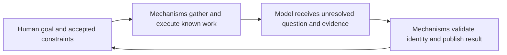

# Research overview — mechanical work, simplicity and software factories

> **Authoritative for:** the research package prepared for the operator's 2026-10-14 discussion.
> **NOT authoritative for:** integration approval, a new core rule, an implementation plan, deployed runtime status or product/merge authority.

## The intended division of labor

The operator's idea generalizes rules-as-tests. A rule that can be formalized is a good mechanical check. The same division can apply to other recurring work: template rendering, inventory, preflight, serialization, status routing and evidence collection. A model need not repeatedly interpret instructions for operations whose inputs and accepted outcomes are already known. It should spend its context on meanings, decisions, unfamiliar causes and assessing whether observations establish the intended outcome.

This is already close to base-core **A7**: mechanically gate detectable conditions, provide context where judgment is needed, and use a narrow reliable trigger (`docs/superpowers/specs/2026-09-28-one-button-chain-base-core.md:95`). Its broad consumer status is still `not_wired`, so existing intent and actual delivery must be discussed separately. The new research question is how consistently this division extends across skills and agent workflows, and what useful external residue should be reused.

This diagram expresses responsibilities, not a newly deployed subsystem. A mechanism can validate a verdict's format and applicability without establishing the verdict's semantic truth.

## What was researched

| Population | Covered | Evidence level |
| --- | --- | --- |
| getff | All 22 canonical skills and 21 roles; delivery census and mechanics-bearing helpers; full 100-ID inventory/status join | Source audit plus specified local integration probes; no blanket runtime health certificate |
| Original pstack | 57 skill cards, including 24 principles and 3 nested automation skills; 23 task playbooks; 8 why-source recipes; 2 agents; 10 prompt/persona templates | Full primary-catalog reading; original behavior distinguished from port additions |
| Independent pstack port | 61 capability cards plus one evaluation stub; 25 task playbooks; inherited source hash/diff comparison; substantive additions and changed contracts | Source comparison; no install or external code execution |
| Osmani agent-skills | 25 skills, 4 personas, 9 command concepts in 18 wrappers, 7 root references; 216 archive filenames | All declared primary bodies read; support/scripts coverage explicitly bounded |
| Supplied video transcript | 1,727 logical lines, 00:00–60:54, 31 contiguous topic blocks | User-supplied transcription; recording/UI/audio not independently observed |

Sources are pinned. All counts describe this dated inspection, not perpetual product inventories. Poteto Mode is pstack's router; it is not a third independent framework. The port has independent ownership and materially different policies.

Detailed materials: [initial mechanical audit](../2026-10-14-deterministic-skill-agent-audit.md), [pstack synthesis and all 24 principles](./pstack-complete.md), [full pstack surface matrix](./pstack-surface-matrix.md), [pstack ledger](./pstack-complete.json), [Osmani complete comparison](./osmani-complete.md), [video annotated retelling](./video-notes.md), [simplicity note](./simplicity-research.md), [handoff](./HANDOFF.md).

## The video: the complete argument at a useful level

### 00:00–08:34 — move up from execution to designing work

The author argues that stronger models shift the bottleneck from writing code to choosing useful goals, starting work and unblocking agents. Human advantages are framed as practical prioritization, intuition and product taste. Historical farming/computation analogies support the move toward higher-level work. A PostHog sponsorship segment argues for feedback from actual users rather than simply building more features.

The proposed ladder is personal execution, agent execution, a recurring agent loop, then a factory containing many loops. Typing or speaking every prompt still uses human attention. Schedules, webhooks, outages, feedback and other agents can initiate well-bounded tasks.

### 08:36–18:36 — discover recurring work and define trigger plus execution

The proposed human role includes resource allocation, model/harness choice, evaluation and business direction. Start with a small recurring task set, rather than attempting to automate an entire company. The calendar example uses recorded time to find actual effort drains; the transcript reports launching this analysis, not its final result.

The central abstraction is two halves: **trigger** and **execution**. Execution needs scope, model, skills, context and tools. A strong model alone does not select the right work or supply the right environment. The proposed 5%-at-a-time approach is a practical increment, not a measured universal threshold.

### 18:38–36:15 — runtime capacity and Cloudroom

Many workers on one laptop compete for processes, disk, resources and the graphical session. The author argues for always-on isolated cloud environments and describes recovery and a manager/coordinator/worker hierarchy. The transcript narrates managers launching and controlling 15 then 25 workers; a 110-agent run is reported earlier. None of those counts measures completed valuable work.

Reported departmental loops include billing review, database health, security, feedback and simplification. Empty or low-value results self-archive; useful exceptions remain for the founder. Cloudroom is pitched as a common interface for local/worktree/cloud threads using existing subscriptions and multiple harnesses. Ultra onboarding and startup-speed comparisons are commercial content. Isolation and continuity are technical properties worth evaluating; limitless scaling, security superiority and SLO claims are not proved by the narrated sidebar.

### 36:17–49:54 — economics, adversarial filtering and procedural compression

The author favors particular model subscriptions and makes large economic comparisons; these are time-sensitive workload anecdotes. The enduring point is to evaluate valuable outcomes rather than unused token allowance or agent count.

A second model challenges cleanup or test-gap candidates before the founder spends attention. Simple recurring prompts become snippets, more complex procedures become skills/SOPs. Automatically discovering repeated skill sequences from session history is presented as a future layer; no deployed sequence learner is shown. A related Director source manages stopped-agent decisions, but its documented approval boundary is narrower than a fully autonomous learner.

### 49:56–56:26 — what the mini-factory demonstration actually specifies

The voice prompt creates a recurring product-discovery task every two hours: read product ADRs and decisions; identify one improvement; launch an adversarial reviewer; reconcile the criticism; archive a rejected candidate or leave a surviving proposal for David. The transcript narrates a test run reaching subordinate review and a new schedule appearing.

It does not show the candidate being implemented, tested, merged, deployed or producing user benefit. The demonstration is useful **discovery and attention filtering**. It is compatible with a separate gated execution factory.

The author explicitly says early runs need tuning and rejects code/Markdown/agent volume as the objective. Product/UI taste and important choices remain human responsibilities in this later, more bounded account.

### 56:29–60:54 — protect thinking time

The final thesis is that advanced orchestration may increase productivity differences between users. This is a prediction, not a verified labor-market result. The practical advice is focused, recorded first-principles discussion about direction and second-order effects while routine execution is delegated. The closing Ultra offer is sales content.

The annotated retelling preserves all 31 blocks, sponsorship, caveats and noisy names. No AGI, pricing, displacement, vendor ranking or infinite-capacity claim is adopted as a research conclusion.

## Compare by responsibility, not by product name

| Responsibility | getff/operator factory | pstack/Poteto Mode | Osmani | Video/Cloudroom emphasis |
| --- | --- | --- | --- | --- |
| Codify and enforce conventions | Core function: native rules/checks, negative controls, multichannel delivery, source drift | Principles and workflows plus selected scripts; not a per-principle hard gate inventory | Constraints/floor, project commands, references and regressions; installed hooks remain separate | Good rules mentioned; full convention enforcement not demonstrated |
| Preserve product meaning | Intent briefs/snapshots, specification/result review and content-bound continuation | Experience-first and architecture/design exploration; accepted-scope limits | Interview/idea/spec workflows with human approval | ADR-constrained discovery; surviving proposal goes to human |
| Coordinate executable work | Pipeline priority, claims/in-flight admission, dispatcher, review, harvest and closure | Router/playbooks, role/persona delegation, file-backed orchestration and PR watching | Lifecycle router, four personas and workflow commands | Schedules, agents spawning agents, sidebar control |
| Prove observed behavior | Toolchain firing/consumer paths; review/fidelity receipts; actual lane support varies | Strong live-verification recipes, parent/head comparison, screenshots/control surface | Browser tooling, profiling, telemetry and release criteria | Narrated automation starts; accepted delivered software not shown |
| Place execution | Optional bridge/backends and host/harness-specific capabilities; not measured here | Depends on host/driver; original Cursor and independent port differ | Relies on configured host/tool integrations | Cloud sandbox/local/worktree execution is central product function |
| Spend attention efficiently | Narrow triggers, compact anchors, formal receipts, scope/effort discipline | Reader/context load, reversible progress, concise outcomes | Defaults, limited mode/scorecards, simplification, rejected-experiment records | Archive empty results; surface useful exceptions; outcome over volume |

The operator factory already has concrete mechanics that the video leaves implicit: paused claims before cold review, in-flight rechecks, stage dependency checks, final-SHA fidelity review, host egress gates, bounded autonomy and exact-content intent. The source also has a cloud-fire backend that explicitly cannot read completion back. Therefore neither “we lack loops/cloud” nor “our cloud delivery is proven” follows from this comparison.

## The simplicity principle the operator highlighted

The favorite idea is broader than using fewer lines: avoid architecture that creates more mental state, repeated decisions and coordination than it removes. Current pstack separates this into **Laziness Protocol**, **Subtract Before You Add**, **Minimize Reader Load**, **Foundational Thinking**, and **Redesign From First Principles**.

Most useful synthesis:

- Look for a simpler sufficient solution and existing owner before adding a mechanism.
- Consolidate actual repeated decisions; avoid abstracting superficial textual resemblance.
- Judge an abstraction by the work it saves callers and maintainers.
- Track both indirections to trace and hidden/mutable state to remember.
- Consider removal and a better data/interface shape before adding wrappers or state.
- Preserve accepted invariants, consumers and unique residue while simplifying.

We already have related owners: Superpowers YAGNI in the arch/intent companion path, available Matt Pocock deep-module/deletion-counterfactual vocabulary, and core B7/H2/H6/H12 slices. A broad named architectural criterion may add useful emphasis, but ownership and residual scope remain questions for discussion. It is not an absent idea in the entire stack, and it is not fully implemented by a line-count or complexity threshold.

Some mechanical slices are credible: unused-code/dependency checks, public-surface diffs, exact duplicated recipes, serialization and known status transitions. Whether a module earns its keep, a guard protects a real condition, or a larger implementation makes callers simpler remains judgment. The full simplicity note records the boundary and examples.

## Useful material to take to the next discussion

| Candidate family | Why it is interesting | Reuse check before any integration |
| --- | --- | --- |
| Lever + mechanical skill envelope | Known repeated work can have one rerunnable implementation and focused receipts | Existing invocation/helpers/renderer owners first; a new engine is not assumed necessary |
| Reader-load and subtraction lens | Makes needless wrappers/state/prompt machinery visible | Resolve overlap with deep-module/YAGNI/core slices; preserve invariant and removal-consumer contracts |
| Verify-command guards | A zero exit, zero selected tests, swallowed pipeline failure or no-op command can give false assurance | Compare to existing run-helper/firing/CI checks and exact intended observable |
| Project-specific live verification recipe | Record real launch/driver/evidence once, reuse it on actual behavior changes | Existing stack/consumer tooling and installed runtime; preserve semantic product review |
| Constraint intake and floor | Choose meaningful quality dimensions, bind command/channel/cost and prevent weakening | Existing installer/core/anti-bypass owner; lexical examples alone are not AST or semantic proof |
| Skill discovery evaluation | Positive/negative routing corpus exposes missing metadata and collisions cheaply | Existing metadata checks; lexical retrieval is a proxy, not model-obedience proof |
| Rejected-experiment ledger | Stop repeating neutral or failed optimizations; preserve noise and outcome evidence | Existing journal/decision/history mechanisms before another registry |
| Honest performance/telemetry evidence | Mark measured versus unavailable metrics and entry-point attribution | Only on a relevant real product/runtime; no guessed score or copied universal budget |
| Product-discovery exception queue | Periodic candidate search plus adversarial filter can reduce human attention load | Existing research/priority/advisor/intent paths and actual false-dismissal/usefulness evidence |

These are hypotheses and discussion material. A candidate is invalidated if its existing owner already supplies the behavior, it does not fit our problem class, it weakens accepted behavior/authority, or comparable usage costs more work without a useful improvement.

## Costs and conflicts to preserve

- A second full workflow pack creates competing routers, review grammars, prompt templates and source owners. A complete catalog is a menu, not an instruction to run every item.
- Original pstack and its port differ materially. The port adds merge-gate/probe/doc-impact tooling and allows tests-only `PASS+NOTES` shipping where original shipping demands driving the live surface. Preserve the distinction.
- Published-branch rebase/force-push recipes conflict with local merge-forward policy. Upstream broad external-action autonomy and deletion-under-uncertainty likewise do not override the operator's grant or getff consumer/residue rules.
- Osmani's mandatory repeated confirmations and serial interview defaults can conflict with delegated brief approval and current frontier-based discussion. Its TDD loop does not replace the local Superpowers loop owner.
- Some external sample versions, budgets and numerical heuristics are illustrative or stale. Templates need actual source, installed version and project validation before future use.
- Typed JSON, resolvable citations, fresh cache validators and a posted review are separate from true evidence and semantic acceptance. URL-only reuse of a prompt-shaped source reading demonstrates this boundary concretely.
- Every added script/check has a maintenance and false-positive cost. Mechanical extraction needs sound input identity, appropriate adverse controls and measured total benefit; no token-savings percentage is established by this research.

## Continuity and acceptance of the research package

This session produced research artifacts only. The scoped handoff records exact input hashes, source revisions, completed coverage, failed approaches and future questions, preserving the unrelated root handoff. Complete matrices and raw ledgers stay on disk; a subsequent session can load the needed family instead of the whole corpus.

Research completeness means the declared primary catalogs and supplied transcript were covered and claims have inspectable sources. It does not mean every transitive code line, runtime deployment or behavior was proven. Source checks found real policy/metadata/recipe differences and explicitly bounded unknowns.

### §1.7 Forward-check applied

The work preserves research-only scope (core G1), own-stack-first/reuse (SSOT #41/#64/#65/#233/#253/#270 and existing Osmani F7), project goal, source authority, no paid inference in CI, and the distinction between mechanical gate and judgment at `.agents/rules/rule-enforcement-channel-selection.md:20-32`. The candidate portfolio is not an integration approval.

### §1.7 Backward-check applied

Class = mechanical procedures and simplicity/discovery conventions across core, skills/roles, external catalogs and factory execution surfaces. Complete per-card and per-surface matrices cover those populations, including sibling delivery paths, inherited versus port-added behavior and shipped versus intended status. Transcript coverage is independently checked against source bytes. No code rule or exception was introduced, so no new exemption or claimed enforcement green is invented.
