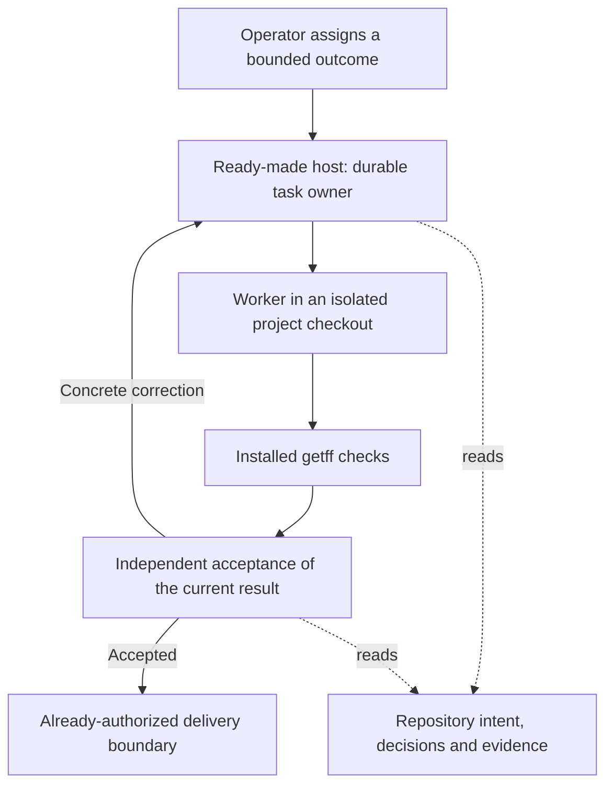

<!-- scope:portable-autonomy-reuse -->
# Portable autonomy: reuse the agent host, preserve getff acceptance

> **2026-10-26 operator clarification — candidate priority superseded:** the operator explicitly removed OpenMausBot preference. Compare existing subscription-native bot facilities (including the operator's Codex/Dot and Grok Bot examples), OpenMausBot and suitable free alternatives, targeting no additional payments. Investigate the operator-reported existing “hi-memory” integration before proposing a memory backend. The original recommendation and first-candidate ordering below are historical, not current selection authority. Source findings remain scoped to their inspected revisions; the earlier cold-review receipt binds only the earlier bytes. The current framing is [portable-autonomy intent preparation](../../superpowers/specs/2026-10-26-portable-autonomy-intent-prep.md). Host choice, memory identity and integration design remain open.

> **Status:** architecture recommendation for discussion; no runtime adoption, approved solution specification, installation or execution authorization is recorded here.
> **Authoritative for:** this bounded 2026-10-26 source comparison, operator premises, proposed ownership boundaries and falsifiable next experiment.
> **NOT authoritative for:** the project goal, existing workflow owners, deployed capabilities, permission settings or implementation approval.

Current as of **2026-10-26**. Own source baseline: `943e417c5a70d4589d5ee75fcf6ee273a9d46bfd`. OpenMausBot source baseline: `0d8eacc65cd3b783a0d28d019d39e6367780b911`. Source observations below were read, not exercised with live agents.

## Operator premises

- P1: Autonomous development starts in getff's own repository and is reused by consumer repositories. Keeping a generally useful development capability private to getff does not satisfy that outcome.
- P2: Ready-made autonomous bots must be considered for actual reuse, not merely as inspiration for another implementation.
- P3: The operator asked for an accessible explanation and then invoked `/arch`; the latest request asks the senior design seat to reason about the best approach. It is not approval of a particular written solution or a request to install a service.
- P4: The preceding proposal covers continuation, meaningful result acceptance, applicable experience and consumer portability, with one complete task cycle as the first useful increment. This document recommends its architecture; it does not silently mark all four capabilities complete.

## Recommendation and alternatives

**Recommendation:** retain getff's portable intent, rules and acceptance in the repository; use a ready-made host for agent processes, durable assignments, return delivery and restart handling. Evaluate **unmodified OpenMausBot as an optional companion**, initially through its native owner/worker route and installed getff procedures. Keep the current AIF path as a comparison and existing supported route. Do not build a scheduler, fork OpenMausBot, extract its runtime or generalize every bridge API before demonstrating a real integration need.

This is an **ADOPT candidate for the upstream application**, with any getff-specific host binding still subject to the observed mismatch. It is not an adopted-runtime verdict. Own-stack precedents remain #64 (existing execution/review loop), #258 (AIF paused claims), #307 (native completion/delegation), #308 (immutable review inputs) and #315 (canonical procedures and harness adapters) in [the reuse register](../prior-art-evaluations.md). The existing [satellite doctrine](../../../.agents/rules/build-first-reuse-default.md#11-satellite-doctrine--own-stack-first--two-axis-application) already separates optional host tooling from a portable core; recursive self-application does not require every consumer to use the maintainer's desktop application.

| Approach | Benefit | Main cost or uncertainty | Proposed disposition |
| --- | --- | --- | --- |
| Current AIF plus native host continuation | Existing integration and delivery; least migration | Full terminated-owner continuation across review/repair/delivery is not established | Preserve baseline and exercise native capabilities already available before crediting a new host with improvement |
| Unmodified OpenMausBot with native accountable owner | Reuses actual durable delegation and return/resume machinery; no own agent application | New dependency, cold-review context, getff acceptance binding and live recovery still need proof | First external-host candidate for a bounded comparison |
| OpenMausBot as another worker backend beneath a terminated external owner | External submission/status APIs already exist | External replies are polling; it does not wake the missing owner | Useful for worker access, insufficient for the recovery objective |
| Extract/fork OpenMausBot's runtime | Direct control | Ownership of upstream host callbacks, provider protocols, security and updates moves to us | Do not select without a measured requirement that configuration or a narrow upstream change cannot satisfy |

No claim is made that no better host exists, that OpenMausBot is production-superior, or that a custom runtime is necessary.

## What the sources establish

| ID | Observation and exact source | Limit |
| --- | --- | --- |
| E1 | Bot/task cwd is retained by `server/store.ts:1924-1944` and passed to the engine at `server/index.ts:8327-8333`. Claude starts in that cwd at `server/drivers/claude.ts:1213`. [Pinned store](https://github.com/milind-soni/OpenMausBot/blob/0d8eacc65cd3b783a0d28d019d39e6367780b911/server/store.ts#L1924-L1944) | Local repository access is not remote workspace synchronization or credential isolation. |
| E2 | Native skill discovery searches project `.claude/skills`; Claude retains project settings and merges project MCP. [Skill discovery](https://github.com/milind-soni/OpenMausBot/blob/0d8eacc65cd3b783a0d28d019d39e6367780b911/server/native-skills.ts#L17-L71), [driver](https://github.com/milind-soni/OpenMausBot/blob/0d8eacc65cd3b783a0d28d019d39e6367780b911/server/drivers/claude.ts#L1074-L1213) | No installed getff acceptance was run. Claude background tasks are explicitly disabled at lines 1211-1212; cross-turn work must use a supported host route. |
| E3 | External-runtime bearer support exposes the existing agents proxy and task submission/status. External roots and children use `reply:poll`; the documented pinned bot engine is not woken. Native coordination selects `resume` instead (`server/index.ts:14619-14627`). [External-runtime contract](https://github.com/milind-soni/OpenMausBot/blob/0d8eacc65cd3b783a0d28d019d39e6367780b911/docs/verification/external-runtime.md#L12-L33) | Adding an OpenMausBot worker backend does not solve a terminated getff/Codex owner. Token configuration was not inspected or changed. |
| E4 | Runtime persists assignment/event/inbox state; startup reconciles interrupted parents and leaves, refusing blind replay after recorded outward actions. [Runtime recovery](https://github.com/milind-soni/OpenMausBot/blob/0d8eacc65cd3b783a0d28d019d39e6367780b911/server/runtime/runtime.ts#L77-L120) | This runs when the application is started. It does not prove OS auto-start, arbitrary-effect exactly-once behavior or full getff recovery. |
| E5 | New tasks have empty resume cursors (`store.ts:2211-2222`), but prompt assembly adds team memory, recent work and shared notes (`index.ts:8787-8791`). [Prompt assembly](https://github.com/milind-soni/OpenMausBot/blob/0d8eacc65cd3b783a0d28d019d39e6367780b911/server/index.ts#L8787-L8791) | A fresh task or personal-memory toggle alone does not establish a cold reviewer. Actual reviewer input must be observed, or an already-supported independent review route retained. |
| E6 | The inspected coordinator completion branch returns completed after an OK turn without requiring independent product acceptance. [Coordinator](https://github.com/milind-soni/OpenMausBot/blob/0d8eacc65cd3b783a0d28d019d39e6367780b911/server/runtime-coordinator.ts#L488-L497) | Native completion must remain distinct from getff acceptance. Optional upstream review paths were not exhaustively audited. |
| E7 | getff already has intent/result-review, runtime commands and actionable completion metadata. `RuntimeBackend` owns dispatch/status/wait, not a durable reviewer/delivery owner. [Backend](../../../packages/runtime-bridge/src/backend.ts), [result review](../../../.agents/procedures/intent/references/result-review.md), [current owner boundary](../../../docs/superpowers/specs/2026-10-22-development-efficiency-design.md#11-separately-bounded-unresolved-work) | Existing development-efficiency S3/S4 must be reused; D1 explicitly remains a separate terminated-owner recovery problem. |
| E8 | `env` already delivers orchestration/design skills; `intent`, dispatcher and bridge are factory-scoped. [Delivery manifest](../../../setup.d/ships.manifest#L42-L65) | A host can read a repository without having the required getff closure. The first comparison must inventory installed profile prerequisites and avoid assuming non-AIF intent delivery already exists. |

Native Codex app tool contracts available in this session include heartbeat scheduling, completion waits and explicitly authorized follow-up messaging. They are an existing-host baseline, not proof of restart delivery or a portable consumer service. No automation was created and no peer chat was messaged.

## Proposed responsibility boundary

This is a proposed flow, not an observed integration. The host owns process lifecycle and waking its native accountable owner. getff's existing procedures own the meaning and evidence of completion. The model does not need to stay active while waiting. Artifact persistence does not itself wake anything, and a model's statement that a result is accepted is not a substitute for the existing applicable review record.

There is one outer owner of a given task. For the first external-host comparison, prefer the host's native worker route if the required getff closure is available. Do not require a second AIF hierarchy as a prerequisite merely to reuse the existing bridge. If AIF must remain the implementation backend, record that dependency explicitly: the host owns the overall outcome; AIF owns the single implementation task/worktree; repair returns to that task and must not create a competing implementation. This is a scope choice for the integration assessment, not an assertion that AIF-free delivery is already ready.

The reviewer is a responsibility with fresh, bounded inputs, not necessarily a permanent personality with accumulated project history. A long-lived owner may retain continuity; cold acceptance may not inherit the producer's narrative through team memory or recent-work injection.

The first experiment can use OpenMausBot's own UI. Keeping Dot as a unified front door is a separate transport question; a seamless Dot-to-OpenMausBot wake path is not promised by a polling MCP connection.

## Smallest useful comparison

Use one safe, bounded code change with an observable acceptance condition, initially in a disposable checkout of getff and then in a disposable consumer repository. Preserve existing checks, budgets and authorization. The chosen final destination must be stated: a verified local candidate proves that boundary, not PR publication or deployment.

1. **Inventory before adding infrastructure.** Bind existing native-host/AIF capability and the target consumer's installed workflow closure. Demonstrate what already works; do not attribute existing success to a new host.
2. **Exercise the unmodified host.** Configure repository cwd and the existing getff procedures. Use one accountable owner, one isolated worker and one independently verified reviewer input boundary. Record any missing binding before writing an adapter.
3. **Acceptance counterexample.** Let execution report completion while a deliberately wrong candidate violates the task's promise. Existing getff acceptance must withhold acceptance and return one concrete correction. Repair must preserve task and candidate identity and get a fresh applicable result review.
4. **Lifecycle interruption.** End the owner after the worker result but before consumption, then restart the host through its supported route. Verify the same task is reconciled. Repeat the result notification; confirm no duplicate implementation or already-performed correction. A host that remains stopped is not claimed to be doing work.
5. **Effect uncertainty and cancellation.** In a harmless fake destination, interrupt between effect and receipt. Resolve from destination evidence or retain an explicit unknown; do not blindly repeat. An intentional cancellation must remain cancelled after restart.
6. **Consumer replay.** Repeat the same outcome/check/recovery contract using consumer-local paths and installed artifacts, without getff contributor-only knowledge. Differences belong in explicit host/project bindings, not a second workflow.

Record operator interventions, manual minutes, accepted/reopened outcome, duplicate/lost effects, elapsed time and attributable model usage where available. Count setup/migration cost separately. This exploratory comparison is not a statistical superiority claim or an instruction to purchase model capacity.

**Pilot stop conditions:** required getff checks are not loaded; actual reviewer context cannot be made independent through a supported route; recovery needs a permanent upstream fork or a new scheduler; existing task/effect identity cannot be reconciled; a consumer needs private getff state; or the new host increases operator work without useful additional recovery. Report the concrete boundary before deciding whether a small upstream contribution, narrow binding or the existing host is the better response.

## What happens to the other proposals

- Preserve product acceptance in the first task cycle; it is essential, not a later dashboard.
- Defer a new learning backend until the task cycle is demonstrated. Reuse the existing memory-codification and Reflex Loop precedent #105. Hy-Memory's environment/source/supersession concepts remain candidates for inspectable experience, not authority over current repository decisions.
- Do not extract the entire bot application, replicate its UI, or expand to a large standing roster. More roles can be added when a concrete responsibility requires them.
- Once the first comparison passes, turn only the observed setup/binding residue into consumer delivery, and prove the same delivery on getff. No speculative universal runtime adapter framework is proposed.

## Evidence discipline and review input

The input research scope was recorded before the follow-up probes at `/tmp/getff-autonomy-choice-20261026/research-scope.md`, with a pre-mortem and falsifier. This is a bounded extension of the supplied 2026-10-26 evidence package, not a fresh market survey. Source snapshots were read as data; external programs and model agents were not executed.

The author spot-checked three OpenMausBot source files for decisive claims: `server/runtime/runtime.ts` (restart is bounded and conditional), `server/runtime-coordinator.ts` (completion does not itself call product acceptance), and `server/index.ts` (external poll versus native resume; shared context injection). The public external-runtime contract and native-skill discovery were also fetched to verify their declared integration surface. These checks changed the proposal from adding a worker backend to placing the accountable owner in a supported durable host; they also made cold-review input a pilot acceptance condition. Context7 was navigation only; its mixed main-branch snippets were not treated as pinned evidence. Additional source reads are enumerated in the probe reports, not inferred from repository coverage.

Active traps from [the canonical catalogue](../../../.agents/rules/ai-laziness-traps.md): **T2/T3** (source paths are not exercised integration), **T5** (research remains a document), **T7/T16** (challenge whether a worker backend actually restores an owner), **T8** (resolve factual questions by probes), **T11/T13** (inspect ready-made and own-stack mechanisms without treating adoption as zero work), **T14** (no whole-system clean claim), **T15** (test the recommendation's own assumptions), **T19/T20** (independent evidence review and cited provisional recommendation). Domain traps: **PA1**, confusing external polling with native owner wake; **PA2**, confusing a new thread with an uncontaminated reviewer; **PA3**, confusing a portable getff workflow with a mandatory shared desktop runtime.

Self-application finding: the initial idea of adding another worker backend did not cover the missing owner's lifecycle (E3), and fresh reviewer tasks did not prove independence (E5). Both were corrected in this recommendation rather than left as assurances. The task-cycle proposal remains unverified until the destination experiment observes it.

### §1.7 Forward-check applied

This document applies the existing build-vs-reuse/satellite rule, preserves getff's intent and review owners, and proposes no runtime, paid CI, permission changes or implementation launch. It labels source observations and deployment unknowns. The application-adoption candidate and every pilot stop condition remain reversible discussion input, not an accepted product policy.

### §1.7 Backward-check applied

The compared class is portable ownership and continuation across task, review and effect boundaries. Existing parallel surfaces include AIF active waiting and scoped effects, dispatcher/report consumption, supervision intervention records, native host scheduling, OpenMausBot external/native delegation, reviewer context, consumer delivery and experience validity. S3/S4 are preserved; D1 is not declared solved. A polling external adapter is not counted as a wake mechanism, a fresh task is not counted as cold review, a completion event is not counted as acceptance, and application restart is not counted as OS-level always-on operation.
