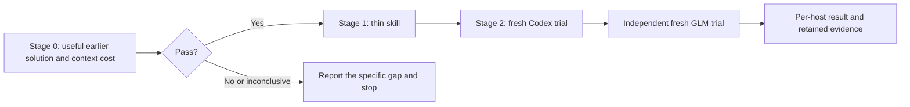

# getff experience recall — gated pilot kickoff

> **Status:** local contributor workflow observed in native Codex and GLM trials; see [native acceptance](../../audits/2026-10-28-getff-experience-native-acceptance.md). The original context-only Stage 0 remains `NOT_PASSED`; the later explicit human implementation admission is preserved. Accepted examples show one lookup, useful lead reuse and no duplicate on continuation. They are controlled tests, not organic adoption or universal invocation. The adapter's staging delivery (commit, PR, squash merge) is human-authorized (admission snapshot 2026-10-28; its delivery outcome is recorded by the PR/Git/CI history under owner custody, not asserted here); consumer/OpenMausBot/global rollout is not authorized. Query brevity remains a documented minor adherence limit.
> **Authoritative for:** execution order, bounded evaluation, file ownership and acceptance of the local experience-recall pilot.
> **NOT authoritative for:** product requirements, MemHub permissions or maintenance, global configuration, consumer rollout, OpenMausBot integration or publication.
> **Spec:** [2026-10-28-getff-experience-recall-design.md](../specs/2026-10-28-getff-experience-recall-design.md), current accepted-source SHA256 `54eb38e344b280ca02228d665135a100d725f200a1eed063c342228b16ce1221` (final design bytes including the section-13 delivery admission). Earlier design revisions remain historical evidence: the closure-revision hash `e66ad31eeb35…` (pre-delivery-addendum) and the original executed input hashes and exact bytes retained in the private Stage 0 and diagnosis receipts. The closure revision records the implementation admission, the actual candidate and the reconciled call protocol (spec section 5 / section 10) without renewing execution admission beyond it; sections 11–13 are later dated addenda.

## 1. Outcome and custody

Prove that a short lookup can recover a useful earlier solution for real getff work. Only then add a thin getff skill and prove its unprompted selection and useful application separately in Codex and GLM in Claude Code.

This is a local kickoff under `docs/superpowers/plans`, not an executable `/pipeline` or AIF dispatch entry. Writing or reviewing it does not launch its stages. A future pipeline dispatch requires a recognized tracked kickoff published to `staging`, with destination access verified; do not hand out a dispatch command for this local file.

The owner directs and reviews; retained GLM execution performs session analysis and any later implementation under the operator's [standing execution mode](/Users/art/.agents/skills/coordinator/references/owner-execution-mode.md). Codex participates in the required native acceptance trial. This packet creates no assignment, session, monitor or permission grant by itself. Before a future GLM launch/resume, read `/Users/art/.config/getff/glm-launch-policy.md`, use the configured `/Users/art/.local/bin/glm` route and bind evidence to its actual model/session/mode. Preserve existing hooks and denials.



A useful manual lookup permits implementation. It does not prove automatic selection, application or faster development. A pass on one host does not pass the other.

## 2. Re-ground and bind execution

Read the spec in full, project `AGENTS.md`, `README.md#why-this-exists`, `.agents/session-bootstrap.md`, `CLAUDE.md`, and applicable source/description/AI-doc rules. Verify the spec hash before execution; changed requirements require reconciling this packet, not silently using an old hash. Follow the existing orchestrator intake and cold-review protocol before a future worker dispatch.

Authoring checkout: `/Users/art/.codex/worktrees/d961/rules-as-tests-aif`. Acceptance destination is the operator's Mac with its existing MemHub identity, store and native host integrations. A container or copied repository alone does not establish access to that installation. At execution record the actual checkout, branch/base/head, current WIP, host/model/session IDs and exposed tool declarations. Preserve foreign edits and existing owners; use the existing isolation workflow for implementation. Do not stash, reset or move another session's work.

Read the installed provider skill on each host before using its tool: Codex currently uses `/Users/art/.codex/skills/memhub-recall/SKILL.md`; Claude Code uses `/Users/art/.claude/skills/memhub-recall/SKILL.md`. Revalidate those paths and hash the actual bytes. If the host does not expose `MemHub_context` or access is denied/unavailable, retain that result and stop the affected stage. Do not enable integrations, grant permissions or substitute another transport to get a pass.

Private evidence root: `/Users/art/Library/Application Support/getff/hy-memory-experiment/native-stock/maintenance/experience-recall-pilot/<UTC-run-id>/`. Bind it once in `run.json`; preserve completed receipts on resume. Store minimal public-event excerpts and byte/line references there, not whole transcripts. Keep private queries, returned memories and session excerpts out of Git. The repository receives only a sanitized result report.

Existing Luna medium capture, Astra low daily processing, ultra store, provider files, maintenance holds, receipts and natural-use monitor remain under their current owners. Do not pause/restart maintenance, replay history, write synthetic memories, change database triggers or edit engine/SDK bytes for this pilot. Evaluation-driven sessions and calls must be labeled and their IDs recorded for exclusion from organic-use counts.

## 3. Stage 0 — real task, existing installation, no skill edits

> Executed and closed 2026-10-28, verdict `NOT_PASSED` (receipt preserved; do not rerun the closed sample). The parameters below are the historical Stage 0 protocol, not the current normative contract. The reconciled normative call protocol is: supported `MemHub_recall`, **one call total per concrete work unit**, `limit: 2`, `character_budget: 2000`, `timeout_ms: 30000`, query ≤240 Unicode characters built from the starting task/error text as 3–6 concise English action/component terms plus exact error or file identifiers, no follow-up, no fallback tool, no retry — see spec section 5 and the canonical skill body (`.agents/procedures/getff-experience/SKILL.md`).

### Freeze the sample before inspection

At execution start freeze `evaluation_started_at` and the preceding seven calendar days as one absolute timestamp interval. Examine at most **20 eligible sessions: up to 10 Codex and 10 Claude Code/GLM**, newest first within each host. Use existing JSONL roots `~/.codex/sessions`, `~/.codex/archived_sessions`, and `~/.claude/projects`. Deduplicate archived/moved sessions. Selection uses record timestamps and project identity, not file modification time alone.

Exclude this design/maintenance chat, review children, probes and synthetic acceptance sessions. Identify actual GLM use from available model metadata; Claude Code is a host, not proof of model family. Do not silently substitute other projects, older history or more sessions when the bounded sample yields no suitable case.

Parse locally and expose only compact public task requests, assistant actions and relevant tool outcomes. Do not dump whole JSONL files into model context, inspect hidden reasoning/credentials or re-ingest sessions. Record source gaps and exclusions; an unreadable or missing source is not a negative finding. Complete this bounded pass and stop on an inconclusive sample rather than expanding it automatically.

### Freeze a fair query, then evaluate retrieval

1. Find a concrete repeated problem with an earlier successful solution and a later occurrence. Begin with the later task's starting request/error and project context. Freeze its query before inspecting its eventual resolution; do not let the earlier answer, memory IDs or answer-only terminology enter the query. If the starting request already supplies the earlier solution, reject that candidate as unable to show added value.
2. Record the earlier successful action/outcome and why its conditions apply. Keep this evaluation evidence separate from the query input. A shared topic or generic preference is insufficient. If no eligible pair exists in the sample, record `INCONCLUSIVE` and stop before Stage 1.
3. Through the existing provider skill, make the explicitly requested lookup below. Preserve the exact request, response, timing/state and IDs. Record unsuccessful attempts as well; do not fish for a positive result through repeated reformulation.

```json
{
  "query": "<concrete work, at most 240 Unicode characters>",
  "limit": 2,
  "character_budget": 2000,
  "timeout_ms": 8000
}
```

Omit `kinds` and `raw_source_ids`; retain native identity, scope and grants. At most **one** follow-up is permitted, using the same limits, only for an already relevant returned item missing an essential detail. Empty/denied/unavailable/timeout results do not authorize a retry. Match IDs/revisions before claiming the follow-up expanded the same source. No item-by-ID expansion API or raw-history fallback is assumed.

4. Identify the concrete useful step or dead end in the returned material and link it to the earlier public outcome. Verify that the useful underlying source predates the later task. Its own completed answer is leakage. A later-published memory can establish availability now for future recurrence, not availability at the historical decision point. Distinguish raw excerpts, System 1 experience and System 2 schemas by actual returned kind/lineage.
5. Measure the complete recall cost: adapter/provider instructions actually loaded, skill/tool discovery, query arguments, every full model-visible response including metadata/duplicates, and any follow-up. Stage 0 has no new adapter, so mark its cost not applicable. Record Unicode characters by category, attributable tokens where exposed, otherwise a named tokenizer estimate or `UNKNOWN`. Separate one-time loading, per-query overhead and the researcher's session-analysis cost. Never use cumulative account usage or the provider's text-only `used_characters` as total context cost.

### Admission receipt

Write `stage0.json` and a short `stage0.md` with: spec/query hashes; frozen sample window and session references; earlier/later source evidence; attempts; returned IDs/kinds/source dates; concrete added step; applicability limits; costs by category; and `PASS`, `NOT_PASSED` or `INCONCLUSIVE` with reasons.

**PASS requires all:** a source-linked older solution contributes a concrete useful step absent from the initial task; every request respects the limits; requested text totals at most 4000 characters across the sequence; each complete visible response is at most **8000 Unicode characters**; and full instruction/query/result costs and attribution limits are reported. The 8000-character ceiling is an acceptance bound, not an upstream runtime guarantee. Provider metadata can exceed it.

The owner reviews this exact receipt and binds the admission to its SHA256. Record the decision in `run.json`. A failure or uncertainty stops before skill files or native trials: report the content/retrieval/access/size gap. Do not add hooks, broaden budgets, rebuild memory or introduce a compacting service to manufacture a pass. No measured time-saving claim follows from retrospective retrieval alone.

## 4. Stage 1 — conditional thin adapter

Entry prerequisite as written: Stage 0 `PASS` and its content-bound owner admission. Execution record: the owner instead admitted implementation explicitly on 2026-10-28T17:38Z for one bounded candidate, on the useful-read evidence and owner review; the Context-only `NOT_PASSED` receipt stays preserved and is not relabelled. Preserve that receipt; do not rerun the lookup on resume merely because context was compacted.

| File/surface | Responsibility |
| --- | --- |
| `.agents/procedures/getff-experience/SKILL.md` | New canonical adapter, at most 600 body words; spec sections 3–6 govern behavior. |
| `.agents/skills/getff-experience/SKILL.md` and `agents/openai.yaml` beneath that skill | Generated Codex entry with implicit invocation enabled. |
| `.codex/contributor-inventory.json` | Renderer-owned derived inventory including the new skill; retain its task-caused change, never hand-edit it. |
| `.claude/skills/getff-experience/SKILL.md` | Normal Claude compatibility pointer to the same canonical owner. |
| `scripts/canonical-agents-map.json`, only if required by the current mapping contract | Register the new compatibility pointer without broad mapping regeneration. |
| Existing delivery tests/fixtures for canonical native entries | Meaningful affected source/discovery/size/status checks; no new evaluation framework. |
| `docs/meta-factory/prior-art-evaluations.md` | Append the capability's ADAPT evidence when shipping, without rewriting old entries. |

Before editing, inspect those actual owners and the current renderer/map conventions. Reuse the installed MemHub provider procedure and getff delivery. Keep the spec's discovery description and work-unit definition: a substantive development outcome gets one focused lookup before choosing an approach; trivial edits, mechanical continuation and already supplied experience are skipped. A genuinely different obstacle may start a new work unit. Retain the outcome/source in an existing handoff so resume does not repeat the search.

Load the provider skill once per usable context. Preserve its notice, permissions and truthful empty/partial/error semantics. Recall is model-selected guidance, not a deterministic gate. The adapter must not copy the provider body or modify `self-reflection`, always-loaded rules, hooks, global skills/settings, consumer installation or Memory v2. No legacy recall-plus-conversations fallback for this proactive pilot.

Inspect applicable principle allowlists/structural requirements for every new skill path, including paired-negative examples and authority/description limits. Satisfy the existing rules; do not add an exemption merely to pass. Use `ai-doc`/`writing-skills` for the actual skill change. Reuse the spec's pinned upstream evidence; reconcile changed APIs rather than inventing arguments.

Generate Codex entries through the existing renderer, inspecting scope first so unrelated hook/config output is not adopted. Do not run an unfiltered Claude settings emitter. Expected verification commands, to revalidate against the candidate checkout:

```bash host-verify
node scripts/render-harness-config.mjs --check --only codex
node --test scripts/canonical-native.test.mjs scripts/codex-contributor.test.mjs
git diff --check
```

Before those checks, emit the scoped Codex candidate with `node scripts/render-harness-config.mjs --write --only codex`, then inspect every changed path. Run affected principle tests for the new skill's authority header, paired-negative body, portability and description budgets using the checkout's existing test runner. Retain actual commands/results and any baseline failures; deterministic success does not establish native skill selection.

Execution result (2026-10-28): the candidate was created per this table — canonical owner `.agents/procedures/getff-experience/SKILL.md` SHA256 `a1ed6656d8bc77637c3623ce432082bcd1cc00409aab443fa53db26dfb8a17bb` (484 body words), renderer-emitted Codex twin with `allow_implicit_invocation: true`, Claude compatibility symlink plus its `scripts/canonical-agents-map.json` `link` entry, renderer-owned `.codex/contributor-inventory.json` change retained. Checks actually run: renderer `--check --only codex` PASS; `node --test scripts/canonical-native.test.mjs scripts/codex-contributor.test.mjs` 50 pass / 0 fail (exit 0); `git diff --check` clean. The vitest principle lane was **not** run — its census can skip untracked sources — so the candidate's authority header, paired-negative sections, posture marker and description were verified by direct content inspection instead; no principle-runner pass is claimed. Open items left to the owner: the principle-48 `.claude/skills` description-budget overage this candidate would introduce (~461 B over the 6800 B visible population cap; remediations — trimming foreign descriptions, re-pinning the budget, dropping the compatibility pointer — are all owner decisions), and the pre-existing renderer twin boilerplate ("explicit-only policy still forbids self-initiation") that contradicts `allow_implicit_invocation: true` population-wide. The original implementation run terminated at the operator-set `--max-turns 32` (native CLI reported 33 turns, `error_max_turns`) — not a clean worker completion; the docs/registry/report closure ran as a separately accounted increment (max 12 CLI turns).

## 5. Stage 2 — native selection and application, one host at a time

Entry prerequisite: admitted adapter candidate and affected deterministic checks. First use a fresh native Codex session, then independently a fresh **actual GLM** session in Claude Code, both in the candidate getff checkout. Record the real model, session ID, skill discovery and MCP exposure. Missing prerequisites mean `UNSUPPORTED`/`BLOCKED` for that host, not inferred success or permission to install another trigger. Status at closure (2026-10-28): PENDING — the fresh Codex trial was running against the frozen candidate and the independent GLM trial had not started; no verdict is recorded here.

Give each session a normal substantive task from the eligible real-task material, containing only information legitimately available at its starting point. Do not mention memory, name either skill or provide the old solution. Neither session inherits this evaluation discussion, Stage 0 answers or evaluator history. Keep the evaluator's source/cost evidence outside its prompt. Label the trial evaluation-driven even though the task is real.

A bounded replay may ask for diagnosis and a concrete proposed next step only. Do not execute the old development change or an external action without that task's authorization. If current repository state cannot represent the task, use a bounded source fixture or report the limitation; do not quietly feed it an already repaired problem and claim reuse.

For each host retain the actual trace establishing:

- **Selected:** the agent discovers/loads the getff adapter without a memory cue and calls the real context tool before selecting its approach.
- **Retrieved:** paired response contains the relevant source-linked item, with actual kind/state and full visible response size. An advertised tool, prose mention, empty/timeout/partial-zero result or saved fixture does not pass.
- **Applied:** a public action or concrete proposed next step uses a specific returned useful detail absent from the task prompt. Mere source citation or an announcement is insufficient; pre-supplied advice means adoption is unknown.
- **Economical:** complete instruction/query/result cost is reported; the same limits and 8000-character full-response ceiling hold. Observe an ordinary continuation with the lookup outcome retained and no duplicate query.

Use distinct bounded fixtures for a trivial edit and a continuation skip. Exercise remaining spec section 8 cases with existing deterministic fixtures where possible: retained outcome across resume, genuinely different obstacle, stale/irrelevant advice, denial/unavailable/empty/timeout/partial, citation-heavy oversize, one follow-up, missing context tool and authorized AIF handoff reuse. Do not call production memory merely to generate negative-test traffic or write synthetic records. Fixtures prove handling only; native trials prove selection and application.

Produce `codex.json` and `glm.json` with independent verdicts. Failed selection leads to discovery/selection diagnosis; real calls without useful results lead to content/retrieval diagnosis. Oversized output stops rollout on that host. Do not add a rule/hook, increase limits, launch repeated model matrices or change the backend automatically. Preserve failed attempts and report the missing claim rather than retrying until green.

### GLM trial result and routing-cue repair (2026-10-28)

The first fresh GLM session failed **Selected**: the init listing carried `getff-experience` and cwd was correct, yet 9 unique assistant responses / 24 tool calls produced zero adapter or provider loads and zero MemHub calls (native memory file and repo scans used instead). Receipt preserved in `glm-trial/stream.jsonl`; not relabelled. Repair, narrowly superseding the no-standing-cue position for one pointer in the existing entry doc: a single routing sentence appended to the end of `CLAUDE.md` (spec section 11). No per-message lookup is forced; skill/schema/grant bytes stay frozen; AGENTS.md is untouched (Codex implicit baseline already passed). Corrected GLM regression: PENDING, owner-run within the remaining native-host allowance.

**Query-formation repair (2026-10-28, later the same day).** The corrected GLM session DID select: both skills loaded and exactly one real recall fired before source work. The mixed Cyrillic/English query returned two unrelated records (a Windows delivery item and a chat item) — wrong-result trial preserved, no practical GLM adoption claimed. The pinned `recall.py` normalization (inspected earlier, on the useful-read result) recognizes Latin/CJK keyword terms, not Cyrillic, and short English queries already returned the useful coding experience in Codex and earlier research — supporting a formatting fix, not proof that language alone caused ranking. Repair: the canonical body now carries a query-formation paragraph under "The one lookup" (3–6 concise English action/component terms + exact identifiers; translate the meaning, never the suspected solution); spec sections 4–5 and the section-3 normative line are reconciled; the generated Codex twin is regenerated through the existing renderer. One final owner-run GLM useful-retrieval regression remains (starting-task-only, no solution/memory cue); irrelevant or unavailable data → stop tuning and report the concrete retrieval gap.

## 6. Review, delivery and rollback

Retain a compact `run.json` checkpoint: exact spec/candidate/receipt hashes, stage and next permitted action, active owner/executor/session, cumulative attempts, private evidence paths, acceptance decisions and unresolved gaps. Resume this state instead of replaying completed stages. Follow the standing owner observation mode inside an admitted job; no new timer or automation is part of this kickoff.

Write a sanitized repository report at `docs/audits/2026-10-28-getff-experience-recall-pilot.md`. Include Stage 0 outcome and useful step; first-load versus per-query context cost; actual versus estimated/unknown tokens; per-host selected/retrieved/applied/skip results; commands run; limitations and rollback state. Reference private receipts by stable identity/hash without publishing their content. Report in Russian to the operator, artifacts in English.

Before handoff, perform the required independent capability-reuse and affected-change review under existing project procedures. The review must cover the actual candidate bytes and source/tool claims. Keep acceptance bound to unchanged content; changed bytes require affected revalidation. Do not turn this small pilot into a new review or evaluation framework.

This packet prepares a local pilot. It does not authorize push, PR creation, staging/main merge, global installation or OpenMausBot rollout. Report the accepted candidate and evidence for later delivery. If rollback is needed, remove only this adapter and its own native discovery entries through the normal source mechanism; preserve MemHub manual recall, memory data, source capture and Astra maintenance. A failed host remains explicitly unaccepted.

After passing native trials, use the existing natural-use monitor for subsequent ordinary tasks. Controlled trials are excluded. One example establishes useful reuse, not a quantified productivity improvement or guaranteed future invocation.

## 7. Active AI traps and self-check

See [ai-laziness-traps.md section 2](../../../.agents/rules/ai-laziness-traps.md). Active traps: **T2, T3, T10, T14, T15, T19, T20, T21**.

- T2/T3: actual paired tool results and public use, not a proposed query or plausible claim.
- T10/T14: a bounded sample and one accepted host cannot establish all-history coverage or both-host adoption; missing evidence remains unknown.
- T15/T19: apply admission and exact-content review to this packet and the skill itself; CI is not behavioral acceptance.
- T20/T21: ground the verdict and sweep parallel Codex, GLM/Claude Code and AIF surfaces; identify OpenMausBot as deferred rather than claiming it supported.
- **T-ER-A — answer leakage:** searching with the successful answer or retrieving the later task's own resolution is not remembering an earlier solution.
- **T-ER-B — cheap body, expensive envelope:** `used_characters=2000` can coexist with excessive metadata; measure every agent-visible representation.
- **T-ER-C — prompted lookup called automatic:** Stage 0 and skill exposure do not prove unprompted host selection; a manual success cannot waive Stage 2.

### §1.7 Forward-check applied

The sequence follows spec sections 1, 5 and 8: real-task admission precedes skill edits; every lookup retains its cost/lineage; native selection is evaluated independently. The spec remains the requirements owner. No rule injection, runtime memory modification or universal full-response guarantee is added.

### §1.7 Backward-check applied

The change class is development-experience reuse across hosts. Codex and Claude Code/GLM require separate native evidence; AIF reuses an authorized handoff; OpenMausBot and consumer delivery remain deferred. Upstream managed skills, current maintenance and convention self-reflection are separate owners. Preserve their bytes/settings and inspect derived entry changes before accepting the candidate.

## Verified local pilot — owner acceptance

The final observations and preserved failures are recorded in [native acceptance](../../audits/2026-10-28-getff-experience-native-acceptance.md). Current canonical SHA256 is `45a17d7f4d1a3807cac4b0c360cf9421aa418f2c31c9fd55acb8cc6329908a2c`. Historical pending labels and earlier candidate hashes in dated execution notes describe their recorded moment; this acceptance supersedes those pending states only. Do not repeat completed research or native trials merely on resume. Ordinary new tasks may use the local skill.

**Delivery admission (2026-10-28, later increment).** A human admission authorized this skill's commit, PR and squash merge into `staging` (branch `codex/getff-experience-recall` off `fd031522d63d…`), superseding the earlier local-only publication exclusion — including the "publication and wider deployment remain outside this packet" sentence above — for exactly this adapter delivery. Consumer/OpenMausBot/global rollout remains out of scope; the delivery outcome is recorded by the PR/Git/CI history under owner custody, and no claim is made here that a merge has occurred. Documentation-only admission snapshot: no runtime behavior, research or native-trial repetition.
