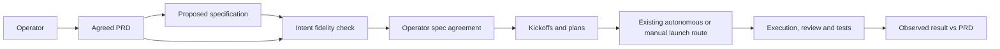

# Intent continuity — document-bound advice and specification checks

> **Status:** Architecture proposal for operator discussion. The focused cold closure of the round-4 findings returned GO on the exact frozen design identified below. Operator written-spec agreement and implementation authorization are still pending.
> **Authoritative for:** the proposed incremental design for the [intent-continuity PRD](2026-10-12-intent-continuity-idea.md).
> **NOT authoritative for:** current deployed behavior, execution authorization, or project-wide policy. Existing canonical procedures remain authoritative until an approved implementation updates them.

Approved product input: SHA-256 `f1a42d1c375b9f4b96dc662da714ed9abf54885fa93716b847d65d0cd7a7ee2a`, preserved by the [exact-content approval record](2026-10-12-intent-continuity-approval.md). Read the snapshot named there when the readable PRD changes. The former `a722...` approval is historical after the operator accepted both launch routes.

## 1. Context and relationship to existing work

The operator reports losing the product's purpose during specification authoring, before any code exists. The current `/intent` already owns a narrative brief, immutable approval, product-context restoration and first-result review. `/arch` already owns premise/decision registers, consensus retells, cold design review and question-class routing. `/pipeline` and the runtime already own launch/review/continuation mechanics. This design connects those responsibilities and adds a mandatory spec-to-intent checkpoint; it does not replace them.

The [2026-10-07 design](2026-10-07-idea-arch-incremental-design.md) remains the earlier design source, not proof of shipped behavior. Its artifact restoration, class-based consultation, independent result observation and scoped repair are retained. Its blanket operator launch-choice wording is superseded by the updated PRD's acceptance of both existing launch routes. Its stage map is not evidence that Task 1 has completed. This proposal elaborates design-time fidelity and per-document advisor bindings; it does not adopt all of the earlier admission-policy/index proposals as already implemented requirements.

Source evidence for reuse:

| Responsibility | Existing source | Proposed delta |
| --- | --- | --- |
| Brief, approval and restoration | `.agents/procedures/intent/references/product-brief.md` | Reuse without a second PRD format. |
| Independent semantic review | `.agents/procedures/intent/references/result-review.md` | Add a named specification-review mode beside result review; keep result schema semantics separate. |
| Preserved premises and consent | `.agents/procedures/arch/references/ideation.md`; `scripts/check-arch-retell.mjs` | Bind spec checkpoints to the actual approved PRD and exact candidate spec. |
| Question-class routing | `.agents/procedures/arch/references/exit-and-escalation.md`; `.agents/procedures/dispatcher/references/parks.md` | Select the document-bound responsibility and carry its exact evidence. The current consult mailbox addresses the architecture advisor, so direct product/task delivery needs an explicit target binding. No fixed hop chain. |
| On-demand advice and journal-first answers | `docs/superpowers/specs/2026-08-10-advisor-pattern-design.md`; `docs/superpowers/specs/2026-10-06-advisor-codex-transport.md` | Restore the selected role from its primary artifact and decisions; session handle remains optional. |
| Structural result/continuation guards | `.agents/procedures/intent/helpers/check-result-review.mjs`; `packages/runtime-bridge/src/resultReview.ts` | Extend only the adopted-scope bindings needed by the new checkpoint and reviewed changes. |
| First admission and legacy separation | [Earlier design §5](2026-10-07-idea-arch-incremental-design.md) and `packages/runtime-bridge/src/resultReview.ts` | Adopt its minimal frozen legacy/adoption discriminator: zero declared scope currently passes as `unscoped`, so omission must be rejected before effects. The broader stage-readiness index is not assumed shipped. |
| Stage launch and execution quality | `.agents/procedures/pipeline/references/dispatch.md`; existing review/execution procedures | Consume readiness evidence; preserve launch authority and quality gates. |

Reuse disposition: ADAPT existing advisor and review bindings; ADOPT existing interview, review and execution mechanics. Prior-art SSOT [#201, #253 and #64](../../meta-factory/prior-art-evaluations.md) are the existing advisor, interview/domain-modeling and execution-loop precedents. No external-runtime or negative-existence claim is made. New transport or scheduling would reopen research rather than silently expand this adaptation.

## 2. Operator-premise register

These are product decisions, faithfully transferred by pointer to the frozen PRD and its approval record. Technical proposals below are not retroactively attributed to the operator.

| ID | Premise | Source |
| --- | --- | --- |
| P1 | Preserve what/why and the future experience throughout design and execution. | PRD IC-P1, IC-P6, IC-D1. |
| P2 | Each advisor has its own primary document; route questions by class. | PRD IC-P2, IC-P3, IC-D4. |
| P3 | Check the specification against intent even without an author question. | PRD IC-D5. |
| P4 | Operator discusses idea/specification; existing autonomous kickoff dispatch and operator-selected `/pipeline` launch are both valid routes. An explicit design-only instruction forbids execution; routine authorized work is autonomous. | PRD IC-P4, IC-D2, IC-D3. |
| P5 | Changing the idea requires operator agreement and renewed specification discussion. | PRD IC-D6. |
| P6 | Restore from documents; retain checks with their applicability through changes. | PRD IC-P5, IC-P6. |
| P7 | Reuse existing procedures and applicable project/stack quality rules; deliver the complete scope incrementally. | PRD IC-P7, IC-D7. |
| P8 | Check meaning before spec agreement and after changes affecting behavior, promises or boundaries, not after every text edit; verify current applicability before kickoff preparation. | Operator explicitly accepted the proposed timing on 2026-10-12 and requested a handoff before continuing the remaining decisions. |

## 3. Alternatives and proposed decision

1. **Recommended: bind the existing roles to documents and add explicit checkpoints.** Smallest change to existing class routing and advisor transport. Cost: artifact identity, a semantic review at defined transitions, and targeted continuation bindings.
2. **Mandatory owner-to-owner relay.** Preserves context through successive owners but adds calls even when the question's class is clear. The operator explicitly chose class routing instead; this is not the proposed path.
3. **One permanently loaded advisor for everything.** Simpler addressing but mixes product authority with technical convenience and depends on session history. Conflicts with the agreed per-document model and recovery requirement.

The recommendation is wrong if a live document-only trial cannot restore the appropriate responsibility or if the new checkpoint duplicates an existing checkpoint with equivalent inputs, timing, freshness and semantics. In that case strengthen/reuse the equivalent checkpoint rather than create another.

## 4. Components, inputs and ownership

The PRD defines the promised experience; architecture proposes its realization; a product comparison precedes presenting the spec as ready for agreement. An agreed spec supports autonomous plan preparation. The existing route may dispatch a ready kickoff automatically or wait for an operator-selected `/pipeline` launch; an explicit design-only instruction does not launch. Existing technical reviews and independent product-result comparison both remain required where applicable.

| Responsibility | Primary document | Additional bounded input | Authority |
| --- | --- | --- | --- |
| Task advisor | Current kickoff/plan | Task question, relevant project rules, observation and linked spec clauses if needed | Clarify assignment and choose in-scope execution details. |
| Architecture advisor | Current agreed spec, or explicitly identified candidate during design | Technical question, affected contract/decision, relevant evidence | Resolve architecture interpretation and propose/review changes within its authority. |
| Intent advisor | Approved PRD | Accepted product decisions, open product questions, the candidate artifact or concrete observations being judged | Interpret existing promises; identify contradiction, uncertainty or a required operator decision. |

Reading the candidate specification is necessary to judge it. Product-only context means no inherited authoring conversation or persuasive implementation narrative; it does not mean the reviewer cannot inspect the artifact under review. Advisor roles are responsibilities, not new registry roles or mandatory persistent sessions. The task role may be fulfilled by the existing dispatcher/senior executor; do not add a new agent service.

Each authored spec/kickoff records the stable feature ID, its exact parent artifact reference (path plus content digest), the applicable approval/decision references and the responsible role. Use existing artifact records and headers; no new central advisor registry. References must resolve in the selected project/allowed coordination root, and required inputs must exist. Mutable paths alone do not establish authority. The later kickoff must name exact field/schema changes after the implementation inventory; these bindings are not a claim that all fields already exist.

For adopted feature work, absence of that header cannot mean legacy exemption. Before the upgraded authoring/launch path is used, an explicit admission operation freezes existing legacy kickoff path+digest pairs and already-active task IDs under the repository identity, as the earlier design's §5 specifies; failure to establish that set holds activation. New/adopted work gets a durable feature/stage adoption reference outside its editable kickoff text, carried in the existing orchestration/task artifacts. At every first-admission and release/resume effect boundary, the consumer checks standing adopted identity or a valid bounded-scope receipt, otherwise exact frozen legacy identity; unknown, missing, stale or foreign evidence holds. A new kickoff with its own marker removed cannot fall through to the legacy arm, and a later edit cannot refresh the frozen allowlist. This uses the earlier design's minimum discrimination contract without adopting its whole stage-readiness index or a new scheduler. Direct tiny edits retain their existing edit-time gates; the admitted task paths and unsupported host channels must be enumerated in the kickoff and acceptance evidence.

The product approval currently in force is selected outside the candidate spec/kickoff. `/intent` maintains a per-feature current-approval reference in the existing orchestration/decision home, keyed by repository and stable feature ID, only after exact-content approval is recorded. Updating an idea appends the new approved decision and atomically advances that reference; previous approvals and reviews remain historical. The transition resolves this independent reference before considering any approval supplied by the candidate. Missing, conflicting or unreadable current selection holds; a self-consistent older approval cannot validate a stale spec. The implementation kickoff must identify the incumbent decision-journal storage and define the narrow reference update/read contract there, without creating an advisor registry or treating a candidate-supplied pointer as current authority.

The **currently agreed specification** is selected independently in that same decision home, not from the candidate spec, kickoff or a `matches` verdict. After the operator reviews and agrees to the exact written spec, `/arch` records that decision with repository/feature identity, the spec content reference and the current approved PRD reference, then conditionally advances a per-feature current-agreed-spec reference. Prior agreements remain historical. A material revision is a candidate until the operator discusses and agrees to its exact bytes; an updated PRD makes the old spec agreement inapplicable through its bound PRD reference even if the spec file is unchanged. The kickoff inventory must identify the existing decision-journal owner and define the narrow atomic read/update contract for both references; it must not invent a new advisor registry or infer agreement from a spec review, a retell, or a candidate-supplied pointer. Missing, conflicting, superseded or unreadable current agreement holds plan preparation and adopted execution effects.

## 5. Question routing and restoration

The existing dispatcher/advisor intake classifies the concrete question: assignment, architecture, product meaning or operator-owned change. It selects the corresponding responsibility directly. If the class is unclear, the current task/architecture owner clarifies it. Mixed questions are separated or returned with the unresolved part explicitly named; no bouncing loop grants authority.

Use the existing ask schema, `class: consult`, Evidence references and journal-before-answer protocol, extended with an explicit target responsibility (`task`, `architecture`, or `intent`), feature/task identity, primary-document content reference, relevant decision IDs, return-to ask path/owner and proposed effect. The current `role` field names the sender; it is not repurposed as recipient. The ask validator and delivery adapter must reject a missing/mismatched target for adopted work. Task questions return to the current task owner with the kickoff; architecture questions may use the current architecture advisor only when the target spec and decisions are bound; product questions instantiate a fresh intent responsibility from the approved PRD/decisions, never by forking the architecture seed. The selected advisor journals before answering the same ask; the caller verifies target, document digest, decision basis and unresolved remainder before applying the answer. Existing ask statuses remain unchanged. An answer is advice until the owning execution/review path validates that applying it is within the current contract. No compulsory intermediate call or global role registry is added.

If the session handle is gone, instantiate the same responsibility from the primary document, recorded decisions and relevant unresolved ask. Before deciding, it demonstrates understanding of its scope and one permitted versus forbidden interpretation. Missing references or unresolved approval produce a hold for the affected work, not a reconstructed agreement. Independent unaffected work may continue.

No architecture-seed fork supplies product context. Reuse existing fresh artifact-only advice where available. Unavailable isolation/transport is reported as an unsupported path; inline rereading must not be advertised as an independently restored advisor. A restored role does not re-interview the operator over already settled product meaning.

## 6. Mandatory specification fidelity checkpoint

The architecture author carries the PRD throughout drafting. A separate intent advisor evaluates the candidate before the first specification is offered for operator agreement and after a revision affecting promises, behavior or accepted boundaries. At the agreement and executable-plan transitions, the consumer verifies that the ruling still binds the exact current PRD and specification. A formatting-only edit does not trigger an immediate full semantic review: at the next transition, a bounded reviewer comparison of the reviewed and current bytes may attest equivalence and bind a new attempt to the current bytes. The author cannot self-declare that equivalence to bypass the check. Uncertain impact takes the semantic-review path.

The checkpoint consumes the preserved approved PRD, its exact-content approval record, recorded product decisions and the exact full candidate spec. Before a `matches` attempt is current, a deterministic check resolves the independent current-approval reference from section 4, then verifies the selected approval artifact's approved decision/approver/feature identity and confirms that its preserved snapshot reference names the very PRD bytes and digest under review. The candidate's own approval reference must match that independently selected record. Missing, conflicting, unparseable, superseded, changed or cross-feature approval holds; a matching PRD digest alone is not authority. The implementation must define a small parseable approval receipt or normalize existing approval records without silently treating legacy prose as approval. The semantic advisor compares each essential promise with specific spec clauses and rejected interpretations. It returns the existing vocabulary: `matches`, `mismatch`, `needs-evidence` or `needs-operator`, with per-promise reasons and citations. For this mode, `matches` means the design preserves the promise; it never claims the product has been built or tested.

Publish a separate immutable **specification-review** attempt with artifact kind, feature ID, PRD/spec digests, the exact approval reference, reviewer independence/context declaration, per-promise comparisons and outcome. A formatting-equivalence attempt also names the prior reviewed spec and the bounded diff so the new binding does not masquerade as a fresh semantic review. Do not put a design review into a result-review record whose schema requires observed implementation evidence. Reuse the existing exported content-reference resolution and the result-review protocol's publication semantics; the supplied validator is read-only, so the implementation inventory must find a real stage-owner publisher or add one narrow writer that completes a unique attempt off-path and publishes by same-filesystem atomic rename, refusing attempt-ID collisions. Add only a mode-specific shape/identity check, not another general reference validator or transport. Detailed serialized keys and storage location belong to the implementation kickoff and must fit the existing helper's conventions.

The `/arch` transition to written-spec agreement/cold handoff requires a current `matches` record for the candidate and its approved PRD. Only the operator's subsequent agreement with that exact written spec advances the independent current-agreed-spec reference from section 4. The transition from agreed spec to executable-plan preparation also requires that current agreement and `matches` record to bind the same spec and PRD. Missing, stale, unapproved, unagreed, cross-feature or cross-kind evidence holds only the affected transition; a digest or product verdict alone cannot confer operator agreement or execution authority. A mismatch goes to architecture repair; an ambiguous clause goes back for bounded clarification; a new product choice goes to the operator via intent. Neither a product verdict nor the agreement record replaces either existing cold architecture review.

This is a named semantic protocol backed by deterministic identity/freshness checks, not an instruction to be more attentive. No paid inference runs in CI. Host paths lacking tool interception provide a procedural checkpoint, with honest limits; they do not claim confinement of arbitrary noncompliant agents.

## 7. Changes, autonomy and evidence

An in-scope code/plan repair follows the existing autonomous review/rework loop and applicable principles (including negative tests and test-quality checks). Reading a higher-level document does not grant permission to alter its promises. A technical proposal that contradicts the agreed spec returns to architecture; architecture cannot quietly label a changed decision as already agreed.

After specification agreement, `/arch` retains its existing route decision: an authorized autonomous path may auto-dispatch a ready kickoff; the manual path presents the kickoff for operator-selected `/pipeline` launch. An explicit design-only instruction, including this session's, permits preparation but no dispatch. Before writing any kickoff under that instruction, `/arch` must omit the first-line `bridge: auto` marker and skip its aif auto-dispatch exit arm; otherwise the existing write hook may start work before a later exit warning can help. This is a narrow authoring precondition, not a runtime claim that the hook can read the conversation. Neither path adds a separate per-kickoff approval or launch-selection registry.

At each adopted effect that can first start or later resume work, the existing consumer independently resolves the current PRD approval, current operator-agreed spec from section 4 and current `matches` specification-review attempt, then checks those exact identities against the kickoff/task payload. Cover the auto-marker write hook and direct dispatch, the factory release/`/fire` or manual packet boundary, the scoped `start-reviewed` implementation start after planning, and answer-driven restart/resume. Reuse one validation contract across reachable entry points; missing, superseded, changed or conflicting evidence holds regardless of route. The implementation kickoff must inventory these effects and name unsupported external/manual execution paths honestly rather than claim a prompt can intercept them. An unchanged kickoff or PlanReview cannot retain authority from an older PRD or spec decision. Existing stage gates and the frozen legacy compatibility arm remain in force. This is a narrow freshness binding at existing effect boundaries, not a rewrite of `/arch`, `/pipeline` or the runtime launch workflow.

The operator chose this boundary on 2026-10-12: clarifications and repairs within the agreed design proceed autonomously; replacement of a material agreed architectural decision returns for specification discussion even when PRD meaning is unchanged. A material replacement changes the selected component responsibility, authority, data/evidence contract or agreed review transition; changing code organization or an implementation detail within those constraints does not by itself reopen discussion. The architecture owner identifies the affected clauses and may propose the replacement, but cannot silently treat the replacement as already agreed. An idea change always requires operator agreement, a newly approved PRD snapshot, a new spec fidelity check and renewed discussion/agreement of the affected spec.

Each published check binds the exact subject and input identities. Preserve old attempts. Changed relevant inputs make them historical evidence rather than current permission. Revalidate affected descendant plans/result checks; do not make unrelated independent features repeat their whole checks. Missing/ambiguous dependency scope conservatively holds the affected branch until the architecture owner establishes it. A hash checks identity, not semantic relevance.

Preserve existing `within-contract` continuation and scoped repair paths in `resultReview.ts`. Its current hold for `contract-revision`/`product-decision` is not treated as a working approval path: a later stage must bind the authorized revised documents, new review and current task payload before resuming. Advice or a previous green result cannot unpark a changed contract. Existing release/resume guards are extended at their current effect boundaries; no new scheduler or task state machine is introduced.

Codex loads the installed companion skill texts through its native skill entries and the [Codex host binding](../../codex-contributor.md), but that proves discoverability and a documented translation, not automatic joint behavior. `/arch` explicitly gives `grilling` the question-round pacing when it conflicts with `brainstorming`'s one-question rule. A second conflict is present in the installed `superpowers:brainstorming` text: its architectural path requires the operator to review the written implementation plan, while this feature's approved PRD assigns kickoff/plan preparation to agents without another plan vote. For this feature, the operator's instruction controls: the written specification receives operator discussion/agreement, then plans are prepared autonomously and the existing autonomous/manual dispatch route is honored. Before delivery, make this narrow plan-vote boundary explicit in the shared `/arch` procedure and its Codex binding, and verify it in a fresh Codex session; merely listing both plugin skills or reading `CLAUDE.md` does not establish correct routing. Neither companion skill nor the existing launch mechanism needs a rewrite.

## 8. Testing seams and acceptance

Primary seam: an existing workflow transition consumes a referenced artifact review immediately before treating a spec/plan as ready. Reuse validator fixtures and runtime effect-boundary tests; semantic behavior is demonstrated separately by fresh artifact-only advisors. A regex finding a sentence in a skill is not an acceptance proof of the behavior.

| Case | Required evidence |
| --- | --- |
| AC1 — confident wrong spec | A fresh advisor rejects a spec substituting ready-made stack templates for the PRD's documentation-based generation, without a leading warning from the author. Corrected spec passes. |
| AC2 — omission and staleness | Missing review, changed PRD/spec bytes, unapproved PRD, an unagreed or superseded spec, mismatched feature, wrong artifact kind or absent snapshot prevents the corresponding transition; assert no ready handoff/effect. A reviewed spec B that materially replaces operator-agreed spec A cannot launch before B is discussed and agreed. Newly admitted work with its scope marker deleted cannot pass as frozen legacy work. |
| AC3 — direct consultation | Task, architecture and product questions select their own document-bound responsibilities without forced intermediate calls. Unclear class is resolved without inventing product authority. |
| AC4 — cold recovery | Remove session handles; fresh artifact-only role explains the same promise and reaches the same justified answer. Missing decision evidence remains unresolved. |
| AC5 — launch boundary | An authorized autonomous route can dispatch a ready kickoff without another operator vote; a manual route waits for the chosen `/pipeline` launch. Under an explicit design-only instruction, `/arch` writes no auto marker and calls no auto-dispatch; exercise the real write-hook path and assert no task/planner effect. Both routes recheck current PRD approval, current operator-agreed spec and its review at each reachable dispatch/start/resume effect, including `start-reviewed` after planning: superseding PRD A or agreed spec A holds the unchanged A kickoff/PlanReview. |
| AC6 — autonomous quality | In-scope technical repair uses the existing rules/review/test loop; no extra operator brief/plan vote is invented. A product change remains held. |
| AC7 — retained result evidence | A real observed result gets an independent intent ruling. Relevant change invalidates its current use, preserves history, permits authorized repair and blocks dependent expansion until rechecked. |
| AC8 — updated idea or architecture | Operator-approved new PRD advances an independently resolved per-feature current-approval reference and requires renewed spec discussion/checks. A materially revised spec remains a candidate until the operator agrees to its exact bytes and the independent current-agreed-spec reference advances. An old self-consistent approval, answer or ruling cannot resume the changed task. |
| AC9 — compatibility | Unrelated WIP and legacy tasks retain their contracts; adopted/newly authored feature work cannot claim a missing required reference as an exemption. Unsupported launch paths stay explicitly unverified. |
| AC10 — Codex companion routing | In a fresh Codex `/arch` session, the installed `brainstorming` and `grilling` texts are both used: prerequisite-settled questions follow the agreed round pacing, the written spec receives operator discussion, plan preparation needs no second operator vote, and the existing autonomous/manual launch route is honored. A skill-list/source-text match alone is insufficient evidence. |

Deterministic tests use local fixtures and no LLM calls. Live acceptance uses the existing operator-selected model/transport and captures actual commands, artifacts, outcomes and limitations. No live execution is authorized by this document.

## 9. Incremental delivery map

This is an outcome/dependency map, not executable kickoffs or a replacement claim that the earlier Task 1/2 have completed.

| Slice | Complete outcome | Dependency |
| --- | --- | --- |
| A — preserve meaning during design | One real `/arch` path binds approved PRD/spec, publishes an independent spec fidelity attempt, holds missing/stale/unapproved/cross-kind evidence at actual agreement/plan-preparation transitions, rejects a confidently wrong spec, accepts its correction and restores one advisor from documents only. The adopted-versus-legacy discriminator prevents omitted scope from bypassing that path. A fresh Codex probe checks the companion-skill plan/launch boundary. Covers the earliest reported failure. | Agreed written design and an authorized existing launch route. |
| B — advice across the existing workflow | Task/spec/intent document binding and explicit target routing demonstrated through existing ask/answer and plan preparation paths, including lost-session recovery and return-to-owner validation. | A acceptance and findings. |
| C — changes and result continuity | Current result review, affected-scope invalidation, scoped repair and approved contract/product-change resumption demonstrated on one existing factory route. | B and required existing first-path evidence. |
| D — delivery coverage | Canonical source/native-card/runtime-vendor delivery and supported host/channel proofs; explicit limits for all untested paths. | Accepted earlier slices. |

Each slice receives a complete reviewed kickoff before its launch. Keep the full map while detailing later local work from earlier evidence. Existing delivery generators produce derived copies; do not hand-edit generated cards. No global configuration changes, installer redesign or bulk migration of historical work belongs here.

## 10. Decision register and review frontier

| Decision | Status | Resolution | Falsifier |
| --- | --- | --- | --- |
| D1 — responsibility and routing | answered | Operator selected one primary document per advisor and question-class routing; P2. | Answer requires mandatory relay or loses its source authority. |
| D2 — proactive fidelity | answered | Operator requires spec checking even without a question; P3. | A confident contradictory spec reaches agreement unchallenged. |
| D3 — reuse boundary | answered | Extend existing procedures, advisors and guards; P7. | A parallel scheduler, registry or quality-policy copy appears. |
| D4 — checkpoint timing | answered | Operator accepted P8 on 2026-10-12: before spec agreement, after meaning-relevant revisions, and a currency check before kickoff preparation; not every text edit. This acceptance does not approve the entire section 6 record schema or integration. | A contradictory semantic revision bypasses checking, or ordinary text edits repeatedly trigger full semantic reviews. |
| D5 — architecture-change authority | answered | Operator chose option A on 2026-10-12: in-scope clarifications/repairs are autonomous; material replacement of agreed architecture returns for specification discussion, even when PRD promises stay unchanged. Section 7 defines the boundary. | Routine fixes repeatedly interrupt the operator, or an agreed architecture is silently replaced. |
| D6 — rollout scope | answered | Author's technical selection for written-spec review: sections 8–9 deliver one real design path first, then consultation, result/change continuity and supported delivery; all PRD promises remain in the complete scope. No blanket legacy activation. | First slice is a prose-only demonstration or later promised lifecycle is omitted. |
| D7 — record and integration design | answered | Author's technical selection for written-spec review: sections 4/6 use independently selected current PRD approval and operator-agreed spec references, a distinct immutable specification-review attempt, existing content-reference resolver and publication protocol at the agreement/plan-preparation transitions. A narrow writer is needed if no callable publisher exists. Formatting-only rebinding requires a reviewer-attested diff; uncertain changes receive semantic review. | A superseded but internally consistent PRD/spec agreement passes, missing/stale/cross-kind evidence permits a ready handoff, or equivalent checking is duplicated. |
| D8 — Codex companion boundary | answered | Author's technical selection for written-spec review: section 7 resolves the installed `brainstorming` plan-vote conflict under the operator's PRD, while preserving its written-spec gate and `grilling`'s question pacing. Fresh Codex behavior remains to be demonstrated. | A fresh Codex `/arch` asks for an extra plan approval, suppresses `grilling`, or ignores an explicit design-only instruction. |
| D9 — launch-route reuse and freshness | answered | The operator confirmed both existing autonomous and manual routes are valid and rejected a large launch redesign. Section 7 adds only current PRD/agreed-spec/review checks at adopted dispatch/start/resume effects and a design-only no-auto-marker authoring precondition, without a new per-kickoff approval or launch registry. | The design rewrites `/arch` to forbid authorized auto-dispatch, or an unchanged payload/plan starts after its PRD/spec agreement has been superseded. |

## Independent design review — round 1

Inputs-ref: `8048eed3bddd2c435c1809d998942284bb73fcc6` (a detached Git object built with a separate temporary index; the working branch and shared index were not advanced). The [top-down report](reviews/intent-continuity/round1-top-down-8048eed3.md) returned **GO, zero findings** on purpose and authority. The [bottom-up report](reviews/intent-continuity/round1-bottom-up-8048eed3.md) returned **REVISE** on source integration. These are separate altitude verdicts; the top-down GO does not cancel the bottom-up findings.

| Bottom-up finding | Grade | Disposition in this revision |
| --- | --- | --- |
| New/adopted kickoff can erase scope and pass as legacy | BLOCKER | ACCEPTED — sections 1/4/8/9 now adopt the minimal frozen legacy and standing adopted-identity discriminator from the earlier design; the first slice must reject omitted scope before effects. |
| Consult mailbox addresses the architecture seed, not a selected document role | MAJOR | ACCEPTED — section 5 now defines target responsibility, exact primary document, fresh intent instantiation and return-to-owner checks without changing existing ask statuses. |
| Specification review can bind an unapproved PRD | MAJOR | ACCEPTED — section 6 now requires a parseable approved decision and matching immutable snapshot identity; unapproved/ambiguous approval holds. |
| Atomic publication has no demonstrated callable primitive | MINOR | ACCEPTED — section 6 calls the existing publication rule a protocol, requires the implementation inventory to locate a writer or add one narrow collision-safe writer, and does not claim the read-only validator publishes. |

Author self-review also found an installed-companion conflict not covered by that snapshot packet: `superpowers:brainstorming` 6.4.2 requires operator review of the written implementation plan, while PRD IC-D2 assigns plan preparation to agents. Section 7 and D8 record the narrow Codex binding and live acceptance test. The revised design needs a fresh two-altitude review on a new immutable input ref; round 1 is historical evidence, not current GO.

## Independent design review — round 2

Inputs-ref: `7513d6d58eb660a1c714ed9cc1f6395ad7ed3321`. The [top-down report](reviews/intent-continuity/round2-top-down-7513d6d5.md) returned **GO, zero findings** on product coherence and the companion-skill boundary. The [bottom-up report](reviews/intent-continuity/round2-bottom-up-7513d6d5.md) returned **REVISE**; it confirmed the round-1 source gaps were addressed at design level and identified two further integration gaps. These altitude verdicts remain separate.

| Bottom-up finding | Grade | Disposition in this revision |
| --- | --- | --- |
| `/arch` can dispatch a kickoff at write time or on auto-dispatch exit before operator launch choice | MAJOR | ACCEPTED — section 7 now keeps prepared kickoffs inert and requires an exact operator launch selection at the write-time hook and all direct/automatic dispatch effects for adopted work; AC5 covers the negative path. |
| Candidate can select an internally consistent but superseded PRD approval | MAJOR | ACCEPTED — sections 4/6 now define a per-feature current-approval reference selected independently of the candidate and advanced only by an exact-content `/intent` approval decision; AC8 covers A→B supersession. |

At that point this was the second `REVISE` round. The `/arch` review rule capped the loop at two, so another cold review required an operator choice; the operator subsequently requested the bottom-up third round recorded below. The author amendment after round 2 had no bottom-up GO.

Later operator clarification supersedes the round-2 launch premise: both existing autonomous and manual routes are acceptable, and the installed `/arch` is not rewritten to impose a new launch vote. The finding and its former disposition above remain historical review evidence; section 7 now retains auto-dispatch and checks current document authority at the dispatch effect.

## Independent design review — operator-authorized bottom-up round 3

The operator chose one additional bottom-up review only. Inputs-ref: `2b52bff8103c0b0772adfad1c0d6cb2b5dd4e3ab`. The [bottom-up report](reviews/intent-continuity/round3-bottom-up-2b52bff8.md) returned **REVISE**; no top-down seat was dispatched in this round. This verdict applies to the frozen input, not the author correction below.

| Bottom-up finding | Grade | Disposition in this revision |
| --- | --- | --- |
| Launch effect can accept a kickoff whose PRD approval and spec review became historical after plan preparation | MAJOR | ACCEPTED — section 7 now requires an independent current-approval and agreed-spec review check at every adopted dispatch effect on either existing route; AC5 covers PRD A→B with unchanged kickoff. |
| Current-approval selector storage is proposed, not an existing API | MINOR / notes lane | ACCEPTED — section 4 keeps the implementation inventory and durable update/read contract explicit; no existing orchestration state is misrepresented as a finished selector. |

The author correction has no independent bottom-up GO. The written specification remains unapproved and no kickoff or implementation launch is authorized.

## Independent design review — operator-requested final two-altitude round

Inputs-ref: `6d26ba299a27da49a1efc145e1184f44f208e495`. The [top-down report](reviews/intent-continuity/round4-top-down-6d26ba29.md) and [bottom-up report](reviews/intent-continuity/round4-bottom-up-6d26ba29.md) independently returned **REVISE**. The frozen input was the revised PRD and design permitting both existing launch routes; neither report authorizes a kickoff.

| Review finding | Grade | Disposition in this author revision |
| --- | --- | --- |
| Top-down: a PRD-matching material spec revision could launch without operator agreement | MAJOR | ACCEPTED — sections 4/6 now define an independent current operator-agreed-spec reference bound to exact bytes, feature and approved PRD; a `matches` verdict cannot advance it. AC2/AC8 cover an unagreed revision. |
| Bottom-up: no independent current agreed-spec selection; a superseded but internally consistent kickoff could launch | MAJOR | ACCEPTED — the same section 4 selector is resolved independently of the candidate at each adopted effect; an agreement for spec B supersedes A. |
| Bottom-up: `start-reviewed` can start implementation after planning without refreshed document authority | MAJOR | ACCEPTED — section 7 explicitly includes post-planning `start-reviewed` and other reachable start/resume effects in the shared currency check; AC5 covers a PRD/spec change between planning and implementation start. |
| Bottom-up: a design-only kickoff carrying `bridge: auto` dispatches on write before an exit warning | MAJOR | ACCEPTED — section 7 adds a pre-write `/arch` authoring condition: omit the marker and auto-dispatch arm under an explicit design-only instruction; AC5 exercises the real hook path. |

These are author corrections after the reviewers' frozen input, not a claimed review GO. The operator requested this as the final round; do not silently commission another review. Written-spec agreement and kickoff preparation remain separate later steps.

## Independent focused closure — operator continuation

Inputs-ref: `1281a0b1118a1e84886943315c120cbee266d8e8`; reviewed design SHA-256: `969e4e7660993a73acf065d5d534581578847097b877b43dbe5b87da2ceb6615`. After the operator asked to continue, fresh cold reviewers checked the bounded corrections against the immutable round-4 input and current working-tree seams. The [top-down report](reviews/intent-continuity/round5-top-down-1281a0b1.md) and [bottom-up report](reviews/intent-continuity/round5-bottom-up-1281a0b1.md) independently returned **GO** with zero graded findings. The top-down report closes the missing exact operator-agreed-spec authority; the bottom-up report closes that authority plus post-planning `start-reviewed` freshness and design-only pre-write suppression of `bridge: auto`.

This closure is a design verdict on the frozen input, not proof that the proposed selectors, advisor, hook behavior or tests already exist. Changes after that input are confined to this status and review-history annotation; the technical design and acceptance clauses are unchanged. Operator agreement with the written specification remains a separate decision before kickoff preparation.

## Consensus retell

Baseline: none — first retell

| # | Claim | Source |
| --- | --- | --- |
| 1 | Preserve the future product experience throughout specification and execution. | P1 |
| 2 | Each advisor uses its own primary document; questions route by class. | P2 |
| 3 | Specification fidelity checking is mandatory even without an author question. | P3 |
| 4 | Operator discusses idea/specification; both existing autonomous and manual launch routes are valid, with no new plan vote; routine authorized work is autonomous. | P4 |
| 5 | Changes to intent require operator agreement and renewed specification discussion. | P5 |
| 6 | Recovery and evidence continuity use documents; existing machinery and quality rules remain the foundation. | P6 + P7 |
| 7 | Check meaning before specification agreement and after semantic changes; verify currency before preparing kickoffs, without reviewing every text edit. | P8 + register D4 |
| 8 | Routine work inside the agreed architecture is autonomous; a material replacement returns for specification discussion. | register D5 |

### Unconfirmed — author derivations

- Admission discrimination, direct target envelope, independently selected PRD approval/agreed-spec record structure, reviewer-attested formatting-only rebinding and transition integration in sections 4–6 are author technical selections awaiting operator written-spec review; checkpoint timing is accepted under D4.
- The exact detection mechanism for material architecture changes and affected-scope invalidation in section 7 remains an author derivation; the discussion boundary itself is operator-confirmed under D5.
- The slice boundaries and live acceptance plan in sections 8–9 are the author's technical selection awaiting independent and operator review under D6.
- The precise Codex skill binding and live probe in section 7 are an author technical selection under D8; the operator's no-extra-plan-vote boundary is recorded in P4.
- The current-approval/agreed-spec/spec-review check at existing dispatch/start/resume effects and the design-only pre-write condition in section 7 are author technical selections under D9; the operator's acceptance of both launch routes is recorded in P4.

## Consequences and next boundary

The design adds a semantic checkpoint where the reported failure occurs and makes existing advice recoverable from precise inputs. It costs review calls and evidence maintenance; measure whether they reduce repeated operator corrections rather than claim savings in advance.

Next: present the written specification and the focused two-altitude GO closure to the operator for discussion and exact written-spec agreement. Do not prepare a kickoff or dispatch implementation in this design-only session before that agreement. No skill rewrite has been performed by authoring this proposal.
