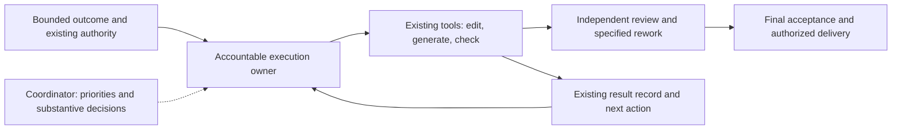

# Development efficiency without weaker AI controls

> **Feature:** `development-efficiency`.
> **Version:** 2 — consolidated specification, 2026-10-22.
> **Status:** Updated at the operator's request. The five-priority sequence is the selected working hypothesis; exact written-spec agreement and implementation are separate.
> **Authoritative for:** proposed outcomes, priorities, removal/reuse contracts and acceptance for this improvement program.
> **NOT authoritative for:** current execution permissions, shipped behavior or the [project goal](../../../README.md#why-this-exists).

## 1. Outcome and central decision

Deliver useful, meaningfully verified changes sooner, with less repeated model work and fewer operator reminders. Start by removing a moving line-number reference that forces an otherwise unnecessary delivered-source edit. Repair existing execution and ownership boundaries next. Decide whether a new fingerprint representation is worth maintaining only after measuring the remaining work.

One accountable execution owner carries a bounded useful outcome through ordinary corrections, known generated outputs, relevant checks and specified review fixes to the authorized delivery boundary. The coordinator handles priority, substantive uncertainty and cross-task dependencies. Independent reviewers and publication owners retain their distinct responsibilities. One owner does not mean self-approval or one model performing every operation.

Each addition must remove named existing work or an observed failure opportunity. A replacement retires the old mandatory path in its migrated workflow. Adding reports, observers or approvals while retaining all previous obligations is not simplification. No general dependency graph, evidence database, scheduler, standing observer, coordinator hierarchy or recurring model audit is proposed.

This is the proposed responsibility flow. Required checks stay before their protected effects. Saved state supports recovery but does not itself restart a terminated owner.

## 2. Premises and evidence

- P1: The operator wants faster, more economical development by addressing causes.
- P2: The operator selected the small edit -> hashes -> fingerprints -> evidence chain for detailed investigation.
- P3: Prefer removal and reuse; avoid another complex system.
- P4: Preserve effective control over AI-generated changes.
- P5: Cover all investigated cause groups and propose priorities by expected practical benefit.
- P6: Codex may approve exact product-brief content within delegated scope; this grants no implementation, spending, security changes or main merges.
- P7: The latest request selects the five-step working hypothesis: stable reference; reliable commands; complete ownership/report consumption; active waiting/reconnect; conditional fingerprint/ledger decision. Terminated-owner recovery stays separate.
- P8: Improve our existing specification with applicable SPEC-A content. The request does not authorize implementation.

Evidence baseline:

- I1: operator-supplied `WORK-EFFICIENCY-INVESTIGATION-20261021.md`, sections 1–15, under `/Users/art/.codex/visualizations/2026/10/12/01a12f1d-43d9-7853-9446-cd96c4d1f3b8/outputs/daily-recap-20261021/`. Observed mechanisms and unknown causes are separate; account-wide token attribution is absent.
- I2: this chat's `outputs/change-maintenance-analysis/ANALYSIS.md`, under `/Users/art/.codex/visualizations/2026/10/22/01a1629d-eeca-7db2-a21b-3e9b710039b8/`.
- I3: SPEC-A snapshot SHA-256 `c43f4c29560fe0a32a6a38bc53d1c71393342098573b1b6b256be62440b70b98`, retained in this chat's `outputs/spec-a-review/SPEC-A-c43f4c29560f.md`; review: `outputs/spec-a-review/REVIEW.md`.
- Framework source baseline: `96706e3cbd6a3e63c25fd8b0122aeadeb7cacb0d`. Source anchors below do not establish every historical session's installed version.

Historical `e5c511601d7` changes only a precompact comment citation from `:47-55` to `:48-56`. `abde02fa6ab` changes eight fingerprints, 24 rows: canonical hook, compatibility copy and refresh-ledger hash per fixture. The retained episode reports eight fresh comparisons and retained evidence for seven unchanged cells, not fifteen fresh captures for that comment. This establishes a cascade, not its share of all development cost.

## 3. Priorities and independently useful delivery

The sequence favors concrete evidence, bounded effort, reversibility and little new maintenance. It is a working hypothesis, not measured optimal ROI. Independent authorized work need not wait behind an unrelated slice. Correctness applies immediately in every slice.

| Priority | Useful outcome and destination                                                                                 | Existing owner surfaces                                                                     | Work removed / benefit hypothesis                                                           | Dependencies and acceptance                                                       |
| -------- | -------------------------------------------------------------------------------------------------------------- | ------------------------------------------------------------------------------------------- | ------------------------------------------------------------------------------------------- | --------------------------------------------------------------------------------- |
| 1 — S1   | Stable navigation in the canonical and delivered precompact hook through normal source/package delivery        | `.agents/hooks/precompact-residue.sh`; current package/install checks                       | Future target-line movement stops forcing hook edits and recapture; smallest bounded change | No later slice required; S1 controls; current matrix retained                     |
| 2 — S2   | Reliable scoped check/launch results in the affected contributor or owner workflow                             | `tests/install-sh/snapshot.sh`, affected fixture constructors, existing launcher/run record | Wrong matrix runs, contaminated cases, false success and unrecorded-start investigation     | Independently deliverable local repairs; incident-shaped controls                 |
| 3 — S3   | A bounded outcome moves through actual executor/coordinator/reviewer/delivery owners with an actionable result | Installed report producer/consumer; dispatcher/harvest; generator/task records              | Routine re-kickoffs, relay-only hops, fragmented evidence and obsolete restrictions         | Bind actual owners; retain independent decisions; S3 cases                        |
| 4 — S4   | A live or explicitly resumed owner consumes completion despite late attachment/reconnect                       | `aifWsStatus.ts`, `AifHandoffBackend.ts`, existing owner result handling                    | Missed events and stale waiting while an owner can execute                                  | Reuse S3 identities/actions; S4 cases; terminated-owner recovery is D1            |
| 5 — S5   | Evidence-backed keep/migrate decision for remaining fingerprint maintenance                                    | Installer expectations, refresh ledger, pre-push drift consumer                             | Avoid a normalization mechanism unless residual work justifies it                           | Measure after applicable earlier repairs; keeping current representation is valid |

Before a slice starts, its bounded plan binds the actual checkout/installed target, existing authority and owner, replaced path, checks and rollback. A source PR is not installed delivery. Each slice can reach its own authorized usable destination without waiting for the program. Unavailable destination-specific work remains pending without invalidating unchanged source evidence.

## 4. Complete cause disposition

Every cause has a slice or an explicit discovery/containment disposition. Unknown causes are not counted as eliminated.

| Cause                                                            | Evidence          | Disposition                                                               |
| ---------------------------------------------------------------- | ----------------- | ------------------------------------------------------------------------- |
| C01 Moving numerical navigation reference                        | I1 §5, I2         | S1 removes the triggering edit                                            |
| C02 Repeated literal hashes of pass-through files                | I1 §12–14         | S5 residual-cost decision; no automatic migration                         |
| C03 Hash of derived refresh ledger                               | I1 §13–14         | S5 conditional candidate; protective ledger remains                       |
| C04 Manifest/generated-reference maintenance                     | I1 §5/14          | S3 existing generators on final inputs and independent verification       |
| C05 Wrong cwd, selection, wrappers and result interpretation     | I1 §4/7/8/13      | S2 validated interfaces and truthful outcomes                             |
| C06 Inherited controls and missing/stale prerequisites           | I1 §5/8/14        | S2 explicit scenarios and pinned provisioning                             |
| C07 Weak tests and incomplete aggregate suite registration       | I1 §4/5/13        | S2 real behavior and failure propagation through the actual entry command |
| C08 Semantic API migration missed by textual merge               | I1 §14            | S2 callers/typecheck on integrated candidate                              |
| C09 Completion unconsumed after interruption/task switch         | I1 §1/5/8/9/13–15 | S3 responsibility, S4 live/resumed consumption, D1 automatic restart      |
| C10 Stale status, launch treated as running, request as approval | I1 §1/2/5/15      | S3 producer/consumer contract and reconciliation                          |
| C11 Cwd treated as identity; missing launch records              | I1 §4/13          | S2 identity and pre-receipt crash accounting                              |
| C12 Unsupported CLI resume of desktop reviewer                   | I1 §11/14         | S3 supported owner-mediated route; locks preserved                        |
| C13 Missing generated scope and fragmented packets               | I1 §1/2/13        | S3 complete bounded work and canonical result reference                   |
| C14 HO8 complexity and uncertain benefit                         | I1 §7             | D2 bounded necessity analysis of external-red-to-triage promise           |
| C15 Intermittent destination availability                        | I1 §7             | S3 pending delivery boundary; D2 destination-specific work                |
| C16 Socket resets, vanished processes, historical timeouts       | I1 §4/14/15       | S2 diagnostics/accounting; D3 unknown-cause recovery limits               |
| C17 Repeated or premature final checks                           | I1 §2/12–14       | S2 phase effects; S3 final-state order/evidence applicability             |
| C18 Superseded executor-role restrictions                        | I1 §10–11/14      | S3 latest applicable explicit authority                                   |
| C19 Intentionally shared GLM session                             | I1 §10/13         | S3 custody, queue and acknowledged return; no added concurrency           |

## 5. Control floor

1. Independently expected membership, file/link identity, bytes and behavior remain distinct assertions. The implementation cannot author its own expected success.
2. Relevant missing/extra files, corruption, wrong transforms, consumer-data loss and misleading success remain detectable. Equal source/destination bytes do not prove source behavior.
3. Independent decisions retain their authority and exact applicable content/candidate. Submission, transport success and acknowledgement are not approval or usable delivery.
4. Before removing a handoff, establish its actual function. Any unique control survives at a named existing boundary with demonstrated detection before retiring its old path. A reminder is not equivalent enforcement.
5. Evidence reuse requires known relevant code, tests, dependency, toolchain, configuration and environment inputs. Unknown applicability means full relevant verification or an explicit unresolved result. A SHA refresh cannot manufacture GO.
6. Scope, deny rules, hook trust, spending, destructive effects and publication boundaries remain binding. No self-approval or increased concurrency follows.
7. Initial simplification changes neither fingerprint representation nor required installer matrix. Later changes require an explicit decision and applicable fault controls.

## 6. S1 — remove the avoidable source edit

Replace the live numerical navigation in the precompact comment with the existing `ZCODE_EVENTS` symbol and source path where these identify the target unambiguously. Historical revision-bound citations keep their line evidence. A missing/renamed symbol still requires correction; merely moving its line does not.

Keep manifest generation, installer fingerprints, refresh ledger, early drift checks and full required matrix. The initial edit may itself require current one-time regeneration and checks. The saving is that subsequent target-line movement no longer changes hook bytes solely to repair navigation. Real hook changes still require their relevant checks.

Acceptance: inspect the named target and delivery through the current route; demonstrate on a bounded harmless target-line movement that navigation still resolves and no further hook edit is required. Existing applicable package/install checks pass. No new standing test framework is needed for a comment. Rollback is a normal source revert with current derivative maintenance.

## 7. S2 — make existing execution trustworthy

### Runner, environment and meaningful checks

- Expose validated cell selection in the existing snapshot runner through its per-cell functions. Default retains the full population. Unknown/empty selectors fail. Importing definitions must not run global loops. A selected cell runs exactly once with paths resolved from the declared root. Retire source-text extraction/full-script embedding wrappers in the migrated path.
- Keep installer exit/semantic outcome separate from artifact equality. `tests/install-sh/snapshot.sh:186` suppresses an installer exit; snapshot equality alone cannot establish successful installation. Overall success requires every required outcome.
- Use existing fixture constructors with explicit scenario values for controls such as `AIF_CTX_WINDOW`, `RUNTIME_BRIDGE_MODE` and `CLAUDE_CODE_ENTRYPOINT`, preserving intentional platform inputs. Dirty-parent and clean-parent runs of the same scenario agree. Use pinned lockfiles/provisioning; fail clearly before expensive runs when prerequisites are missing.
- Test promised behavior at its real boundary. Routing stubs do not prove actual Yarn/Astro behavior, consumer preservation or Windows compatibility. An intended bad case fails and restoration passes through the real aggregate entry command; every required suite must be able to turn that aggregate red.
- For helper/API migration, enumerate affected callers in the integrated candidate and run relevant type/contract checks before broad acceptance. Separate green branches and a clean textual merge are insufficient.

### Identity, phase effects and launch accounting

Keep stable session identity and authorized mode separate from mutable cwd and repeated initialization. A valid postcompaction init continues; a real identity/mode mismatch is rejected. Respect the existing GLM launch policy and deny rules.

For preparation-only admission, enforce effects at an existing capable runner/admission boundary. Observing one Write call cannot constrain other write/execution channels. If a host cannot enforce the phase, record the limitation and use an already-authorized capable route; prose does not establish enforcement.

Before child creation, persist admitted launch intent and attempt identity in the existing run/task record. Bind available actual child/session identity and retain early stderr and semantic terminal outcomes from launch, not only after waiting. An observed failure to create the child is a failure. A crash after spawn but before receipt remains `unknown`; intent is not proof of execution or zero allowance use.

Recovery reconciles known process/session state and retained outcomes against that attempt before continuation. Missing records never reset cumulative counters or authorize duplicate charged work. Unresolvable ambiguity remains an explicit pending action for the existing owner under current retry authority. This repairs recording gaps without promising atomic external-process creation or introducing a supervisor service.

Acceptance covers selected-cell scope and invalid selectors, contaminated inputs, missing prerequisites, real defects and omitted-suite propagation, merged signature mismatch, valid repeated init and invalid identity, forbidden next-stage effects, semantic failure with exit zero, and crash after child creation before receipt. The crash case retains prior intent, counters and uncertainty, avoids duplication, and reconciles an available known child/result. Restore relevant valid controls. Apply cases to the changed family, not every task. Rollback restores the affected interface while retaining historical run evidence.

## 8. S3 — complete ownership and actionable results

Bind the actual installed report producer, consumer and execution/delivery owners before editing. `.agents/procedures/orchestrator/references/chip-worker-template.md:46` is an existing REPORT surface, not proof that all affected owners use it. Updating a template alone is insufficient.

An assignment includes the usable destination, permitted source changes, known generated-output closure, necessary checks and already-specified corrections. Keep these with the existing execution owner until the authorized boundary. No new kickoff or operator vote is needed for already-admitted corrections with no remaining architectural decision. Unexpected outputs, changed goals and live authority restrictions still require their applicable route.

Use existing generators for manifests, catalogs and recoverable citations. Check actual outputs against the admitted closure. Preserve staged/index versus working-tree input identity and independent archive comparison. Keep `MANIFEST.sha256` tracked initially; untracking requires mapping its index, pre-push, package and merge consumers and is not a prerequisite.

### One report contract, updated at both ends

Reuse existing fields/records for task and assigned slice, immutable candidate/result generation and attempt, actual completed action/outcome, authoritative evidence, next required action, accountable owner and applicable authority/decision dependency. Distinguish implementation, checking, acceptance, merge and installed delivery. Free-form explanation cannot override these facts. Reference one canonical result from task/PR records; do not introduce a second universal packet.

The consumer parses mechanically decidable facts and reconciles authoritative current evidence when needed. Launch is not current running state; request/response is not approval; a newer report for another candidate does not supersede this candidate's block. Resolve conflicts with the narrow source read rather than another blanket narrative.

Consumption ends in an actual authorized action or a durably owned pending action with its prerequisite/return condition. An internal pending action without an executing consumer is not continuing progress. Ordinary repair returns to its executor, review to its independent reviewer, accepted delivery to its authorized owner. Keep sent, received, accepted and performed distinct. Use supported native routing for desktop-owned review sessions; preserve writer locks.

Reconcile stale role restrictions against the latest applicable explicit authorization before preparing continuation. Remove only superseded restrictions with that reference. Record acknowledged custody return, next eligible work and displaced-task return conditions in the existing queue. Keep intentional serial GLM custody; real capacity limits do not authorize more workers.

### Remove repetition at the correct boundary

For each proposed handoff removal, establish producer, consumer, evidence/decision/effect and surviving owner. Remove a relay-only hop only after verifying it adds no unique necessary function. There is no blanket removal of reviews or authority boundaries.

Use targeted checks during editing; stabilize code through existing review/rework before expensive final conformance acceptance. Preserve required pre-egress review. An existing unmerged/no-auto-merge path serves PR-based review only within actual authority. Final evidence binds the last relevant edit. Use existing independent narrow delta review when judged substance is unchanged; changed substance receives required review. Applicable historical results remain historical, not newly performed progress.

Acceptance: known generated outputs complete within admitted scope while unexpected outputs stop; blocking responses never become approval; final same-candidate CI replaces stale evidence while different-candidate results do not; a completed candidate reaches its real next owner or stays explicitly pending; specified repair avoids re-planning; applicable unchanged evidence is reused and changed relevant inputs invalidate it; superseded restrictions and custody returns are reconciled. A unique control formerly held by a removed hop still fires at its surviving boundary. Rollback restores prior workflow routing without deleting results, decisions or consumer data.

## 9. S4 — reliable active waiting and reconnect

Reuse existing backend/task observation. `packages/runtime-bridge/src/aifWsStatus.ts:200` handles socket open; `:205` consumes events; `AifHandoffBackend.ts:664` delegates `awaitDone`. These are source seams, not durable owner-restart guarantees.

Establish subscription before reconciling authoritative state on initial connection and every reconnect. Route events and snapshots through one settlement path. Bound observation; timeout means uncertainty, not task failure or retry permission. Reconcile candidate, result generation, current authority and pause/cancellation before next-action effects. Deduplicate by task, immutable result generation, recipient and continuation stage so later rework can progress.

Retain the pending action before acknowledging consumption; record actual outcome and reconcile uncertain external effects before repeating them. A deduplication key alone cannot make an external effect exactly once across a crash. Reuse supported idempotent effects or existing reconciliation; otherwise preserve an explicit unknown action instead of duplicating review, execution or publication.

On explicit owner resume, reconcile retained results/actions before reporting current state or launching duplicate work. A live waiter and saved record do not wake a terminated chat. An unattended route requires a demonstrated real receiver; otherwise its limitation stays explicit. S4 claims active/reconnected/resumed-owner correctness only. D1 owns automatic recovery after owner termination.

Acceptance: completion before attachment, between subscription/snapshot and during disconnect; duplicate observations; new rework generation; stale candidate; intentional pause/cancellation; transport uncertainty; explicit owner resume. The appropriate next action occurs once when its effect is reconciled, or remains unresolved without unsafe retry. Cancelling observation/a turn is not itself cancellation of the underlying task. Rollback preserves pending records and supported ownership.

## 10. S5 — decide whether fingerprint migration pays

Measure residual maintenance after applicable earlier repairs using existing logs and the next real authorized change. Separate capture/update work, comparison runs, evidence assembly and waiting. Compare existing capture/build automation with implementation and recurring maintenance of a new representation. This is a scoped design decision, not a new mandatory gate on every task.

Keeping current fingerprints is valid when residual work is small or the replacement costs more. Stable references remove one trigger; a real payload edit may still affect all eight variants. Expected-value simplification does not itself justify fewer runs.

If evidence warrants migration, revisit prior B's bounded candidate: two direct-copy precompact destinations in eight npm fixtures; independent source/destination mapping; full expected path inventory and file/link identity; exact installed-byte comparison; separate source-behavior tests. Other/transformed outputs keep independent expectations. Update the early `pre-push.ts` consumer in the same slice; unknown schema/mapping must fail rather than disappear from checks.

Keep the runtime refresh ledger. Prior B's test-only value masking is an option, not an approved requirement. It requires validating selected membership/values against final delivery and scenario before masking only explicit value tokens, preserving every other byte, rejecting malformed/duplicate/missing/ambiguous data, and distinguishing retained consumer records from fresh delivery. If not justified and safely bounded, keep the existing ledger oracle.

Before removing a relevant old oracle, demonstrate faults for missing canonical/alias, extra path, corruption, wrong mapping/link identity, transformed output, missing/invalid/duplicate ledger key, unrelated mutation, stale pre-transform hash, overwritten prior record and lost consumer edits. Each fails for the intended reason and restoration passes. Test selection remains separate. Rollback restores representation and early consumer together without changing consumer ledger data.

S5 acceptance is an evidence-backed keep/migrate decision and explicit scope. That decision alone proves neither implemented safety nor eliminated bookkeeping.

## 11. Separately bounded unresolved work

**D1 — terminated-owner recovery.** A separate design after S4's boundaries are established, not a prerequisite for S1–S3 or live-waiter repairs. Identify an existing durable runtime capable of the full selected continuation, including host-bound independent review/egress. Migration or a bounded adapter requires actual capability evidence. Demonstrate termination after result, restart, new generation, duplicate event, effect-without-receipt and explicit cancellation. A passive READY file, assumed heartbeat or unowned process is insufficient. Until demonstrated, full no-reminder continuation on that route remains open; saved state is not closure.

**D2 — HO8 proportionality and destination delivery.** After applicable command/ownership repairs, inventory the actual enrolled-external-red -> bounded triage promise and each component's unique effect. Compare necessary protections and operating cost with a smaller adequate path. Backend acceptance is not end-to-end value. Preserve data/WIP, drain and authorization boundaries. Unavailable destinations leave resumable pending work; reuse unchanged source evidence when destination acceptance can run. No blanket deletion or remote retry follows. Priority may change on concrete benefit/cost evidence through the existing owner.

**D3 — unknown incident causes.** Socket-reset initiator, unexplained process disappearance and historical timeout origins remain unknown without discriminating evidence. S2 retains diagnostics; S3/S4 retain state. Do not infer provider outage, quota exhaustion or permission failure from incomplete evidence. Existing recovery authority and a verified changed condition govern retries; cumulative caps survive. These are containment/discovery dispositions, not elimination claims.

## 12. Measurement and stopping

Use existing task/check results to compare time to the same usable destination, manual/model handoffs, mandatory manual steps, unchanged repeated checks, capture/update count and produced-to-consumed waiting. Record migration effort separately. Attribute usage only when task-specific host data exists; account-wide allowance is not per-cause cost.

For S1, replay target-line movement and observe whether source/derivative churn remains. For S2–S4, use incident-shaped controls and the next real authorized workflow. Compare equivalent scope, inputs and destination; missing data stays unknown. No numerical saving or completion date is promised.

Stop or narrow replacements whose recurring handling/configuration burden exceeds removed work. Roll back if a relevant formerly detected fault becomes silent or a unique authority boundary is lost. Reprioritize against actual work/wait data without treating this hypothesis as measured fact. Do not build another platform or audit ladder merely to measure improvement.

## 13. Reuse and review disposition

Existing anchors: SSOT #111 and `.agents/rules/cold-seat-economy.md` for review economy; #267 packaging; #270 independent regeneration/comparison; #274/#277 citations; #258/#307 task claims/completion primitives; #308 immutable review inputs. `tests/install-sh/canonical-bindings.test.sh:41` demonstrates byte comparison, not full migration safety. `setup.d/lib.sh:309` and `:879` record/flush delivery hashes; `scripts/build-getff-dist.sh:109` verifies archive content. These identify reuse surfaces, not live activation or an unearned new BUILD verdict.

| Input finding / design change                         | Disposition | Resolution                                                                                         |
| ----------------------------------------------------- | ----------- | -------------------------------------------------------------------------------------------------- |
| SPEC-A review M1: missing proposed rollout            | FIXED       | Five priorities, destinations, owner surfaces and dependencies in §3; full cause mapping in §4     |
| SPEC-A review M2: unrecorded launch interval          | FIXED       | S2 pre-spawn intent, child/early diagnostics, conservative uncertainty and crash acceptance        |
| Prior B: mandatory direct-copy/ledger migration first | FIXED       | S1 stable navigation only; S5 conditional decision                                                 |
| SPEC-A ownership/report strengths                     | FIXED       | S3 complete bounded responsibility, paired contract changes, removal mapping and final-state order |
| Owner restart mixed with active waiting               | FIXED       | S4 live/resumed consumption; D1 separate automatic-restart design                                  |

## 14. Live decision register

| Decision       | Status        | Basis / falsifier                                                                  |
| -------------- | ------------- | ---------------------------------------------------------------------------------- |
| D-Priority     | answered      | P7 selects the sequence; measurements or explicit operator change can revise it    |
| D-Control      | answered      | P4 preserves effective controls; deleting the oracle cannot establish acceptance   |
| D-Removal      | answered      | P3/P7 require mapping handoff function and retiring replaced work                  |
| D-Migration    | answered      | S5 may keep fingerprints; no assumed payoff or pre-approved masking                |
| D-Restart      | answered      | P7 separates terminated-owner recovery; capability precedes outcome claims         |
| D-Written-spec | operator-fork | Requesting this revision does not approve unseen final bytes or authorize dispatch |

## Consensus retell

Baseline: c5c6f683e308561ca57806057b36e163638640c6

> Re-pointed at merge-forward 2026-10-26: the original baseline `0d719eff` was the
> authoring-branch commit (pre-squash) and is not an ancestor of shared history; the
> squash commit above is the shared-history landing that published these exact bytes
> (#2124). Provenance pointer only — see the note below on what the baseline is not.

Premise meaning is retained; P7/P8 add the latest operator direction. The baseline is historical proposal content, not a claim of prior exact-spec agreement.

| #   | Claim                                                                                                                  | Source  |
| --- | ---------------------------------------------------------------------------------------------------------------------- | ------- |
| 1   | Improve speed/economy by addressing causes while preserving effective AI controls.                                     | P1 + P4 |
| 2   | Cover all investigated causes; prefer removal and existing mechanisms.                                                 | P3 + P5 |
| 3   | Start with stable navigation, reliable commands, complete ownership/report consumption, then active waiting/reconnect. | P7      |
| 4   | Decide fingerprint/ledger migration from residual cost; preserve controls when replacing an oracle.                    | P7      |
| 5   | Keep terminated-owner recovery separate and improve our specification using applicable SPEC-A content.                 | P7 + P8 |

### Unconfirmed — author derivations

Detailed interfaces, acceptance implementation and relative effort are author proposals. Actual installed owners/targets are bound before each slice starts. No measured optimality, full autonomous recovery, implementation completion or exact written-spec agreement is asserted.

## 15. Self-review and handoff boundary

### §1.7 Forward-check applied

Proposed replacements preserve executable detection under `.agents/rules/attention-is-not-a-mechanism.md:15`. Inspected seams include `.agents/procedures/orchestrator/references/chip-worker-template.md:46`, `packages/runtime-bridge/src/aifWsStatus.ts:200` and `.agents/procedures/dispatcher/references/execution.md:213`; existing mechanisms are distinguished from proposals. Prior-art anchors support reuse. No new external tool, shipped rule or service is introduced by this documentation revision. Each slice defines acceptance and rollback/disposition.

### §1.7 Skipped: Backward implementation conformance remains pending because this specification proposes bounded repairs and changes no live rule or runtime; each slice must enumerate installed owners and parallel consumers before retiring existing paths.

Cold design and intent reviews bind this revision's content and remain distinct from operator agreement and implementation acceptance. Earlier GO applies only to historical bytes. After agreement, the next deliverable is a bounded S1 implementation plan through the existing workflow; this specification dispatches no slice.
