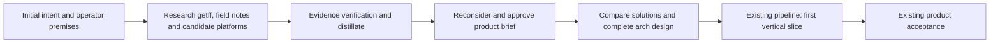

# Portable, verified autonomous development — intent preparation

> **Status:** Initial product framing and research agenda, 2026-10-26. Not an approved product-brief snapshot or a solution design.
> **Authoritative for:** the recorded operator premises and proposed research boundary for this initiative.
> **NOT authoritative for:** the project goal, implementation readiness, runtime adoption, or permission to launch workers or change installed services. Project authority remains [README](../../../README.md#why-this-exists).

> **Product-baseline successor:** [the reviewed PRD](2026-10-26-portable-verified-autonomy-prd.md) and its exact-content approval record now own product requirements. This document retains preparation history and research leads. The latest operator clarification explicitly preserves OpenMausBot's heterogeneous-agent advantage as an evaluation criterion while keeping getff host-agnostic and host selection open.

Feature candidate: `portable-verified-autonomy`.
Approval reference: none for these exact bytes. The operator has delegated brief review and approval to Codex; that delegation is not an approval record for this preparation document.

## Product idea

A repository maintainer should be able to agree a development outcome, give it to their available agents, and receive a verified result without repeatedly forwarding messages, waking a coordinator, reconstructing context, or deciding routine next steps. Within the agreed scope and permissions, implementation, review, correction and continuation should proceed with an accountable owner. The operator should be involved when their decision is genuinely needed, with the missing decision and its consequences clearly stated.

Develop getff's existing procedures, executable conventions, verification and acceptance into a portable development process that ready-made agent platforms can execute. Prefer reusing a host's existing coordination and lifecycle facilities to building a getff scheduler or agent application. Compare native facilities available through existing subscriptions, the operator's Codex/Dot and Grok Bot examples, OpenMausBot, and relevant free alternatives without privileging one host. Actual availability, subscription eligibility and integration capabilities must be verified.

The intended default path requires no additional payments beyond subscriptions the operator already holds, or uses genuinely free available components. Existing subscription quotas still apply. Open-source licensing alone does not establish free model execution, memory extraction, embeddings, hosting or operation. No new subscription, metered API or paid hosting dependency may be silently introduced as a prerequisite for the promised experience.

The process must first improve development of getff itself and then be usable in consumer repositories. Useful autonomy must not remain an internal maintainer setup. Product intent, project rules, review evidence and useful experience should remain understandable and usable when models or agent platforms change. Platform breadth can grow incrementally, with explicit capability limits.

The benefit is lower total operator effort for a comparable accepted outcome, including setup, supervision, recovery and maintenance. Eliminating message forwarding while increasing those other burdens is not sufficient. Research must establish an observable baseline and propose a useful first scenario before a final improvement threshold is agreed.

This initiative supports getff's existing goal: agents must not silently bypass the repository's conventions. Recursive self-application is the method for proving the improvement, not a replacement project goal.

## Recorded operator premises

These are meaning-faithful English records of the operator's requests in this conversation, not new architectural decisions.

| ID | Premise |
| --- | --- |
| P1 | The current coordination problem makes the operator supply continuation and communication that should be automated where their judgment is unnecessary. |
| P2 | Reuse ready-made bots instead of constructing another proprietary coordinator. The operator's latest clarification removes OpenMausBot priority: native Codex/Dot and Grok Bot facilities and other suitable free options belong in the comparison. |
| P3 | Start in getff's own repository and reuse the same useful development capability in consumer repositories. |
| P4 | Aim for a framework usable with different agent platforms, including the requested Grok Bot and Codex examples; those examples are desired applicability, not verified integrations. |
| P5 | Cross-agent communication matters, including GPT in Codex and GLM through Claude Code; shared experience and memory ownership must be investigated. The operator reports an existing integration called “hi-memory” and asks whether it can help; identify its actual implementation and reuse potential before proposing another memory system. |
| P6 | Much may already exist: intent/arch/pipeline, vertical slices, tracer bullets, TAK and Dot review. Establish and reuse actual implementations before proposing additions. |
| P7 | Compare getff, grokbot-field-notes and OpenMausBot comprehensively enough to understand what to retain, improve, connect or avoid duplicating. |
| P8 | Research first, reconsider the idea using the findings, and only then settle the final design and architecture. The operator asks Codex to formulate a complete initial framing. |
| P9 | Prefer operation with no additional payments: through existing subscriptions or free components. Compare actual execution costs and limits, not only software license prices. |

## Candidate essential promises

These IDs prepare the product discussion. They are not a frozen approved inventory. Research may refine them through an explicit product revision; it may not silently erase an unmet promise.

| ID | Essential | User-visible promise | Scenario | Failure case | Permitted deferrals |
| --- | --- | --- | --- | --- | --- |
| PA1 | Yes | Routine work advances without human relaying. | An executor finishes; review occurs; actionable findings return for correction; the accepted result reaches its next authorized destination. | The operator must say “continue” or copy the result to trigger a routine next step. | Additional workflow families; the selected first end-to-end path must demonstrate actual continuation. |
| PA2 | Yes | Completion means the agreed outcome is verified under project rules. | A change is reviewed against the specification and applicable checks on the current candidate. | A successful agent turn, stale review or vacuous green suite is reported as product acceptance. | Unrelated assurance campaigns; required assurance for the selected path cannot be deferred to claim success. |
| PA3 | Yes | Work retains a clear owner and recoverable state. | After an interruption, the responsible agent resumes from known work and evidence; uncertainty about an external action stays visible. | Work becomes ownerless, a completed action is blindly repeated, or a deliberate pause is overridden. | Broader availability targets; the supported interruption/restart cases must be explicit and demonstrated. |
| PA4 | Yes | Agents in supported environments exchange actionable work and results. | A bounded task passes between different supported agent environments with the correct repository, candidate, result and next action. | Agents need a human messenger or act on another task's files or results. | Additional engines and platforms; unsupported capabilities must be disclosed. The initial pair is selected after feasibility research. |
| PA5 | Yes | Useful project experience survives a change of agent or session. | A successor retrieves a relevant, sourced lesson; changed facts can supersede it; approved decisions and rules remain authoritative. | Memory is trapped in one private chat, stale recollection overrides current decisions, or unrelated project knowledge is silently mixed in. | A particular memory product, automatic extraction of every conversation and historical migration. A useful continuity case is required. |
| PA6 | Yes | The improvement is reusable beyond getff's maintainer environment. | The supported workflow is installed and exercised in a consumer repository without private machine-specific state; platform-specific dependencies are declared. | The demo works only in the maintainer's checkout or requires rewriting its core process for another host. | Broad language/platform coverage; consumer proof and an honest portability boundary cannot be omitted from final acceptance. |
| PA7 | Yes | Operator involvement is reserved for meaningful decisions. | A genuine product conflict is presented with context and options; routine repair proceeds within existing authority. | Every review needs another human relay, or automation changes the objective or exceeds existing permissions to keep moving. | More autonomy levels; existing authority and pause/cancel behavior must remain effective. |
| PA8 | Yes | The supported default path needs no additional paid service or metered model API beyond existing subscriptions. | A representative workflow, including required memory operations, runs through eligible existing access or free local components with its limits disclosed. | The nominally free setup requires paid API inference, another subscription or paid hosting to complete the promised cycle. | Additional paid optional integrations; they cannot be prerequisites for the default path. Existing quotas and local resource consumption remain explicit. |

## Distinctions the research must preserve

- **Task owner:** accountable for the next required action and final disposition. This is distinct from the program that launches or resumes that agent.
- **Execution completion / product acceptance / delivery:** separate observable events. Delivery means the agreed authorized destination, which may be a reviewable PR; it does not imply permission to merge or deploy.
- **Model / agent environment / coordination host:** changing a model does not prove a workflow can move between hosts. Running a host-managed agent differs from connecting an already-open external session.
- **Working state / authoritative project knowledge / experience memory:** task progress, approved decisions and searchable lessons have different purposes. Their storage and ownership remain design questions.
- **Portable / supported:** portable meaning and artifacts do not imply identical platform capabilities or universal integrations at launch.

These are working distinctions for this initiative; research must reconcile them with the existing project glossary and owners before introducing canonical vocabulary.

## Rejected interpretations

- Replace getff's mission with a general-purpose bot platform or build a new scheduler before proving an upstream gap.
- Treat OpenMausBot adoption, a new memory database, a particular adapter architecture or AIF removal as settled.
- Equate more bots, messages, tokens, PRs or green tests with less operator work and a correct result.
- Copy grokbot-field-notes wholesale, treat its author's observations as verified xAI runtime behavior, or replace existing stronger checks with prose advice.
- Rebuild TAK, Dot review, workflow stages, task records or memory services because their latest implementations were not located.
- Deliver an internal-only solution and postpone consumer applicability indefinitely.
- Promise endless unattended execution, automatic approval of every action, or support for platforms whose actual interfaces were not verified.

## Research agenda before solution design

### R1 — Establish getff's real baseline

Inventory the entire relevant lifecycle, then trace representative end-to-end paths. Cover intent/arch/pipeline, slice and tracer-bullet planning, task dispatch, owner continuation, messages, claims, review/rework, TAK and other assurance, Dot integration, acceptance, delivery, pause/cancel/recovery, memory, skills/hooks and consumer installation. Map the existing native-host/AIF routes and their responsibilities.

For every capability record its authoritative owner, concrete source revision, current implementation location (including relevant branches or other worktrees), installation route, active configuration where authorized, evidence and limitation. Distinguish proposed, implemented, merged, installed and observed-live states. An old checkout or design document cannot prove either absence or present readiness. Reuse existing research and evidence after checking applicability; do not rerun unchanged proofs without a reason.

### R2 — Compare practices with grokbot-field-notes

Build a practice-by-practice matrix covering roles, coordination, verification, handoffs, skills/routines, memory, operator intervention and reported failure modes. For each: source and evidence class; getff equivalent; stronger/weaker/missing aspects; proposed disposition and user benefit. Dispositions include already covered, retain getff, improve existing, reuse upstream, investigate, or reject. Research must be able to conclude that no change is needed for a practice.

### R3 — Compare ready-made platforms against the actual coordination gap

Include the existing getff/native-host/AIF baseline, native facilities in the operator's subscribed environments, OpenMausBot and relevant free alternatives. Treat product names supplied by the operator as discovery leads, not proof of public APIs or integration support. Trace native and external agent routes separately: engine configuration, GLM compatibility, task/result transport, owner wake-up, queueing, restart/reconciliation, permissions, workspaces, project instructions/tools, memory, review isolation and cancellation. Determine what exists upstream, what requires configuration, what a small binding could cover and what remains unsupported. Record eligible subscription routes, quotas, incremental charges, local resources and operating prerequisites per candidate. Compare candidates on the same outcome before selecting an initial integration; OpenMausBot has no default preference.

### R4 — Resolve memory and knowledge continuity

Start with the existing integration the operator calls “hi-memory”: locate its actual package/service, integration code or configuration, supported readers/writers and current deployment. Confirm whether this refers to Hy-Memory or another component rather than normalizing the name by assumption. MemHub tools are exposed in this conversation; that establishes an available interface, not that MemHub and the reported integration are identical or that a read/write cycle has been verified. Map who writes, who reads, how relevance and project scope are selected, provenance, supersession, deletion/retention, access, portability and retrieval cost, including any model or embedding charges. Examine whether shared context contaminates independent review. Separate facts needed for this task from broad personal-memory contents; inspect interfaces and bounded project evidence rather than indiscriminately ingesting histories. Determine whether existing storage/services suffice before considering a new memory component.

### R5 — Establish portability and economics

Define which responsibilities belong to getff and which can remain with a host. Investigate the actual extension surfaces of candidate platforms rather than assuming a universal API. Identify consumer installation prerequisites and dependencies on private accounts, local paths or factory-only delivery. Compare operator interventions, blocked time, successful acceptance, token/runtime cost, setup and maintenance burden against a comparable baseline. Report observed numbers with their conditions; do not invent improvement percentages.

## Required research outputs and stopping condition

Produce a dated evidence inventory, capability/ownership map, practice comparison, alternatives with trade-offs, unresolved-risk list and recommended disposition for each existing component: keep, configure, connect, improve, or retire only with mapped consumers and migration consequences. Attach exact source pins and reproducible evidence; unknowns stay explicit. Prior research is an input, not a final adoption verdict.

**Pre-mortem:** the idea fails if the host merely adds another queue while the original coordinator still requires manual wake-up; if integration duplicates existing systems; if shared memory undermines review; if recovery repeats uncertain actions; if consumer use depends on private maintainer state; or if operational cost exceeds the human effort removed.

**Acceptance/falsifier:** before an adoption recommendation, propose the smallest authorized live comparison that can show whether the selected host reduces manual relaying while preserving current-candidate acceptance, correction and recovery. Reject or rework that host choice if the representative task still needs the operator to bridge routine transitions, loses evidence after interruption, weakens checks or costs more to maintain without useful benefit. This rejects a candidate solution, not automatically the user's need.

Research is ready for design when each consequential architecture choice has evidence, a named unresolved question or a bounded experiment; the existing capability inventory is reconciled; and a cold verifier has checked the distillate's anchors and reproducibility through the existing arch K-pass. Unknown platform compatibility must not be promoted to a fact. Broader implementation work is not part of this preparation artifact.

## Proposed route

The existing intent and arch procedures own these transitions. This diagram is a proposed route, not a completed review or a new workflow engine. Research may refine the product framing; changed promises must be explicit. The final architecture must explain how each approved essential promise is met before implementation expands. Use the existing pipeline and result-review protocol for delivery, rather than adding another acceptance hierarchy.

## Starting evidence and decision status

- [Prior bounded reuse assessment](../../meta-factory/research-patches/2026-10-26-portable-autonomy-reuse-decision.md): provisional candidate analysis; its cold review does not approve this broader initiative or establish live integration.
- [Existing reuse register](../../meta-factory/prior-art-evaluations.md): locate prior decisions and their revisit conditions before new capability proposals.
- [grokbot-field-notes](https://github.com/unicodef1wn/grokbot-field-notes): practice source; third-party observations, not platform source code.
- [OpenMausBot](https://github.com/milind-soni/OpenMausBot): candidate host; refresh and pin relevant source revisions during research.
- The operator-supplied evidence dossier is at `/Users/art/.codex/worktrees/56f0/rules-as-tests-aif/docs/meta-factory/research-patches/2026-10-26-agent-practices-evidence-dossier.md`. Treat this as a research input location, not a consumer dependency; preserve relevant durable source references in the research handoff.

Settled for this preparation: research-first ordering, own-stack reuse, no preferred bot platform, no additional paid dependency in the intended default path, recursive consumer applicability, cross-environment communication and investigation of existing memory before replacement. Open: runtime adoption, coordination ownership, exact identity and capabilities of the reported memory integration, delivery profiles, initial supported pair, migration, exact acceptance scenarios and effort/budget. These technical questions are research work, not questions to return to the operator before inspecting available evidence.

Product choices to revisit with the findings: which first scenario removes the most operator work; what observable improvement is worthwhile; and whether connecting existing open sessions is essential to that scenario or host-managed sessions are acceptable. Do not silently decide these by selecting the easiest technical integration. The initial artifact-only advisor identified these questions and the need to count total operator effort; they remain explicit rather than blocking preparation on facts not yet researched.

No implementation, installation, paid experiment, external communication, retirement or merge follows merely from this document. Existing authorization and task-specific gates continue to apply. Testing seam for this artifact: source/premise traceability and artifact-only product understanding; runtime testing belongs to the later bounded experiment and design.
