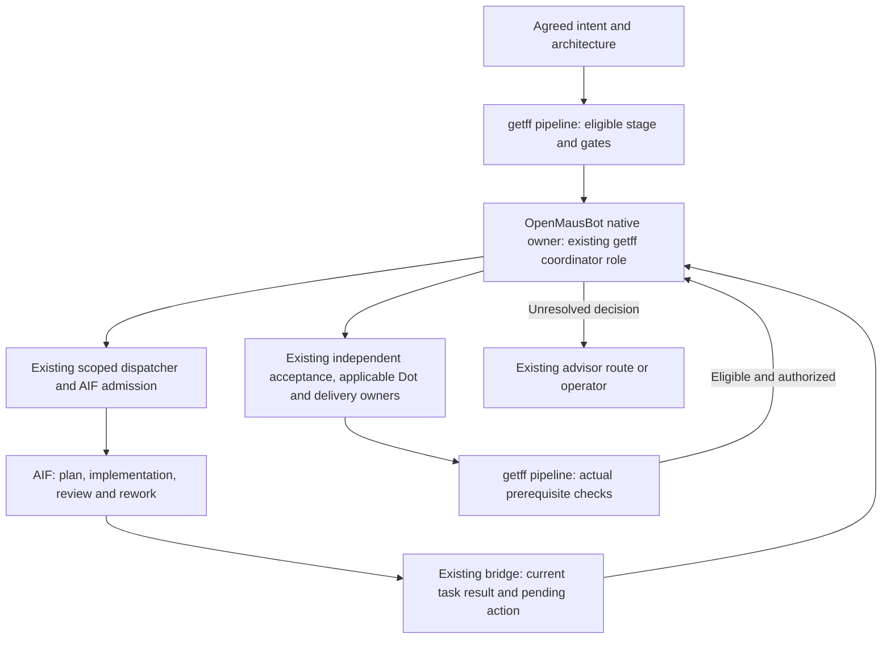

# Portable verified autonomy: OpenMausBot integration design

> **Status:** architecture candidate for cold review and operator agreement; not yet agreed or authorized for implementation.
> **Authoritative for:** the proposed first-host architecture, implementation boundaries and staged acceptance contract.
> **NOT authoritative for:** product approval, host fitness, implementation permission, runtime enrollment or completed acceptance.

## Context

The [approved PRD](2026-10-26-portable-verified-autonomy-prd.md) remains unchanged at SHA256 `ec33fd3d88ae41fb623b31d4d465d96d2cbe3af63dfc7d815f72c8c684590721`. The [accepted research distillate](../research/portable-verified-autonomy/2026-10-26/distillate.md) and its [independent verification](reviews/portable-verified-autonomy/research-kpass.md) support design, not live acceptance. The current authority selector was read at revision 1, with no currentSpec. No agreement to these draft bytes is recorded.

The maintainer wants an existing getff task to advance through the existing intent, architecture, pipeline, execution, review and delivery obligations without manual message relays or repeated continuation prompts. OpenMausBot is the selected first host. It may create task sessions. Existing AIF execution remains available: the operator explicitly clarified that a bot may call its plan/work/review loop. The no-AIF research exception is not a product constraint.

## Operator-premise register

The following entries transfer the recorded meaning by pointer, rather than reconstructing consent from the implementation proposal. Exact entries and conversation evidence are in [arch-decisions.md](reviews/portable-verified-autonomy/arch-decisions.md).

- P10 — Pointer to recorded P10: host-managed working sessions are allowed.
- P13 — Pointer to recorded P13: first trial is one real getff task; no exact task family was selected.
- P14 — Pointer to recorded P14: retain existing pipeline roles, checks, acceptance and stage gates.
- P15 — Pointer to recorded P15: OpenMausBot is the first integration design target.
- P16 — Pointer to recorded P16: bots may use AIF's existing execution/review cycle; avoid manual continuation stalls.
- P17 — Pointer to recorded P17: first version runs on the operator laptop; no always-on deployment is required.
- P18 — Pointer to recorded P18: verify and configure the already installed Hy-Memory as required integration work.

## Approaches and decision

| Approach | Benefit | Consequence | Status |
| --- | --- | --- | --- |
| Existing getff/AIF plus existing native continuation | Maximum reuse of existing admission, tasks and review | Outer-owner continuation still needs proof | Comparison baseline and fallback |
| OpenMausBot native owner plus getff, retaining AIF where useful | Ready-made heterogeneous sessions and native child-to-owner return; preserves existing execution machinery | Must qualify the outer continuation, acceptance and context boundaries | Selected host approach; retained-AIF first binding proposed |
| Direct Codex/Dot or Grok owner facilities | Uses a native host's available coordination facilities | Account/access and equivalent continuity obligations remain unproved | Later second-host candidate, not selected yet |

Selection is provisional with respect to fitness: failure of required acceptance, recovery, consumer closure or no-additional-payment operation requires revising the binding or host choice. It does not weaken the PRD. No scheduler extraction, replacement AIF implementation, permanent bot roster or new memory backend is selected.

## Proposed responsibilities

This is a proposed connection map. The source components exist; the full connected route has not run. The platform supplies native session/assignment lifecycle. getff retains workflow meaning and evidence. AIF owns its admitted execution task and internal review/rework. The outer owner handles the remaining getff obligations and next authorized transition. No second owner independently repairs the same candidate while AIF owns that repair.

| Responsibility | First-route owner | Reuse / qualification |
| --- | --- | --- |
| Product and architecture authority | Existing intent/arch artifacts and selector | Reuse exact current refs and existing validators |
| Eligibility, dependencies and stage routing | Existing pipeline role | Preserve actual merge prerequisites and in-flight checks |
| Outer assignment, session return and host restart | OpenMausBot native runtime | Qualify native owner/child return; do not substitute external polling semantics |
| Task admission, plan review, implementation and internal rework | Existing dispatcher/runtime bridge/AIF route | Preserve current task claims and reviewed-start gates |
| Observation of AIF result | Existing bridge observer, executed in the selected native task context | Observation returns data; native host must durably return it to the correct owner |
| Change/product review and applicable PR review | Existing distinct review responsibilities, including enrolled Dot where applicable | No assumption that one review satisfies all other obligations |
| Questions and returned advice | Existing advisor protocol | Advice is bound to current inputs and grants no new execution rights |
| Authorized delivery and managed-PR ownership | Existing designated owner | No inference of merge/deploy authority from host completion |
| Relevant experience | Existing repository knowledge and evaluated memory installation | Prove provenance, correction and permitted reviewer context |

Proposed custody rule: the native outer owner retains responsibility for the whole admitted stage until its authorized completion or explicit transfer. The bounded observer only reports AIF state; it does not implement, judge acceptance, merge or become the stage owner. AIF owns its internal corrective attempts while its task is active. After harvest, a registered managed-PR coordinator retains its existing correction/merge rights; the outer owner tracks the obligation and consumes its current receipts rather than assigning a competing fixer. For an unmanaged PR, the existing stage owner routes correction through the applicable current procedure. Exact parent/dispatcher/observer identities, correction transport and cessation/transfer evidence must be bound before launch; a role label alone is insufficient.

### Proposed concrete role binding

The [Q2/custody recheck](reviews/portable-verified-autonomy/q2-review-custody-probe.md) supports the following composition of existing roles. It does not prove a configured launcher or return path.

- The OpenMaus native parent performs the scoped dispatcher responsibility. Pipeline planning retains its existing scope; the parent does not relabel a campaign coordinator merely to avoid standalone-worker rules.
- One standalone local getff pipeline worker owns the execution checkout and eventual harvested branch. The AIF observer is an existing bounded command inside that worker, not an additional permanent bot. Its actual launch/return binding to the native parent is a qualification prerequisite.
- The same worker invokes the existing fresh product-only advisor checkpoint with the permitted artifact packet, publishes the independently authored result through the existing helper, and returns its exact artifact identity to the native parent. The reviewer is read-only and has no correction/merge ownership.
- After AIF's task custody is reconciled, that worker retains fully specified, in-scope post-harvest fixes on the existing branch under the existing dispatcher/tier-home rules. It does not automatically send every already-adjudicated fix through another AIF task. Open design choices return to the relevant advisor/owner.
- Managed Dot PR coordination remains with its registered owner. Late results, a disconnected worker or an expired wait do not prove cessation or authorize a competing worker.

## One task through the proposed binding

1. Select an actual useful, unfinished getff task through the current workflow. Pin its agreed scope, acceptance and permitted destination. Check existing owners and prerequisites before claiming work. Do not manufacture a task just to exercise infrastructure.
2. Start the outer owner as an OpenMausBot-native task in the correct repository. Supply references to the existing bounded kickoff, current PRD/spec and allowed actions. The startup grant must name the allowed workflow and continuation scope; loading a skill alone grants nothing.
3. Use the existing dispatcher/AIF admission route for execution. AIF task IDs, claims, PlanReview, current task readback and result contracts remain authoritative for that task. Do not replace these with a native task-shaped imitation.
4. Record the relationship between getff feature/stage, AIF task, OpenMaus root/child and the current candidate in the existing task/coordination artifacts. A native receipt proves submission only. Never identify work solely by title or repeat a submission after a lost receipt without reconciliation.
5. Use existing AIF observation under a bounded native assignment. A proposed native child can observe and return to its awaiting parent using the host's native resume route; this needs live qualification. It must satisfy the existing standalone-worker/report contract where applicable. It is not an in-session implementation subagent substituted for a required standalone worker.
6. Let AIF perform its own plan/implementation/review/rework. The outer owner acts on the actual returned state: pending work, actionable blocker, current candidate, failure or uncertain effect. Timeout does not mean failure or permission to launch a replacement.
7. Run the remaining existing acceptance and delivery obligations for the exact current candidate. Respect managed Dot coordinator ownership if the PR is enrolled. An AIF review, a product review and Dot finding closure have different responsibilities.
8. Return to pipeline eligibility only after required evidence and actual predecessor merges. Continue within the explicit workflow grant. A new product conflict returns to the advisor/operator rather than silently changing scope.

## Completion and progress are separate obligations

Four states must remain distinguishable: a worker turn finished; a current candidate passed required review; the authorized delivery happened; the stage's prerequisites for expansion are satisfied. Native OpenMaus completion is not an alias for any of the last three.

The native runtime holds an owner while awaited children or unseen results remain. The inspected completed-turn branch does not consult getff acceptance. Retaining AIF reduces the amount of new execution machinery and preserves its inner loop, but does not prove the outer owner cannot finish prematurely.

**Do not confuse durable task responsibility with one native turn/root.** The PRD requires the same getff task and its pending obligations to survive, not a permanently nonterminal native root. A further source countercheck found that OpenMaus routine definitions persist independently of individual runs and can schedule later attempts after a prior run completes. A host routine that remains responsible for reconciling the current getff task is therefore a candidate existing continuation mechanism. It could treat native run completion as an attempt result while current getff acceptance remains authoritative. This may avoid a host-runtime completion extension; any assertion that such an extension is necessarily required is withdrawn pending this narrower binding check.

The proposed routine must reconcile the same task, avoid overlapping owners, respect deliberate task pause/cancel and effective routine disable, and stop or remain quietly inactive after current authorized completion. Actual supported check predicates, scope/permissions and restart/return behavior remain qualification inputs; a recurring prompt alone is not proof of these properties. No routine has been created or enabled.

### Selected stock-host design, subject to qualification

The [corrected Q1 recheck](reviews/portable-verified-autonomy/q1-completion-design-probe.md) identifies an ordinary recurring OpenMaus routine as the selected first design for carrying the durable getff obligation. The routine definition and its enabled/schedule/startup state survive separately from completed runs. A run is an attempt to advance the same admitted getff task; it is not the acceptance authority. Native child return remains the prompt continuation path; scheduled/startup reconciliation is the recovery path if that attempt ends early or the laptop returns.

At each permitted attempt, independently reread the task's current authority, disposition and existing owner/result before doing work. If the task is paused/cancelled, do not resume it. If a live worker owns the next action, observe it rather than dispatch a duplicate. If an existing AIF task produced a result, consume that result. If current acceptance and the authorized destination are complete, verify those facts before requesting routine retirement. Otherwise perform the next bounded action under the existing getff procedure. A healthy AIF execution lasting beyond twelve unchanged checks must still deliver its later result automatically; include this as a required Q1 case. All attempts refer to the same getff task even when their native run/root IDs differ.

The captured built-in routine check schema supports calendar/mail/runs, not a local getff command or file predicate. Its read-and-draft access profile is unsuitable for coding/AIF shell operations. Therefore this stock-host proposal does **not** claim a deterministic getff check before model startup, and does not apply that restricted mail/calendar profile to an execution worker. It requires verification of the actual permitted execution profile, safe routine pause/disable/retirement, in-flight exclusion and current-result gating. Recurring no-op model invocations consume quota/resources and must be counted explicitly; silence to the user is not zero execution cost.

Prefer qualifying this existing routine route before a host-runtime patch. A native completion-contract extension is a documented fallback proposal, not selected implementation. If routine control cannot preserve the getff obligation, termination authority or acceptable overhead, return that concrete failure to architecture rather than adding a parallel scheduler or declaring Q1 passed.

**Qualification Q1:** produce an AIF result with outstanding getff obligations, then deliberately make the native outer owner end successfully. Demonstrate both that the product is not falsely accepted and that the permitted pending action is resumed automatically. Withholding acceptance without a continuation mechanism fails this experiment. Include a parent interruption, result arriving while disconnected and app restart; bind observations to the same task/candidate.

A host-supported project hook or other existing continuation facility may close Q1 only after actual firing and restart semantics are demonstrated. The captured host Stop handler returns OK; internal runner interfaces are not a public plugin API. No supported completion middleware is invented by this document. If Q1 requires a host change, return the exact bounded extension and maintenance tradeoff to architecture before implementing it. Do not silently add a second general coordinator.

## Concrete first-route contract

This section selects implementation mechanisms; earlier probe recommendations remain evidence, not alternative specifications. Proposed new names below do **not** describe existing exported APIs. The minimum new getff glue consists of a one-shot binding helper, a durable relationship record, a host setup recipe and qualification tests. It has no daemon, model router, scheduler, replacement pipeline or memory database. Existing intent helpers continue to judge authority and published reviews; existing AIF/dispatcher commands continue to own admission and execution.

### Entry, worker and return

1. One ordinary OpenMaus routine targets a dispatcher bot using the installed Codex CLI engine. Use normal execution tools under existing grants, **not** the calendar/mail `read-and-draft` routine profile. The selected pair is Codex in OpenMaus plus a standalone Claude Code pipeline worker; AIF may use the already configured executors. Neither a second OpenMaus model nor model names alone count as PA4/PA9 proof.
2. The routine prompt carries only the project identity, durable obligation path and the instruction to call the proposed one-shot `autonomy-binding.mjs reconcile --record <path>`. This command validates scope and reads authoritative current state before returning `observe`, `work`, `review`, `hold` or `complete`. Those are routing results, not new AIF task states or acceptance verdicts. The bot follows the existing dispatcher/pipeline procedure for the returned action.
3. For bounded work the dispatcher uses native `coordinate_bots` with `thread: new`, `reply: resume`, and the record/action reference. The native child is a transport responsibility, not the implementation worker: it calls the proposed binding helper's `worker` operation. That launches a **separate OS Claude Code session** in the bound execution checkout, using `claude --print --output-format json --session-id <recorded UUID>` with a standalone pipeline REPORT prompt on stdin. A later quantum uses `--resume <that exact ID>` only after proving the preceding process stopped. Never use `--continue`, which could select another task. No conversation from the OpenMaus team is copied into the worker prompt.
4. The local worker uses normal configured authentication, permissions, deny rules and hooks. No bypass, bare mode, API key switch or paid model fallback is part of this route. A missing grant/account is a preflight hold. The installed `claude --help` exposes print, JSON, explicit session-ID and resume; a help surface is not proof of eligible billing or successful execution. The launcher uses argv/stdin, never interpolated shell text. This design does not launch GLM; if the chosen existing AIF profile does, its launcher policy still applies.
5. Each worker quantum performs one bounded existing pipeline action, persists REPORT/evidence and exits. Observation uses the existing `await.ts <taskId> --until-actionable --timeout-ms 45000`. A pending wait is a normal PARTIAL return. Long execution stays in the existing AIF task, not a model repeatedly waiting. Authorized local post-harvest fixes may use a longer bounded worker quantum on the same branch. Initial quantum ceiling is ten minutes; reaching it requests a safe stop and reconciliation, never blind replacement.
6. The helper records spawn intent before starting the process, then PID/start identity and CLI session ID; the exact REPORT and published-review references are written durably **before** the native child returns. Native return is the immediate wake path. If a child/parent disappears after the write, the next routine attempt reads the same record and consumes the already-published result. It does not repeat the effect. Native messages carry record revision, task, candidate, attempt ID/path/digest and ATTN; a summary is insufficient.

The CLI launcher is deliberately outside OpenMaus team prompt construction. Worker and reviewer are different sessions. A required capability missing on this installed CLI is a failed qualification of this binding, not permission to invent an undocumented flag or silently substitute another launch mechanism. Supporting CLI help is captured separately in [local-cli-surface.md](reviews/portable-verified-autonomy/local-cli-surface.md).

### Durable relationship record and ownership

Put one versioned `autonomy-binding.json` under the existing bound stage artifact root; do not create a global task registry. Proposed fields are: repository identity/root, feature/stage, authority content refs, granted actions/destination, business disposition, host routine ID, native attempt IDs, AIF task/claim refs, worker session/process identity, custody generation, candidate revision, pending action, review references, delivery receipt and last reconciled revision. Records contain references and observations, not copied private transcripts or credentials. Runtime/AIF/PR facts and the current authority selector win over cached observations.

The helper serializes record transitions with an OS-held local advisory lock released when its owning process exits. Use an existing project lock facility if one meets that contract; otherwise a small platform binding is explicitly in scope. Updates use same-filesystem atomic replacement with durable writes. A lock is a local serialization primitive, **not** proof that an AIF worker or remote effect ceased. Keep the worker process identity in the record while it is alive; do not transfer repair custody merely because the helper lock, native root or wait expired. On a spawn-intent-only crash, reconcile the named CLI session/process before another launch; if existence cannot be established, hold as `uncertain-owner` with a concrete recovery action. This is an explicit blocked state allowed by PA3, not automatic failover by timeout.

Persist a unique action identity before each consequential command and bind its target/result. On uncertain AIF dispatch, publication or delivery, query that subsystem's actual claim/task/attempt/PR state before retry. Existing subsystem claims remain mandatory; the local lock does not replace them. Do not claim generic exactly-once effects across systems. A reconnecting old worker's report is historical if its custody generation or candidate is stale. Acceptance and authorized delivery each reread current authority, candidate and effective control state at the existing effect boundary. The helper's new checks complement existing checks; they do not turn every prose merge rule into an existing deterministic gate.

### Control and bounded wakeups

The proposed `status`, `pause`, `cancel` and `resume` binding operations update the same record with serialized monotonic control revisions. Status displays owner, current candidate, last verified evidence, next action and blocking reason. `pause` admits no new actions and requests suspension of applicable active work; `cancel` admits no new actions and requests existing AIF/native/process cancellation. Report `pause-pending`/`cancel-pending` until actual cessation is acknowledged, including any effect already in flight. Never claim to undo an already completed remote effect. `resume` requires an explicit authorized business-control action; a host restart or late result cannot do it. Preserve records and candidate/evidence on cancellation. Direct host routine disable stops future wakes but does not by itself cancel an existing AIF task; surface that distinction in status.

Use ordinary host scheduling, initially every five minutes while the laptop app runs, with startup reconciliation enabled and native child returns for prompt progress. Only one routine per admitted obligation is enrolled. Healthy owned pending work, including an unchanged AIF state or `observation_deadline_not_worker_failure`, never consumes the recovery-failure budget and never disables its intake routine. Keep scheduled reconciliation enabled until that work produces a result or an actual control/prerequisite change occurs. After twelve such healthy unchanged checks, reduce observation frequency to thirty minutes using the same host routine, retaining automatic late-result intake; native child returns remain the prompt path. Initial recovery budget is twelve consecutive confirmed recovery errors (for example an unreachable prerequisite), reset by a successful authoritative read; it is separate from normal waiting. Exhaustion records an actionable availability hold and reduces retries to the same thirty-minute schedule, which automatically rereads prerequisites and clears that technical hold when they return. A quota error likewise retains a scheduled retry after the reported reset time, or the thirty-minute schedule if none is known; quota absence is not silently treated as business pause. These retries count toward measured resource use. Automatic routine disable is restricted to verified authorized completion or explicit business pause/cancel, not pending healthy work or an exhausted error counter. This is a stated conservative implementation default, configurable at enrollment; it is not evidence of acceptable operator effort. Routine control uses the host's existing routine-management surface after readback, never direct database edits. At enrollment verify that this surface is actually callable by the permitted owner and that disable is observable. Failure to disable, including a crash between task disposition and disable, must be reconciled on the next native run, which performs no work for terminal/paused business state. If safe automatic disable and bounded idle behavior cannot be demonstrated, do not enroll the real task.

An idle routine may still spend a short model turn to call the helper: the pinned host has no arbitrary command precheck. Count this explicitly. No busy model waiting, unbounded retries, external scheduler or host patch is selected. Compare this overhead with the existing baseline; unacceptable overhead or repeated human reactivation fails the integration benefit claim. User notification occurs for completion, changed actionable blocker or real decision, not identical checks.

### Independent result reviewer

Use a **new standalone Claude print session**, not `--resume` and not a native OpenMaus teammate, for every required product comparison. A one-shot `review` binding operation builds a disposable packet directory outside the implementation checkout, verifies immutable allowed input digests, and supplies the existing intent result-review procedure, approved PRD/approval, applicable decisions, enforcing contract, exact candidate and raw observations. The read-only reviewer has no repair custody. The producer supplies observations, but the reviewer may return `needs-evidence` and demand an additional independently repeatable observation; absent evidence cannot become `matches`.

Use the existing installed CLI tool-selection facilities to expose only packet reading, with external memory/MCP retrieval absent from that review profile. Explicit session settings must preserve applicable mandatory policies and deny rules. Do not disable protective hooks or switch to API-only bare mode to obtain apparent isolation. Inspect all actual injected sources (project/global instructions, auto-memory, plugins, MCP and environment), and record a sanitized inventory with Q2. A fresh process alone is insufficient. If ordinary local configuration cannot exclude author/unrelated-project memory while preserving policy and subscription eligibility, stop this route and return the concrete incompatibility to architecture. Do not silently give the reviewer Hy-Memory access or relax Q2.

The reviewer returns the existing ResultReview JSON within the CLI JSON result envelope; the helper decodes that envelope, rejects error/truncated/multiple or invalid payloads, and captures the independently authored attempt immutably. CLI success alone is not ResultReview validity. The stage owner publishes via `publish-result-review.mjs`, then the native dispatcher validates it with `check-result-review.mjs --current-result` using independently selected authority/current candidate and `requirePublished: true`. This remains a structural applicability check over an independent semantic verdict. Any changed candidate, unmet essential promise, missing observation or non-matches result holds delivery/expansion and routes through the existing correction/advisor protocol. Artifact input and automatic result return, including a lost native return, are mandatory Q2 cases.

### Hy-Memory binding

The required integration is a scoped reader/writer for **experience**, available to the ordinary worker/coordinator, excluded from the independent product reviewer. First bind the installed runtime identity/version, actual endpoint, account mode and project-scoping facilities using safe diagnostics. Reuse its existing supported MCP or local interface; select the actual supported transport by capability readback, not a guessed endpoint or a new memory service. Record the transport/configuration changes in the installation receipt. User/global secrets and complete chat histories are not research inputs.

On normal task entry, retrieve only the bound repository/project scope with source/correction metadata; compare applicable lessons against current repository authority. After accepted work, write a concise sourced lesson with task/revision/evidence and applicability. A correction creates an explicit successor/supersession relationship and retrieval must prefer the current applicable version. Model extraction/embedding is allowed only through verified already-eligible or free/local operation. If the runtime lacks sufficient provenance/supersession, retain canonical lesson text and correction links in repository knowledge and index those through Hy-Memory; do not fabricate native fields. If project isolation or no-extra-payment cannot be obtained, the memory qualification fails and the architecture returns for a bounded integration decision.

Before enabling the normal profile, run the isolated synthetic M4 sequence from the accepted memory report: S1 to successor, S2 supersedes S1, project-B decoy excluded, Q2 review has no experience retrieval, export/cleanup verified where supported. Then demonstrate a successor's use of a real sourced lesson on the selected workflow. An outage reports unavailable experience and proceeds only if no task-required evidence depends on it; neither task ownership nor current approved decisions live exclusively in memory. Automatic synchronization of OpenMaus personal memory with Hy-Memory is not part of this design.

### Delivery surfaces and slices

The proposed one-shot helper and its host recipe belong beside the canonical pipeline procedure (`.agents/procedures/pipeline/helpers/autonomy-binding.mjs` and `references/openmaus-binding.md`); factor reusable existing helper APIs rather than duplicating their validation. Register the actual transitive procedure/helper/role closure in the installer profile authority `setup.d/ships.manifest` (env/factory) and the relevant `packages/core/templates/templates.manifest.json` inventory. Test delivery through the actual installer, not manifest presence alone. Host IDs, local paths, credentials, observations and instance records stay consumer-local. A normal consumer install must deliver all required files and detect missing AIF/CLI/memory prerequisites before enrollment. The first supported recipe may explicitly require AIF; the core acceptance contract does not.

Implement as successive vertical slices under the existing pipeline, each with a useful acceptance boundary:

- **S1 — tracer bullet:** one durable task binding, ordinary routine, actual CLI worker/return, Q1/Q2 failure cases and control/overlap tests. No real work enrollment until these pass. Reuse the existing AIF observer/publisher/checkers; no fake provider acceptance from unit mocks.
- **S2 — useful self-application:** select the real task, record baseline, complete implementation/finding/repair/recheck/authorized destination and Hy-Memory qualification plus successor use. Record remaining PA6/PA9; do not claim feature completion.
- **S3 — consumer closure:** install in an independent repository using its own authority/access, run the same supported cycle and memory/control cases, repair packaging gaps before acceptance.
- **S4 — host independence:** select an actually available second coordination host against the same contract and observed first-host gaps. Replace only host enrollment/wake/transport mapping, run the cycle and failure cases. A Codex-native Dot facility is a candidate, not certified by this specification. If this requires changing product meaning, return to intent; PA9 remains open until demonstrated.

S3/S4 are required feature acceptance, not promises that all host bindings are already designed. This specification is buildable for S1/S2 and defines the preserved contract for later adapters. Later host-specific designs pass arch before implementation. No retirement of AIF, Dot, existing advisors or the installed memory is authorized here.

For S2 choose a ready, useful unfinished getff backlog task whose existing approved scope includes implementation and verification, has a real reported handoff burden, is not actively owned elsewhere, and can reach its already-authorized destination within existing access. Record why it represents the burden rather than selecting a documentation-only change merely to simplify the demo. Existing task/authority/ownership gates must pass at admission. If no such task exists, report that prerequisite; do not invent consent or manufacture a fake product task. The native setup is not itself the representative task.

Record setup and observed baseline/cycle/recovery/maintenance effort separately. Report explicit one-, five- and ten-cycle sensitivity scenarios and break-even only from observed per-cycle savings; extrapolation is labeled, never measured proof. The operator has not selected an acceptable payback horizon. A final economic-success claim requires their acceptance of a stated comparison horizon and measured lower total effort; this is a later value judgment, not an implementation blocker disguised as another design interview.

## Review context and memory

Keep the ordinary coordinator's useful context separate from the independent reviewer's permitted inputs. OpenMausBot team memory and recent work may help a coordinator. They are not automatically appropriate for a cold reviewer. A new native thread or disabled personal memory does not prove exclusion of team memory/shared notes.

The first-route proposal is to retain existing independent-review mechanisms where they already belong, rather than require every reviewer to become an OpenMaus bot. This is reuse, not proof of isolation: capture the actual review input and retrieval boundary in the selected execution environment. AIF's internal code review cannot replace the fresh product-only result reviewer.

For the product-only checkpoint, propose a fresh native reviewer invoked by the standalone local getff worker outside OpenMaus team-prompt construction. Reuse `.agents/procedures/intent/references/result-review.md`, `publish-result-review.mjs` and `check-result-review.mjs --current-result`; the latter must require actual publication where the route mandates it. Publication returns the existing attempt ID/path. The transport additionally binds its content digest, task and observed candidate, rather than converting a prose summary into acceptance. The native owner selects current authority independently before checking applicability. A recorded `mismatch`, `needs-evidence` or `needs-operator` is a received result, never a match.

This proposal removes one known source of unwanted context; it does not establish that the external native reviewer excludes every inherited memory/project instruction or that its result returns automatically. The exact permitted local launcher, native agent mechanism and actual input inventory must pass Q2 before enrollment. No new reviewer service or inference from a fresh-session flag is allowed.

**Qualification Q2:** place a prohibited author-rationale sentinel in coordinator/team memory and an unrelated project sentinel in memory. The actual independent review packet and retrieval log must exclude both while including the exact approved requirements, candidate and allowed observations. If the chosen route cannot demonstrate that separation, do not credit independent review.

Task truth stays in task/runtime and coordination records. Current project decisions stay in approved repository artifacts. Experience may use the existing Hy-Memory-related installation after the research's isolated continuity experiment. No new store or wholesale history import is proposed. Reuse the synthetic source→successor→supersession→scope-isolation sequence from the accepted memory report, including processing-cost and cleanup checks. A memory outage must remain distinct from losing task ownership. Whether a particular missing source blocks work follows that task's requirements.

P18 explicitly requires verification and configuration of the already installed Hy-Memory. Bind the actual endpoint/runtime and normal grants first, exercise the isolated continuity/correction/reviewer-input cases, then configure the selected host integration if those checks pass. Record any actual incompatibility rather than treating the installed product as either unnecessary or already integrated. No new provider bill or unrestricted conversation import is implied.

## Recovery, control and operating limits

- P17 selects the operator laptop for the first version. Native OpenMaus resume requires its application/runtime to run; no progress is promised while that host is asleep, powered off or its application is closed. Opening the application after an intentional exit is an availability prerequisite, not a manual task-result relay. No OS autostart, sleep prevention or always-on deployment is selected.
- Once the supported environment returns, reconcile the same task and current results before continuing. If AIF completed while the laptop was unavailable, read that existing result instead of resubmitting the task. If AIF was also unavailable, preserve the pending action and wait for its prerequisite. Deliberately paused/cancelled business work stays paused/cancelled; host availability returning is not permission to undo task controls.
- Pause/cancel must win over late results, retries and restart. Cancelling observation is not cancelling the underlying AIF task; reconcile each task control explicitly.
- Before reissuing an uncertain action, read the actual AIF/PR/destination state. Preserve unknown effect rather than blindly repeating submission, publication or merge.
- A new review of changed bytes supersedes old green evidence. Reread independently selected current authority before consequential transitions.
- Use existing bounded retry/rework budgets where applicable. Quota exhaustion, permissions and unavailable prerequisites become explicit task states with a responsible owner; they do not justify unlimited retry or spend.
- Escalate only actual unresolved decisions or unavailable prerequisites. Routine result delivery and authorized correction must not need another operator prompt.

## Portability and consumer delivery

Keep OpenMaus IDs and setup in the host binding; preserve getff requirements, acceptance meanings and artifacts across hosts. AIF is an allowed execution backend for the first route, not a new universal product prerequisite. Two models inside OpenMaus do not establish host independence.

Consumer proof must include the actual selected procedure/helper/role closure, native discovery and normal trust, eligible execution access, and the accepted workflow. The current manifest's env/factory split must be evaluated for that route. Do not copy maintainer-private coordination state or assume a copied selector is valid in another clone. Initialize the consumer's legitimate authority through existing mechanisms. A consumer that legitimately uses AIF may use that supported route; other-host support remains a separate required proof before full feature completion.

## Testing seams and staged acceptance

### Practice transfer from grokbot-field-notes

The [accepted comparison](../research/portable-verified-autonomy/2026-10-26/field-notes-comparison.md) supplies practice/failure cases, not a bot implementation. Proposed concrete transfers:

- F-P11: establish a reliable bounded workflow and its failure/recovery cases before enrolling its routine. One happy-path demo is insufficient.
- F-P16 and F-A30/F-A34/F-A35: use native result return first; any recovery check should remain quiet on unchanged state and avoid an active model merely waiting. Measure no-op wakeups rather than claiming a scheduled prompt is free.
- F-P6: retain sourced experience and explicit supersession through the existing memory/repository mechanisms; a retrieved old lesson cannot override current authority.
- F-P13/F-P17 and F-A38: measure accepted results and total operator effort, including setup and recovery. More PRs, roles or bot messages do not establish benefit.

These transfers are falsified if the chosen integration adds supervision, repeated empty model turns, stale-memory decisions or weaker result verification. Existing stronger getff checks remain in place; no persona roster or external playbook replaces them.

Prefer the existing task/result observation and current-result validation boundary as the primary reusable seam, plus real host lifecycle tests where mocks cannot prove continuation or context. This is a qualification and acceptance structure, not an executable plan or dispatch permission.

| Promise | Evidence required |
| --- | --- |
| PA1 | One real getff task traverses the existing cycle, including finding, correction and recheck, without human relays |
| PA2 | Current candidate independently accepted; wrong requirement and stale-green result withheld |
| PA3 | Q1 plus restart, duplicate event, pause/cancel and uncertain-effect reconciliation |
| PA4 | Actual actionable work/result crosses two supported agent environments; engines and identities recorded |
| PA5 | Sourced experience succession and supersession; project isolation; Q2 |
| PA6 | Another repository installs and runs the actual supported cycle without private maintainer state |
| PA7 | Routine correction automatic; genuine unresolved decision escalates; status/pause/cancel effective |
| PA8 | Execution, memory processing/retrieval and hosting all fit existing eligible subscriptions/free components; quotas and resources explicit |
| PA9 | A second materially different host preserves the same requirements and acceptance; not merely another engine inside OpenMaus |

Sequence proposal: qualify host return/acceptance/context boundaries → integrate one existing execution route → run a real getff task → demonstrate consumer closure and second-host portability. Later proofs remain essential. Do not call the first-host pilot the completed feature.

Record initial setup, active supervision, message relays, decision interventions, recovery/maintenance, blocked time and incremental costs separately. Do not claim net savings until the comparison conditions and reuse horizon are settled. The first task supplies observations; it cannot establish universal reliability or long-run economy.

## Live decision register

| Decision | Status | Resolution | Falsifier |
| --- | --- | --- | --- |
| A1 | answered | P14: existing pipeline and acceptance meanings retained | Parallel replacement workflow or bypassed stage gates |
| A2 | answered | P15: OpenMausBot first host | Required semantics need effectively replacing the host |
| A3 | answered | P16: bots may invoke AIF's existing cycle | Nested execution introduces duplicate owners or manual result relays |
| D5 | answered | P10: task sessions may be host-managed | Required context/experience cannot survive those sessions |
| D4a | answered | P13: first trial is one real getff task | Synthetic-only test presented as useful development |
| D4 | pilot admission | Select a real pending getff pipeline task by the admission criteria below; no synthetic substitute or new task family is authorized | Choice hides the recurring operator burden |
| D6 | measurement boundary | Record raw setup and per-cycle effort, compare explicit 1/5/10-cycle scenarios; no claimed acceptable payback horizon until the operator chooses one | Setup/recovery cost hidden in claimed savings |
| A4 | answered | P17: local laptop first; reconcile and resume when supported runtime returns | Lost task custody, duplicate effects or manual relays after return |
| A7 | answered | P18: installed Hy-Memory verification and configuration are required work; actual route remains subject to its evidence/grants | Installed bytes are credited as live continuity or extra payment is silently required |
| A5 | author selection for approval | First implementation: retained AIF plus stock recurring OpenMaus obligation, native returns for prompt progress, schedule/startup reconciliation for recovery; Q1/Q2 and safe routine control remain unproved | Premature run completion closes the getff obligation, routine control bypasses acceptance, or recovery consumes unacceptable supervision/quota |
| A6 | author selection for approval | Concrete mapping below: native dispatcher parent, standalone local worker with bounded observer command and harvested-branch custody, external fresh product advisor checkpoint; qualify launcher/return and actual scope | AIF completion leaves no owner, two owners repair the same candidate, or reviewer receives forbidden context |

## Consensus retell

Baseline: none — first written design retell; approved PRD and recorded premises remain the authority.

| # | Claim | Source |
| --- | --- | --- |
| 1 | Existing getff pipeline roles, acceptance and stage prerequisites remain in place. | P14 |
| 2 | OpenMausBot is the first platform for integration design. | P15 |
| 3 | The system may create task sessions. | P10 |
| 4 | The first trial is a real getff task. | P13 |
| 5 | Bots may call AIF for its existing plan/work/review cycle. | P16 |
| 6 | The first version runs on the operator laptop and does not require an always-on deployment. | P17 |
| 7 | The installed Hy-Memory must be verified and configured for this integration. | P18 |

### Unconfirmed — author derivations

- Retained-AIF observation through a native awaited child is a proposed binding, not a demonstrated deployment or agreed exact implementation.
- Q1/Q2 may require a different existing hook/reviewer route or a narrowly scoped host extension; no such extension is approved or implemented.
- A stock recurring routine carrying the getff obligation is the preferred qualification proposal. Same-native-root persistence is not a product requirement. Actual task admission, pause/cancel, retirement and no-op cost still need proof.
- Exact task is a pilot-admission choice. Payback acceptance and second-host selection remain later product checkpoints. The first-route transport and memory capability contract are specified below; their runtime fitness is unproved.

## Evidence and review status

Supporting producer rechecks: [OpenMaus binding probe](reviews/portable-verified-autonomy/openmaus-binding-probe.md) and [pipeline binding probe](reviews/portable-verified-autonomy/pipeline-binding-probe.md). These are factual reports, not cold reviews of this draft. The latter's initial native-without-AIF analysis is conditional; P16 removes any assumption that product execution must exclude AIF. Its retained-AIF addendum governs reuse of that route.

Consumed the accepted distillate, host/getff/memory reports and producer rechecks. Direct cited-source drill-down for this draft: canonical pipeline card (ownership/gates), canonical intent result-review reference (review/publication separation); both corroborate rather than replace the existing protocols. Producer rechecks carry their own bounded-read records. No fresh upstream survey or runtime experiment occurred.

Before offering these bytes for agreement: obtain cold top-down, bottom-up and intent-fidelity reviews over immutable artifacts and run the presentation gate. The following concrete contract resolves the former A5/A6 author forks; runtime qualifications remain implementation acceptance, not claimed completed research. Nothing in this draft advances currentSpec, launches work, enrolls a bot, changes permissions or retires AIF.

The preliminary [builder check](reviews/portable-verified-autonomy/draft-builder-check.md) binds the earlier draft hash recorded in that report. P17 and the resulting local-availability clauses were added afterward; no earlier review verdict is represented as approval of these revised bytes.

Subsequent bounded producer rechecks are [Q1 completion alternatives](reviews/portable-verified-autonomy/q1-completion-design-probe.md) and [Q2 review/custody](reviews/portable-verified-autonomy/q2-review-custody-probe.md). Q1 includes five exact-pin directly referenced source captures in its separate addendum and explicitly corrects its initial same-root assumption; the accepted original research evidence remains unchanged. These are supporting source/design inputs, not independent approval of this draft. Final bottom-up review must verify their load-bearing claims and the proposed binding's actual seams.
