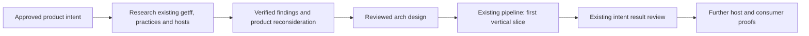

# PRD: portable, verified autonomous development with getff

> **Feature:** `portable-verified-autonomy` · **Version:** 1 · **Date:** 2026-10-26.
> **Authoritative for:** this feature's user outcomes, essential promises, scope and acceptance requirements once exact-content approval is recorded.
> **NOT authoritative for:** the project goal, final architecture, runtime adoption, installed readiness or implementation authorization. The [README](../../../README.md#why-this-exists) remains the project-goal authority.
> **Approval and immutable snapshot:** recorded separately in [the approval record](reviews/portable-verified-autonomy/approval.md) and its machine receipt. The record identifies the exact approved bytes; editing this file does not amend that approval.

## 1. Product proposition

Enable repository maintainers to use their available AI agents to complete agreed development tasks with enforced project conventions, meaningful verification and substantially less manual coordination. The maintainer specifies the desired outcome and decision boundaries. Within those boundaries, the supported workflow carries work through implementation, independent review, correction and delivery to the agreed destination, retaining responsibility and useful context across sessions and interruptions.

getff supplies portable development discipline and evidence of correctness, and reuses suitable existing agent platforms for execution and coordination. The framework must remain independent of a particular model, provider or host. Its own repository is the first real consumer; the resulting capability must also be delivered and exercised in another repository.

The feature succeeds when an accepted outcome requires less total operator effort. More agents, more messages or more generated code are not success measures. This extends getff's existing purpose: repository conventions must not be silently bypassed by agents. Recursive self-application is the validation method, not a new project mission.

## 2. Users and problem

The primary user is a maintainer developing a repository with one or more AI agent environments. The first user is getff's maintainer; consumer maintainers have the same product promise without needing the original maintainer's private setup.

Today, the operator reports having to supply continuity: wake the coordinator, pass an executor's response to a reviewer, return findings for repair and reconstruct what remains after an interruption. Existing getff capabilities may already solve substantial parts of this process, but their actual deployment and connections need reconciliation. The reported problem is the end-to-end experience, not an assumed absence of components.

The user also wants agents in different environments to cooperate and retain applicable project experience. GPT/Codex, GLM through Claude Code, native Dot or Grok Bot facilities and OpenMausBot are investigation targets; no named integration is certified by this PRD.

## 3. Intended experience

1. The maintainer agrees a bounded outcome through the existing intent and design process, including observable acceptance and the permitted delivery destination.
2. The supported agent setup receives that task with the applicable repository rules, relevant decisions and necessary project context. Unsupported requirements are identified before promising unattended execution.
3. Work proceeds through existing pipeline mechanisms. Agents exchange scoped assignments, results and actionable findings without the maintainer copying messages or repeatedly requesting continuation.
4. The current candidate is independently reviewed and checked. A material finding returns to correction and then to the necessary recheck. An executor's claim of completion cannot substitute for acceptance.
5. Interruptions leave an intelligible state: who owns the task, what is verified, what is pending and what must happen next. Supported recovery proceeds when its prerequisites return. Uncertain effects, quota exhaustion and genuine decision dependencies remain explicit.
6. The maintainer receives the accepted result and its evidence, or a precise explanation of the unresolved decision or unavailable prerequisite. Delivery may be a reviewable PR or another authorized destination; completion does not grant merge or deployment authority.
7. Useful, sourced experience is available to subsequent agents without treating stale recollection as current policy or exposing unrelated project material.

The user can inspect current progress, next action and a blocking reason when needed, and can pause, cancel or redirect within the existing authority model. The product does not require a continuously active model merely to wait for another agent.

## 4. Essential promises

All listed promises are essential to final feature acceptance. A first vertical slice may demonstrate a subset and must state the remaining promises; it may not redefine the full feature as complete. IDs PA1–PA8 retain the preparation document's meaning; PA9 makes platform independence separately testable.

| ID | Essential | Required outcome | Acceptance scenario | Failure case | Permitted deferrals |
| --- | --- | --- | --- | --- | --- |
| PA1 | Yes | Routine transitions proceed without human message relaying or continuation prompts. | A representative task reaches the agreed destination through implementation, review, a real or deliberately introduced bounded finding, correction and recheck, with zero manual relays for those transitions. | The operator must tell the coordinator that a worker finished or manually return review findings. | Additional workflow families; not the selected full task cycle. |
| PA2 | Yes | Acceptance proves the current result meets agreed intent and applicable conventions. | The final candidate has applicable mechanical evidence and independent review; a known unmet requirement or stale review does not pass. Existing TAK/assurance mechanisms are reused where relevant. | A successful turn, irrelevant green suite or superseded evidence is presented as acceptance. | Unrelated assurance campaigns; not the obligations required for the selected result. |
| PA3 | Yes | Responsibility and recoverable task state survive supported interruptions. | Interrupt the owner during an active task and restore the supported environment. Work resumes or remains explicitly blocked with its next action and evidence preserved; deliberate pause/cancel is honored and uncertain actions are reconciled. | An ownerless task, lost result, duplicated consequential action or overridden pause. | Additional availability environments; not a demonstrated owner interruption/recovery case. |
| PA4 | Yes | Different supported agent environments can exchange actionable work and results. | Two agent environments cooperate on a bounded task with correct repository, candidate, result and next-action context, without a human messenger. | Messages arrive but refer to the wrong work, cannot be acted upon, or need manual copying. | Additional environment pairs; not one verified cross-environment pair. |
| PA5 | Yes | Relevant project experience survives sessions and agent changes. | A successor retrieves a sourced lesson, uses it in the applicable task, and respects an explicit correction or superseding project decision. Independent review receives only its permitted context. | Memory stays in one private chat, stale memory overrides current instructions, unrelated project data leaks, or author narrative biases the required independent review. | Historical migration, automatic capture of every conversation and extra memory products; not a bounded continuity and supersession case. |
| PA6 | Yes | Consumers receive the useful capability demonstrated in getff. | Install and exercise the supported cycle in another repository with documented prerequisites and that consumer's legitimate access, without the original maintainer's private state. | Only the maintainer's checkout works, or required procedures/checks are missing from consumer delivery. | Broad stack support; not a consumer demonstration. |
| PA7 | Yes | Human intervention is meaningful and authority remains effective. | Routine correction proceeds within scope; an unresolved product conflict is surfaced with context and options; status, pause and cancellation are observable. | Permission is inferred from a worker's output, goals silently change, or every routine handoff becomes another approval request. | Additional autonomy profiles; not effective boundaries and a genuine escalation case. |
| PA8 | Yes | The default supported path requires no additional paid service beyond already-held eligible subscriptions, or uses free components. | Account for every required execution and memory operation in a representative cycle; no new subscription, metered API bill or paid hosting prerequisite is needed, and quotas/resources are disclosed. | Free software hides a required paid model, embedding service or runtime charge. | Optional paid integrations; not a default path that meets this constraint. |
| PA9 | Yes | Core product meaning and quality obligations are independent of any single model, provider or host. | Demonstrate the supported workflow through two materially different coordination hosts while preserving the same intent, rules and acceptance meanings; host-specific setup is explicit. A model switch inside one host alone does not qualify. | A second host requires rewriting core product promises, removing checks or maintaining a separate internal development methodology. | All-platform launch coverage and identical host features; a first-host pilot is allowed, but second-host proof is required before claiming full platform independence. |

## 5. Agnosticism and reuse policy

Agnosticism is a product requirement, not a neutral score assigned to every candidate. Give positive weight to demonstrated support for heterogeneous agents, portable project artifacts and reduced provider dependence. OpenMausBot's support for multiple agent environments is a relevant potential advantage and must be evaluated explicitly. It is not a predetermined winner, and multi-model support alone does not prove full workflow portability.

Compare the existing getff/native-host/AIF paths, facilities available through the operator's current subscriptions, OpenMausBot and relevant free alternatives against the same required outcomes. A native platform may be a useful supported route even if it is provider-specific; getff must retain its independent product contract and an honest capability boundary. The research decides the initial hosts and supported environment pair.

Reuse working components before writing replacements. This includes intent/arch/pipeline, vertical slices and tracer bullets, TAK, Dot review, messaging, task/result records, recovery facilities, installation and memory. Existing implementations must be located at their actual revisions and deployment paths. The word “implemented” cannot stand in for “installed and observed working.” Retirement requires mapped consumers, preserved unique behavior and a migration decision.

No particular adapter abstraction, database, scheduler, bot roster or coordinator hierarchy is prescribed here. New glue is justified only by a demonstrated gap after reuse evaluation. Building a replacement bot platform is outside this initiative.

## 6. Memory outcomes and boundaries

The user reports an existing integration called “hi-memory.” Research must identify it, distinguish it from similarly named systems and establish what it already provides before proposing changes. MemHub tool availability is not proof of that identity or complete operational integration.

The product needs three distinct kinds of continuity:

| Information | User need |
| --- | --- |
| Task state | Know what happened, what is verified, who is responsible and what happens next. |
| Authoritative project knowledge | Preserve agreed intent, specifications, decisions and executable rules across agents. |
| Experience | Retrieve relevant lessons with their source, applicability and correction history. |

These distinctions do not require three stores. The architecture will assign storage and ownership after investigating existing systems. Memory must be scoped to the intended project/access, support correction and supersession, preserve independent-review boundaries, and meet PA8 for required operations. A dedicated memory bot, a new database and unlimited context sharing are not requirements.

## 7. Research required before solution architecture

Research is an explicit first phase with decision-oriented outputs, not a commitment to implement every observed practice.

| Workstream | Required output |
| --- | --- |
| getff reality | Capability/ownership and end-to-end lifecycle map, including relevant branches/worktrees; source revision, implementation, installation, runtime evidence and consumer delivery for each capability; actual gaps in operator experience. |
| grokbot-field-notes | Practice-by-practice comparison with getff: already covered, stronger existing mechanism, useful improvement, inapplicable or unverified. Distinguish third-party observation from executable behavior. |
| Agent platforms | Capability and cost comparison covering cross-environment communication, owner continuation, recovery, project tools/rules, review context and access, host independence and setup burden. Evaluate OpenMausBot's heterogeneous-agent advantage explicitly. |
| Existing memory | Actual identity/integration, readers/writers, project scope, retrieval, provenance, correction, review isolation, portability and cost; a reuse recommendation grounded in a bounded continuity case. |
| Consumer and economics | A feasible installation/use path, comparable baseline, measurement plan and evidence needed for the first slice and later second-host/consumer proofs. |

Reuse the existing evidence dossier and bounded reuse assessment after checking source currency and scope. Research is ready for design when every essential promise has a plausible evidenced route, a bounded experiment or an explicit incompatibility; consequential unknowns are named rather than silently assumed. Apply the existing arch distillation and cold K-pass before using research conclusions as design facts.

If evidence makes an essential promise infeasible, surface that incompatibility and reconsider the product brief explicitly. Research does not silently weaken acceptance or certify an unsupported platform. A changed promise needs renewed exact-content approval; ordinary technical choices remain architecture work.

## 8. Acceptance and benefit measurement

Before the first integration trial, select a representative bounded task and record the current workflow baseline and evaluation conditions. Compare accepted outcomes, counting operator relays, continuation prompts, clarification/decision interventions, active supervision time, setup, recovery and maintenance burden, blocked time and incremental charges. Report setup separately and state the assumed reuse horizon rather than hiding it in an unsubstantiated average.

Final feature acceptance requires all PA1–PA9 evidence, including a getff task, a consumer task and a second-host workflow demonstration. The same run may cover several promises when the evidence actually establishes each one. Host selection and concrete fixtures are design decisions; the semantic criteria above remain fixed.

The key success conditions are zero routine relays in the selected accepted cycle, lower total operator effort under stated comparable conditions, preserved verification quality, effective recovery and control, and no required incremental paid dependency. The trial must include adverse cases: a review finding, an interrupted owner, stale or corrected information and a genuine decision boundary. Existing assurance tools should establish that the relevant checks discriminate these cases.

No percentage improvement, completion-time guarantee or universal reliability claim is made before measurement. A proof that new plumbing works is insufficient if the old operator burden remains or moves into maintenance. If a host fails these conditions, reject or revise that integration choice while preserving the product need and reusable findings.

## 9. Scope and exclusions

In scope: research and reconcile existing capabilities; improve justified gaps; connect suitable ready-made platforms; deliver portable procedures/checks and useful memory continuity; demonstrate the complete experience recursively and in a consumer.

Out of scope: a new general-purpose agent application, model, universal scheduler or memory product; all platforms/languages at launch; automatic acceptance of arbitrary changes; mandatory cloud/API spending; treating AIF as obsolete without evidence; blanket replacement of project rules with external playbooks; assuming every host can attach to already-open chats; autonomous merging/deployment beyond existing task authority.

## 10. Decisions, open questions and route

Recorded operator requirements: reuse existing work; avoid constructing another coordinator where ready-made facilities suffice; research before final architecture; preserve a model/provider/host-agnostic getff; explicitly credit OpenMausBot's heterogeneous-agent advantage; use existing subscriptions or free components; investigate the reported existing memory; apply the system to getff and consumers.

Product decisions specified by this PRD: all PA1–PA9 are essential; staged progress is allowed without claiming whole-feature completion; quality and reduced total operator effort are evaluated together; a host may be rejected without discarding the initiative. The second-host acceptance scenario operationalizes the operator's agnosticism requirement; it does not mandate two simultaneous integrations in the first slice.

Open technical questions for research/arch: initial hosts and environment pair, actual memory identity and reuse, responsibility for owner continuation, integration mechanisms, delivery profiles, migration needs, concrete tests and operating costs. These are not prerequisites for articulating the product intent.

Product choices to settle using research: the most valuable first task family, whether connecting existing live sessions is essential for it, and the acceptable setup/reuse horizon for evaluating total effort. Do not silently choose these by picking the easiest integration. If they materially alter a promise, revise and reapprove this PRD.

This is the intended route owned by the existing intent, arch and pipeline procedures. It is not a new runtime design or evidence that the stages have run. The current deliverable is a reviewed product requirements baseline; architecture and implementation follow the research.

## 11. Review and authority

The preparation document remains a research agenda and historical framing. This PRD is the product baseline only when its exact bytes are approved through the existing intent mechanism. An independent product-only reviewer must demonstrate understanding, examine promise coverage and concrete failure cases, and distinguish product requirements from unverified capability claims. The author records delegated brief approval separately; a reviewer GO alone is not that approval.

Review scope is this PRD and the recorded operator requirements, not the authoring narrative or a proposed implementation. Active traps from [the catalogue](../../../.agents/rules/ai-laziness-traps.md#2-canonical-trap-catalogue): T2, T3, T4, T7, T8, T10, T13, T15, T16, T19, T20. Enumerate every promise before judging coverage; cite actual text; retain unknowns; do not invent adoption evidence. Domain trap PA-T1: calling a host “agnostic” because it selects multiple models while core workflow/acceptance remains locked to it. Domain trap PA-T2: calling a workflow “free” because its repository is open source while required execution or memory uses a paid API.

Self-application: review the document's own completion, portability and affordability claims against PA1–PA9. Its approval proves product-framing review only. The cold-review record, revision disposition, immutable snapshot and delegated approval are retained together; no runtime success is inferred from this documentation work.
