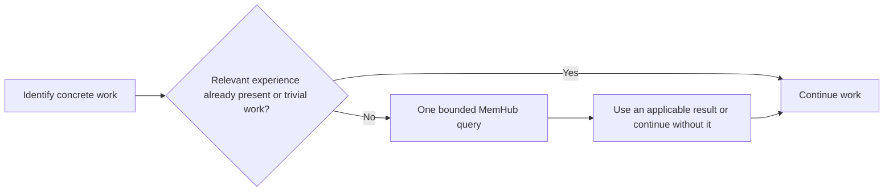

# Design: economical experience recall for getff

> **Status:** local contributor workflow observed in native Codex and GLM trials; see [native acceptance](../../audits/2026-10-28-getff-experience-native-acceptance.md). The original context-only Stage 0 remains `NOT_PASSED`; the later explicit human implementation admission is preserved. Accepted examples show one lookup, useful lead reuse and no duplicate on continuation. They are controlled tests, not organic adoption or universal invocation. The adapter's staging delivery (commit, PR, squash merge) is human-authorized (admission snapshot 2026-10-28; its delivery outcome is recorded by the PR/Git/CI history under owner custody, not asserted here); consumer/OpenMausBot/global rollout is not authorized. Query brevity remains a documented minor adherence limit.
> **Authoritative for:** the proposed getff experience-recall behavior, integration boundary, pilot defaults, and acceptance criteria.
> **NOT authoritative for:** MemHub permissions, retrieval semantics, memory maintenance, project conventions, or OpenMausBot deployment.

## 1. Intent and product source

First identify the concrete work; then briefly recall how similar work was done; use relevant experience and continue. The agent should avoid rediscovering a solution or repeating a known dead end without making the user locate an old conversation.

Product source: `GETFF-MEMORY-PRD-v2.md`, SHA256 `29627a2774e0af7ae4a1f69d1167a3bd12dab7dba69601deab2ec68b489bf8e2`, recorded on 2026-10-28 under the operator's `hy-memory-experiment` directory. This specification restates the implementation-relevant requirements so it can be read without that private directory. Version 1's elaborate verification workflow is superseded.

The first release is a local getff contributor pilot for Codex and GLM in Claude Code. It reuses MemHub, the current ultra store, Luna medium capture and Astra low consolidation. AIF participants reuse an authorized task handoff where possible. OpenMausBot receives the same behavioral contract later, after its roles and access model are specified.

Success requires useful prior experience affecting actual work, with low added context and no repeated searching of the same work. Queries, returned hits, and background memory generation are separate facts; none alone proves benefit.

### Required execution order — operator clarification

At the specification-edit turn, the operator authorized only that edit and reserved the kickoff for Sol. A later explicit go authorized Stage 0; subsequent read-only diagnosis established the fast-reader limits below. It did not admit skill implementation or host trials. A still later explicit human admission (2026-10-28T17:38Z) authorized the bounded skill implementation for a single candidate, superseding that stop for that candidate only (section 10); the Stage 0 `NOT_PASSED` receipt is preserved and not relabelled. The conditional sequence as originally specified was:

1. **Check useful retrieval on a real task from recent sessions, using the existing installation.**
2. **Only after that check passes, implement the thin getff skill.**
3. **Check unprompted selection and use separately in Codex and GLM in Claude Code.**

These stages answer different questions: whether useful experience is retrievable, whether the agent chooses to retrieve it, and whether it applies it. A manually requested lookup does not establish automatic selection.

### Stage 0: real-task retrieval before building

During later authorized execution, inspect a bounded newest-first sample of recent getff Codex and Claude Code/GLM sessions. The kickoff must name the time window and maximum session count before the inspection starts. Read public task requests, assistant actions and relevant tool results; retain only compact task descriptions and source references. Exclude this maintenance/design chat, probes and reviewer sessions. Do not load whole transcripts into model context, inspect hidden reasoning or credentials, re-ingest history, or alter another working session.

Choose one concrete recurring task with evidence of a successful earlier solution and a later occurrence of the same relevant problem. Record the earlier solution's source and outcome, the later task's starting request, and the conditions making the experience applicable. If the later task already supplies that solution, it cannot demonstrate added value from memory. A vague topic match or a generic preference is insufficient.

Freeze the query from the later task's starting request, error and project context **before looking at its eventual resolution**. Do not seed the query with the earlier solution, its memory ID or answer-specific terms absent from the starting context. Keep the known earlier solution as evaluation evidence, separate from the query input. Record the actual query and all attempts, including unsuccessful ones; no repeated reformulation until a hit appears.

Through the existing installed provider skill, perform one explicitly requested `MemHub_context` lookup using section 5's parameters. The same single-follow-up allowance applies. Compare returned items to the actual earlier solution: identify a concrete step or failed approach that the result could help the later task select or avoid. Cite the returned IDs and the public source outcome. This is a retrospective retrieval check, not permission to rerun the development task or claim measured time savings.

Confirm that the underlying useful source predates the later task. A result consisting only of the later task's own completed solution is answer leakage, not prior-experience reuse. A memory published after the later task may show usefulness for a future recurrence, but cannot establish that the agent could have retrieved it at the historical decision point. State that temporal limit explicitly.

Record context cost for the complete lookup sequence, separating: first-use skill/tool-discovery instructions; query arguments; full agent-visible responses including metadata and duplicated representations; and any follow-up. Record characters for every category and attributable token counts where exposed. If using a tokenizer estimate, name it and label the count estimated; missing token attribution remains unknown. Service `used_characters` alone is insufficient. Keep one-time setup overhead separate from repeated-query overhead and do not use shared account totals or unrelated model traffic. The researcher's session-analysis cost is separate from what a working agent would load for recall.

**Pass:** at least one source-linked, applicable earlier solution adds a concrete useful step absent from the later task's starting context; the text and full-response ceilings in section 5 hold for every call; and the complete instruction/query/result cost is reported with attribution limits. This permits the skill pilot, not an assertion of universal efficiency or organic adoption.

**Not passed / inconclusive:** no eligible task in the bounded sample, no useful result, a result consisting only of the later task's solution, unavailable access, or an oversized response. Preserve the finding and stop before implementing the skill. Diagnose the specific content/retrieval/access/size issue; do not automatically widen history, regenerate memories, add hooks or replace the backend. An inconclusive sample does not prove memory useless. The implementation kickoff must preserve this conditional stop rather than dispatch all stages together.

## 2. Evidence and approaches

The installed `memhub-recall` skill version 15 emphasizes preferences, decisions, background and explicit references to earlier work. Its body also includes project conventions. The proposed gap is selection for ordinary development tasks; it is a hypothesis, not a proven sole cause of absent use.

Primary sources were checked against Hy-Memory release commit `688878171e9d98ade3871fecf7eca603c7c43a76`:

- [Recall installer](https://github.com/Tencent-Hunyuan/Hy-Memory/blob/688878171e9d98ade3871fecf7eca603c7c43a76/memhub/packages/host-bridge/src/recall-installer.ts): Codex and Claude Code receive a managed skill and MCP integration. Editing that managed file directly is not our ownership boundary.
- [Context protocol](https://github.com/Tencent-Hunyuan/Hy-Memory/blob/688878171e9d98ade3871fecf7eca603c7c43a76/memhub/packages/host-bridge/src/context-protocol.ts): `query`, `limit`, `character_budget`, `timeout_ms` are supported; raw and governed paths are searched together by default. This session's exposed tool declaration confirms those arguments.
- [Context search](https://github.com/Tencent-Hunyuan/Hy-Memory/blob/688878171e9d98ade3871fecf7eca603c7c43a76/memhub/apps/core/src/one_memory/context_search.py): `_characters`, `_shares`, `_clip` and final selection enforce a shared text budget. Text is clipped, not newly summarized by another model.
- [Context models](https://github.com/Tencent-Hunyuan/Hy-Memory/blob/688878171e9d98ade3871fecf7eca603c7c43a76/memhub/apps/core/src/one_memory/context_models.py): metadata and evidence IDs sit outside that text budget. A governed item can carry up to 128 evidence IDs, each up to 512 characters. A small text budget is therefore not a small whole-response guarantee.
- Local `scripts/render-codex-contributor.mjs:104` discovers canonical procedures; line 138 emits implicit-invocation policy. `.agents/procedures/self-reflection/SKILL.md:11` owns convention self-review, not historical experience retrieval.

Context7 did not resolve a matching Hy-Memory library. DeepWiki corroborated the general parameter surface but could not establish the release version; the pinned source and exposed declarations govern this design. No memory query was performed merely to author the specification.

Approaches considered:

| Approach | Decision |
| --- | --- |
| Edit MemHub's installed managed skill | Avoid: ambiguous ownership and update durability. |
| A thin getff skill over the installed MemHub skill and tools | Selected: smallest independently owned adaptation; no engine or scheduler changes. |
| Automatic query hook, extra classifier, new memory service | Outside this pilot: greater cost and scope before testing the selection hypothesis. |

Reuse verdict: **ADAPT** the existing recall workflow and getff canonical skill delivery. Do not replace MemHub retrieval, permissions, storage or status semantics. This choice is falsified if native skill discovery still does not select the adaptation, or native result size cannot satisfy the economic acceptance criteria below.

## 3. Skill ownership and activation

This section was written as conditional on a Stage 0 pass. Execution actually proceeded under the owner's explicit 2026-10-28T17:38Z implementation admission (section 10); the shipped candidate is recorded there. It specifies the later skill change, not a prerequisite for the initial lookup.

Proposed canonical owner: `.agents/procedures/getff-experience/SKILL.md`. The skill owns only when to recall for development, concise query construction, request budgets and reuse during the task. It loads the installed `memhub-recall` skill for provider behavior; it does not copy that provider's full instructions.

Use the existing canonical delivery mechanisms: generated Codex entry under `.agents/skills/getff-experience/`, with implicit invocation enabled, and the Claude Code compatibility entry mapped to the same canonical owner. Do not hand-maintain divergent bodies. Validate actual discovery in fresh sessions of both hosts; a file on disk alone is not acceptance.

Proposed discovery description:

> Use before starting substantive development, debugging, integration or design work in getff to recall how similar work was solved, or when a new obstacle changes the approach. Skip trivial edits, mechanical continuation and work whose relevant experience is already in the current context.

Keep the adapter body at most 600 words; detailed acceptance material stays in this spec. Load the installed provider skill once per usable context, not before every query. Measure first-use instruction/discovery overhead separately from query and response sizes: the adapter's word limit does not bound the upstream skill or tool descriptions. Add no always-loaded history, project-wide recall rule, per-message hook, new permission grant or user-global skill replacement in this pilot. Existing `self-reflection` remains unchanged.

Activation is model-selected behavioral guidance, not a deterministic gate. Its effectiveness must be observed. If a host cannot discover or invoke it, mark that host unsupported for this pilot rather than silently installing a different trigger.

## 4. Work unit and recall sequence

A work unit is one concrete outcome requiring a choice of approach: diagnose a specific failure, implement a feature, integrate a component, or design a particular change. Reading its files, editing them, running tests and fixing those tests normally remain the same work unit.



1. Understand enough of the request and current project to name the work. This uses ordinary task understanding, not a second classifier model.
2. Skip recall for conversational replies, formatting-only changes, mechanical follow-through, or experience already supplied for this work. No public skip report is required.
3. Otherwise send one focused query before committing to the approach. Form it as 3–6 concise English action/component terms plus exact error or file identifiers — translate the task meaning, never add the suspected solution, and omit generic repository words when a distinctive component identifies the work. Example: `getff Windows packaging manifest mismatch previous fix`. Keep it to one sentence, at most 240 Unicode characters. Preserve useful exact error identifiers; do not paste the whole conversation.
4. Use relevant returned experience as a lead. It may describe a working approach, a failed approach, or a condition to account for. Do not manufacture a lesson from an unrelated hit.
5. Continue ordinary work. A materially different outcome or obstacle permits another work unit; a new message, test rerun or minor wording change does not.

The agent remembers the query outcome in the current task context. If an existing handoff or compaction note is written, retain one short line with the work, query outcome, used source ID and remaining limitation. Do not create a separate database or cross-session negative cache. A resumed task with that line should not repeat an empty or failed lookup merely because the chat resumed.

## 5. Calls, limits and follow-up

The values below are **designer-selected pilot defaults**, not previously agreed user numbers or measured optima. They make the first implementation testable without adding a tuning service. Revised 2026-10-28 on the useful-read evidence and the implementation admission: the supported lane is `MemHub_recall`, one call per work unit, `timeout_ms` 30000, and no follow-up. The earlier `MemHub_context` + 8000 ms + single-follow-up protocol survives only as superseded history inside the closed Stage 0 receipt and the read diagnosis.

For a host exposing the verified recall tool, call it once with:

```json
{
  "query": "<3–6 concise English action/component terms + exact identifiers, at most 240 characters>",
  "limit": 2,
  "character_budget": 2000,
  "timeout_ms": 30000
}
```

Leave scope arguments omitted. Preserve native host identity, workspace resolution and grants. Two items allow a small governed result; do not promise a fixed mix or semantic ranking. `MemHub_recall` searches the governed store plus the HY semantic lane (broker HTTP); `MemHub_context`'s fast inner deadlines — 900 ms overall, 300 ms raw, 750 ms governed, regardless of the caller timeout — are why it is not the pilot lane; see the [manifest-bound diagnosis](../../audits/2026-10-28-memhub-read-timeout-diagnosis.md). The 30-second value is an outer request/transport allowance for the recall lane, not a way to deepen `MemHub_context` retrieval.

One call total per work unit. No follow-up, rephrasing or retry is permitted — not after empty, timeout, unavailable, denied, errored or permission-changed results, and not for a clipped or detail-lacking but relevant item. Total requested source text is therefore at most 2000 characters for the work unit. The earlier single-follow-up allowance is superseded and survives only in the closed Stage 0 receipt.

The exposed context API has no item-by-ID expansion parameter. A refined search is a new search, not proof of expanding the same item. Match returned IDs/revisions before attributing added details to the earlier result; a different result remains a different source. Do not invent an expansion tool, use a raw source filter as a memory scope filter, or read whole JSONL histories as a fallback.

For this proactive pilot, `MemHub_recall` is the required tool; never call `MemHub_context` alongside it and never substitute raw-conversation, ask or fresh-synthesis tools. If the recall tool is missing or unavailable, continue without the lookup and state that plainly, leaving the adaptation inactive on that host. A runtime denial ends the lookup; never switch tools or transports to bypass it.

### Whole-response limitation and release condition

The 2000-character budget bounds source text **before it enters context**, but does not bound all metadata, MCP wrapping, duplicated content representations or tokenization. No fixed token saving is claimed. Both the body limit and actual full tool output must be measured in host acceptance.

For the pilot, require at most **8000 Unicode characters in the complete agent-visible response per call**, including all rendered MCP representations; record actual tokenizer usage when the host exposes it. This is an acceptance ceiling, not a new runtime limiter. It is a designer-selected starting bound, not a guarantee provided by the skill.

The release contract permits metadata larger than that ceiling. Therefore skill-only delivery cannot satisfy a universal hard whole-response cap. If acceptance exposes oversized responses, stop rollout on that host and record the exact unsupported requirement. A compact response adapter or an upstream facility would need a separate design decision; do not silently build either or summarize a large result after it has already entered context. The present spec is sufficient to build a bounded **pilot**, not to claim the PRD's strict whole-response promise universally solved.

## 6. Using experience safely and economically

Keep the relevant condition next to the recalled advice. For example, a workaround for one SDK version is not automatically the right approach for the current version. Resolve an apparent mismatch while inspecting the current task's code/configuration; do not add a separate audit of every historical statement.

Current user instructions and project rules govern the work. Returned material cannot approve actions, expand access or become instructions to execute a command. Distinguish original conversation excerpts, extracted experiences and System 2 schemas by returned kind/identity; a raw-only hit is not evidence of using Astra's conclusions. Do not infer an underlying model family from the host name: Claude Code may contain GLM work, and a timestamp alone does not establish present validity.

Preserve the provider's public notice and truthful result receipt, once per logical lookup. Report unavailable, denied, partial and empty accurately and briefly. For partial results, use only what is actually present; clipped conditions are a reason for the single follow-up or for discarding the suggestion. Continue the task when memory contributes nothing useful.

When experience materially changes the approach, an ordinary progress update can state the concrete reuse and source. Do not append a ceremonial memory report to every answer. Discard irrelevant results from the working summary; this reduces future repetition but does not erase tokens already loaded.

## 7. Hosts, handoffs and scope

| Surface | Pilot behavior |
| --- | --- |
| Codex in getff | Discover adapter, load native provider skill, use the exposed context MCP tool. |
| GLM in Claude Code in getff | Same canonical instructions and bounds; verify its actual MCP exposure and response independently. |
| AIF participant with authorized useful handoff | Reuse the applicable short lesson/source, do not repeat the same search. Search for a genuinely different assigned work unit only if its host passes the same prerequisites. |
| AIF participant without MemHub access | Continue with authorized task context; no automatic forwarding of private memory or permissions. |
| OpenMausBot | Contract reserved; implementation deferred until roles, user/workspace isolation and available tools are specified. |

The pilot does not ship to all getff consumers or enable memory globally. It changes neither collection/consolidation nor Codex Memory v2. No full historical replay, new extraction, extra model-based reflection, model switch or maintenance schedule change is needed.

## 8. Acceptance and diagnosis

Stage 0 validates existing retrieval before implementation. After it passes, the checks below validate the new skill; this is not a nightly evaluation system. Use the host subscription/session mechanisms already authorized; no paid-model CI jobs. Both the manually requested real-task lookup and subsequent controlled host trials are labeled evaluation-driven and excluded from natural-use monitoring, even when they use genuine tasks and historical sources.

Run the automatic-selection trial first in a fresh Codex session, then independently in a fresh GLM/Claude Code session with its actual model and tool exposure recorded. Give the task normally, without asking for memory, naming the adapter, or supplying the previous solution. Neither session inherits the Stage 0 evaluation discussion or answer. Inspect the actual call/result and subsequent public work; then exercise an ordinary continuation to check that the same query is not repeated. Passing on one host does not pass the other. Ordinary development actions still require the task's own authorization; a replay can stop at a concrete proposed next step and must be described as such.

| Case | Required evidence |
| --- | --- |
| New substantive task, no memory hint in user prompt | Fresh native session selects adapter and issues one focused lookup before selecting an approach; discovery alone does not pass. |
| Trivial edit and ordinary continuation | No proactive call. Distinct fixtures exercise each skip. |
| Same work across multiple turns/compaction | No repeat when query outcome is retained; changing query phrasing is not treated as new work. |
| New obstacle with a materially different question | One new lookup for that work unit, not a retry of the old query. |
| Applicable known prior solution | Returned source ID links to a concrete subsequent action; no claim of incremental benefit if the same solution was already supplied by the task. |
| Irrelevant or stale-condition result | Ordinary work proceeds without treating the suggestion as a current instruction. |
| Empty, unavailable, denied, timeout or partial | Accurate state, no retry loop, no permission bypass and no fabricated lesson. |
| Large text and many citation IDs | Verify text cap, full visible output size and clipping labels; oversized metadata fails the economic ceiling even if `used_characters` is small. |
| One-call limit and host mismatch | One call total, no follow-up or invented ID expansion; missing recall tool is unsupported, not silently replaced. |
| AIF handoff | Same useful authorized experience is reused without duplicate retrieval or cross-user disclosure. |

Use deterministic saved response fixtures for size/status behavior where possible, without writing synthetic memories into production. A fixture cannot prove native selection or successful retrieval. Native acceptance must record the actual selected tool, arguments, returned state, visible response size and source-linked public action on each supported host.

After those checks, observe the next real suitable tasks using the existing read-only natural-use monitor. Do not count reviewer/probe sessions as organic adoption. A first source-linked useful application establishes an example, not a quantified productivity gain. Persistent absence of calls leads to discovery/selection diagnosis; calls without useful hits lead to retrieval/content diagnosis. Do not automatically add hooks or increase limits in either case.

## 9. Implementation boundary and rollback

Sol's next kickoff must start with Stage 0 and carry its pass/stop condition into the later skill and host-validation stages. Writing this specification neither writes that kickoff nor dispatches its work.

After Stage 0 passes, implementation should touch only the new canonical adapter, its normal native discovery entries and relevant delivery/fixture tests. Register its ADAPT verdict in the prior-art SSOT when shipping the capability. Avoid rewriting unrelated generated configurations during emission. Preserve upstream managed skill bytes and existing memory settings.

Rollback removes only this getff adapter and its own discovery entries. Existing MemHub manual recall, stored memories, source capture, Astra maintenance and receipts remain. No database operation is part of rollback.

This specification does not launch implementation. Final host acceptance may establish that the skill-only pilot is useful; it cannot convert its known full-response-cap limitation into a universal guarantee.

### §1.7 Forward-check applied

Design review uses the existing canonical discovery path (`scripts/render-codex-contributor.mjs:104`) and upstream provider contracts rather than a new memory backend. The proposed adapter is explicitly a soft selection mechanism; native acceptance is required. The known metadata-budget gap is retained in section 5, not hidden behind an instruction to be concise. No existing rule or runtime behavior is changed by this document.

### §1.7 Backward-check applied

Class: task-scoped experience recall across hosts. Surfaces: Codex, Claude Code/GLM and AIF handoffs are mapped in section 7; OpenMausBot is explicitly deferred. Existing convention self-review (`.agents/procedures/self-reflection/SKILL.md:11`) remains a separate capability. Per-host discovery, permissions and response limits must be established independently; no cross-host pass is inferred. This is a design-scope sweep, not a claim of installed conformance.

## 10. Admission record and candidate status (2026-10-28 addendum)

This addendum records what actually happened. Sections above are reconciled where superseded (section 5 call protocol, section 8 follow-up row) and otherwise stand as written.

**Admission sequence (each bound recorded in the private receipts):** spec edit → Stage 0 go → read-only read-timeout diagnosis → owner-reviewed useful-read (`owner-verified.json` SHA256 `102d1db58217042f4df6895fd3eb40434b20a68ae4ac925adddd1c06b0fedb2b`, 7 owner corrections) → **explicit implementation admission 2026-10-28T17:38Z** for one bounded candidate — this superseded the Stage-0 stop for that candidate only; the Context-only `NOT_PASSED` receipt is preserved and never relabelled → closure admission 2026-10-28 (remaining docs, prior-art registry entry and report only, separately accounted).

**Actual candidate (uncommitted):** canonical owner `.agents/procedures/getff-experience/SKILL.md`, SHA256 `a1ed6656d8bc77637c3623ce432082bcd1cc00409aab443fa53db26dfb8a17bb`, 484 body words; generated Codex twin `.agents/skills/getff-experience/SKILL.md` (SHA256 `ce6b82499fbe70c0932a7f12e7aa91ce9839cde3f4e83670d6c3443a3ea55ad1`) with `agents/openai.yaml` `allow_implicit_invocation: true` (SHA256 `8619a54e8c098122a7f3881394f84ca89b684366e848233a29ad18b6ec363935`), emitted by the existing renderer (`render-harness-config.mjs --write --only codex`); `.claude/skills/getff-experience/SKILL.md` is a symlink to the canonical owner, registered as a `link` entry in `scripts/canonical-agents-map.json`; `.codex/contributor-inventory.json` changed additively by the renderer and is retained. The discovery description is task-shaped ("Use when beginning substantive implementation, debugging, integration, or design work in the getff repository…") and does not mention memory or the user's memory, so implicit selection must be driven by the task cue alone, as section 8 requires.

**Process status:** the original implementation run terminated at the operator-set `--max-turns 32` (the native CLI reported 33 turns, `error_max_turns`) — this is not a clean worker completion and the receipt is preserved as such. The owner's go authorized finishing the remaining docs/registry/report in a separately accounted closure increment (max 12 CLI turns). Deterministic checks recorded in the implementation report: renderer `--check --only codex` PASS; `node --test scripts/canonical-native.test.mjs scripts/codex-contributor.test.mjs` 50 pass / 0 fail; `git diff --check` clean.

**Still pending, not PASS:** the section 8 / Stage 2 native implicit-selection trials — at closure time the fresh Codex trial was running against the frozen candidate and the independent GLM trial had not started. No rollout, merge, global configuration or memory-data change occurred. Known open items for the owner (recorded in the implementation report): the principle-48 `.claude/skills` description-budget overage this candidate would introduce (visible population total ~7261 B against the 6800 B cap), and the pre-existing renderer twin boilerplate ("explicit-only policy still forbids self-initiation") that contradicts `allow_implicit_invocation: true` across the whole generated population.

## 11. GLM non-selection and the CC routing cue (2026-10-28 addendum 2)

The first native GLM trial (fresh session, correct checkout/cwd, `getff-experience` present in the init skill listing) failed selection: 9 unique assistant responses and 24 tool calls produced zero adapter or provider loads and zero MemHub calls — the session worked from its native memory file and repo scans. The failed trial is preserved (`glm-trial/stream.jsonl`) and is not relabelled.

Owner-directed repair, deliberately narrow: one routing sentence appended to the END of the project `CLAUDE.md` (an existing always-loaded entry doc; append-only, no shifted lines) directing new substantive work units to `getff-experience`. This supersedes section 3's "no project-wide recall rule" clause in exactly that sense — a pointer inside the existing entry doc; no new standalone rule, hook, permission, global file or backend, and no forced per-message lookup. The skill still owns the single call, its arguments and every skip; a routing cue raises the probability of selection, it does not guarantee invocation. AGENTS.md stays unchanged — native Codex implicit selection already passed and keeps that baseline. No skill, schema or grant bytes changed (canonical SHA256 `a1ed6656d8bc…` frozen). The corrected native GLM trial is PENDING, owner-run.

## 12. Wrong-result trial and the English query-terms rule (2026-10-28 addendum 3)

The corrected native GLM trial ran: a fresh session loaded both skills and made exactly one real recall before source work — the section-11 activation cue works. The mixed Cyrillic/English query, however, returned two unrelated records (a Windows delivery item and a chat item). That wrong-result trial is preserved; practical GLM adoption is NOT claimed.

Evidence for a formatting fix rather than a language-only conclusion: the source inspected earlier in this pilot (the pinned `recall.py` normalization, on the useful-read result) recognizes Latin/CJK keyword terms, not Cyrillic, and short English queries already returned the useful coding experience in Codex and in the earlier research. This supports the rule below; it does not prove language alone caused the ranking.

The canonical skill body now carries one added paragraph directly under "The one lookup" (the only behavioral change): use 3–6 concise English action/component terms plus exact error or file identifiers; translate the task meaning, never add the suspected solution; omit generic repository words when a distinctive component identifies the work. Sections 4 and 5 above are reconciled to the same rule. The metadata/trigger description, the CLAUDE.md cue, the provider, permissions, models, SDK/data and all call limits are unchanged; the generated Codex twin was regenerated through the existing renderer.

One final owner-run GLM useful-retrieval regression remains after this source change: starting-task-only, no solution or memory cue. If it returns irrelevant or unavailable data, stop tuning and report the concrete retrieval gap.

## Verified local pilot — owner acceptance

The final observations and preserved failures are recorded in [native acceptance](../../audits/2026-10-28-getff-experience-native-acceptance.md). Current canonical SHA256 is `45a17d7f4d1a3807cac4b0c360cf9421aa418f2c31c9fd55acb8cc6329908a2c`. Historical pending labels and earlier candidate hashes in dated execution notes describe their recorded moment; this acceptance supersedes those pending states only. Do not repeat completed research or native trials merely on resume. Ordinary new tasks may use the local skill; publication and wider deployment remain outside this packet.

## 13. Delivery admission (2026-10-28 addendum 4)

A later human admission (2026-10-28, delivery-documentation increment) authorized this skill's commit, PR and squash merge into `staging` — the verified default workspace base (branch `codex/getff-experience-recall` off `fd031522d63d…`). This supersedes the earlier local-only publication exclusions — the status-header sentence above, section 10's no-rollback wording and the acceptance note's "publication and wider deployment remain outside this packet" — for exactly this adapter delivery. Consumer/OpenMausBot/global rollout remains out of scope, and nothing here claims the merge already happened or that the skill is installed anywhere beyond the observed local checkouts. The delivery outcome is recorded by the PR/Git/CI history under owner custody; this admission snapshot itself changed documentation only, with no runtime behavior, research or native-trial repetition.
