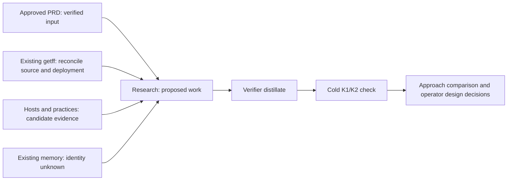

# Research specification: portable verified autonomy

> **Feature:** `portable-verified-autonomy` · **Date:** 2026-10-26.
> **Status:** research scope prepared; execution admission pending. No solution architecture is selected or agreed.
> **Authoritative for:** questions, evidence requirements and bounded research outputs for this initiative.
> **NOT authoritative for:** product approval, implementation, platform adoption, deployed readiness, permission changes or final architecture. The [approved PRD](2026-10-26-portable-verified-autonomy-prd.md) owns product promises; the [research procedure](../../../.agents/procedures/arch/references/research-contour.md) owns execution and verification.

## Context and research decision

The operator wants agreed development tasks to proceed through implementation, independent review, correction, current-result acceptance and authorized delivery without routine human relaying. getff must supply this capability to itself and consumers across different hosts, using existing subscriptions or free components. Existing getff mechanisms and ready-made hosts are both candidates for reuse. Neither retaining all existing components nor replacing them with a particular platform is prescribed.

Parent PRD SHA256: `ec33fd3d88ae41fb623b31d4d465d96d2cbe3af63dfc7d815f72c8c684590721`.
Approval and immutable snapshot: [approval record](reviews/portable-verified-autonomy/approval.md).
Restored selector: revision 1; current PRD approved; current solution spec absent.
Research authoring source baseline: `c458396147b48e3b2c14d2a458870c1bc31d4a22`. This differs from the earlier dossier baseline; do not transfer its current-state claims without checking the affected files.

**Decision:** investigate before choosing the solution. This is a research phase, not a feature implementation handoff. The complexity of ownership, installed behavior, memory and consumer delivery requires research; no Tier-0/Tier-1 research exemption is claimed.

**Pre-mortem:** this initiative fails if it automates task submission while leaving humans to restore ownership and return findings; if host completion or a green suite substitutes for current product acceptance; if memory contaminates independent review or silently overrides current decisions; if the only working setup depends on the maintainer's private state; or if apparent autonomy shifts more effort into setup, recovery and maintenance than it saves. It also fails if choosing a host first forces getff to abandon provider/host independence or creates an undisclosed paid dependency. Existing code and upstream marketing can conceal each failure without any missing component being obvious.

**Acceptance/falsifier:** research is sufficient for design only when every PA1–PA9 has either a cited plausible route with explicit remaining proof, a bounded discriminating experiment, or a concrete incompatibility. An option is falsified by a mandatory manual relay in its selected complete cycle, acceptance of a known-wrong/stale candidate, lost ownership or unsafe replay after interruption, inability to preserve independent review, an unavoidable additional paid dependency, or inability to deliver the required workflow without maintainer-private state. Finding such a failure rejects or revises that option; it does not silently weaken the PRD. Lack of evidence is UNKNOWN, not a failed experiment.

## Operator-premise register

The [operator requirements](reviews/portable-verified-autonomy/operator-requirements.md), approved PRD sections 4–10 and [continuation record](reviews/portable-verified-autonomy/arch-handoff.md) retain the complete premises. These pointers preserve their meaning without reconstructing agreement from a compacted transcript.

| ID | Recorded premise / source |
| --- | --- |
| P1 | PRD sections 1, 4 PA6 and 5: recursive application begins in getff and must reach consumers. |
| P2 | PRD section 5 and handoff's subsequent clarification: inspect before deciding to keep, configure, connect, improve, replace or retire; assembly is a hypothesis. |
| P3 | PRD PA4/PA9 and section 5: heterogeneous-agent cooperation and independence from a single host are separate obligations; OpenMausBot's heterogeneous support deserves explicit evaluation. |
| P4 | PRD PA8: default path has no additional paid dependency; subscription eligibility, quota and local resources remain explicit. |
| P5 | PRD section 6: identify the reported existing hi-memory integration; do not infer identity from a similar name or tool availability. |
| P6 | PRD sections 7 and 10: research precedes final architecture, then reconsider implications before design. |
| P7 | PRD PA2/PA7: preserve verification quality and effective authority; completion is not permission to merge or publish. |
| P8 | Handoff's latest reuse emphasis: locate existing Dot PR review and advisor patterns; distinguish reported deployment from independently observed behavior. |

## Live decision register

| Decision | Status (answered / operator-fork) | Resolution | Falsifier |
| --- | --- | --- | --- |
| D1 — research before solution design | answered | P6; execute the existing research contour and verify its outputs. | A host or architecture is selected as agreed before required evidence is examined. |
| D2 — retain versus replace | answered | P2; all six dispositions are allowed per component, grounded in consequences and cost. | A component is retained solely because it exists, or replaced solely because upstream offers one. |
| D3 — scope of this phase | answered | Documents and bounded read-only research; no installation, migration or product implementation. | A research task changes runtime/configuration, spends outside eligible subscriptions or delivers feature code. |
| D4 — first task family | operator-fork | Compare representative recurring tasks and operator burden before recommending a selection. No selection yet. | Choosing the easiest demonstration while ignoring the operator's actual bottleneck. |
| D5 — existing open sessions versus host-managed sessions | operator-fork | Establish feasibility and tradeoffs first; then resolve whether attachment is essential. | Assuming newly created sessions satisfy a workflow that requires continuing existing ones. |
| D6 — setup/reuse horizon | operator-fork | Report raw setup and recurring effort separately; obtain a horizon before claiming net benefit. | Amortization hides ongoing supervision or migration costs. |

D4–D6 remain outside the closed agreement set. Their factual prerequisites are research work, not questions to repeat to the operator now. No empty-frontier or final-design claim is made.

## Vocabulary and responsibility boundaries

Use the existing [context glossary](../../../CONTEXT.md), especially Advisor seat and Reviewer seat. No new project vocabulary is ratified here. Within this research, a **host** means the environment that owns agent execution and continuation; an **agent environment** is the concrete harness/session in which a worker acts. Switching models inside a host does not establish PA9. A **memory service** is not automatically the task owner or policy authority.

Record each transition as: trigger → current responsible owner → scoped input → action → result/evidence → receiving owner → next trigger. Identify who restores this chain after failure. Advisor decisions, independent PR review, product-result acceptance and authorized delivery retain their distinct existing owners/protocols.

The research executor gathers evidence, the verifier distills it, and a fresh seat checks the distillate before the design seat consumes it. This is the existing arch route, not a proposed agent runtime.

## Population and source boundary

Enumerate the population before sampling. Include the following source families; report unexamined members explicitly. The prior dossier and its four detailed reports are navigation inputs, not adopted findings. Pin repository revisions, document dates and local deployment observations separately. Source freshness is checked on every decisive claim; publication date alone is insufficient.

| Family | Admitted starting sources | Questions / limits |
| --- | --- | --- |
| S1 — getff | This checkout; relevant local branches/worktrees; `.agents/procedures/{intent,arch,pipeline,dispatcher,orchestrator}`; `packages/runtime-bridge`; `scripts/dot-review-gate`; `scripts/advisor-bridge-beta`; intent helpers; `setup.d/ships.manifest`; `.agents/rules/memory-codification.md`; relevant specs and receipts | Enumerate relevant versions; do not infer absence from this branch or turn pilot code into a deployment claim. |
| S2 — prior evidence | [Reuse assessment](../../meta-factory/research-patches/2026-10-26-portable-autonomy-reuse-decision.md); [intent preparation](2026-10-26-portable-autonomy-intent-prep.md); operator dossier at `/Users/art/.codex/worktrees/56f0/rules-as-tests-aif/docs/meta-factory/research-patches/2026-10-26-agent-practices-evidence-dossier.md` and its `2026-10-26-agent-practices/` siblings | Old priority and source conclusions are not current adoption authority. Capture needed files by content hash before remote execution; temporary directories are not durable inputs. |
| S3 — Grok practices | [grokbot-field-notes](https://github.com/unicodef1wn/grokbot-field-notes), prior pin `02780c04ef5f412b28573bce6f82afd15d195d1f` | Third-party practices, contradictions and failure reports; not source or access proof for native xAI bots. |
| S4 — heterogeneous host | [OpenMausBot](https://github.com/milind-soni/OpenMausBot), prior pin `0d8eacc65cd3b783a0d28d019d39e6367780b911` | Native ownership versus external polling; wrappers; project rules; recovery; actual review context; costs and consumer setup. |
| S5 — own runtime and native facilities | [aif-handoff](https://github.com/lee-to/aif-handoff); existing getff integration; official [OpenAI Codex documentation](https://developers.openai.com/codex/) and [xAI documentation](https://docs.x.ai/); documented capabilities exposed by this active host | Source, account availability and exercised behavior are distinct. Do not call AIF obsolete without evidence. Native Grok availability may remain unknown. |
| S6 — memory | Existing repository/configuration references and integration metadata; [Hy-Memory](https://github.com/Tencent-Hunyuan/Hy-Memory), prior pin `1c0cbf6d05c7b47fa815b91b363d34b6a9f67d41`; actual installed service documentation after identity is established | No private conversation collection, credential printing or assumed equivalence between hi-memory, Hy-Memory and MemHub. |
| S7 — reuse register | [Prior-art SSOT](../../meta-factory/prior-art-evaluations.md), including IDs 64, 105, 253, 258, 307, 308 and 315 cited by prior work | Inspect actual entries and revisit conditions. Cite existing ownership before suggesting replacements. |

The executor may inspect named repositories, their official documentation and directly relevant first-party references, recording each addition in its source inventory. This is a bounded source investigation, not a market-completeness claim. If a new alternative is needed, return its proposed source and decision relevance for an explicit scope extension; never conclude that no alternative exists from this starting set. Consuming design/review seats remain cited-sources-only; web search is not a substitute for their bounded verification. Primary sources own technical claims; field notes own only their author's observations.

## Workstreams and required outputs

### R1 — existing lifecycle and connections

Enumerate intent/arch/pipeline, vertical slices/tracer bullets, TAK, executor dispatch, task/result identity, Dot review/rework, advisor ask/journal/return, owner wake/recovery, result acceptance, delivery and consumer installation. Locate relevant current branches/worktrees and map merged state separately from unmerged code. For each record source revision, code path, installed path/version if observable, actual invocation owner and evidence level.

Trace at least one recent relevant completed cycle and one stalled/reworked cycle if accessible from task-scoped records. Record the selection rule and unavailable evidence; two traces are diagnostic examples, not statistical performance claims. Do not open unrelated chats or message a participant. The essential output is a **connection map**, not a list of impressive components. Include active waiting, process loss, paused/cancelled owner and ambiguous external effect as separate cases.

### R2 — field-notes comparison

Enumerate practice and failure categories from S3 before disposition. For each: exact source, problem addressed, existing getff mechanism and evidence, useful difference, rejected overreach, experiment that would distinguish benefit. Dispositions: already covered / existing mechanism stronger / improve / candidate reuse / inapplicable / unverified. Include narrow roles, accountable owner, checks before scaling, skills versus routines, memory claims, quiet event-driven work and roster/attention failure modes. Do not install personas or replace AGENTS.md wholesale.

### R3 — platform comparison

Compare current getff/AIF/native paths, OpenMausBot, native Codex/Dot and Grok where evidence permits. Use identical dimensions: task admission, cross-environment assignment/result, owner wake, supported restart, pause/cancel, uncertain effects, scoped project tools/rules, independent-review context, current-result evidence, consumer setup, maintenance, licensing prerequisites and incremental cost. Credit heterogeneous-agent support explicitly. Separate existing-session attachment from host-created sessions; multi-model from multi-host; application restart from unattended OS availability; dispatch acknowledgment from completion and acceptance.

For each plausible route, name the ready-made reusable unit and smallest residual getff binding. Do not design a generic adapter hierarchy, scheduler, memory product or standing bot roster before observing a concrete gap. If replacement/retirement is proposed, map content and presence-based consumers, necessary unique behavior, retained task/data history, migration and rollback consequences before the recommendation.

### R4 — memory reality and continuity

Identify the reported integration using bounded metadata and repository references first. Record exact product/version/endpoint role only when verified, without secrets. Distinguish task state, authoritative decisions/rules and experience without prescribing three stores. Map readers/writers, provenance exposure, retrieval scope, correction/supersession, source retention, export/portability, cost and review isolation. A schema field or available tool does not prove end-to-end behavior.

Define a synthetic continuity case: one project lesson with source; successor retrieval; newer contradictory decision; corrected retrieval; unrelated project decoy; cold reviewer forbidden from receiving author narrative. Do not inject synthetic memories into a production service during this research. Existing safe evidence can be inspected; otherwise return a bounded later experiment and its cleanup plan.

### R5 — consumer closure and useful economics

Trace required files/dependencies through actual delivery profiles and native discovery. Separate source availability, install closure, trusted activation and live firing. Identify a candidate consumer demonstration without creating or modifying a consumer. Compare representative task families and propose measurement conditions: manual relays, continue prompts, decision requests, active supervision, setup, recovery, maintenance, elapsed blocked time, reopened results and incremental charges. Unknown cost/eligibility is not zero. Report unamortized setup and recurring effort; do not claim net improvement until D6 is resolved.

## Promise-to-evidence obligations

These are experiments to specify or existing evidence to locate, not assertions that they ran. A later live experiment requires its own bounded admission, destination and authority; source research alone does not certify PA1–PA9.

| Promise | Decisive evidence / negative case | Primary workstream |
| --- | --- | --- |
| PA1 | Complete task → actual finding → repair → recheck → authorized destination; count every human relay. | R1/R3/R5 |
| PA2 | Current candidate accepted; wrong requirement and superseded green withheld; meaningful TAK/check/review evidence. | R1/R2 |
| PA3 | Owner interrupted at result boundary; restoration reconciles the same task; duplicate notification and ambiguous effect cannot cause blind replay; pause/cancel remains honored. | R1/R3 |
| PA4 | One genuine cross-environment pair receives actionable scoped tasks/results with correct repository/candidate identity. | R1/R3 |
| PA5 | Sourced lesson survives succession and correction; decoy project and author narrative do not cross forbidden boundaries. | R4 |
| PA6 | Consumer installs/exercises required closure without maintainer-private state. | R5 |
| PA7 | Routine repair stays automatic; product conflict escalates once with evidence/options; status and control remain effective. | R1/R3 |
| PA8 | Required execution, coordination, retrieval, extraction/embedding and hosting operations have an eligible no-extra-payment route; quotas/local resources recorded. | R3/R4/R5 |
| PA9 | Two materially different hosts preserve intent/rules/acceptance; model switching alone fails this check. | R3/R5 |

## Execution, verification and output contract

The canonical route is executor-tier research in AIF. Preflight must establish service/profile availability, input reachability, task isolation, existing in-flight ownership and applicable admission before creating a task. Do not launch or resume GLM without the global launch policy. Do not use a raw API, misleading feature identity or legacy classification to evade the current intent gate. A read-only readiness probe can proceed separately and is not research execution. If this pre-design research stage has no admissible route, record the exact missing prerequisite or conflict and preserve the research scope; do not claim a task is running.

Required executor output, each with source inventory and limitations:

1. `getff-reality.md`: capability and connection maps; current branches/deployments; diagnostic traces; missing evidence.
2. `field-notes-comparison.md`: complete enumerated practices/failures and per-item disposition.
3. `host-comparison.md`: common capability/cost matrix, native/external distinction, feasible options and disqualifiers.
4. `memory-reality.md`: identity verdict, continuity boundaries and bounded experiment.
5. `consumer-and-benefit.md`: delivery closure, baseline/task-family choices, measurement plan and unresolved operator decisions.

The verifier produces one `distillate.md` with a current-as-of date, PA1–PA9 coverage table, disagreements, alternatives, reuse dispositions, explicit unknowns, falsifiers and `GO | rework | kill` for proceeding to design. Keep a stable claim ID for every decision-bearing finding. Each claim has a pinned file/line plus actual content, a reproducible command and bounded output, or an explicit inconclusive status. Record command exit status; an unsuccessful inventory is not an empty population.

The verifier spot-checks decisive raw sources, recording what changed. Before consumption, a fresh artifact-only K1/K2 seat checks each distillate's anchors and quoted outputs. It receives only exact snapshots, cited sources and the check contract, never authoring dialogue or expected verdict. Two consecutive rework rounds are surfaced. Consumer drill-down follows the existing membrane: ask the producer first; at most three direct cited-source openings per consumed artifact; record every opening and its consequence in the resulting artifact. This spec is a commissioning scope, not a verified distillate.

Output files belong in a task-specific research directory chosen at admission, with immutable input hashes and result references recorded in this feature's review folder. Do not overwrite earlier research patches or external worktrees. Fresh output uses English. No feature implementation, dependency installation, live memory writes, bot provisioning, external messages, automation creation, publication or merge belongs to this research task.

## Adversarial checks, stopping and testing seams

Run and record actual counterchecks, not just the questions: Which required transition still depends on the human? Could a wrong candidate pass with stale evidence? Does the proposed host wake the owner or merely expose status? Can a fresh reviewer still receive shared author context? Does the no-extra-payment path require paid extraction/embedding? Which consumer depends on the component proposed for retirement? Which relevant category is missing from the comparison? A failed search stays unknown; a source statement is not an executed experiment.

Stop collecting once every declared population and PA row has its required disposition and each decision-critical unknown has a bounded next experiment or incompatibility. Do not expand into a general survey or demand all runtime proofs before design. Conversely, a polished comparison with missing rows is not complete. No proposal may claim final-feature acceptance from the first-host slice.

**Testing seams:** this phase produces documents. Verify authority hashes, local references, complete PA mapping, source pins and quoted output reproducibility. Reuse relevant existing deterministic check/test entrypoints as evidence only when their result answers a named research question; do not install dependencies or run whole suites merely to decorate a report. Future live seams are the existing task/result observation, review receipt/current-candidate checks, advisor return validation, consumer installer and memory retrieval/correction interfaces, subject to R1/R4 findings.

Self-application: the research must expose its own owner, inputs, output state and unknowns; cannot call a prepared spec executed research; cannot assume the compaction handoff's checkout status remains current; and cannot consume its own source conclusions as cold verification. Active traps: T2, T3, T4, T5, T7, T8, T10, T13, T14, T15, T16, T18, T19 and T20 from the [catalogue](../../../.agents/rules/ai-laziness-traps.md). Domain traps: multi-model ≠ host independence; open source ≠ free operation; source presence ≠ deployed behavior; task completion ≠ accepted outcome.

## Exit to design

After verified research, present the evidence-supported approaches and tradeoffs, settle D4–D6 where relevant, and record any revised product promise through intent. Then write the solution architecture, its testing seams and bounded first vertical slice. The existing arch design reviews, exact-content intent-fidelity/presentation checks and distinct operator architecture agreement still apply. This research specification does not populate `currentSpec` or grant feature execution authority.
