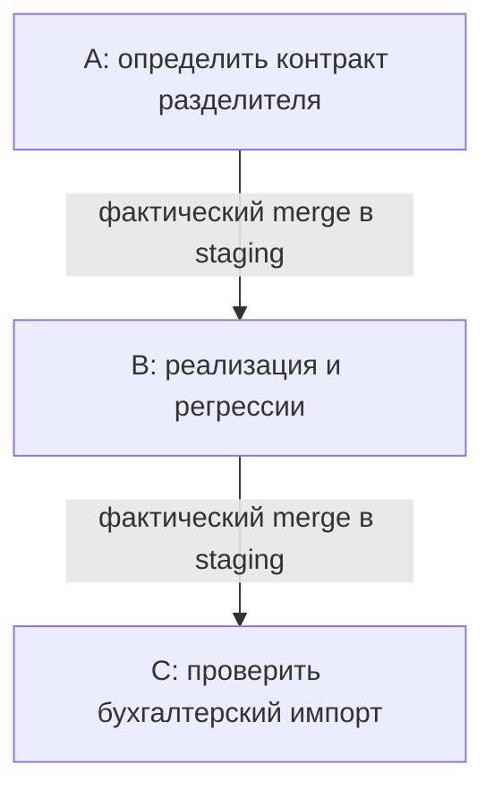

Обзор `$pipeline` завершён в режиме чтения: **2 umbrella, запуск BLOCKED**. Приоритет — `paired-csv-export`, как указано в [плане](</private/tmp/getff-pipeline-corrected-5faf-literal/corrected-literal-codex-r3 outer git with spaces/installed child project with spaces/.ai-factory/orchestrator-prompts/plan.md:5>).

## Dependency graph

A ↓ B ↓ C. Оба merge-gate — **UNKNOWN**. Безопасность параллельного выполнения — **UNKNOWN**.

## Action queue — очередь планирования

Оценка: `3×разблокирование + 2×польза + размер + 2×предпочтение`; сигналы бинарные, S=1.

| Приоритет | Результат | Оценка | Следующий prerequisite | Можно параллельно с |
|---|---|---:|---|---|
| 1. `paired-csv-export` | Контракт и поддержка CSV с `;` | 8 = 3+2+1+2 | Разрешение исполнения, подтверждённый владелец и изоляция | UNKNOWN |
| 2. `paired-import-check` | Измеренный результат реального импорта | 3 = 0+2+1+0 | Фактический merge B в staging | UNKNOWN |

**Paste into a new CC tab / новый Codex chat:** недоступно в текущем scope; новые чаты и dispatch запрещены.

### Stage A — контракт

Определить точный разделитель в `docs/csv-contract.md`. Первая стадия по [kickoff экспорта](</private/tmp/getff-pipeline-corrected-5faf-literal/corrected-literal-codex-r3 outer git with spaces/installed child project with spaces/.ai-factory/orchestrator-prompts/paired-csv-export/kickoff.md:9>); исполнение заблокировано scope.

### Stage B — реализация

Изменить `src/export.ts` и проверить допустимые/недопустимые разделители в `tests/export.test.ts`. Требуется подтверждённый merge A.

### Stage C — реальный импорт

Записать фактический результат и идентичность исходного экспорта в `docs/import-receipt.md`. Требуется merge B: [явная межumbrella-зависимость](</private/tmp/getff-pipeline-corrected-5faf-literal/corrected-literal-codex-r3 outer git with spaces/installed child project with spaces/.ai-factory/orchestrator-prompts/paired-import-check/kickoff.md:15>) сохраняется, несмотря на вывод парсера `FRONTIER: C`.

## In-flight и ограничения

- Подтверждённой выполняющейся работы нет; ownership — **UNKNOWN**, отсутствие работников не доказано.
- PR-проверки недоступны: `no git remotes found`. `HEAD` и `origin/staging` не разрешаются; merge и CI — **UNKNOWN**.
- Bridge-запрос не удался; принадлежность factory-задач fixture не подтверждена.
- `git fetch origin staging` запрещён scope: prerequisite свежести не выполнен. Актуальность плана не доказана.
- Синтетических follow-up элементов не обнаружено. Helper завершён: `END rc=0`; ошибки probes сохранены.

Файлы не изменялись, работники и новые сессии не запускались.
