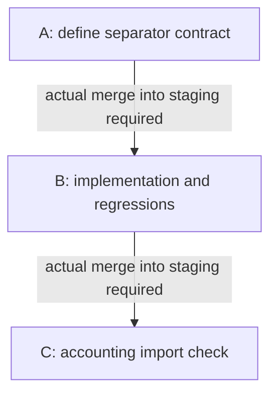

═══════════════════════════════════════════════════════════════
PROJECT OVERVIEW — all open umbrellas (2026-10-10)
═══════════════════════════════════════════════════════════════

## Dependency graph

A ↓ B ↓ C. Merge status: UNKNOWN. Parallel safety: UNKNOWN.
Source: supplied fixture kickoff and plan references retained in the original R3; this illustration does not certify their real contents.

## Action queue — what you do next

| # | Paste into a new Codex chat | When | Waiting on | Can parallel with |
|---|---|---|---|---|
| 1 — paired-csv-export | Unavailable: read-only scope prohibits new chats/dispatch. Native named invocation, if separately authorized: `$pipeline paired-csv-export`. | BLOCKED | Confirmed owner, isolation and launch permission unavailable. First permitted action: read and reconcile the existing contract/plan. | UNKNOWN |
| 2 — paired-import-check | Unavailable: read-only scope prohibits new chats/dispatch. Native named invocation, if separately authorized: `$pipeline paired-import-check`. | After verified B merge; currently BLOCKED | Actual B merge into staging is UNKNOWN. Read existing kickoff dependency before seeking launch approval. | UNKNOWN |

Priority rationale: export scores 8 = 3 + 2 + 1 + 2; import-check scores 3 = 0 + 2 + 1 + 0, from the supplied R3 observations. Ranking is not a dependency edge.
Deliverables described by the supplied fixture: A `docs/csv-contract.md`; B `src/export.ts` and `tests/export.test.ts`; C `docs/import-receipt.md`. This illustration creates none of them.

## In-flight work and evidence limits

No verified running work. Ownership UNKNOWN; do not infer idle. HEAD/staging/CI/merge evidence is unresolved. Bridge request failed; fetch is prohibited. No synthetic follow-ups observed. No launch or write is authorized. For this design fixture alone, the expected reconciled inventory is explicitly supplied as the two named work items; real R3 global completeness remains unproven.

Total open umbrellas: 2 (after supplied fixture completion-filter; actual global completeness is not asserted).

### Stage — overview only

No per-stage execution 1-liner in this read-only scope. Permitted next action: review the existing source references and resolve missing ownership/permission; a named drill-down can follow only within its allowed scope. STOP.
═══════════════════════════════════════════════════════════════
